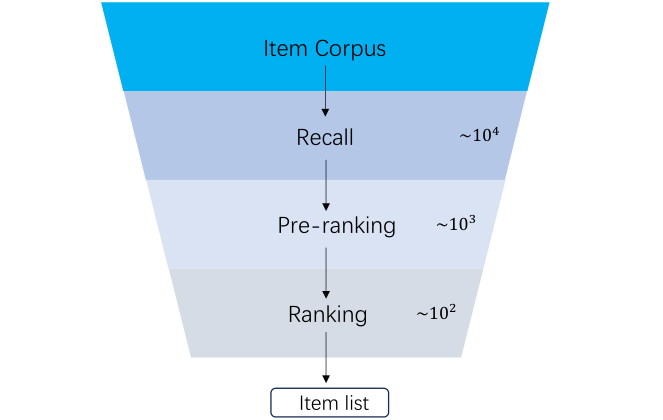

# GR-LLMs 综述精读：LLM 生成式推荐的版图、落地考量与未解问题（阿里高德，arXiv 2507.06507）

> 论文：GR-LLMs: Recent Advances in Generative Recommendation Based on Large Language Models（arXiv:2507.06507v2），阿里高德团队，2025 年 7 月。这是一篇综述，完整中文译稿见同目录 `../translation/paper.zh-CN.md`。本文可与已精读的 TIGER、HSTU、HyFormer 三篇对照阅读——它们都能在这张综述地图上找到坐标。

## 这篇综述讲了什么

推荐建模经历了三个范式：机器学习推荐（协同过滤、矩阵分解，受困于稀疏与冷启动）、深度学习推荐（工业界用了近十年，依赖大量手工特征，参数规模小、难以随算力扩展），以及正在兴起的生成式推荐（GR）。作者认为 GR 与判别式推荐的根本区别在于三点：可解释性（模型能说明为何推荐）、支持新颖性探索、以及用统一序列建模替代手工特征工程——加上 LLM 的 scaling law 有望抬高推荐性能的天花板。

传统推荐系统是级联架构：召回（约 10⁴ 候选）→ 预排序（约 10³）→ 排序（约 10²），各阶段独立优化，前一阶段的上限就是后一阶段的输入。综述的核心框架是：LLM-based GR 沿两条路径进入这个体系——与级联模块协作，或者直接端到端取代整条流水线。

*图 1：典型级联排序系统的三个阶段与候选规模。来源：论文 Figure 1，第 3 页。*

## 路径一：GR 与级联系统协作

**召回侧分三派**。prompt 式直接调用冻结的预训练 LLM（如 LLMTreeRec 用 prompt 引导 LLM 总结兴趣、沿物品树召回；SyNeg 用 LLM 合成困难负样本）；token 式把行为序列映射为 token 序列做 next token prediction（HSTU、KuaiFormer、URM——KuaiFormer 已在快手 4 亿日活部署）；embedding 式把 LLM 当编码器产出物品嵌入喂给 DSSM/SASRec 等传统模块（MoRec）。三派的工程含义不同：prompt 式零训练成本但延迟高，token 式训练自由度最大，embedding 式改动最小、最易灰度。

**排序侧分两派**。生成式架构抛弃 DLR 框架，直接从行为序列生成候选分数：HSTU 把排序重构为序列转导任务并首次观察到推荐 scaling law；GenRank 用"物品作位置上下文、预测动作"的序列组织方式；DFGR 用 real/fake 双流压缩序列长度。混合集成架构保留 DLR，把 LLM 表示作为补充特征注入：LEARN 用冻结 LLM + 双塔生成内容嵌入喂给现有排序模型；HLLM 用可训练的 ITEM LLM + USER LLM 分层提取表示后晚融合；MTGR 则是折中——基于 HSTU 的生成式架构但保留 DLR 的交叉特征，其实验发现去掉交叉特征性能严重受损。

## 路径二：端到端取代级联

端到端与召回任务的区别在于输出是否自带排序能力。OneRec 是首个工业级端到端部署：生成会话级推荐列表，用基于奖励模型的迭代 DPO 对齐，用单一模型完全取代级联流水线。同类的还有 OneSug（query 建议，list-wise 偏好对齐）与 EGA-V1/V2（广告，拍卖式偏好对齐，V2 在下一物品预测之上训练广告序列的累计奖励模型）。学术侧的排序增强工作——S-DPO（多负样本扩展 DPO）、RosePO（流行度+语义相似度构造更难负样本）、SPRec（自博弈，模型预测当负样本）——提供了这些后训练阶段的技术菜单。

## 落地三大考量

**训练流水线**（Table 1 汇总了 12 个工作）。单阶段训练要么做下一物品预测（HSTU、URM，配负采样；KuaiFormer 用 in-batch softmax），要么做 CTR 二分类（MTGR）。多阶段训练分两支："表示微调"派（HLLM、LEARN、LUM、QARM）用对比学习产出嵌入再喂给传统 DLR——LUM 更是三阶段：先下一物品预测、再对比学习产嵌入、最后用嵌入训练召回排序；"模型微调"派（OneRec、OneSug、EGA）预训练学下一物品预测、再用 RL 增强排序，这条线就是端到端。

**推理效率**分三类手段：压缩序列（GenRank 输入减半、KuaiFormer 对早期行为做粗粒度聚合）、改架构（HSTU 逐点聚合注意力、EGA-V1 的 cluster-attention）、阶段定制技巧（RQ-VAE 层级 Semantic ID 缩词表、RPG 并行长语义 ID、EGA-V2 的多 token 预测推理、M-FALCON/MTGR 的掩码批式候选打分）。

**冷启动**依赖 LLM 的世界知识，分信息增强（SAID 把文本生成的物品嵌入融入下游、CSRec 融合常识知识）与模型推理（LLM-Rec 的 prompt 方案）两路；多模态扩展包括 NoteLLM-2（小红书，笔记曝光 +6.4%）、TALKPLAY（音乐）、InteraRec（网页截图）。

## 未来方向与这篇综述的边界

作者给出三个方向：更大规模 scaling（当前 GR 模型多在 0.x-1.x B，更大规模未验证）；推荐域数据清洗（行为序列没有语法性检查那样的质检等价物，如何评估行为序列有效性是开放问题）；one model for all（URM 式通用推荐学习器，统一推荐与搜索）。

**这份综述的适用边界**。它是一张好的地图，但有三处读的时候要打折扣。其一，个别转述与原文有出入：综述称 HSTU 的逐点聚合注意力"将自注意力二次复杂度降为线性"，而 HSTU 原文的注意力仍是 O(n²) 级，靠随机长度训练截断把复杂度降到 O(N^α)、推理靠 M-FALCON 摊销——引用时以原文为准。其二，端到端取代级联的论证主要靠 OneRec 单例，且"完全取代"与"给级联新增一路 GR 源"在工程上是风险等级完全不同的选择，综述未讨论可解释性、紧急降级与 bad case 回滚这些问题。其三，被引工作大量是 arXiv 预印本（OneRec、MTGR、GenRank、EGA 均未正式发表），部分收益描述（如 OneRec"显著提升"）没有给出数字。把它当索引使用、决策时回读各原文实验，是更稳妥的用法。

**对推荐算法工程师的实用结论**。结合本系列已精读的论文，当前版图可以这样归纳：检索侧，TIGER 的 RQ-VAE 语义 ID + 生成式解码适合中小语料；排序侧，HSTU/HyFormer 代表"行为序列为主、算力可扩展"的路线，HyFormer 的逐层解码-增强是两阶段体系升级阻力最小的路径；混合集成（LEARN/HLLM）是存量 DLR 体系收益最确定、改动最小的选择；端到端（OneRec/EGA）是收益上限最高但工程风险也最高的选项，建议以新增一路生成源的方式起步验证。
