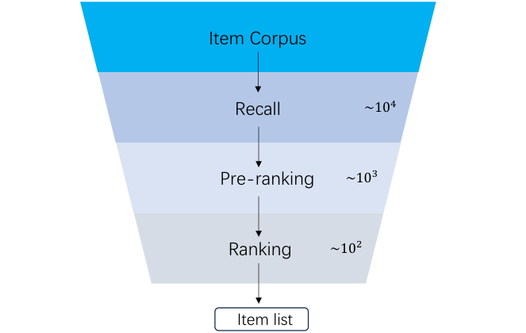

# GR-LLMs：基于大语言模型的生成式推荐最新进展（综述）

**作者**：Zhen Yang、Haitao Lin、Jiawei Xue、Ziji Zhang（高德/AMAP，阿里巴巴集团）

arXiv:2507.06507v2 [cs.IR]，2025 年 7 月 14 日。

## 摘要

过去一年，生成式推荐（Generative Recommendations，GRs）取得了长足进展，尤其体现在利用大语言模型（LLM）强大的序列建模与推理能力提升推荐整体效果上。基于 LLM 的 GR 正在形成与判别式推荐截然不同的新范式，展现出替代严重依赖复杂手工特征的传统推荐系统的强大潜力。本文提供一篇全面的综述，以促进基于 LLM 的 GR 的进一步研究。我们首先概述基于 LLM 的 GR 的一般性基础知识与应用案例；随后介绍 GR 工业落地中的主要考量；最后探讨基于 LLM 的 GR 的未来方向。希望本综述能为 GR 领域的持续进步做出贡献。

## 1 引言

推荐系统（Adomavicius and Tuzhilin, 2005; Li et al., 2024b）通过从用户画像和历史交互中隐式推断用户兴趣来推荐物品（如电商商品、短视频、新闻、兴趣点），在现代数字世界中无处不在，是在海量信息与选择中导航的关键接口。推荐系统的有效性是众多在线平台成功的驱动力——从电商巨头、社交网络到内容流媒体和新闻聚合器。

随着推荐系统的发展，建模算法大致经历了三种技术范式：基于机器学习的推荐（MLR）、基于深度学习的推荐（DLR）和生成式推荐（GR）。MLR 主要依赖传统机器学习算法，通常建立在显式特征工程之上，关键技术包括协同过滤（Breese et al., 2013; He et al., 2017; Sarwar et al., 2001; Linden et al., 2003）——基于与其他用户或物品的相似度预测用户偏好，以及基于物品属性推荐相似物品的内容过滤。矩阵分解技术（Koren et al., 2009; Rendle et al., 2012）（如 SVD、交替最小二乘）也是该时代的核心，旨在学习表示用户与物品偏好的潜在因子，以预测用户-物品交互矩阵的缺失项。MLR 侧重捕捉历史数据的统计规律，但经常面临数据稀疏与冷启动（新用户/新物品缺少交互数据）难题，且特征工程始终是提供有意义输入的必要条件。DLR 利用深度神经网络从原始或稀疏特征中自动学习复杂的非线性表示（Tang and Wang, 2018; Xue et al., 2017; Zhang et al., 2017; Chen et al., 2019; Xue et al., 2025）。工业推荐系统使用 DLR 已近十年，输入通常包含大量精心设计的手工特征以提升性能。DLR 的主要挑战在于效果与效率的折衷：相对较小的参数量使其难以扩展，制约了通过提升模型容量来改善推荐质量的便利性。

传统推荐范式（MLR 与 DLR）专注于基于手工特征工程和复杂级联建模结构预测相似度或排序分，因此脆弱、难解释，且在新数据或新领域的维护与适配上需要大量人工。近年来，大语言模型（LLM）的出现与快速发展催化了范式转变。以 GPT、BERT、encoder-decoder Transformer 等架构为代表，这些模型在海量文本上训练，展现出理解和生成人类语言的卓越能力（Floridi and Chiriatti, 2020; Liu et al., 2019; Guo et al., 2025a）。它们擅长捕捉序列数据中的复杂统计依赖、执行复杂推理，并对上下文与语义有深入理解。这种前所未有的序列建模与通用推理能力自然催生了 GR 的兴起与快速发展。尤其过去一年，GR 系统进展显著。SASRec（Kang and McAuley, 2018）率先提出基于 Transformer 的自回归方式预测用户下一个交互物品。Zhai et al.（2024）提出 HSTU，一个更好地建模序列与推理效率的新 Transformer 框架，Huang et al.（2025）随后将其用于排序任务。为处理工业级推荐的海量物品，TIGER（Rajput et al., 2023）引入 RQ-VAE（Zeghidour et al., 2021）思想学习把物品转换为多个 Semantic ID，大幅缩减词表规模。在类似的 Semantic ID 编码之上，OneRec（Deng et al., 2025）采用专家混合（MoE）架构（Dai et al., 2024）与直接偏好优化（DPO）策略（Rafailov et al., 2023）进一步提升推荐能力。面向工业级生成式推荐，MTGR（Han et al., 2025）提出纳入 DLR 中使用的交叉特征，并发现剔除交叉特征会严重损害模型性能。Qiu et al.（2025）与 Zheng et al.（2025）进一步提出端到端生成式架构，把在线广告排序统一到单一模型。此外，Jiang et al.（2025）指出 LLM 可作为通用推荐学习器，并提出能在多种推荐任务上表现良好的 URM。

上述工作表明，基于 LLM 的 GR 是对传统判别式方法的根本性背离。生成式特性带来几方面优势。第一，更强的可解释性：系统能够说明为何推荐某物品，建立用户信任并形成反馈闭环。第二，天然支持创造性与新颖性：LLM 能基于历史行为推荐超出"最可预测"范围的物品，帮助用户发现新兴趣。第三，统一语言模型方法有望简化系统设计，减少对手工特征工程和分任务独立模块的依赖。此外，LLM 的 scaling law 有极大潜力抬高生成式推荐系统的性能天花板。

鉴于该领域的变革潜力与快速发展速度，亟需一篇综述来综合梳理 GR 的现有知识。本综述首先概述基于 LLM 的 GR 的一般基础知识；随后深入研究这些系统的多样化应用案例与真实部署；最后批判性地分析在严苛工业场景中应用基于 LLM 的 GR 所遇到的主要考量与挑战，并以未来研究方向收尾。希望本综述能为 GR 领域的持续进步与成熟做出贡献。

## 2 基础知识

### 2.1 大语言模型

在海量文本上训练的大语言模型已展现出显著的自然语言处理能力（Bubeck et al., 2023; Yang et al., 2025a; Grattafiori et al., 2024）。给定输入序列 $X = \{x_1, x_2, \ldots, x_n\}$，LLM 以 next-token prediction 的形式优化概率 $P(x_t \mid x_{<t}; \theta)$，其中 $\theta$ 为模型参数，$x_{<t}$ 为 $x_t$ 之前的 token。LLM 最初以文本为主，但已演进到处理多模态数据，将文本与图像、音频、视频整合（Team et al., 2023; Liu et al., 2023b,a; Yang et al., 2023）。凭借支持多模态输入与输出的能力，大模型可以执行多种序列生成任务。

### 2.2 传统级联式推荐

传统推荐系统广泛采用多阶段级联架构以平衡计算效率与预测精度（Burges, 2010; Chang et al., 2023; Wang et al., 2011）。如图 1 所示，典型的级联推荐系统包含三个先后阶段：召回（recall）、预排序（pre-ranking）与排序（ranking）。实践中虽然高效，但现有方法通常将各阶段独立对待——每个孤立阶段的效果构成后续阶段的上限，从而限制了推荐系统整体性能。许多先前工作（Fei et al., 2021; Gallagher et al., 2019; Huang et al., 2023b; Wang et al., 2024b）通过让不同阶段交互来提升整体推荐效果，但仍保持传统级联范式。近期，GR 作为端到端生成的统一架构脱颖而出（Qiu et al., 2025; Deng et al., 2025）。

*图 1：典型级联排序系统，自上而下依次为召回（约 10⁴）、预排序（约 10³）、排序（约 10²）三个阶段。原文 Figure 1，第 3 页。*

## 3 GR 的应用设置

过去一年，各种 GR 系统在实际工业场景中取得了显著业务收益。在线推荐中应用 GR 有两个分支：其一是与传统级联系统的相应模块协作；其二是直接将生成式模型用于端到端推荐。本节按具体应用设置对近期工作进行系统梳理与分析。

### 3.1 召回

召回是把候选物品池缩小到与用户潜在相关子集的基础步骤。该阶段对支撑后续排序至关重要，在海量数据上优先考虑高效实现（McAuley, 2022）。LLM 可以通过三种方式用于召回：基于 prompt、基于 token、基于 embedding 的召回方法。

**基于 prompt 的方法**通过定制化查询把用户信息提供给预训练 LLM 来生成召回结果。Qwen3（Yang et al., 2025a）等预训练 LLM 具备广泛的世界知识，使用户信息隐式或稀疏时也能完成召回。具体地，LLMTreeRec（Zhang et al., 2024b）构造 prompt 引导 LLM 总结用户兴趣、推断相关物品类目，并通过物品树召回具体物品；注意该方法中 LLM 参数保持冻结、不微调。此外，SyNeg（Li et al., 2024a）利用 LLM 合成难以分类的负样本，将生成的困难负样本与检索到的负样本融合用于模型微调。

**基于 token 的方法**把用户行为序列映射为 token 序列，将召回问题形式化为 next token prediction。这类方法在 token 序列构造、模型架构设计与信息编解码上高度灵活，支持多种工业部署场景。HSTU（Zhai et al., 2024）在生成式框架内重构召回任务；类似地，KuaiFormer（Liu et al., 2024）把召回过程定义为 next token prediction，纳入对早期、中期与近期行为序列的分层用户行为总结，已部署于服务 4 亿日活的工业级平台，离线与在线指标均显著提升。为统一多样召回目标（如用户会点击的物品），通用检索模型 URM（Jiang et al., 2025）把这些目标编码为 token 序列中的组成部分，提供目标感知的召回结果。

**基于 embedding 的方法**把 LLM 用作编码器生成物品嵌入，随后融入经典 DLR 方法。例如 MoRec 用预训练视觉与文本编码器获得物品嵌入（Yuan et al., 2023），供 DSSM（Huang et al., 2013）、SASRec（Kang and McAuley, 2018）等下游预测模块使用。

### 3.2 排序

排序阶段决定了最终呈现给用户的候选物品的相关性与多样性。相比 DLR，LLM 主要通过按时间顺序的用户行为序列精确建模用户偏好，从而免去大量特征工程。此外，LLM 具备 scaling law 的理论基础，使基于 LLM 的排序系统能借助模型规模增长突破 DLR 方法的性能瓶颈（Zhai et al., 2024）。

当前将 LLM 引入排序阶段的方法按是否保留传统 DLR 框架分为两种范式：生成式架构与混合集成架构。

**生成式架构**抛弃 DLR 框架，用 LLM 直接处理用户行为序列，通过 CTR 预估等显式监督任务生成候选分数。HSTU 通过整合用户相关行为与特征构造时序序列，把排序任务重构为序列转导任务；值得注意的是，GR 首次在大规模推荐系统中观察到 LLM 固有的 scaling law。GenRank（Huang et al., 2025）提出面向动作的序列组织方式：把物品当作位置上下文，专注于预测与每个候选物品关联的用户动作。DFGR（Guo et al., 2025b）引入双流生成式架构，把用户行为序列解耦为并行的真实流与虚拟流（real/fake flows），以解决 GR 的计算低效问题；通过合并真实与虚拟动作类型 token 建模异构用户行为，同时保持端到端效率。

**混合集成架构**则利用 LLM 生成高信息量的表示，作为补充特征融入 DLR，增强现有系统。代表工作 LEARN（Jia et al., 2025）将冻结的 LLM 适配为内容嵌入生成（CEG）模块，通过由用户塔与物品塔组成的双塔结构，在保留开放世界知识的同时弥合通用域与协同域的鸿沟；LEARN 把 LLM 派生的表示作为补充特征部署进工业场景的现有排序模型，取得显著实用收益。HLLM（Chen et al., 2024a）采用层级 LLM 架构：先后使用可训练的 ITEM LLM 与 USER LLM 分别提取物品级与用户级表示；在线场景通过晚融合整合高层物品与用户表示。SRP4CTR（Han et al., 2024）将自监督序列推荐预训练与 CTR 模型结合，采用 FGBERT 做多属性侧信息编码、uni cross-attention 块把预训练序列知识高效迁移到物品级预测，以增强 CTR 预估。为融合两种范式的长处，MTGR（Han et al., 2025）在保留 DLR 交叉特征等原始特征的同时，采用基于 HSTU 的生成式架构建模用户级数据。

### 3.3 端到端推荐

端到端推荐的目标是直接基于用户历史行为输出推荐结果。它与召回任务的关键区别在于：输出是否天然具备排序能力、能否完全取代传统级联推荐流水线。端到端推荐的主要优势是可以避免流水线方法造成的误差传播与目标错位。

多数以召回为核心的方法（如 TIGER（Rajput et al., 2023）、COBRA（Yang et al., 2025b）、URM（Jiang et al., 2025））以下一物品预测为目标训练，评估时强调 top-k 命中率。端到端方法则通常在生成式模型之上增加后训练阶段来增强排序能力。OneRec（Deng et al., 2025）率先把端到端推荐模型部署到工业场景，核心任务为生成会话级推荐列表；它采用基于奖励模型的迭代式 DPO 对齐策略渐进精炼模型，用单一模型完全取代级联在线推荐流水线，在线反馈指标显著提升。OneSug（Guo et al., 2025c）采用 list-wise 偏好对齐，利用在线反馈信号做强化训练，生成更符合偏好的 query 建议。EGA-V2（Zheng et al., 2025）专为广告推荐场景优化：在下一物品预测之上训练奖励模型，评估广告序列的期望累计奖励，从而提升推荐广告的整体期望收益。EGA-V1（Qiu et al., 2025）虽主要设计为排序模型，但把全部候选广告作为输入，因此也属于端到端推荐范畴。

工业应用之外，若干学术研究聚焦如何在端到端框架内学习更强的排序能力。S-DPO（Chen et al., 2024b）首个把 DPO 算法应用于推荐模型：通过考虑同时曝光的多个负样本，把 DPO 的二元偏好优化扩展为多偏好设置，提升推荐排序质量。RosePO（Liao et al., 2024）进一步改进负样本构造，纳入流行度与语义相似度等因素，生成更困难的负样本以实现更有效的强化学习。SPRec（Gao et al., 2025）引入自博弈（self-replay）机制，把模型自身的预测结果作为负样本，增加正负样本的区分难度，带来更强泛化。把这些强化学习策略与工业应用结合，是端到端推荐发展的有前景方向。

## 4 主要考量与挑战

作为推荐新范式，GR 在工业应用中面临诸多挑战。本节详述应用过程中需要考虑的关键问题。

### 4.1 训练流水线

GR 的核心问题之一是如何设计训练方法与目标以对齐推荐任务。按训练过程涉及的阶段数，现有方法分为单阶段训练与多阶段训练两类。表 1 按类别、训练目标与特色策略汇总了这些方法。

**4.1.1 单阶段训练。** 模型经单一训练阶段产出最终推荐输出，通常只聚焦一个具体任务——召回或排序。召回任务的常见训练目标是下一物品预测：HSTU（Zhai et al., 2024）、URM（Jiang et al., 2025）等基于该目标训练模型，以预测 top-k 物品为召回结果；鉴于物品空间巨大，这些方法常在训练时用负采样降低 softmax 的计算成本。相比之下，KuaiFormer（Liu et al., 2024）采用 in-batch softmax，直接生成用于召回的嵌入。排序任务的典型训练目标是 CTR 预估：MTGR（Han et al., 2025）显式建模用户序列与候选物品的关系、预测 CTR 值以替代传统排序模型，从而提升推荐性能。

**4.1.2 多阶段训练。** 多阶段训练通常包含预训练与微调两阶段，通过在不同阶段定义不同训练目标让模型习得不同能力。按预训练模型在微调期的使用方式，可再分为两个子类：基于表示的微调与基于模型的微调。

**基于表示的微调**：这类方法（HLLM（Chen et al., 2024a）、LEARN（Jia et al., 2025）、LUM（Yan et al., 2025）等）主要面向排序任务。预训练阶段用对比学习与 InfoNCE 损失（Oord et al., 2018）生成用户与物品嵌入；微调阶段把这些嵌入作为特征，训练传统 DLR 模型以增强排序性能。QARM（Luo et al., 2024）进一步把嵌入量化为 Semantic ID 供下游训练，使这些信息可学习。值得注意的是，LUM 采用三阶段流水线：第一阶段只做下一物品预测；第二阶段通过对比学习生成用户与物品嵌入；第三阶段以用户与物品嵌入为输入特征，训练用于召回与排序的 DLM。

**基于模型的微调**：这类方法基本属于端到端推荐范式——预训练阶段学习预测下一物品的能力，微调阶段用强化学习增强模型在特定应用场景的排序能力。OneRec（Deng et al., 2025）与 OneSug（Guo et al., 2025c）都遵循该框架，分别应用于视频推荐与 query 建议。EGA-V2（Zheng et al., 2025）与 EGA-V1（Qiu et al., 2025）专为广告场景设计，在端到端广告推荐与广告排序上取得显著提升。

表 1：近期 GR 工作的训练目标与后训练策略汇总。原文 Table 1，第 6 页。

| 类别 | 方法 | 训练目标 | 训练策略与损失 |
| --- | --- | --- | --- |
| 单阶段 | HSTU (Zhai et al., 2024) | 下一物品/动作预测 | 交叉熵 |
| 单阶段 | URM (Jiang et al., 2025) | 下一物品预测 | 交叉熵 |
| 单阶段 | KuaiFormer (Liu et al., 2024) | 用户-物品嵌入相似度 | in-batch 对比学习 |
| 单阶段 | MTGR (Han et al., 2025) | CTR 预估 | 二分类 |
| 多阶段 | OneRec (Deng et al., 2025) | 下一物品预测 | DPO 损失、迭代对齐 |
| 多阶段 | OneSug (Guo et al., 2025c) | 下一物品预测 | DPO 损失、list-wise 偏好对齐 |
| 多阶段 | EGA-V2 (Zheng et al., 2025) | 下一物品预测 | 拍卖式偏好对齐 |
| 多阶段 | EGA-V1 (Qiu et al., 2025) | CTR 预估 | 拍卖式偏好对齐 |
| 多阶段 | QARM (Luo et al., 2024) | 物品对齐 | 对比学习、ID 作为排序特征 |
| 多阶段 | HLLM (Chen et al., 2024a) | CTR 预估 | 对比学习、嵌入作为排序特征 |
| 多阶段 | LEARN (Jia et al., 2025) | CTR 预估 | 对比学习、嵌入作为排序特征 |
| 多阶段 | LUM (Yan et al., 2025) | 下一物品预测 | 对比学习、嵌入作为排序特征 |

### 4.2 推理效率

LLM 复杂架构带来的推理延迟增加，是阻碍 GR 模型在真实工业场景部署的另一挑战。目前大量工作致力于优化解码速度，主要聚焦序列压缩、模型架构优化，以及针对召回与排序阶段的定制化建模与解码技巧。

**压缩序列长度**是从根本上降低计算成本的有效策略。GenRank（Huang et al., 2025）提出面向动作的序列组织框架，把物品当作位置上下文，输入序列长度减半。DFGR（Guo et al., 2025b）通过 real-flow 与 fake-flow 把用户-物品交互合并为单个 token，缩短输入序列。KuaiFormer（Liu et al., 2024）采用自适应物品压缩机制：把较早的用户交互分组为粗粒度聚合表示，同时保留近期物品的细粒度建模，在不牺牲召回性能的情况下降低序列长度。

**调整模型架构**也能提升解码效率。HSTU（Zhai et al., 2024）用逐点聚合注意力机制替代注意力计算中的标准 softmax，将自注意力的二次复杂度降为线性复杂度。EGA-V1（Qiu et al., 2025）提出 RecFormer，在 Global Cluster-Former 模块中引入 cluster-attention 机制替代标准自注意力：通过可学习的聚类矩阵把 key/value 动态分组为语义连贯的簇，降低计算复杂度。

**召回与排序阶段的定制加速技巧**。为缩小召回阶段的词表规模，一些方法（Rajput et al., 2023; Yang et al., 2024a; Yin et al., 2024）尝试用层级 Semantic ID 替代物品 ID——Semantic ID 由 RQ-VAE 生成，把物品内容编码为语义有意义的 token 序列，利用层级语义结构在自回归物品预测中实现相似物品间的高效知识共享。RPG（Hou et al., 2025）用优化的乘积量化并行生成长的无序 Semantic ID，并以 MTP 损失训练以整合子物品语义。为进一步提升 Semantic ID 方法的推理效率，EGA-V2（Zheng et al., 2025）采用 Multi-Token Prediction（MTP）推理以增强可扩展性并与业务目标对齐。此外，URM（Jiang et al., 2025）引入矩阵分解与概率采样替代 TopK 选择以降低计算复杂度。排序阶段提升推理效率的关键在于如何高效给全部候选打分：Zhai et al.（2024）提出 M-FALCON，通过修改因果注意力掩码保证候选间互不可见，在单次前向中处理多个候选物品。与 M-FALCON 类似，MTGR（Han et al., 2025）引入定制掩码策略，在防止信息泄漏的同时实现高效候选打分。

### 4.3 冷启动与世界知识

冷启动问题指数据不足时（尤其新注册用户与新上传物品）生成准确推荐结果的挑战（Lam et al., 2008; Wei et al., 2020）。LLM 为缓解推荐系统的冷启动提供两种主要策略。

**(1) 信息增强**：目标是把 LLM 生成的新嵌入与知识融入推荐输入数据。例如蚂蚁集团提出的 SAID（Hu et al., 2024）基于文本信息生成物品嵌入并整合进下游推荐任务；类似地，CSRec（Yang et al., 2024b）把来自 LLM 的元数据知识与常识知识融合为侧信息以增强推荐。

**(2) 模型推理**：核心思想是 LLM 可以直接利用从大规模训练数据学到的模式产出推荐结果。代表工作 LLM-Rec（Lyu et al., 2024）采用精心设计的 prompt 策略获得有效推荐方案。

对上述信息增强与模型推理两类方法，LLM 正面影响的底层机理可归因于世界知识——即 LLM 内在的丰富上下文与概念知识，源于其在跨领域大规模数据集上的训练（Zhang et al., 2023）。例如 Llama 3（Grattafiori et al., 2024）与 Qwen3（Yang et al., 2025a）分别用 15 与 36 万亿多语言 token 预训练，领域多样。预训练 LLM 中嵌入的世界知识使推荐系统能在冷启动阶段有效学习用户-物品交互模式。具体地，LC-Rec（Zheng et al., 2024）整合 Llama 的语言语义与协同信号，在推荐系统中兼得世界知识与任务特性。值得注意的是，近期研究表明从 LLM 语言表示线性映射得到的物品表示能增强推荐性能，印证了世界知识在推荐系统中的价值（Sheng et al., 2024）。此外，LLM 中的世界知识可以通过检索增强生成（RAG）技术注入外部领域专属知识来精炼（Arslan et al., 2024）。

推荐中 LLM 的世界知识可来自多种用户与物品数据源：图像（Radford et al., 2021）、视频（Covington et al., 2016）与语音（Cui et al., 2024）。整合多数据源可称为多模态学习。为更好利用多模态表示，一个潜在方案是对比学习，如图文对比损失（Li et al., 2021），在表征融合前对齐图像与文本表示。多模态 LLM 在推荐系统中日益可行，得益于 CLIP（Radford et al., 2021）、vision transformer（Kim et al., 2021）、Qwen2-vl（Wang et al., 2024a）等多模态 LLM 的繁荣。典型多模态 LLM 推荐工作汇总于表 2。具体地，小红书开发的 NoteLLM-2（Zhang et al., 2024a）利用 LLM 内的视觉信息向用户推荐笔记，带来 6.4% 的笔记曝光提升；TALKPLAY（Doh et al., 2025）是多模态音乐推荐系统，把歌词、语义标签等音频特征编码进 LLM 提供音乐推荐，在测试集含冷启动物品的 Million Playlist Dataset（Chen et al., 2018）上表现优越；此外，InteraRec（Karra and Tulabandhula, 2024）是在线电商商品推荐方法，从高频网页截图中提取有价值信息。总之，借助 LLM 的标准表示学习框架，这些外部多模态信号可以轻松融入现有基于 LLM 的 GR 以处理冷启动问题。

表 2：用于推荐的多模态 LLM。原文 Table 2，第 7 页。

| 工作 | 数据 | 目标场景 |
| --- | --- | --- |
| InteraRec (Karra and Tulabandhula, 2024) | 图像、文本 | 商品 |
| I-LLMRec (Kim et al., 2025) | 图像、文本 | 商品 |
| NoteLLM-2 (Zhang et al., 2024a) | 图像、文本 | 笔记 |
| TALKPLAY (Doh et al., 2025) | 音频、文本 | 音乐 |

## 5 未来方向

本节从以下几方面探讨基于 LLM 的 GR 的有前景方向。

### 5.1 模型扩展

自 scaling law 被观察与提出以来，它已成为大语言模型参数扩展的理论基础。谈到扩展，传统 DLR 有两个显著缺陷：1) 随用户行为序列长度增长，DLR 无法高效处理全部用户行为，限制模型性能；2) 扩展带来与候选数近似线性的训练推理成本，开销高得难以承受（Chen et al., 2021; Pi et al., 2020; Han et al., 2025）。对 GR 而言，近期研究已观察到一些扩展效应（Han et al., 2025; Wang et al., 2025; Huang et al., 2025），但这些工作中的模型规模仍限于较小水平（如 0.x B 或 1.x B），更大规模下的性能提升尚未得到充分验证。以更大模型与更长用户行为序列训练更强的生成式推荐模型，是有前景也充满挑战的方向。考虑线上应用需求，探索高效推理方式同样关键。

### 5.2 数据清洗

众所周知，训练数据质量对大语言模型的最终性能影响重大。GR 领域鲜有工作研究推荐域的数据清洗。与文本 LLM 使用的传统语言文本语料不同，推荐系统的训练数据不仅包含物品 ID，还有多源、多模态特性的侧信息，如何处理这些异构侧信息仍是开放问题。GR 的训练语料由用户行为序列构成，为质量评估带来独特挑战——不存在自然语言处理中语法性评估那样的等价物来判别行为序列的有效性。开发评估行为序列有效性的框架、通过判别式过滤实施质量感知的数据治理、建立以语料质量为条件的动态训练协议，是大幅提升推荐性能的原则性方法（Huang et al., 2024）。

### 5.3 一个模型通吃

LLM 的核心愿景是通过单一模型与 prompt 切换完成所有多样语言任务的统一架构；近期多模态大模型的显著进展进一步点燃了研究者对支持多模态统一框架的热情（Girdhar et al., 2023; Huang et al., 2023a; Yu et al., 2023; Yang et al., 2023; Zheng et al., 2024）。Zhai et al.（2024）与 Deng et al.（2025）把召回与排序统一进一个 GR 模型。最近 Jiang et al.（2025）更进一步，提出 GR（其工作中的 URM）可以作为通用推荐学习器，在统一输入输出框架内处理多任务，无需专门的模型设计：URM 能处理多场景推荐（含搜索）、多目标推荐、长尾物品推荐等。我们认为，通过生成式大模型统一输入输出、统一推荐与搜索，由模型动态解释用户指令以提供定制化推荐，将成为下一代信息检索的有前景研究前沿。

## 6 结论

本文对基于 LLM 的 GR 进行了聚焦最新进展的全面综述。我们首先概述 GR 的一般基础知识与应用案例；随后介绍 GR 应用于真实工业推荐系统时的主要考量；综述还揭示了 GR 在多样场景中的能力与这一快速发展领域的未来方向。希望本综述能为研究者提供洞见，为 GR 领域的持续进步做出贡献。

## 局限性

本文对当前基于 LLM 的 GR 版图进行了全面探索，从多元视角结合我们的洞见做了综合。鉴于 GR 的动态性，某些方面可能未被我们覆盖，最新进展也可能未被完全囊括。受篇幅限制，我们无法深入所有技术细节，对主流 GR 工作的核心贡献仅提供了简明概述。

## 参考文献

> 译注：参考文献按原文保留（共 80 余条），此处不逐一翻译；完整列表见原文第 9-13 页。文中涉及的代表性文献：SASRec (Kang & McAuley 2018)、HSTU (Zhai et al. 2024, arXiv:2402.17152)、TIGER (Rajput et al. 2023)、OneRec (Deng et al. 2025, arXiv:2502.18965)、MTGR (Han et al. 2025, arXiv:2505.18654)、URM (Jiang et al. 2025, arXiv:2502.03041)、HLLM (Chen et al. 2024a, arXiv:2409.12740)、LEARN (Jia et al. 2025)、QARM (Luo et al. 2024)、KuaiFormer (Liu et al. 2024)、GenRank (Huang et al. 2025, arXiv:2505.04180)、DFGR (Guo et al. 2025b)、EGA-V1/V2 (Qiu et al. 2025; Zheng et al. 2025)、OneSug (Guo et al. 2025c)、S-DPO (Chen et al. 2024b)、RosePO (Liao et al. 2024)、SPRec (Gao et al. 2025)、RQ-VAE/SoundStream (Zeghidour et al. 2021)、DPO (Rafailov et al. 2023)。
