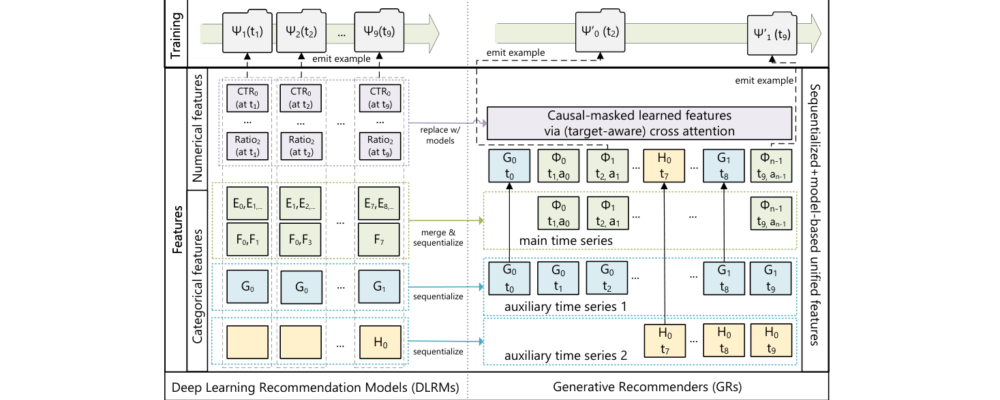
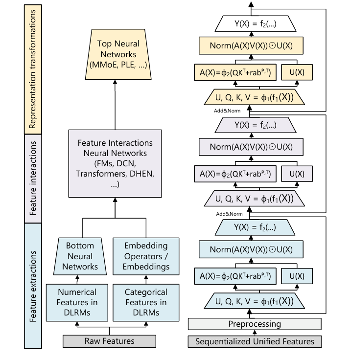
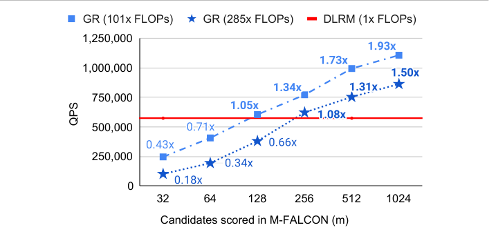
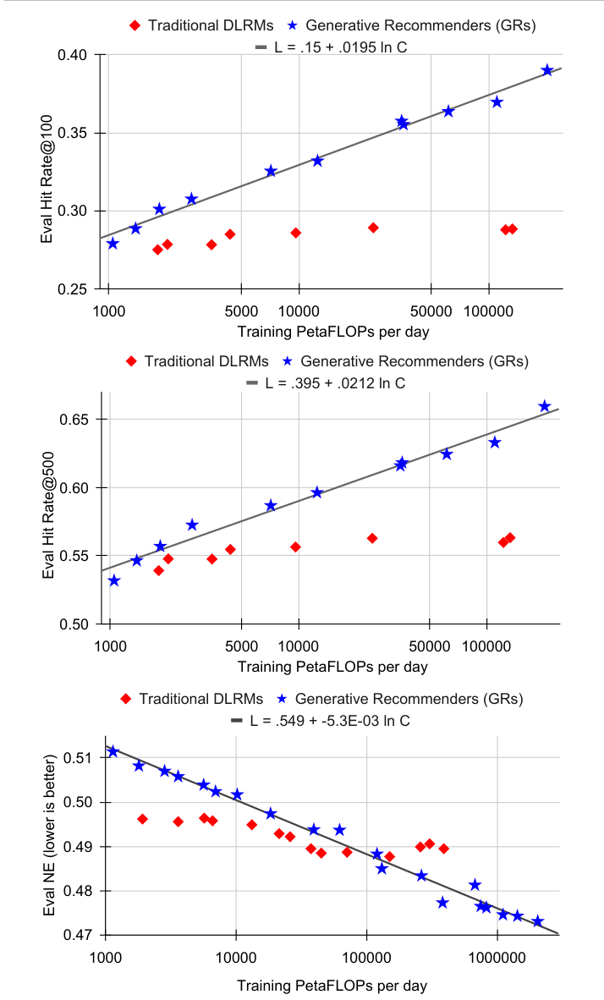

# HSTU 精读：Meta 的万亿参数生成式推荐器——架构、效率与 Scaling Law（ICML 2024）

> 论文：Actions Speak Louder than Words: Trillion-Parameter Sequential Transducers for Generative Recommendations（arXiv:2402.17152v3），Meta，ICML 2024。代码已开源：facebookresearch/generative-recommenders。完整中文译稿见同目录 `../translation/paper.zh-CN.md`。

## 论文要解决的问题

工业推荐系统过去十年主流是 DLRM：上千个稠密特征加几十个稀疏特征，经特征交叉、序列池化、MoE 等异构模块组合输出。Meta 在这篇论文里指出它的根本问题：DLRM 的模型质量不随算力增长——加算力到一定规模后指标饱和。团队把它与 LLM 的差别归纳为三个障碍：推荐特征异构且无显式结构；词表是十亿级且持续变化（语言只有十万级静态词表）；用户行为 token 量比 GPT-3 一两个月处理的还多几个数量级，长序列自注意力的 O(N²) 成本不可承受。

论文的解法分三层：先用"生成式推荐器"（Generative Recommenders，GR）重新定义问题，再设计配套的 HSTU 编码器，最后用训练/推理算法把成本压到与传统 DLRM 相当。最终交付的结果是：1.5 万亿参数的模型在线 A/B 提升 12.4%（主要互动任务），训练算力三年增长三个数量级，并首次给出推荐系统跨三个数量级的 scaling law。

## 从 DLRM 到 GR：特征统一与任务重述

GR 的第一步是把 DLRM 的异构特征空间压成一条统一时间序列。类别特征里，用户交互过的物品构成主时间序列；关注列表、人口属性等慢变特征按区段压缩后合并进来。数值特征（计数器、比率类）变化太频繁，无法逐条序列化，GR 直接把它们移除了——前提是序列转导架构足够强，能通过 target-aware 交叉注意力隐式学出这些统计量。

图 1 对比了两套体系：左侧 DLRM 为每个数值特征、类别特征维护独立的抽取与交叉模块；右侧 GR 把一切序列化，数值特征被"replace w/ models"箭头指向的因果掩码学习特征取代。

*图 1：DLRM（左）与 GR（右）的特征空间与训练样本生成方式对比。来源：论文 Figure 2，第 3 页。*

在任务定义上，GR 把物品与动作交织成序列（Φ₀, a₀, Φ₁, a₁, …），排序任务变成"预测下一动作"：p(a_{i+1} | Φ₀, a₀, …, Φ_{i+1})，从而在因果自回归设置里也能做 target-aware 建模——目标物品在序列末尾，与历史一次性完成交叉注意力。检索任务变成"预测下一正反馈内容"。这一改动的工程价值在于训练侧：传统 impression 级训练每条样本单独过模型，长序列自注意力成本为 O(N³d+N²d²)；GR 在用户请求/会话结束时才发出样本，编码器成本被同会话多个目标摊销，复杂度降到 O(N²d+Nd²)——同样算力下能多训练数量级的数据。

## HSTU 编码器：为推荐改写的注意力

HSTU（Hierarchical Sequential Transduction Unit）每层只有三个子层：单线性层 + SiLU 生成门控 U 和 Q/K/V；逐点聚合注意力；门控输出。它对标准 Transformer 做了两处针对推荐的改写。

第一处是注意力归一化方式。softmax 注意力对整个序列归一化，这会抹掉"与目标相关的历史数据点数量"这一强信号——而推荐既要预测交互强度（停留时长）又要预测相对排序。HSTU 的注意力用逐点聚合 + SiLU：φ₂(QKᵀ + r_{p,t}^{ab})V，只在池化后做层归一化稳定训练。作者用 Dirichlet Process 生成的非平稳词表流式数据验证：逐点注意力比 softmax 版本 HR@10 高 44.7%（.0893 vs .0617，Table 2）。工业流式实验里另一个值得注意的现象：标准 Transformer 在排序任务上频繁损失爆炸、NE 直接为 NaN（Table 5），softmax 版 HSTU 也需要低 10 倍的学习率才稳定。

第二处是用 Norm(AV)⊙U 的门控（SwiGLU 变体）同时替代 DLRM 的三个阶段——特征交互、前馈层和 MoE 路由。图 2 左侧是完整 DLRM 的模块堆叠，右侧 HSTU 用同构 block 取而代之；附带的好处是激活内存从每层约 33d 降到 14d（bf16），同样的显存能训练 2 倍以上深度的网络。

*图 2：左侧为 DLRM 的特征提取/交互/变换三阶段，右侧为简化 HSTU 的单模块堆叠。来源：论文 Figure 3，第 4 页。*

## 效率：三个算法层面的组合拳

架构之外，论文用三个算法把成本压到可部署的水平。

**随机长度（Stochastic Length，SL）**利用用户行为的时序重复性：训练时按式 (4) 的概率把超长历史截成 N^α/2 长度的子序列，把注意力复杂度从 O(N²d) 降到 O(N^αd)。α=1.6 时 4096 的序列多数时候被截成 776（移除 80% token），而主任务 NE 退化不超过 0.002。SL 只作用于训练，推理不受影响。

**Raggified 注意力 kernel**把稀疏序列的注意力重排为分组 GEMM，自注意力变成访存受限，仅此一项带来 2-5 倍吞吐。两者叠加，HSTU 在 8192 长度序列上训练比 FlashAttention-2 的 Transformer 快 15.2 倍（Figure 5b），推理延迟 21.5ms vs 121.3ms（Figure 5c）。

**M-FALCON**解决排序推理的候选数问题。target-aware 表述看似必须逐候选前向（成本 O(mn²d)）；M-FALCON 修改注意力掩码，禁止各候选相互注意后，b_m 个候选可以并行过同一次前向，成本降为 O(n²d)；再配合微批与 KV 缓存，进一步摊薄 2-4 倍。结果（Figure 6）：计算复杂 285 倍的 GR 排序模型，在评 1024 个候选时 QPS 达到 DLRM 的 1.50 倍，16384 个候选时 2.99 倍。

*图 3：GR（101x/285x FLOPs）与 DLRM（1x FLOPs）在候选数 32-1024 下的推理 QPS 对比，m=1024 时 285x 的 GR 达到 DLRM 的 1.50 倍。来源：论文 Figure 6，第 8 页。*

## 实验与在线结果

公开数据集（MovieLens、Amazon Books，全 shuffle 多遍训练）上，同配置的 HSTU 已优于调优过的 SASRec 配方（ML-1M HR@10 +8.6%），HSTU-large 把优势拉到最高 +65.8% NDCG@10；GRU4Rec 与 BERT4Rec 同样被显著超越（Table 4/12）。论文自己强调这一设置与工业流式差异很大，只作归纳假设的验证。

工业级证据分两层。离线：100B 样本流式训练，HSTU 在排序 NE（E-Task .4937 vs Transformer NaN）和检索 log perplexity（3.978 vs 4.069）上全面占优（Table 5）。在线：GR 排序模型在 A/B 中主要互动任务 +12.4%、消费任务 +4.4%；检索侧新增 GR 源 +6.2%，替换原主源 +5.1%（Table 6/7）。归因方面有两个消融值得注意：把 GR 用的特征子集喂给 DLRM，其 C-Task NE 从 .7842 恶化到 .7925，支持"GR 架构能隐式学出手工信工特征"的说法；只留交互历史的 GR 变体在消费任务上差 2.6% NE，只留内容特征的 GR 检索 HR@100 从 29.0% 掉到 11.6%——高基数行为序列才是信息主力。

## Scaling Law：这次推荐算力终于花得出去了

论文最重要的实验结论是图 4：GR 的 HR@100、HR@500、NE 随训练算力（PetaFLOPs/day）呈对数线性提升，跨三个数量级，直到接近 GPT-3/LLaMa-2 的总训练算力；而传统 DLRM 在低算力处略优（手工特征红利），之后迅速饱和。参数维度上，GR 做到 1.5T 嵌入参数仍在涨，DLRM 约 200B 就到顶。与语言模型不同的是，序列长度在 GR 的 scaling 中作用显著，需要与模型参数同步放大。

*图 4：检索 Hit Rate@100/@500 与排序 NE 随训练算力的扩展曲线，GR 呈对数线性而 DLRM 饱和。来源：论文 Figure 7，第 9 页。*

## 工程判断与证据边界

**结果的可信度**。在线 +12.4% 是全部结论里最有分量的部分，但论文未披露流量划分、实验周期和置信区间，且该数字只对应主要互动任务（消费任务 +4.4%）。DLRM 基线号称是数百人多年迭代的生产配置，且基线特征是 GR 的严格超集，方向上公平；但公开组件拼成的 DLRM (DIN+DCN) 与生产基线差 0.57-0.71% NE，说明这类对比对基线成熟度敏感。scaling law 是经验拟合，未报告拟合优度，1.5T 参数也主要是嵌入参数。

**迁移成本与前置条件**。GR 范式要求行为日志能按用户会话重组、正负反馈动作可枚举成 token，数值特征被移除后依赖模型隐式学习——哪些数值统计量最难被替代，论文只给了整体退化证据，没有逐特征组消融。特征穿越问题（流式训练下统计特征的标签泄漏）也未讨论。8192 序列下 21.5ms 是编码器级延迟，端到端链路成本需自行评估。

**三个可独立试点的组件**。即便不整体迁移，论文有三件事可以单独验证：一是生成式训练采样（会话尾发样本），改数据管线不改模型，训练成本降一个数量级因子；二是 SL 训练截断，只影响训练侧，α 的稀疏-质量权衡论文已给出三个时长档的数据；三是 M-FALCON 的掩码批式推理，对任何 target-aware 因果自回归排序器通用。HSTU 的逐点聚合注意力设计则可以视为 DIN 类目标注意力在自注意力框架下的推广，值得在自己的排序数据上做一次 softmax vs 逐点的对照。

**与 TIGER 的关系**。同样走生成式路线，TIGER 用 RQ-VAE 把物品压成语义 token、模型直接解码 ID，论文证据停留在 2 万物品的 Amazon 基准；HSTU 不做 token 化、在原子 ID 上做序列转导，排序与检索统一，并且有工业规模在线验证和 scaling 证据。两者可以看成同一方向在不同规模与约束下的两个解：小语料、语义特征丰富时 TIGER 的语义 ID 更省；十亿级动态词表、行为数据充沛时 HSTU 的路线目前证据更强。
