# 行胜于言：面向生成式推荐的万亿参数序列转导模型

**作者**：Jiaqi Zhai、Lucy Liao、Xing Liu、Yueming Wang、Rui Li、Xuan Cao、Leon Gao、Zhaojie Gong、Fangda Gu、Michael He、Yinghai Lu、Yu Shi（1MRS, Meta AI）

代码开源：https://github.com/facebookresearch/generative-recommenders
发表于：第 41 届国际机器学习大会（ICML 2024），Vienna，PMLR 235。arXiv:2402.17152v3 [cs.LG]，2024 年 5 月 6 日。

## 摘要

大规模推荐系统的特点是依赖高基数、异构特征，并且每天需要处理数百亿用户行为。尽管使用数千特征的海量数据训练，业界大多数深度学习推荐模型（DLRM）仍无法随算力有效扩展。受 Transformer 在语言与视觉领域成功的启发，我们重新审视推荐系统的基本设计选择。我们将推荐问题重新表述为生成式建模框架内的序列转导（sequential transduction）任务（"生成式推荐器"，Generative Recommenders，GRs），并提出一种面向高基数、非平稳流式推荐数据的新架构 HSTU。在合成与公开数据集上，HSTU 的 NDCG 超过基线最高达 65.8%；在 8192 长度序列上比基于 FlashAttention-2 的 Transformer 快 5.3 至 15.2 倍。基于 HSTU 的生成式推荐器拥有 1.5 万亿参数，在在线 A/B 测试中将指标提升 12.4%，并已部署在一个数十亿用户规模的大型互联网平台的多个业务面上。更重要的是，生成式推荐器的模型质量在经验上随训练算力呈幂律扩展，横跨三个数量级、直到 GPT-3/LLaMa-2 的算力规模，这降低了未来模型研发所需的碳足迹，并为推荐领域首批基础模型铺平道路。

## 1. 引言

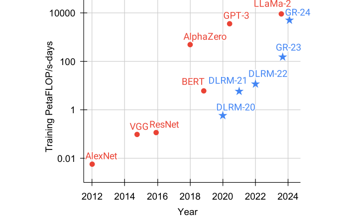

*图 1：历年用于训练深度学习模型的总算力。DLRM 数据来自 Mudigere et al. (2022)；GR 为本文部署的模型。DLRM/GR 在流式设置下持续训练，报告每年所用算力。原文 Figure 1，第 1 页。*

推荐系统是在线内容平台与电商的核心，每天为数十亿用户的体验做个性化。约十年来，业界最先进的方法一直基于深度学习推荐模型（DLRM）（Mudigere et al., 2022）（Covington et al., 2016; Cheng et al., 2016; Zhou et al., 2018; Tang et al., 2020; Wang et al., 2021; Xia et al., 2023）。DLRM 的特征是使用异构特征：数值特征（计数器、比率）、嵌入，以及创作者 ID、用户 ID 等类别特征。由于新内容和新产品每分钟都在增加，特征空间基数极高，通常在数十亿量级（Eksombatchai et al., 2018）。为利用数以万计的这类特征，DLRM 用各种神经网络组合特征、变换中间表示并生成最终输出。

尽管使用了大量人工构造的特征并在海量数据上训练，业界多数 DLRM 随算力的扩展性很差（Zhao et al., 2023）。这一局限值得关注且悬而未决。

受 Transformer 在语言与视觉领域成功的启发，我们重新审视现代推荐系统的基本设计选择。我们观察到，在十亿用户规模上采用新的问题表述需要克服三个挑战。第一，推荐系统的特征缺乏显式结构。虽然序列化表述在小规模场景已被探索（详见附录 B），但异构特征——高基数 ID、交叉特征、计数器、比率等——在工业级 DLRM 中扮演关键角色（Mudigere et al., 2022）。第二，推荐系统使用持续变化的十亿级词表。与语言中 10 万量级的静态词表（Brown et al., 2020）不同，十亿级动态词表带来训练挑战，并因需要以 target-aware 方式考虑数万候选而推高推理成本（Zhou et al., 2018; Wang et al., 2020）。最后，计算成本是启用大规模序列模型的主要瓶颈。GPT-3 用数千 GPU 训练了 1-2 个月、共 300B token（Brown et al., 2020）。这一规模看似庞大，但与用户行为规模对比就相形见绌：最大的互联网平台服务数十亿日活用户，他们每天与数十亿的帖子、图片和视频交互。用户序列长度可达 $10^5$（Chang et al., 2023）。因此推荐系统每天需要处理的 token 量比语言模型 1-2 个月处理的还要多几个数量级。

本文将用户行为视为生成式建模中的一种新模态。我们的关键洞察是：a) 在给定适当的新特征空间时，工业级推荐器的核心排序与检索任务都可以表述为生成式建模问题；b) 这一范式使我们能系统性地利用特征、训练和推理中的冗余来提升效率。得益于新的表述，我们部署了比先前 SOTA 计算复杂度高三个数量级的模型，同时将 topline 指标提升 12.4%（见图 1）。

我们的贡献如下。我们在第 2 节首先提出生成式推荐器（GRs），一个取代 DLRM 的新范式。我们将 DLRM 的异构特征空间序列化并统一，新方法在序列长度趋于无穷时逼近完整的 DLRM 特征空间。这使我们能将推荐的主要问题——排序与检索——重新表述为 GR 中的纯序列转导任务。重要的是，这进一步使模型训练能以序列化、生成式的方式进行，从而在相同算力下多训练数量级更多的数据。

接着我们在训练与推理全程应对计算成本挑战。我们提出一种新的序列转导架构：层级序列转导单元（Hierarchical Sequential Transduction Unit，HSTU）。HSTU 针对大型非平稳词表修改了注意力机制，并利用推荐数据集的特性，在 8192 长度序列上比基于 FlashAttention-2 的 Transformer 快 5.3-15.2 倍。此外，通过一种新算法 M-FALCON（3.4 节）以微批（micro-batching）充分摊销计算成本，我们能在与传统 DLRM 相同的推理预算下服务复杂 285 倍的 GR 模型，并获得 1.50-2.99 倍加速。

最后，我们在第 4 节于合成数据集、公开数据集以及一个数十亿日活大型互联网平台多个业务面的部署中验证所提技术。据我们所知，本工作是首个表明基于纯序列转导的架构（如 HSTU）在生成式设置（GR）下于大规模工业场景显著优于 DLRM 的结果。我们不仅克服了传统 DLRM 已知的扩展瓶颈，还进一步证明了 scaling law（Kaplan et al., 2020）适用于推荐，这代表着推荐系统潜在的"ChatGPT 时刻"。

## 2. 推荐即序列转导任务：从 DLRM 到 GR

### 2.1. 统一 DLRM 的异构特征空间

现代 DLRM 通常用大量类别（"稀疏"）特征和数值（"稠密"）特征训练。在 GR 中，我们把这些特征整合并编码为单一统一时间序列（见图 2）。

**类别（"稀疏"）特征**。例如用户点赞过的物品、用户关注的某类目（如户外）下的创作者、用户语言、用户加入的社区、请求发起城市等。我们如下序列化这些特征：先选出最长的时间序列——通常通过合并表示用户交互过的物品的特征——作为主时间序列。其余特征一般是随时间缓慢变化的时间序列，如人口属性或关注的创作者。我们压缩这些序列：每个连续区段只保留最早一条记录，然后合并进主时间序列。由于这些序列变化很慢，该做法不会显著增加总序列长度。

**数值（"稠密"）特征**。例如加权衰减计数器、比率等。比如某特征表示用户对匹配给定主题物品的历史 CTR。与类别特征相比，这些特征变化频繁得多，可能随每次（用户，物品）交互而变，因此从计算和存储角度完全序列化不可行。但一个重要观察是：这些聚合所依据的类别特征（如物品主题、地点）已经在 GR 中被序列化并编码。因此，只要有足够表达力的序列转导架构，配合 target-aware 表述（Zhou et al., 2018）能随 GR 的序列长度与算力增长有效捕捉数值特征，我们就可以移除数值特征。

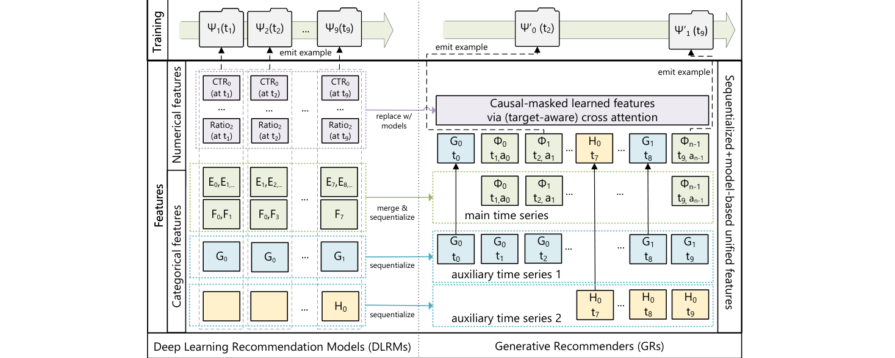

*图 2：DLRM 与 GR 的特征与训练流程对比。E、F、G、H 表示类别特征，Φᵢ 表示合并后主时间序列的第 i 个物品，Ψₖ(tⱼ) 表示在时刻 tⱼ 发出的第 k 个训练样本。完整符号见附录 A。原文 Figure 2，第 3 页。*

### 2.2. 将排序与检索重构为序列转导任务

给定按时间排序的 n 个 token $x_0, x_1, \ldots, x_{n-1}$（$x_i \in \mathcal{X}$）及其被观察的时刻 $t_0, t_1, \ldots, t_{n-1}$，序列转导任务将该输入序列映射为输出 token $y_0, y_1, \ldots, y_{n-1}$（$y_i \in \mathcal{X} \cup \{\varnothing\}$），其中 $y_i = \varnothing$ 表示 $y_i$ 无定义。

我们用 $\Phi_i \in \mathcal{X}_c$（$\mathcal{X}_c \subseteq \mathcal{X}$）表示系统提供给用户的内容（如图片或视频）。由于新内容不断产生，$\mathcal{X}_c$ 与 $\mathcal{X}$ 是非平稳的。用户可以用某个动作 $a_i$（如点赞、跳过、完播+分享）$a_i \in \mathcal{X}$ 回应 $\Phi_i$。我们用 $n_c$ 表示用户交互过的内容总数。在因果自回归设置下，标准的排序与检索任务可定义为序列转导任务（表 1）。我们有如下观察：

表 1：作为序列转导任务的排序与检索。为简洁省略其他类别特征。GR 与传统序列推荐器的对比见附录 B.2。原文 Table 1，第 3 页。

| 任务 | 规格（输入 / 输出） |
| --- | --- |
| 排序 | 输入：$\Phi_0, a_0, \Phi_1, a_1, \ldots, \Phi_{n_c-1}, a_{n_c-1}$；输出：$a_0, \varnothing, a_1, \varnothing, \ldots, a_{n_c-1}, \varnothing$ |
| 检索 | 输入：$(\Phi_0, a_0), (\Phi_1, a_1), \ldots, (\Phi_{n_c-1}, a_{n_c-1})$；输出：$\Phi'_1, \Phi'_2, \ldots, \Phi'_{n_c-1}, \varnothing$（若 $a_i$ 为正反馈则 $\Phi'_i = \Phi_i$，否则 $\varnothing$） |

**检索**。在推荐系统检索阶段，我们学习内容集合 $\Phi_{i+1} \in \mathcal{X}_c$ 上的分布 $p(\Phi_{i+1} \mid u_i)$，其中 $u_i$ 是 token i 处的用户表示。典型目标选 $\arg\max_{\Phi \in \mathcal{X}_c} p(\Phi \mid u_i)$ 以最大化某种奖励。这与标准自回归设置有两点不同：第一，$x_i$ 的监督 $y_i$ 不一定是 $\Phi_{i+1}$，因为用户对 $\Phi_{i+1}$ 的回应可能是负面的；第二，当 $x_{i+1}$ 表示与交互无关的类别特征（如人口属性）时，$y_i$ 无定义。

**排序**。GR 中的排序任务有独特挑战：工业推荐系统通常需要 "target-aware" 表述。在这类设置下，目标 $\Phi_{i+1}$ 与历史特征的"交互"需要尽早发生，而标准自回归设置中"交互"发生得晚（如通过编码器输出后的 softmax），无法满足。我们通过在表 1 中交织排列物品与动作来解决，使排序任务可表述为 $p(a_{i+1} \mid \Phi_0, a_0, \Phi_1, a_1, \ldots, \Phi_{i+1})$（类别特征之前）。实践中我们用一个小神经网络把 $\Phi_{i+1}$ 处的输出变换为多任务预测。重要的是，这使得我们能用一次 target-aware 交叉注意力处理全部 $n_c$ 次交互。

### 2.3. 生成式训练

工业推荐器通常在流式设置下训练：样本就绪后依次处理。该设置下，基于自注意力的序列转导架构（如 Transformer（Vaswani et al., 2017））的总计算需求按 $\sum_i n_i(n_i^2 d + n_i d f_{fd})$ 扩展，其中 $n_i$ 是用户 i 的 token 数，d 是嵌入维度。括号内第一项来自自注意力——由于多数次二次算法有质量折衷且实际耗时不如二次算法（Dao et al., 2022），我们假设 O(n²) 的扩展因子；第二项来自逐点 MLP 层，隐藏层大小 $O(f_{fd}) = O(d)$。取 $N = \max_i n_i$，总时间复杂度降为 $O(N^3 d + N^2 d^2)$，对推荐场景过于昂贵。

为以可扩展的方式在长序列上训练序列转导模型，我们从传统的 impression 级训练转向生成式训练，将计算复杂度降低一个 O(N) 因子（见图 2 顶部）。这样编码器成本被多个目标摊销。具体地，当以 $s_u(n_i)$ 的比率采样第 i 个用户时，总训练成本变为 $\sum_i s_u(n_i) n_i (n_i^2 d + n_i d^2)$；令 $s_u(n_i) = 1/n_i$ 即降为 $O(N^2 d + N d^2)$。在工业级系统中实现该采样的一种方式是在用户请求或会话结束时发出训练样本，从而 $\hat{s}_u(n_i) \propto 1/n_i$。

## 3. 面向生成式推荐的高性能自注意力编码器

为将 GR 扩展到具有大型非平稳词表的工业级推荐系统，我们引入新的编码器设计：层级序列转导单元（HSTU）。HSTU 由残差连接（He et al., 2015）串联的相同层堆叠而成。每层包含三个子层：逐点投影（式 1）、空间聚合（式 2）和逐点变换（式 3）：

$$U(\mathbf{X}), V(\mathbf{X}), Q(\mathbf{X}), K(\mathbf{X}) = \text{Split}(\phi_1(f_1(\mathbf{X}))) \tag{1}$$

$$A(\mathbf{X})V(\mathbf{X}) = \phi_2\left(Q(\mathbf{X})K(\mathbf{X})^T + r^{ab}_{p,t}\right)V(\mathbf{X}) \tag{2}$$

$$Y(\mathbf{X}) = f_2\left(\text{Norm}(A(\mathbf{X})V(\mathbf{X})) \odot U(\mathbf{X})\right) \tag{3}$$

其中 $f_i(\mathbf{X})$ 表示 MLP；为降低计算复杂度并进一步将 Q、K、V 和门控权重 U 的计算批量融合，$f_1$、$f_2$ 用单线性层 $f_i(\mathbf{X}) = W_i(\mathbf{X}) + b_i$；$\phi_1$、$\phi_2$ 为非线性，均用 SiLU（Elfwing et al., 2017）；Norm 为层归一化；$r^{ab}_{p,t}$ 为融合位置（p）与时间（t）信息的相对注意力偏置（Raffel et al., 2020）。完整符号见表 9。

HSTU 编码器设计使 DLRM 中的异构模块得以被单一模块化 block 取代。我们观察到 DLRM 实际上有三个主要阶段：特征提取、特征交互和表示变换。特征提取获取类别特征的池化嵌入表示，其最先进的版本可泛化为成对注意力（pairwise attention）与 target-aware 池化（Zhou et al., 2018），HSTU 层即可涵盖。特征交互是 DLRM 最关键的部分，常用方法包括因子分解机及其神经网络变体（Rendle, 2010; Guo et al., 2017; Xiao et al., 2017）、高阶特征交互（Wang et al., 2021）等。HSTU 通过让注意力池化特征经 $\text{Norm}(A(\mathbf{X})V(\mathbf{X})) \odot U(\mathbf{X})$ 与其他特征直接"交互"来取代特征交互模块。

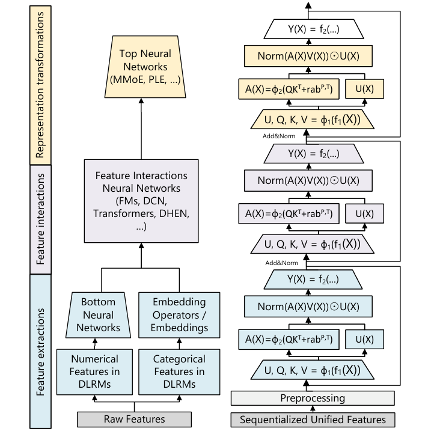

*图 3：核心模型组件对比。左侧为完整 DLRM 设置（Mudigere et al., 2022），右侧为简化的 HSTU。原文 Figure 3，第 4 页。*

表示变换通常用专家混合（MoE）与路由处理多样异构人群，其核心思想是为不同用户群专业化子网络以执行条件计算（Ma et al., 2018; Tang et al., 2020）。HSTU 的逐元素点积在归一化因子之内可以虚拟地执行 MoE 的门控操作。

这一设计的动机是与学习 MLP 点积逼近的困难有关（Rendle et al., 2020; Zhai et al., 2023a）。由于对 U(X) 应用了 SiLU，$\text{Norm}(A(\mathbf{X})V(\mathbf{X})) \odot U(\mathbf{X})$ 也可解读为 SwiGLU（Shazeer, 2020）的变体。

### 3.1. 逐点聚合注意力

HSTU 采用一种新的逐点聚合（归一化）注意力机制（相比之下，softmax 注意力在整个序列上计算归一化因子）。动机有二。第一，与目标相关的历史数据点数量是反映用户偏好强度的强特征，softmax 归一化后难以捕捉。这对我们既要预测交互强度（如在某物品上的停留时长）又要预测物品相对排序（如预测使 AUC 最大化的排序）至关重要。第二，虽然 softmax 激活天然抗噪，但它不太适合流式设置中的非平稳词表。

逐点聚合注意力机制见式 (2)。重要的是，逐点池化后需要层归一化以稳定训练。理解这一设计的一个途径是遵循 Dirichlet Process 生成非平稳词表流式数据的合成数据（细节见附录 C）。如表 2 所示，该设置下 softmax 与逐点注意力方案之间的差距高达 44.7%。

表 2：单遍流式设置下的合成数据。原文 Table 2，第 5 页。

| 架构 | HR@10 | HR@50 |
| --- | --- | --- |
| Transformers | .0442 | .2025 |
| HSTU（-$r^{ab}_{p,t}$，Softmax） | .0617 | .2496 |
| HSTU（-$r^{ab}_{p,t}$） | .0893 | .3170 |

### 3.2. 利用并算法性地增加稀疏性

推荐系统中用户历史序列长度通常呈偏态分布，产生稀疏输入序列，长序列场景尤甚。利用这种稀疏性可以显著提升编码器效率。为此，我们为 GPU 开发了一个高效注意力 kernel，以类似（Rabe & Staats, 2021; Dao et al., 2022）的方式融合背靠背 GEMM，但执行完全 raggified（参差张量化）的注意力计算。这本质上是把注意力计算变换为不同大小的分组 GEMM（附录 G）。结果，HSTU 的自注意力变为访存受限（memory-bound），访存次数按 $\Theta(\sum_i n_i^2 d_{qk}^2 R^{-1})$ 扩展，其中 $n_i$ 为样本 i 的序列长度，$d_{qk}$ 为注意力维度，R 为寄存器大小。如 4.2 节所讨论，仅此一项就带来 2-5 倍吞吐提升。

我们进一步通过随机长度（Stochastic Length，SL）算法性地增加用户历史序列的稀疏性。推荐用户历史序列的一个关键特性是用户行为在时间上具有重复性，行为在交互历史的多个尺度上反复显现。这提供了人为增加稀疏性而不损害模型质量的机会，从而显著降低按 $\Theta(\sum_i n_i^2)$ 扩展的编码器成本。

将用户 j 的历史表示为序列 $(x_i)_{i=0}^{n_{c,j}}$，$n_{c,j}$ 为用户交互的内容数。令 $N_c = \max_j n_{c,j}$。$(x_{i_k})_{k=0}^{L}$ 为从原序列构造的长度 L 的子序列。SL 如下选择输入序列：

$$\begin{cases} (x_i)_{i=0}^{n_{c,j}} & \text{若 } n_{c,j} \le N_c^{\alpha/2} \\ (x_{i_k})_{k=0}^{N_c^{\alpha/2}} & \text{若 } n_{c,j} > N_c^{\alpha/2}\text{，以概率 } 1 - N_c^\alpha / n_{c,j}^2 \\ (x_i)_{i=0}^{n_{c,j}} & \text{若 } n_{c,j} > N_c^{\alpha/2}\text{，以概率 } N_c^\alpha / n_{c,j}^2 \end{cases} \tag{4}$$

这将注意力相关复杂度降为 $O(N_c^\alpha d) = O(N^\alpha d)$，$\alpha \in (1, 2]$。子序列选择的更详尽讨论见附录 F.1。我们指出，将 SL 用于训练是划算的系统设计，因为训练的计算成本通常显著高于推理。

表 3：随机长度（SL）对序列稀疏度的影响。原文 Table 3，第 5 页。

| α | 最长 1,024 | 最长 2,048 | 最长 4,096 | 最长 8,192 |
| --- | --- | --- | --- | --- |
| 1.6 | 71.5% | 76.1% | 80.5% | 84.4% |
| 1.7 | 56.1% | 63.6% | 69.8% | 75.6% |
| 1.8 | 40.2% | 45.3% | 54.1% | 66.4% |
| 1.9 | 17.2% | 21.0% | 36.3% | 64.1% |
| 2.0 | 3.1% | 6.6% | 29.1% | 64.1% |

表 3 展示了 30 天用户历史的代表性工业配置下不同序列长度与 α 值的稀疏度。对模型质量影响可忽略的设置加了下划线并标蓝。"α = 2.0" 行是未施加 SL 的基础稀疏度情形。更低的 α 适用于更长的序列，最长测试到 8,192。

### 3.3. 最小化激活内存占用

在推荐系统中，大 batch size 对训练吞吐（Mudigere et al., 2022）与模型质量（Yang et al., 2020; Chen et al., 2020; Zhai et al., 2023a）都至关重要。因此激活内存成为主要扩展瓶颈，与大语言模型常用小 batch、参数内存为主的情况相反。

与 Transformer 相比，HSTU 采用简化的全融合（fully fused）设计，显著降低激活内存。第一，HSTU 将注意力之外的线性层数从六层减到两层，与近期用逐元素门控减少 MLP 计算的工作一致（Hua et al., 2022; Gu et al., 2022）。第二，HSTU 激进地将计算融合为单算子，包括式 (1) 中的 $\phi_1(f_1(\cdot))$，以及式 (3) 中的层归一化、可选 dropout 和输出 MLP。该简化设计将激活内存降到每层 bf16 下 $2d + 2d + 4hd_{qk} + 4hd_v + 2hd_v = 14d$。作为对比，Transformer 在注意力后接前馈层与 dropout（中间态 $3hd_v$），再接由层归一化、线性、激活、线性、dropout 组成的逐点前馈块（中间态 $2d + 4d_{ff} + 2d + 1d = 4d + 4d_{ff}$）。这里采用标准假设 $hd_v \ge d$、$d_{ff} = 4d$（Vaswani et al., 2017; Brown et al., 2020）。计入输入与输入层归一化（4d）及 QKV 投影后，总激活态为 33d。因此 HSTU 的设计支持构建 2 倍以上深度的网络。

此外，表示词表的大规模原子 ID 也占用大量内存。以 100 亿词表、512 维嵌入、Adam 优化器为例，仅以 fp32 存储嵌入与优化器状态就需要 60TB 内存。为缓解内存压力，我们采用 rowwise AdamW 优化器（Gupta et al., 2014; Khudia et al., 2021）并将优化器状态放在 DRAM，把每个浮点的 HBM 占用从 12 字节降到 2 字节。

### 3.4. 通过成本摊销扩展推理

我们要解决的最后一个挑战是推荐系统服务时需处理的大量候选。我们聚焦排序，因为检索的编码器成本可完全摊销，且无论 MIPS（利用量化、哈希或分区：Jégou et al., 2011; Shrivastava & Li, 2014; Li et al., 2002; Zhai et al., 2011）还是非 MIPS 场景（束搜索或层级检索：Zhuo et al., 2020; Zhai et al., 2023a）都已有高效算法。

排序阶段有多达数万候选（Covington et al., 2016; Wang et al., 2020）。我们提出 M-FALCON 算法（Microbatched-Fast Attention Leveraging Cacheable OperatioNs），对 m 个候选、输入序列长度 n 执行推理。单次前向中，M-FALCON 通过修改注意力掩码与 $r^{ab}_{p,t}$ 偏置，使 bm 个候选的注意力操作完全相同，从而并行处理这 bm 个候选。这将施加交叉注意力的成本从 $O(bmn^2 d)$ 降到 $O((n + bm)^2 d) = O(n^2 d)$（当 bm 相对 n 是小常数时）。我们还可选地将 m 个候选分成 $\lceil m/b_m \rceil$ 个大小为 $b_m$ 的微批，以利用编码器级 KV 缓存（Pope et al., 2022）——跨前向降低成本，或跨请求降低尾延迟（更详细的讨论见附录 H）。

总体上，M-FALCON 使模型复杂度可以随传统 DLRM 排序阶段的候选数线性扩展；我们在 4.3 节讨论的典型排序配置、恒定推理预算下，成功应用了复杂 285 倍的 target-aware 交叉注意力模型，并获得 1.5-3 倍吞吐。

## 4. 实验

### 4.1. 验证 HSTU 编码器的归纳假设

#### 4.1.1. 传统序列推荐设置

我们首先在 MovieLens 和 Amazon Reviews 两个流行推荐数据集上评估 HSTU。遵循文献中的序列推荐设置，包括全量 shuffle 与多 epoch 训练。基线用 SASRec（Kang & McAuley, 2018）这一 SOTA Transformer 实现¹。我们在全语料上报告 Hit Rate@K 与 NDCG@K，与近期工作一致（Dallmann et al., 2021; Zhai et al., 2023a）。

结果见表 4。"SASRec (2023)" 是（Zhai et al., 2023a）报告的最优 SASRec 配方。"HSTU" 行使用与 SASRec 完全相同的配置（相同层数、头数等）；"HSTU-large" 是更大的 HSTU 编码器（4 倍层数、2 倍头数）。结果表明：a) 相同配置下，为推荐优化的 HSTU 设计显著优于基线；b) HSTU 放大后性能进一步提升。值得注意的是，此处的评估方法与工业级设置差异很大：全量 shuffle 与多 epoch 训练在工业流式设置中通常不可行（Liu et al., 2022）。

> 1. 其他基线的结果见附录 D。

表 4：公开数据集、多遍全量 shuffle 设置下的方法评估。原文 Table 4，第 7 页。

| 数据集 | 方法 | HR@10 | HR@50 | HR@200 | NDCG@10 | NDCG@200 |
| --- | --- | --- | --- | --- | --- | --- |
| ML-1M | SASRec (2023) | .2853 | .5474 | .7528 | .1603 | .2498 |
| ML-1M | HSTU | .3097（+8.6%） | .5754（+5.1%） | .7716（+2.5%） | .1720（+7.3%） | .2606（+4.3%） |
| ML-1M | HSTU-large | .3294（+15.5%） | .5935（+8.4%） | .7839（+4.1%） | .1893（+18.1%） | .2771（+10.9%） |
| ML-20M | SASRec (2023) | .2906 | .5499 | .7655 | .1621 | .2521 |
| ML-20M | HSTU | .3252（+11.9%） | .5885（+7.0%） | .7943（+3.8%） | .1878（+15.9%） | .2774（+10.0%） |
| ML-20M | HSTU-large | .3567（+22.8%） | .6149（+11.8%） | .8076（+5.5%） | .2106（+30.0%） | .2971（+17.9%） |
| Books | SASRec (2023) | .0292 | .0729 | .1400 | .0156 | .0350 |
| Books | HSTU | .0404（+38.4%） | .0943（+29.5%） | .1710（+22.1%） | .0219（+40.6%） | .0450（+28.6%） |
| Books | HSTU-large | .0469（+60.6%） | .1066（+46.2%） | .1876（+33.9%） | .0257（+65.8%） | .0508（+45.1%） |

#### 4.1.2. 工业级流式设置

接下来我们在工业级数据集的流式设置下比较 HSTU、消融版 HSTU 与 Transformer。本节其余部分排序报告归一化熵（Normalized Entropy，NE）（He et al., 2014）。我们在 1000 亿样本（DLRM 等价量）上训练，每个作业使用 64-256 块 H100。由于排序是多任务设置，我们报告主要互动事件（"E-Task"）与主要消费事件（"C-Task"）。在我们的语境中，NE 降低 0.001 即视为显著，因为它通常为数十亿用户带来 0.5% 的 topline 指标提升。检索的设置与语言建模类似，报告 log perplexity。受资源限制，我们固定小规模设置下的编码器参数（排序 l=3、n=2048、d=512；检索 l=6、n=512、d=256），网格搜索其他超参。

表 5：工业级数据集、单遍流式设置下 HSTU、消融 HSTU 与 Transformer 的评估。原文 Table 5，第 7 页。

| 架构 | 检索 log pplx. | 排序 NE：E-Task | 排序 NE：C-Task |
| --- | --- | --- | --- |
| Transformers | 4.069 | NaN | NaN |
| HSTU（-$r^{ab}_{p,t}$，Softmax） | 4.024 | .5067 | .7931 |
| HSTU（-$r^{ab}_{p,t}$） | 4.021 | .4980 | .7860 |
| Transformer++ | 4.015 | .4945 | .7822 |
| HSTU（原版 rab） | 4.029 | .4941 | .7817 |
| HSTU | 3.978 | .4937 | .7805 |

结果见表 5。第一，HSTU 显著优于 Transformer，排序尤甚，可能归因于逐点注意力与改进的相对注意力偏置。第二，消融 HSTU 与完整 HSTU 的差距证实了各设计的有效性。基于 Softmax 的 HSTU 与 Transformer 的最优学习率因训练稳定性约低 10 倍；即便用更低学习率和 pre-norm 残差连接（Xiong et al., 2020），标准 Transformer 在排序上仍频繁损失爆炸。最后，HSTU 优于 LLM 常用的 Transformer 变体 Transformer++（Touvron et al., 2023a）（使用 RoPE（Su et al., 2023）、SwiGLU 等）。总体而言，在这一小规模设置中，HSTU 以 1.5-2 倍墙钟速度和 50% 更低的 HBM 占用取得更好质量。

### 4.2. 编码器效率

**随机长度**。图 4 与图 5(a) 展示 SL 对模型指标的影响。α=1.6 时，长度 4096 的序列多数时候被变为长度 776 的序列，即移除超过 80% 的 token。即使稀疏度升到 64%-84%，主任务的 NE 退化也不超过 0.002（0.2%）。该证据支持：对合适的 α，SL 不损害模型质量，并允许高稀疏度降低训练成本。我们在附录 F.3 进一步验证 SL 显著优于现有长度外推技术。

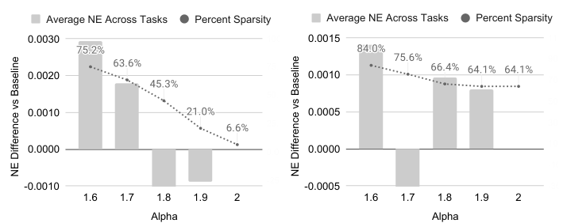

*图 4：随机长度（SL）对指标的影响。左：n=4096；右：n=8192。完整结果见附录 F。原文 Figure 4，第 7 页。*

**编码器效率**。图 5 比较 HSTU 与 Transformer 编码器在训练与推理设置下的效率。Transformer 用 SOTA 的 FlashAttention-2（Dao, 2023）实现。序列长度取 1,024 到 8,192，训练时施加 SL。评估中 HSTU 与 Transformer 用相同配置（d=512、h=8、$d_{qk}$=64），并消融相对注意力偏置（因 4.1.2 节表明 HSTU 在无 $r^{ab}_{p,t}$ 时仍优于 Transformer）。在 NVIDIA H100 GPU 上以 bf16 比较编码器级性能。总体上，HSTU 在训练与推理中分别比 Transformer 至多高效 15.2 倍与 5.6 倍。此外，3.3 节所述激活内存的下降使我们能构建比 Transformer 深 2 倍以上的网络。

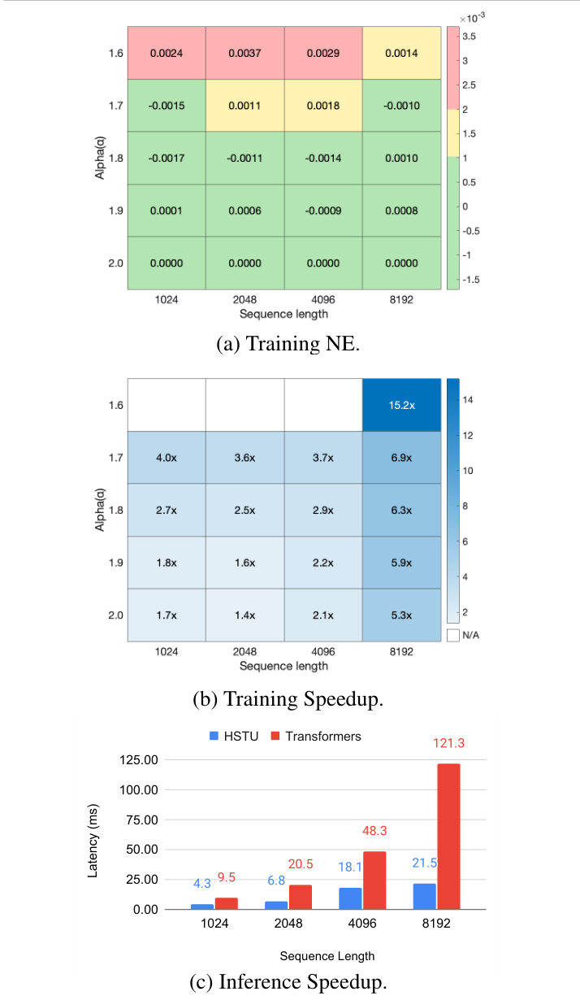

*图 5：编码器级效率：训练 (a) NE 与 (b) 加速比、推理 (c) 延迟，HSTU 对比基于 FlashAttention2 的 Transformer。(b) 中右下角 15.2x 为 α=1.6、n=8192 时的训练加速；(c) 中 8192 长度下 HSTU 延迟 21.5ms vs Transformer 121.3ms。原文 Figure 5，第 8 页。*

表 6：检索模型的离线/在线对比。原文 Table 6，第 7 页。

| 方法 | 离线 HR@K（K=100） | 离线 HR@K（K=500） | 在线指标 E-Task | 在线指标 C-Task |
| --- | --- | --- | --- | --- |
| DLRM | 29.0% | 55.5% | +0% | +0% |
| DLRM（消融特征） | 28.3% | 54.3% | – | – |
| GR（仅内容特征） | 11.6% | 18.8% | – | – |
| GR（仅交互） | 35.6% | 61.7% | – | – |
| GR（新增检索源） | 36.9% | 62.4% | +6.2% | +5.0% |
| GR（替换检索源） | – | – | +5.1% | +1.9% |

表 7：排序模型的离线/在线对比。原文 Table 7，第 7 页。

| 方法 | 离线 NE：E-Task | 离线 NE：C-Task | 在线指标 E-Task | 在线指标 C-Task |
| --- | --- | --- | --- | --- |
| DLRM | .4982 | .7842 | +0% | +0% |
| DLRM（DIN+DCN） | .5053 | .7899 | – | – |
| DLRM（消融特征） | .5053 | .7925 | – | – |
| GR（仅交互） | .4851 | .7903 | – | – |
| GR | .4845 | .7645 | +12.4% | +4.4% |

### 4.3. 工业级流式设置下 GR 与 DLRM 的对比

最后，我们在工业级流式设置下比较 GR 与 SOTA DLRM 基线的端到端表现。我们的 GR 实现反映生产中使用的典型配置，而 DLRM 设置凝聚了数百人多年的迭代。由于推荐系统检索阶段使用多个生成器，我们同时报告新增 GR 检索源（"add source"）与替换现有主 DLRM 检索源（"replace source"）的在线结果。表 6 与表 7 显示，GR 不仅离线显著优于 DLRM，还在 A/B 测试中带来 12.4% 的提升。

如第 2 节所讨论，GR 构建在原始类别交互特征之上，而 DLRM 通常用多得多的特征训练——其中大部分是从原始信号手工构造的。若把 GR 用到的同一组特征给 DLRM（"DLRM (abl. features)"），其性能显著退化，说明 GR 能通过其架构与统一特征空间有效捕捉那些特征。

我们进一步通过与传统序列推荐设置（只考虑用户交互过的物品，Kang & McAuley, 2018，即 "GR (interactions only)"）比较验证 2.2 节的 GR 表述。结果显著变差：其排序变体在主要消费任务上比 GR 差 2.6% NE。考虑到内容型方法（包括语言模型）的流行，我们还加入只用内容特征的 GR 基线（"GR (content-based)"）。内容型基线与 DLRM/GR 之间的巨大差距凸显了高基数用户行为的重要性。

最后我们在图 6 中比较 GR 与生产 DLRM 的效率。尽管 GR 模型计算复杂 285 倍，得益于 HSTU 与 3.4 节的 M-FALCON 算法，我们在评 1024/16384 个候选时分别取得了 1.50 倍/2.99 倍于 DLRM 的 QPS。

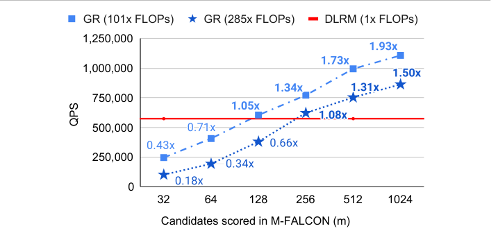

*图 6：最具挑战性排序设置下的推理吞吐对比。GR（101x/285x FLOPs）与 DLRM（1x FLOPs）在候选数 32-1024 下的 QPS：m=1024 时 285x GR 达 1.50x 于 DLRM 的吞吐。完整结果见附录 H.1。原文 Figure 6，第 8 页。*

#### 4.3.1. 推荐系统的 Scaling Law

众所周知，在大规模工业环境中，DLRM 的质量会在某算力与参数规模处饱和（Zhao et al., 2023）。我们比较 GR 与 DLRM 的可扩展性以理解这一现象。由于特征交互层对 DLRM 性能至关重要（Mudigere et al., 2022），我们用 Transformer（Vaswani et al., 2017）、DHEN（Zhang et al., 2022）以及生产环境中使用的、加了残差连接的 DCN 变体（Wang et al., 2021）（He et al., 2015）来放大排序设置的 DLRM 基线。检索基线因使用了残差结构，我们放大隐藏层大小、嵌入维度和层数。对基于 HSTU 的 GR，我们通过调整 HSTU 超参放大模型：残差层数、序列长度、嵌入维度、注意力头数等，并为检索额外调整负样本数。

结果见图 7。低算力区间 DLRM 可能因手工特征而优于 GR，印证了特征工程在传统 DLRM 中的重要性。但 GR 展现出相对 FLOPs 实质更好的扩展性，而 DLRM 性能趋于平台期，与既往发现一致。我们还观察到相对嵌入参数与非嵌入参数的更好扩展性：GR 做到了 1.5 万亿参数模型，而 DLRM 约在 2000 亿参数处饱和。

最后，我们的所有主指标——检索的 Hit Rate@100 与 Hit Rate@500、排序的 NE——在合适超参下经验上都随所用算力呈幂律扩展。该现象横跨三个数量级，直到我们能测试的最大模型（8192 序列长度、1024 嵌入维度、24 层 HSTU）：按 365 天归一化的总训练算力已接近 GPT-3（Brown et al., 2020）与 LLaMa-2（Touvron et al., 2023b）的总训练算力（见图 1）。在合理范围内，模型超参的确切取值比施加的总训练算力更不重要。与语言建模（Kaplan et al., 2020）不同，序列长度在 GR 中作用显著得多，序列长度与其他参数需要同步扩展。这也许是我们方法最重要的优势：我们首次表明 LLM 的 scaling law 可能同样适用于大规模推荐系统。

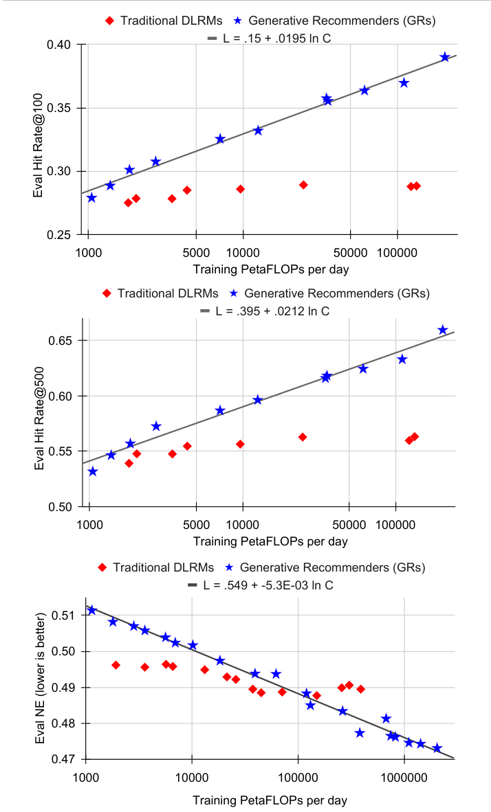

*图 7：检索（上、中）与排序（下）的扩展性对比。+0.005 的 HR 与 -0.001 的 NE 代表显著改进。拟合式分别为 L=.15+.0195 ln C（HR@100）、L=.395+.0212 ln C（HR@500）、L=.549-5.3E-03 ln C（NE）。原文 Figure 7，第 9 页。*

## 5. 相关工作

先前的序列推荐工作将用户交互简化为物品单一同质序列（Hidasi et al., 2016; Kang & McAuley, 2018）。序列方法的工业级应用主要是成对注意力（Zhou et al., 2018）或作为 DLRM 一部分的序列编码器（Chen et al., 2019; Xia et al., 2023）。有工作用多阶段注意力替代自注意力以提升效率（Chang et al., 2023）。将 ID 表示为 token 序列的生成式方法已在检索中探索（Zhuo et al., 2020）。更全面的先前工作讨论见附录 B.1。

由于自注意力 O(n²) 的扩展因子，高效注意力一直是研究热点，主要工作包括分解注意力（Child et al., 2019）、低秩近似（Katharopoulos et al., 2020）等。近期也探索了序列转导设置的替代表述（Gu et al., 2022; Hua et al., 2022）。HSTU 的逐元素门控设计尤其受 FLASH（Hua et al., 2022）启发。近期的硬件感知表述显著降低内存占用（Rabe & Staats, 2021; Korthikanti et al., 2022; Zhai et al., 2023b）并获得更好的墙钟时间（Dao et al., 2022）。长度外推使短序列训练的模型得以泛化，但多数工作聚焦微调或改进偏置机制（Press et al., 2022）。我们的工作反其道而行，在长度维度引入随机性，灵感来自深度维度的随机性工作（Huang et al., 2016）。

对大语言模型（LLM）的兴趣推动了许多把推荐任务当作 in-context learning（Sileo et al., 2022）、指令微调（Bao et al., 2023）或在预训练 LLM 上迁移学习（Li et al., 2023）的工作。LLM 中的世界知识可以迁移到下游任务（Cui et al., 2022）并在零样本/少样本情形改进推荐。用户行为序列的文本表示也在中等规模数据集上展现了良好扩展性（Shin et al., 2023）。多数 LLM for Rec 的研究集中在低数据量场景；在大规模场景，它们尚未在 MovieLens 上胜过协同过滤（Hou et al., 2024）。

## 6. 结论

我们提出了生成式推荐器（GRs）：一个将排序与检索表述为序列转导任务、使其能以生成式方式训练的新范式。这得益于新颖的 HSTU 编码器设计——在 8192 长度序列上比 SOTA Transformer 快 5.3-15.2 倍——以及 M-FALCON 等新训练与推理算法。借助 GR，我们部署了复杂 285 倍而推理算力更省的模型。GR 与 HSTU 在生产中带来 12.4% 的指标提升，并展现出优于传统 DLRM 的扩展性。结果印证了用户行为是生成式建模中一个未被充分探索的模态——呼应标题："行胜于言"（Actions speak louder than words）。

我们工作对特征的大幅简化，通过启用跨领域统一的特征空间，为推荐、搜索、广告的首批基础模型铺平道路。GR 的全序列设置也使推荐能以端到端生成式的方式表述。这两点都让推荐系统得以更整体地辅助用户。

## 影响声明

我们相信本工作具有广泛的积极意义。降低推荐、搜索、广告系统对大量异构特征的依赖，可以让这些系统在改善用户体验的同时更保护隐私。通过全序列表述使推荐系统能将用户长期结果归因到短期决策，可以减少全网不服务用户长期目标的内容（包括标题党与假新闻），并更好地将平台激励与用户价值对齐。最后，基础模型与 scaling law 的应用有助于减少推荐、搜索及相关用例的模型研发所产生的碳足迹。

## 致谢

本工作是数百人共同努力的成果……（译注：致谢名单与产品支持、项目管理及领导层致谢从略，原文完整名单见第 10 页。）

## 参考文献

> 译注：参考文献按原文保留，标题不翻译（Bao et al. 2023 TallRec；Brown et al. 2020 GPT-3；Chang et al. 2023 TWIN；Chen et al. 2019 BST；Chen et al. 2020 SimCLR；Cheng et al. 2016 Wide & Deep；Child et al. 2019 Sparse Transformers；Covington et al. 2016 YouTube DNN；Cui et al. 2022 M6-Rec；Dallmann et al. 2021；Dao 2023 FlashAttention-2；Dao et al. 2022 FlashAttention；Devlin et al. 2019 BERT；Eksombatchai et al. 2018 Pixie；Elfwing et al. 2017 SiLU；Gao et al. 2021；Gillenwater et al. 2014 DPP；Gu et al. 2022 S4；Guo et al. 2017 DeepFM；Gupta et al. 2014；He et al. 2015 ResNet；He et al. 2014 NE；Hidasi et al. 2016 GRU4Rec；Hou et al. 2024；Hua et al. 2022 FLASH；Huang et al. 2016 Stochastic Depth；Jégou et al. 2011 PQ；Kang & McAuley 2018 SASRec；Kaplan et al. 2020 Scaling Laws；Katharopoulos et al. 2020 Linear Attention；Khudia et al. 2021 FBGEMM；Klenitskiy & Vasilev 2023；Korthikanti et al. 2022；Li et al. 2002；Li et al. 2023；Liu et al. 2022 Monolith；Ma et al. 2018 MMoE；Mudigere et al. 2022 DLRM；Peng et al. 2024 YaRN；Pope et al. 2022；Press et al. 2022 ALiBi；Rabe & Staats 2021；Raffel et al. 2020 T5；Rendle 2010 FM；Rendle et al. 2020；Shazeer 2020 GLU；Shin et al. 2023；Shrivastava & Li 2014 ALSH；Sileo et al. 2022；Su et al. 2023 RoPE；Sun et al. 2019 BERT4Rec；Tang et al. 2020 PLE；Touvron et al. 2023a LLaMA；Touvron et al. 2023b Llama 2；Vaswani et al. 2017 Transformer；Wang et al. 2021 DCN V2；Wang et al. 2020 COLD；Xia et al. 2023 TransAct；Xiao et al. 2017 AFM；Xiong et al. 2020；Yang et al. 2020 MNS；Zhai et al. 2011 Atlas；Zhai et al. 2023a RONACS；Zhai et al. 2023 ByteTransformer；Zhang et al. 2022 DHEN；Zhao et al. 2018；Zhao et al. 2023；Zhou et al. 2018 DIN；Zhou et al. 2020 S3-Rec；Zhuo et al. 2020 OTM。）

## 附录 A. 符号表

表 8：符号表（续见下页）。原文 Table 8，第 15 页。

| 符号 | 描述 |
| --- | --- |
| $\Psi_k(t_j)$ | 特征日志系统在时刻 $t_j$ 发出的第 k 个训练样本（k 全局有序）。典型 DLRM 系统中，用户消费内容 $\Phi_i$（以 $a_i$ 回应，如跳过、完播、分享）后，特征日志系统将 $(\Phi_i, a_i)$ 与排序 $\Phi_i$ 所用特征做 join，发出 $(\Phi_i, a_i, \text{features for } \Phi_i)$ 作为训练样本 $\Psi_k(t_j)$。如 2.3 节所述，DLRM 与 GR 处理的训练样本数不同，GR 的样本数通常少 1-2 个数量级。 |
| $n_c$（$n_{c,i}$） | 用户（样本/用户 i）交互过的内容数。 |
| $\Phi_0, \ldots, \Phi_{n_c-1}$ | 推荐系统语境下用户交互过的内容列表。 |
| $a_0, \ldots, a_{n_c-1}$ | 与 $\Phi_i$ 对应的用户动作列表。当所有预测事件为二值时，每个动作可视为（原子）事件（点赞、分享、评论、图片浏览、视频初始化、视频完播、隐藏等）上的 multi-hot 向量。 |
| E, F | 图 2 中 DLRM 的类别特征。$E_0, E_1, \ldots, E_7, E_8$ 与 $F_0, F_1, \ldots, F_7$ 表示在各个时间点对 $(\Phi_0, a_0, t_0), \ldots, (\Phi_{n_c-1}, a_{n_c-1}, t_{n_c-1})$ 经特征提取获得的变换（如最近点赞的 10 张图片、用户过去点击的与当前候选最相似的 50 个 URL 等）。"merge & sequentialize" 表示获取原始交互序列 $(\Phi_0, a_0, t_0), \ldots, (\Phi_{n_c-1}, a_{n_c-1}, t_{n_c-1})$ 的（虚拟）逆过程。 |
| G, H | 图 2 中与用户-内容交互无关的 DLRM 类别特征（如人口属性或关注的创作者），按 2.1 节所述合并进主时间序列。 |
| n（$n_i$） | 序列转导任务（样本/用户 i）的 token 数。$O(n) = O(n_c)$，但 n 可不等于 $n_c$，见表 1。 |
| $x_0, \ldots, x_{n-1}$ | 序列转导任务的输入 token 列表。 |
| $y_0, \ldots, y_{n-1}$ | 序列转导任务的输出 token 列表。 |
| $t_0, \ldots, t_{n-1}$ | $x_0, \ldots, x_{n-1}$ 被观察时刻的列表。 |
| $\mathcal{X}$, $\mathcal{X}_c$ | 全部输入/输出 token 的词表（$\mathcal{X}$）及其内容子集（$\mathcal{X}_c$）。 |
| N, $N_c$ | $\max_i n_i$，$\max_i n_{c,i}$。 |
| $u_t$ | 时刻 t 的用户表示。 |
| $s_u(n_i)$, $\hat{s}_u(n_i)$ | 生成式训练（2.3 节）中用户 i 的采样率。 |
| d | 模型维度（嵌入维度）。 |
| $d_{qk}$ | HSTU 与 Transformer 的注意力维度，对应式 (1) 的 Q(X) 与 K(X)。 |
| $d_v$ | HSTU 的 value 维度。Transformer 通常 $d_{qk} = d_v$。 |
| $d_{ff}$ | Transformer 逐点前馈层隐藏维度。HSTU 不使用前馈层，见 U(X)。 |
| h | 注意力头数。 |
| l | HSTU 层数。Transformer 中注意力层与逐点前馈层合计为一层。 |

表 9：符号表（续）。原文 Table 9，第 16 页。

| 符号 | 描述 |
| --- | --- |
| X | HSTU 层的输入。标准术语下（batching 前）$X \in \mathbb{R}^{N \times d}$，输入序列含 N 个 token。 |
| Q(X), K(X), V(X) | 式 (1) 得到的 HSTU query/key/value，定义类似标准 Transformer。$Q(X), K(X) \in \mathbb{R}^{h \times N \times d_{qk}}$，$V(X) \in \mathbb{R}^{h \times N \times d_v}$。 |
| U(X) | HSTU 用 U(X) 在式 (3) 中"门控"注意力池化的值 V(X)，配合 $f_2(\cdot)$ 使 HSTU 完全免去前馈层。$U(X) \in \mathbb{R}^{h \times N \times d_v}$。 |
| A(X) | 输入 X 的注意力张量，$A(X) \in \mathbb{R}^{h \times N \times N}$。 |
| Y(X) | HSTU 层对输入 X 的输出，$Y(X) \in \mathbb{R}^d$。 |
| Split(·) | 张量切分操作。式 (1) 中 $\phi_1(f_1(X)) \in \mathbb{R}^{N \times (2hd_{qk} + 2hd_v)}$，经切分与维度重排得到 U(X), V(X)（均 h×N×$d_v$）与 Q(X), K(X)（均 h×N×$d_{qk}$）。 |
| $r^{ab}_{p,t}$ | 融合位置信息（Raffel et al., 2020）与时间信息（token 被观察的时刻 $t_0, \ldots, t_{n-1}$；一种实现是对 $(t_j - t_i)$ 施加分桶函数）的相对注意力偏置。实践中同层各注意力头共享，故 $r^{ab}_{p,t} \in \mathbb{R}^{1 \times N \times N}$。 |
| α | 随机长度（SL）算法控制稀疏度的参数（3.2 节）。 |
| R | 3.2 节 HSTU 算法语境下 GPU 的寄存器大小。 |
| m | 排序阶段考虑的候选数。 |
| $b_m$ | M-FALCON 算法（3.4 节）的微批大小。 |

## 附录 B. 生成式推荐器：背景与表述

许多读者更熟悉经典 DLRM（Mudigere et al., 2022）——自 YouTube DNN（Covington et al., 2016）以来流行、用于所有大型在线内容与电商平台（Cheng et al., 2016; Zhou et al., 2018; Wang et al., 2021; Chang et al., 2023; Xia et al., 2023; Zhai et al., 2023a）。DLRM 建立在异构特征空间之上，使用包括特征交互模块（Guo et al., 2017; Xiao et al., 2017; Wang et al., 2021）、序列池化或 target-aware 成对注意力模块（Hidasi et al., 2016; Zhou et al., 2018; Chang et al., 2023）以及先进的多专家多任务模块（Ma et al., 2018; Tang et al., 2020）在内的各种神经网络。我们在第 2、3 节通过与经典 DLRM 对照给出了 GR 概览；本节从经典序列推荐文献出发给出另一视角。

### B.1. 背景：学术界与工业界的序列推荐

**学术研究（传统序列推荐设置）**。RNN 最早由 GRU4Rec（Hidasi et al., 2016）应用于推荐。Hidasi et al. (2016) 在 RecSys Challenge 2015² 和 VIDEO（私有数据集）上考虑 GRU；两个数据集的输入序列都只保留正事件（点击的电商物品或观看时长达标的视频）。我们进一步观察到，在经典的工业级检索+排序两阶段系统（Covington et al., 2016）中，Hidasi et al. (2016) 解决的任务主要对应检索任务。

**Transformer 与序列转导架构及其变体**。Transformer（Vaswani et al., 2017）等序列转导架构的进展推动了推荐系统的类似进展。SASRec（Kang & McAuley, 2018）率先在自回归设置中应用 Transformer：以评论或评分的存在为正反馈，把 Amazon Reviews³、MovieLens⁴ 等经典数据集转成正物品序列（与 GRU4Rec 类似），用二元交叉熵损失训练——正目标为下一个"正"物品（本质上只是评论/评分存在），负目标从物品语料 $\mathcal{X} = \mathcal{X}_c$ 随机采样。

> 2. http://2015.recsyschallenge.com/
> 3. https://jmcauley.ucsd.edu/data/amazon/
> 4. https://grouplens.org/datasets/movielens/1m/, https://grouplens.org/datasets/movielens/20m/

后续多数研究沿袭 GRU4Rec 与 SASRec 的类似设置，如 BERT4Rec（Sun et al., 2019）应用 BERT（Devlin et al., 2019）的双向编码器设置，S3Rec（Zhou et al., 2020）引入显式预训练阶段等。

**作为 DLRM 一部分的工业应用**。序列方法（序列编码器与成对注意力模块）因增强用户表示的能力而广泛用于工业界。DLRM 通常使用较短的序列长度：BST（Chen et al., 2019）为 20，DIN（Zhou et al., 2018）为 1,000，TransAct（Xia et al., 2023）为 100——与本文的 8,192（4.3 节）相比小 1-3 个数量级。尽管序列长度短，多数 DLRM 仍能捕捉长期用户偏好，这归因于两点：第一，现代 DLRM 普遍使用预计算的用户画像/嵌入（Xia et al., 2023）或外部向量库（Chang et al., 2023），实际延长了回看窗口；第二，大量上下文、用户和物品侧特征（Zhou et al., 2018; Chen et al., 2019; Chang et al., 2023; Xia et al., 2023）配合各种异构网络（FM（Xiao et al., 2017; Guo et al., 2017）、DCN（Wang et al., 2021）、MoE 等）用于变换表示与组合输出。

与附录 B.1.1 的序列设置不同，所有主要工业工作都在（用户/请求，候选物品）对上定义损失。排序用多任务二元交叉熵；检索仍以双塔为主（Covington et al., 2016）。近期工作研究了把待推荐物品表示为（子）token 序列上的概率分布，如 OTM（Zhuo et al., 2020）和 DR（Gao et al., 2021）（在其他近期工作中该设置有时被称为"生成式检索"），通常用束搜索从子 token 解码物品。为替代双塔与束搜索，基于 GPU、定制 ASIC、TPU 等现代加速器的普及，还提出并部署了 mixture-of-logits（Zhai et al., 2023a）等学习型相似度函数。

从问题表述的角度，我们认为上述工作都属于 DLRM（Mudigere et al., 2022），因为其模型架构、特征与损失与附录 B.1.1 的学术序列推荐差异显著。值得指出的是，在本工作之前，业界（尤其在十亿 DAU 规模上）没有全序列排序设置的成功应用。

### B.2. 表述：GR 中作为序列转导任务的排序与检索

下面讨论传统序列推荐与 DLRM 设置的三个局限，以及 GR 如何从问题表述层面解决。

**忽略用户交互物品之外的特征**。过去的序列表述只考虑用户显式交互的内容（Hidasi et al., 2016; Kang & McAuley, 2018; Sun et al., 2019; Zhou et al., 2020），而 GR 之前的工业级推荐系统用大量特征增强用户与内容表示（Covington et al., 2016; Cheng et al., 2016; Zhou et al., 2018; Chen et al., 2019; Chang et al., 2023; Xia et al., 2023; Zhai et al., 2023a）。GR 通过以下方式解决：a) 压缩其他类别特征并合并进主时间序列；b) 利用 2.1 节与图 2 讨论的 target-aware 表述，通过交叉注意力交互捕捉数值特征。我们验证了忽略这些特征的传统"仅交互"表述会显著降低模型质量：表 7 与表 6 中 "GR (interactions only)" 行显示，仅用交互历史使检索 HR@100 下降 1.3%、排序 NE 恶化 2.6%（如 4.1.2 与 4.3.1 节所述，NE 变化 0.1% 即显著）。

**用户表示在 target 无关设置下计算**。第二个问题：多数传统序列推荐器（GRU4Rec、SASRec、BERT4Rec、S3Rec 等）以 target 无关方式表述——对目标物品 $\Phi_i$，用 $\Phi_0, \Phi_1, \ldots, \Phi_{i-1}$ 作编码器输入计算用户表示再做预测。相反，工业界主流 DLRM 方法以 target-aware 方式表述序列模块，可将"目标"（排序候选）信息融入用户表示，包括 DIN（Zhou et al., 2018，阿里）、BST（Chen et al., 2019，阿里）、TWIN（Chang et al., 2023，快手）和 TransAct（Xia et al., 2023，Pinterest）。

GR 通过交织内容与动作序列（2.2 节）结合两者之长，在因果自回归设置中实现 target-aware 注意力。表 10⁵ 分类对比了先前工作与本文。

表 10：排序设置下先前序列推荐器与 GR 的对比（含 DLRM 以求完整）。原文 Table 10，第 18 页。

| 架构 | 目标物品 i 的输入 | 目标物品 i 的期望输出 | 训练流程 |
| --- | --- | --- | --- |
| GRs | $\Phi_0, a_0, \Phi_1, a_1, \ldots, \Phi_i$ | $a_i$（target-aware） | 自注意力（HSTU）；因果自回归（流式/单遍） |
| GRU4Rec | $\Phi_0, \Phi_1, \ldots, \Phi_{i-1}$ | $\Phi_i$ | RNN（GRU）；因果自回归（多遍） |
| SASRec | $\Phi_0, \Phi_1, \ldots, \Phi_{i-1}$ | $\Phi_i$ | 自注意力（Transformer）；因果自回归（多遍） |
| BERT4Rec | $\Phi_0, \Phi_1, \ldots, \Phi_{i-1}$（推理时） | $\Phi_i$ | 自注意力（Transformer）；序列多遍⁶ |
| S3Rec | 同上 | $\Phi_i$ | 同上 |
| DIN | $\Phi_0, \Phi_1, \ldots, \Phi_i$ | $a_i$（target-aware，隐式作为 DLRM 一部分） | 成对注意力；逐点（通常流式/单遍） |
| BST | 同上 | 同上 | 自注意力（Transformer） |
| TWIN | 同上 | 同上 | 两阶段成对注意力 |
| TransAct | $(\Phi_0, a_0), \ldots, (\Phi_{i-1}, a_{i-1}), \Phi_i$ | 同上 | 自注意力（Transformer） |

> 5. 由于日志数据量巨大，多数大规模工业推荐器需在流式/单遍设置下训练。
> 6. BERT4Rec 用 Cloze 与逐点（末位物品）混合监督的多遍训练；S3Rec 用预训练+微调两阶段的多遍训练。

**判别式表述限制了先前序列推荐工作只能用于逐点设置**。最后，传统序列推荐器是判别式设计：包括 GRU4Rec、SASRec 在内的现有文献建模 $p(\Phi_i \mid \Phi_0, a_0, \ldots, \Phi_{i-1}, a_{i-1})$，即给定用户当前状态下下一物品的条件分布。而我们观察到标准推荐系统存在两个概率过程：推荐系统向用户建议内容 $\Phi_i$ 的过程，和用户通过动作 $a_i$（点赞、完播、跳过等的组合）回应 $\Phi_i$ 的过程。生成式方法需要建模建议内容与用户动作序列的联合分布 $p(\Phi_0, a_0, \Phi_1, a_1, \ldots, \Phi_{n_c-1}, a_{n_c-1})$（如 2.2 节所述）。我们提出的 GR 使建模该分布成为可能，见表 11（图 8）。注意，下一动作 token（$a_i$）预测任务正是表 1 的 GR 排序设置；下一内容（$\Phi_i$）预测任务类似交织设置下的检索，目标改变是为了学习输入数据的分布。

表 11：对 $p(\Phi_0, a_0, \ldots, \Phi_{n_c-1}, a_{n_c-1})$ 的生成式建模。插图见图 8。原文 Table 11，第 18 页。

| 任务 | 规格（输入 / 输出 / 长度） |
| --- | --- |
| 下一动作 token（$a_i$）预测 | 输入：$\Phi_0, a_0, \Phi_1, a_1, \ldots, \Phi_{n_c-2}, a_{n_c-2}, \Phi_{n_c-1}, a_{n_c-1}$；输出：$a_0, \varnothing, a_1, \varnothing, \ldots, a_{n_c-2}, \varnothing, a_{n_c-1}, \varnothing$；n = $2n_c$ |
| 下一内容 token（$\Phi_i$）预测 | 输入：$\Phi_0, a_0, \Phi_1, a_1, \ldots, \Phi_{n_c-2}, a_{n_c-2}, \Phi_{n_c-1}, a_{n_c-1}$；输出：$\varnothing, \Phi_1, \varnothing, \Phi_2, \ldots, \varnothing, \Phi_{n_c-1}, \varnothing, \varnothing$；n = $2n_c$ |

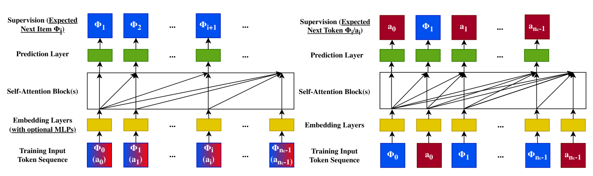

*图 8：传统序列推荐器（左）与生成式推荐器（右）的对比。为便于比较，左侧以因果自回归设置展示且动作类型 $a_i$ 被忽略或经 MLP 与物品信息 $\Phi_i$ 合并后再进入自注意力块。原文 Figure 8，第 19 页。*

重要的是，该表述不仅能正确建模数据分布，还使直接通过束搜索等方式采样推荐物品序列成为可能。我们假设这将优于传统 listwise 方法（如 DPP（Gillenwater et al., 2014）与 RL（Zhao et al., 2018）），此类系统的完整表述与评估（第 6 节简要讨论）留作未来工作。

## 附录 C. 评估：合成数据

如 3.1 节所述，标准 softmax 注意力的归一化因子使其难以捕捉用户偏好强度，而这对用户表示学习很重要。在推荐场景，系统除物品相对排序外还需预测交互强度（如某主题上未来的正向行为数）。为理解该行为，我们构造遵循 Dirichlet Process 的合成数据，在动态词表上生成流式数据。Dirichlet Process 刻画了用户交互历史中"富者愈富"的行为。合成实验设置如下：

- 将 20,000 个物品 ID 随机等分到 100 个类目。
- 生成 1,000,000 条长度 128 的记录，前 90% 训练、后 10% 测试。为模拟流式训练，最初 40% 的物品 ID 可用，其余以等间隔逐步可用：即第 500,000 条记录时可采样的最大 ID 为 $(40\% + 60\% \times 0.5) \times 20{,}000 = 14{,}000$。
- 每条记录从 100 个类目中随机选至多 5 个，并在其上随机采样先验 $H_c$。对每个位置按如下 Dirichlet process 顺序采样类目（n > 1 时）：
  - 以概率 $\alpha / (\alpha + n - 1)$ 从 $H_c$ 抽取类目 c；
  - 以概率 $n_c / (\alpha + n - 1)$ 抽取类目 c，其中 $n_c$ 是此前类目为 c 的物品数；
  - 在流式约束下随机采样一个类目为 c 的物品。

其中 α 从 (1.0, 500.0) 均匀随机采样。结果见表 2。该数据集无时间戳，我们对 HSTU 总是消融 $r^{ab}_{p,t}$。观察到 HSTU 相对标准 Transformer 将 HR@10 提升超过 100%；重要的是，把 HSTU 的逐点注意力换成 softmax（"HSTU w/ Softmax"）也导致 HR 显著下降，验证了逐点注意力式聚合机制的重要性。

## 附录 D. 评估：传统序列推荐基线

4.1.1 节的评估聚焦 HSTU 与采用最新训练配方的 SOTA Transformer 基线 SASRec 的比较。本节再考虑两个替代方法。

**循环神经网络（RNN）**。考虑经典序列推荐工作 GRU4Rec（Hidasi et al., 2016），帮助读者理解自注意力模型（Transformer 与 HSTU）在完全纳入最新建模与训练改进后与传统 RNN 的对比。

**自监督序列方法**。考虑最流行的 BERT4Rec（Sun et al., 2019），理解双向自监督（BERT4Rec 的 Cloze 目标）与 SASRec、HSTU 等单向因果自回归设置的对比。

表 12：传统序列推荐设置（多遍全量 shuffle）下的方法评估（与表 4 相比补充了 GRU4Rec 与 BERT4Rec 两个基线）。原文 Table 12，第 20 页。

| 数据集 | 方法 | HR@10 | HR@50 | HR@200 | NDCG@10 | NDCG@200 |
| --- | --- | --- | --- | --- | --- | --- |
| ML-1M | SASRec (2023) | .2853 | .5474 | .7528 | .1603 | .2498 |
| ML-1M | BERT4Rec | .2843（-0.4%） | – | – | .1537（-4.1%） | – |
| ML-1M | GRU4Rec | .2811（-1.5%） | – | – | .1648（+2.8%） | – |
| ML-1M | HSTU | .3097（+8.6%） | .5754（+5.1%） | .7716（+2.5%） | .1720（+7.3%） | .2606（+4.3%） |
| ML-1M | HSTU-large | .3294（+15.5%） | .5935（+8.4%） | .7839（+4.1%） | .1893（+18.1%） | .2771（+10.9%） |
| ML-20M | SASRec (2023) | .2906 | .5499 | .7655 | .1621 | .2521 |
| ML-20M | BERT4Rec | .2816（-3.4%） | – | – | .1703（+5.1%） | – |
| ML-20M | GRU4Rec | .2813（-3.2%） | – | – | .1730（+6.7%） | – |
| ML-20M | HSTU | .3252（+11.9%） | .5885（+7.0%） | .7943（+3.8%） | .1878（+15.9%） | .2774（+10.0%） |
| ML-20M | HSTU-large | .3567（+22.8%） | .6149（+11.8%） | .8076（+5.5%） | .2106（+30.0%） | .2971（+17.9%） |
| Books | SASRec (2023) | .0292 | .0729 | .1400 | .0156 | .0350 |
| Books | HSTU | .0404（+38.4%） | .0943（+29.5%） | .1710（+22.1%） | .0219（+40.6%） | .0450（+28.6%） |
| Books | HSTU-large | .0469（+60.6%） | .1066（+46.2%） | .1876（+33.9%） | .0257（+65.8%） | .0508（+45.1%） |

结果见表 12。BERT4Rec 与 GRU4Rec 在 ML-1M、ML-20M 上的结果复用 Klenitskiy & Vasilev (2023) 的报告值。由于使用 sampled softmax 损失，我们将负样本数固定（ML-1M/ML-20M 为 128，Amazon Books 为 512）以保证方法间公平。结果证实：使用 sampled softmax 损失时 SASRec 仍是传统序列推荐中最有竞争力的方法之一（Zhai et al., 2023a; Klenitskiy & Vasilev, 2023），而 HSTU 显著优于所评估的 Transformer、RNN 与自监督双向 Transformer。

## 附录 E. 评估：传统 DLRM 基线

第 4 节使用的 DLRM 基线配置凝聚了数百名研发人员多年的持续迭代，非常接近 HSTU/GR 部署前一个数十亿 DAU 大型互联网平台的生产配置。以下简述所用模型。

**排序设置**。基线排序模型如（Mudigere et al., 2022）所述，使用约一千个稠密特征与五十个稀疏特征，并纳入 MoE（Ma et al., 2018）、DCN 变体（Wang et al., 2021）、包括 target-aware 成对注意力在内的多种序列模块（工业常用变体见（Zhou et al., 2018））以及特殊交互层上的残差连接（He et al., 2015; Zhang et al., 2022）。scaling law 小节（4.3.1）的低 FLOPs 区间，为达到目标 FLOPs，部分高计算成本模块被简化或替换为 DCN 等 SOTA 变体。出于保密无法披露确切设置；据我们所知，在充分纳入近期研究的前提下，该基线代表了已知最好的 DLRM 方案之一。为验证这一说法并帮助读者理解，我们在表 7 中报告了使用相同特征、但只用公开发表组件（DIN（Zhou et al., 2018）、DCN（Wang et al., 2021）、MMoE（Ma et al., 2018））的典型设置（"DLRM (DIN+DCN)"），组合架构见图 9。该设置在主要 E-Task 上比我们的生产 DLRM 差 0.71% NE，主要 C-Task 上差 0.57% NE（0.1% NE 即显著）。

**检索设置**。基线检索模型采用标准双塔结构（Covington et al., 2016），混合批内/批外采样。输入特征包括高基数稀疏特征（物品 ID、用户 ID）与低基数稀疏特征（语言、主题、兴趣实体）。带残差连接的前馈层堆（He et al., 2015）将输入特征压缩为用户与物品嵌入。

**特征与序列长度**。两个 DLRM 基线所用的特征——包括各序列编码器/成对注意力模块使用的主用户交互历史——是所有 GR 候选所用特征的严格超集。这适用于本文全部研究，包括 scaling 研究（4.3.1 节）。

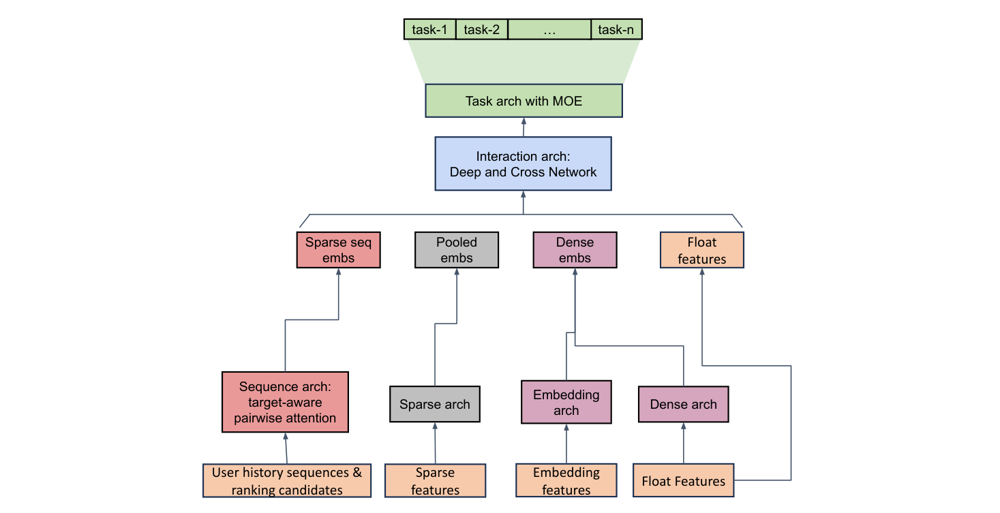

*图 9：基线 DLRM 排序模型（表 7 中"DLRM (DIN+DCN)"）的高层架构，使用 DIN（Zhou et al., 2018）、DCN（Wang et al., 2021）与 MMoE（Ma et al., 2018）等公开发表组件。原文 Figure 9，第 21 页。*

表 13：随机长度子序列选择方法对模型质量（NE）的影响。原文 Table 13，第 21 页。

| 指标 | 选择方式 | Greedy | Weighted | Random |
| --- | --- | --- | --- | --- |
| 主要互动指标（NE） | – | 0.495 | 0.494 | 0.495 |
| 主要消费指标（NE） | – | 0.792 | 0.789 | 0.791 |

## 附录 F. 随机长度（Stochastic Length）

### F.1. 子序列选择

式 (4) 中我们从完整用户历史选择长度 L 的子序列以增加稀疏度。经验结果表明，精心设计子序列选择方法可以改善模型质量。我们计算度量 $f_i = t_n - t_i$（用户与物品 $x_i$ 交互以来经过的时间），离线实验了以下子序列选择方法：

- **Greedy Selection**：从 S 中选 $f_i$ 值最小的 L 个物品。
- **Random Selection**：从 S 中随机选 L 个物品。
- **Feature-Weighted Selection**：按加权分布 $1 - f_{n,i} / (\sum_{j=1}^{L} f_{j,i})$ 从 S 中选 L 个物品。

离线实验中，特征加权子序列选择取得最佳模型质量（表 13）。

### F.2. 随机长度对序列稀疏度的影响

表 3 展示了 30 天用户交互历史的代表性工业配置下 SL 对序列稀疏度的影响。序列稀疏度定义为 1 减去所有样本平均序列长度与最大序列长度之比。为更好刻画稀疏注意力的计算成本，我们还定义 $s^2$（注意力矩阵非稀疏比例的补）。60 天与 90 天用户交互历史的参考结果见表 14 与表 15。

表 14：SL 对序列稀疏度的影响（60 天用户交互历史）。原文 Table 14，第 22 页。

| α | 1,024 稀疏度 | 1,024 s² | 2,048 稀疏度 | 2,048 s² | 4,096 稀疏度 | 4,096 s² | 8,192 稀疏度 | 8,192 s² |
| --- | --- | --- | --- | --- | --- | --- | --- | --- |
| 1.6 | 71.5% | 89.4% | 75.8% | 92.3% | 79.4% | 94.7% | 83.8% | 97.3% |
| 1.7 | 57.3% | 77.6% | 60.6% | 79.8% | 67.3% | 86.6% | 74.5% | 93.3% |
| 1.8 | 37.5% | 56.2% | 42.6% | 62.1% | 51.9% | 74.2% | 62.6% | 85.5% |
| 1.9 | 15.0% | 25.2% | 17.7% | 29.0% | 29.6% | 47.5% | 57.8% | 80.9% |
| 2.0 | 1.2% | 1.7% | 2.5% | 3.5% | 18.9% | 30.8% | 57.6% | 80.6% |

表 15：SL 对序列稀疏度的影响（90 天用户交互历史）。原文 Table 15，第 22 页。

| α | 1,024 稀疏度 | 1,024 s² | 2,048 稀疏度 | 2,048 s² | 4,096 稀疏度 | 4,096 s² | 8,192 稀疏度 | 8,192 s² |
| --- | --- | --- | --- | --- | --- | --- | --- | --- |
| 1.6 | 68.0% | 85.0% | 74.6% | 90.8% | 78.6% | 93.5% | 83.5% | 97.3% |
| 1.7 | 56.3% | 76.1% | 61.2% | 80.6% | 67.5% | 87.0% | 74.3% | 93.3% |
| 1.8 | 38.9% | 58.3% | 42.0% | 61.3% | 50.4% | 72.4% | 61.0% | 84.4% |
| 1.9 | 16.2% | 27.3% | 17.3% | 28.6% | 27.2% | 44.4% | 54.3% | 77.8% |
| 2.0 | 0.9% | 1.2% | 1.6% | 2.1% | 13.5% | 22.5% | 54.0% | 77.4% |

### F.3. 与序列长度外推技术的比较

我们做了额外研究验证 SL 相对语言建模中现有序列长度外推技术的竞争力。许多现有方法通过修改 RoPE（Su et al., 2023）做长度外推。为对比，我们训练了一个无相对注意力偏置、用旋转嵌入的 HSTU 变体（HSTU-RoPE）。

在 HSTU-RoPE 上评估以下长度外推方法：

- **Zero-Shot**：应用 NTK-Aware RoPE（Peng et al., 2024）后直接评估，不微调；
- **Fine-tune**：应用 NTK-by-parts（Peng et al., 2024）后微调 1000 步。

在 HSTU（含相对注意力偏置、无旋转嵌入）上评估：

- **Zero-Shot**：按最大训练序列长度截断相对位置偏置后直接评估（Raffel et al., 2020; Press et al., 2022）；
- **Fine-tune**：同上截断后微调 1000 步再评估。

表 16：SL 与现有长度外推方法的比较。原文 Table 16，第 23 页。

| 评估策略 | 模型类型 | 2048 / 52% 稀疏度平均 NE 差 | 4096 / 75% 稀疏度平均 NE 差 |
| --- | --- | --- | --- |
| Zero-shot | HSTU（Raffel et al., 2020） | 6.46% | 10.35% |
| Zero-shot | HSTU-RoPE（Peng et al., 2024） | 7.51% | 11.27% |
| Fine-tune | HSTU（Raffel et al., 2020） | 1.92% | 2.21% |
| Fine-tune | HSTU-RoPE（Peng et al., 2024） | 1.61% | 2.19% |
| 随机长度（SL） | HSTU | 0.098% | 0.64% |

表 16 报告了训练时引入数据稀疏（SL、zero-shot、fine-tuning）的模型与全量数据训练模型的 NE 差。zero-shot 与 fine-tuning 的稀疏度定义为训练平均序列长度除以评估最大序列长度。所有 zero-shot 与微调模型在 1024 序列长度数据上训练，在 2048 与 4096 序列长度数据上评估。为给这些方法找到合适的 SL 基线，我们选取产生相同数据稀疏度指标的 SL 设置。

我们认为 zero-shot 与微调式长度外推不适合处理高基数 ID 的推荐场景。经验上 SL 显著优于两者。我们认为原因可能在我们的词表很大：zero-shot 与微调方法难以为较旧 ID 学到好表示，从而无法充分利用长序列中的信息。

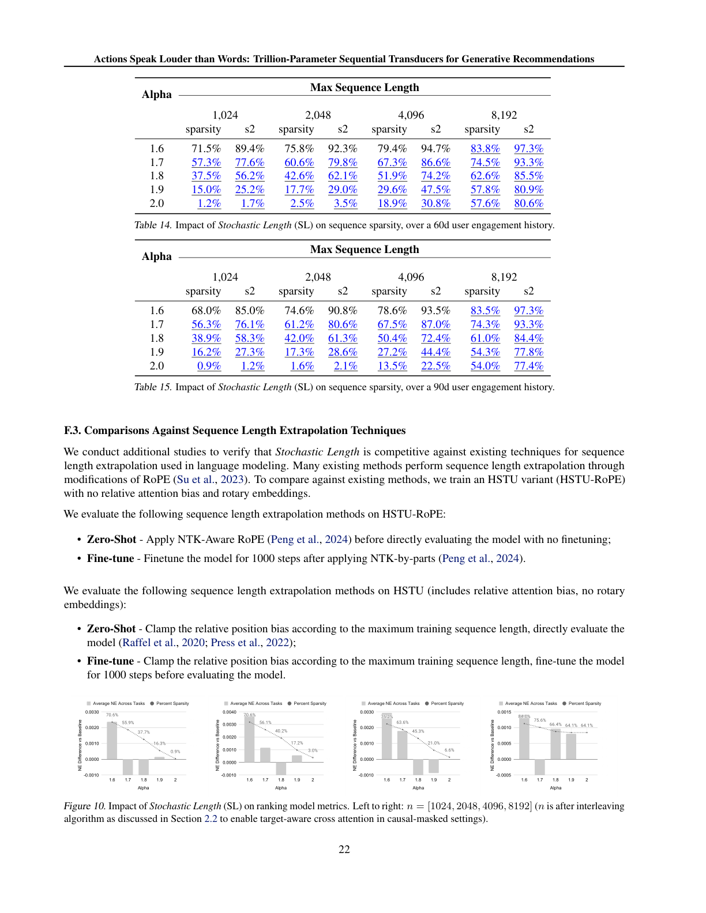

*图 10：随机长度（SL）对排序模型指标的影响，从左到右 n = [1024, 2048, 4096, 8192]（n 为 2.2 节交织算法启用 target-aware 交叉注意力后的长度）。整页参考图，原图为原文 Figure 10，第 22 页。*

## 附录 G. 稀疏分组 GEMM 与融合相对注意力偏置

本节补充 3.2 节介绍的高效 HSTU 注意力 kernel。该方法基于 Memory-efficient Attention（Rabe & Staats, 2021）与 FlashAttention（Dao et al., 2022）：将输入分块、避免为反向传播物化 h×N×N 的大中间注意力张量。利用输入序列的稀疏性，我们把注意力计算重排为一组形状各异的背靠背分组 GEMM，并实现高效 GPU kernel 加速。相对偏置的构造也是访存瓶颈，因此我们把相对偏置构造与分组 GEMM 融合为单个 GPU kernel，并在反向传播中用 GPU 快速共享内存累加梯度。虽然我们的算法需要在反向传播中重算注意力与相对偏置，但比 Transformer 标准方法显著更快、更省内存。

## 附录 H. M-FALCON 算法

本节详述 3.4 节的 M-FALCON 算法，伪代码见算法 1。M-FALCON 引入三个关键思想。

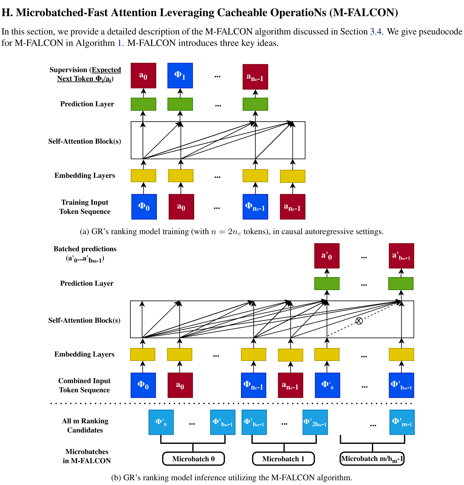

*图 11：M-FALCON 算法。上：GR target-aware 表述下的排序模型训练（n = 2nc 个 token，因果自回归设置）；下：m 个候选 $\Phi'_0, \ldots, \Phi'_{m-1}$ 被分成 ⌈m/bm⌉ 个微批的推理（虚线上方展示第一个微批）。自注意力算法经过修改使 $\Phi'_i$ 无法 attend 到 $\Phi'_j$（i ≠ j），图中以"×"标示。原文 Figure 11，第 24 页。*

**批式推理可用于因果自回归设置**。如 2.2 节所述，GR 的排序任务以 target-aware 方式表述。一般观点认为 target-aware 设置必须逐物品推理，m 个候选、序列长度 n 的成本为 $O(mn^2d)$。这里我们说明这并非最优：即便用原生 Transformer，也可以修改自注意力的注意力掩码来批量执行这类操作（"batched inference"），把成本降到 $O((n+m)^2d) = O(n^2d)$。

图 11 提供了说明。图 11(a) 与 (b) 都使用因果自回归设置的注意力掩码矩阵，关键区别在于：(a) 用标准 2nc 大小的下三角矩阵做因果训练；(b) 将 2nc + bm 大小的下三角矩阵中满足 $i, j \ge 2nc, i \ne j$ 的条目设为 False 或 $-\infty$，阻止目标位置 $\Phi'_0, \ldots, \Phi'_{b_m-1}$ 相互注意。容易看出，这样 self-attention block 对 $\Phi'_i, a'_i$ 的输出只依赖 $\Phi_0, a_0, \ldots, \Phi_{n_c-1}, a_{n_c-1}$ 而与 $\Phi'_j$（i ≠ j）无关。换言之，用修改后的注意力掩码对 (2nc + bm) 个 token 做一次前向，最后 bm 个 token 的结果与"把 $\Phi'_i$ 放在第 2nc 位（0-based）、用标准因果掩码做 bm 次独立前向"完全一致。

**微批将批式推理扩展到大规模候选集**。排序阶段可能面对多达数万候选（Wang et al., 2020）。我们将 m 个候选分成 $\lceil m/b_m \rceil$ 个大小为 $b_m$ 的微批，使 $O(b_m) = O(n)$，对大多数实际推荐器（直到数万候选）保持前述 $O((n+m)^2d) = O(n^2d)$ 的运行时间。

**编码器级缓存在请求内与请求间共享计算**。KV 缓存（Pope et al., 2022）可同时用于请求内与请求间。例如对本文的 HSTU 模型（第 3 节），K(X) 与 V(X) 可跨微批（请求内和/或跨请求）完全缓存。对缓存的前向，只需为最后 bm 个 token 计算 U(X)、Q(X)、K(X)、V(X)，而含 n 个 token 的序列化用户历史复用缓存的 K(X) 与 V(X)；$f_2(\text{Norm}(A(X)V(X)) \odot U(X))$ 同样只需对 bm 个候选重算。这将缓存前向的计算复杂度降到 $O(b_md^2 + b_mnd)$，即便 $b_m = n$ 也比 $O((n+b_m)d^2 + (n+b_m)^2d)$ 好 2-4 倍。

**算法 1 M-FALCON 算法。**

```
输入：合并 token 序列 x0, x1, …, xn-1（例如 (Φ0, a0, …, Φnc-1, anc-1)，n = 2nc）；
      m 个排序候选 Φ'0, …, Φ'm-1；
      在因果自回归设置下训练的 b 层 h 头自注意力模型（如 HSTU 或 Transformer）
        f(X, cacheStates, attnMask) → (X', updatedCacheStates)；
      微批大小 bm（为简洁假设 m 是 bm 的倍数）。
输出：全部 m 个排序候选的预测 (a'0, …, a'm-1)。
1:  numMicrobatches = (m + bm − 1) // bm
2:  attnMask = Ln+bm   {下三角矩阵，下三角条目为 0，其余为 −∞}
3:  attnMask[i, j] = −∞  for i, j ≥ n, i ≠ j   {阻止最后 bm 个条目相互注意}
4:  (a'0, a'1, …, a'bm−1), kvCache ← f(embLayer((x0, …, xn−1, Φ'0, …, Φ'bm−1)), ∅, attnMask)
5:  predictions = (a'0, a'1, …, a'bm−1)
6:  i = 1
7:  while i < numMicrobatches do
8:      (a'bmi, a'bmi+1, …, a'bm(i+1)−1) ←
          f(embLayer((x0, …, xn−1, Φ'bmi, …, Φ'bm(i+1)−1)), kvCache, attnMask)
9:      predictions ← predictions + (a'bmi, a'bmi+1, …, a'bm(i+1)−1)
10:     i ← i + 1
11: end while
12: return predictions
```

M-FALCON 不仅适用于 HSTU 与 GR，也广泛适用于其他基于自注意力架构的 target-aware 因果自回归设置，是一种通用的推理优化算法。

### H.1. 推理吞吐评估：GR（含 M-FALCON）vs DLRM

如 3.4 节所述，M-FALCON 并行处理 bm 个候选以在推理时把计算成本摊销到全部 m 个候选。为理解该设计，我们在相同硬件上比较 GR 与 DLRM 的吞吐（每秒评分候选数，QPS）。

如图 12 与图 13 所示，由于批式推理的成本摊销，GR 的吞吐相对排序候选数（m）呈亚线性扩展，直到某个区域（本案例研究中 m = 2048）。这印证了批式推理在因果自回归设置中的关键性。由于注意力复杂度按 $O((n+b_m)^2)$ 扩展，利用多个微批本身即可提升吞吐；缓存则在微批之上进一步消除冗余的线性与注意力计算。两者合计，相对单微批（bm = m = 1024）基线最多带来 1.99 倍额外加速（图 13）。总体上，凭借高效 HSTU 编码器与 M-FALCON，基于 HSTU 的 GR 在大规模生产设置中的吞吐最高达 DLRM 的 2.99 倍——尽管 GR 的 FLOPs 复杂度是 DLRM 的 285 倍。

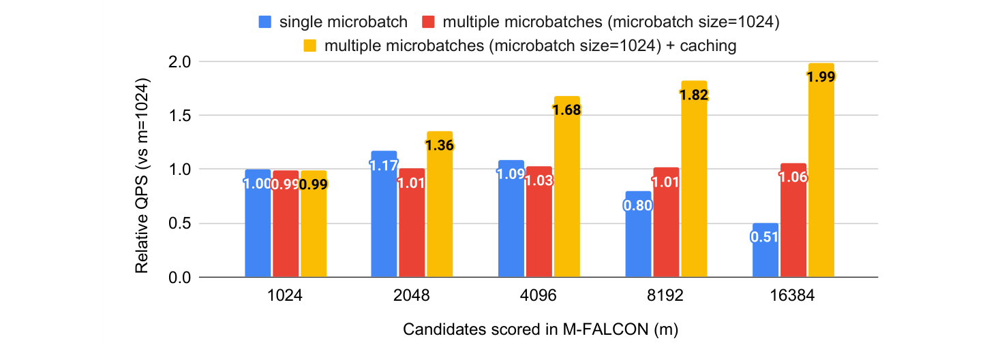

*图 13：端到端推理吞吐：M-FALCON 的吞吐扩展，基于 285x FLOPs 的 GR 模型，m 从 1024 到 16384，bm = 1024。多微批 + 缓存相对单微批最多提升 1.99 倍。原文 Figure 13，第 26 页。*

> 译注：原文 Figure 12（第 26 页）与正文 Figure 6（第 8 页）内容相同，为 DLRM vs GR 端到端推理吞吐对比，本文档以 Figure 6 的裁剪图为准，未重复裁剪 Figure 12。

