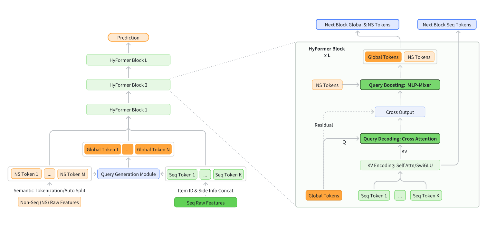
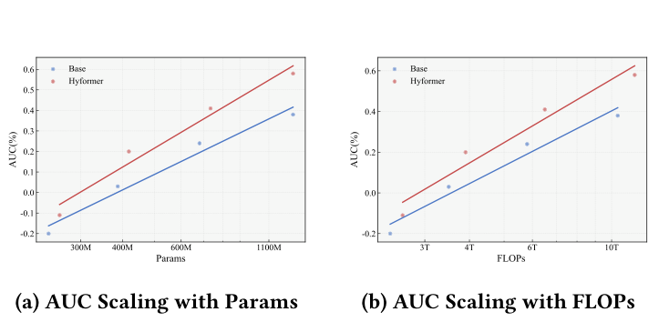

# HyFormer 精读：字节把长序列建模和特征交互塞进了一个 Transformer（arXiv 2601.12681）

> 论文：HyFormer: Revisiting the Roles of Sequence Modeling and Feature Interaction in CTR Prediction（arXiv:2601.12681v2），字节跳动 AML 与搜索团队。完整中文译稿见同目录 `../translation/paper.zh-CN.md`。

## 论文要解决的问题

工业推荐模型这几年收敛到一条固定流水线：先用 LONGER、TWIN 这类序列模型把长行为序列压成一两个压缩 token，再把压缩结果与用户画像、上下文、交叉特征一起送进 RankMixer 这类特征交互模块。字节自己的抖音搜索 CTR 模型就是"LONGER + RankMixer"的组合。这条"先序列、后交互"的路线能扩展、好部署，但论文认为它有三个结构性缺陷：序列压缩用的 query token 只由候选相关特征的一小部分派生，聚合长期兴趣时可用的上下文太少，而直接增加 query 数又会在 KV-Cache 和 M-FALCON 这类服务优化下明显变慢；序列 token 与异构特征的交互被推迟到压缩之后，浅而隐式；交互模块只作用于压缩表示，加参数、加序列长度主要让孤立组件变强，算力换不来联合表征的提升——scaling 效率低。

HyFormer 的答案是：不把序列编码和 token 混合当两个松耦合阶段，而是在单一骨干网里让两者逐层交替、双向影响。

## 方法：Query Decoding 与 Query Boosting 交替

HyFormer 引入一组 Global Token 作为长序列与异构特征之间的共享语义接口，每个 HyFormer 层做两件事。

**Query Decoding（查询解码）**：query 不再只是候选特征，而是由全部非序列特征加上序列均值池化摘要经轻量 FFN 生成（式 3-4）；这些 query 对长序列的逐层 K/V 表示做交叉注意力，把序列信息吸收进 query。序列编码器提供三档可插拔实现——完整 Transformer、LONGER 式交叉注意力（复杂度 O(L_H·L_S)）、无注意力的 SwiGLU——按延迟预算选择，且 K/V 每层重算，序列表征随解码深度一起演化。深层的 query 不重新生成，直接用上一层的解码输出：每层都是用"语义更丰富的 query"重新审问长序列。

**Query Boosting（查询增强）**：解码后的 query 与非序列 token 拼接，做 RankMixer 式的 MLP-Mixer token 混合（切子空间、跨 token 拼接、逐 token FFN、残差回加），强化跨 query 与跨序列交互，然后送入下一层解码。

图 1 是完整数据流：左侧为整体堆叠，右侧为单个 HyFormer Block 内"Global/NS Token → Query Boosting → Query Decoding（Q 来自 Global Token，KV 来自序列编码）"的循环。

*图 1：HyFormer 架构总览。右图为单个 HyFormer Block：Query Decoding 用 Global Token 作 Q、长序列逐层编码作 KV；Query Boosting 用 MLP-Mixer 混合 Global Token 与 NS Token。来源：论文 Figure 1，第 4 页。*

**多序列处理**是另一个关键设计。抖音搜索场景有三条序列（3000 长的长期序列、top-50 搜索序列、top-50 feed 序列），特征空间互不相同。MTGR/OneTrans 的做法是合并序列统一建模，HyFormer 的实验发现合并会掉点（-0.06% AUC），于是每条序列配一组专属 global token、独立做 K/V 编码和解码，跨序列交互推迟到 query 级 token 混合中完成。这还带来一个部署红利：序列编码与交互层的维度、深度可以独立扩展。

工程侧有两项值得注意的优化：长序列特征先去重再传输（唯一 ID 只占约 25%），在 GPU 上用定制算子重建序列；梯度同步用异步 AllReduce，稠密参数接受一步滞后（W_k = W_{k-1} + g_{k-1}），论文称实测不影响收敛。

## 实验结果

实验在抖音搜索 CTR 数据上做：70 天日志、30 亿样本，离线指标为 Query 级 AUC，所有模型对齐 batch size 与超参、64 GPU 训练。

表 1（原文 Table 1，第 7 页）的主结果：HyFormer AUC 0.6489，比生产基线 LONGER + RankMixer（0.6478）高 +0.17%，参数 418M；更重要的是 FLOPs 只有 3.9×10¹²——完整版的 MTGR/OneTrans 要 21.9×10¹² FLOPs 才到 0.6483，约 5.6 倍算力换来的还是更低的 AUC。两阶段范式内最优组合（完整 Transformer 序列 + RankMixer，0.6481）也不及 HyFormer。

消融（Table 2）回答了"收益从哪来"。把 HyFormer 的 query 退化为只有目标特征，掉 0.08% AUC；去掉跨序列池化 token 掉 0.05%。最能说明问题的一组对照：在 BaseArch 上加 Global Token（只加信息、不换架构），AUC 只从 -0.17% 收窄到 -0.14%；同样的 query 扩展放进 HyFormer 架构，贡献是 +0.08%。收益主要来自双向交互的架构本身，信息只是燃料。

扩展性方面（Figure 3），参数从 300M 加到 1100M、FLOPs 从 3T 到 10T，HyFormer 的 AUC 曲线斜率显著陡于基线，随 FLOPs 呈强幂律。序列侧信息的实验（Table 3）补充了一个角度：把序列稀疏维度从 64（3 种侧信息）扩到 224（7 种），基线在 1k/3k 序列长度下分别只拿到 +0.09%/+0.06%，HyFormer 都拿到 +0.12%，且对基线的领先优势随序列变长从 +0.03% 扩大到 +0.06%——HyFormer 能把更丰富的序列 K/V 信息转化为收益，序列越长优势越大。

图 2 是参数与 FLOPs 两条 scaling 曲线，用于观察两种架构在加大算力时的收益分化。

*图 2：(a) AUC 随参数量（300M-1100M）的扩展；(b) AUC 随 FLOPs（3T-10T）的扩展。HyFormer（Hyformer）斜率均陡于 BaseArch。来源：论文 Figure 3，第 8 页。*

**在线 A/B**（Table 4，第 9 页）：抖音搜索全量流量级测试，对照 RankMixer 基线，人均观看时长 +0.293%，人均视频完播数 +1.111%，query 改写率（用户把搜索词改得更具体，负面体验指标）-0.236%。论文称 HyFormer 已在字节全面部署，日服务数十亿用户。

## 工程判断与证据边界

**结果的可信度**。这篇论文的工程可比性做得比较扎实：基线就是字节现役生产模型 LONGER + RankMixer，特征、token 预算（16 个）、超参全部对齐。但 +0.17% 的离线 AUC 是强基线上的小增量，论文未报告离线指标的方差或显著性；在线只有单次 A/B、且只对照 RankMixer，没有与 MTGR/OneTrans 的在线对比。MTGR/OneTrans 是作者复现的（含去掉序列内自注意力的简化版），复现忠实度无法核验——考虑到美团 MTGR 原文报告的是全量 token 联合建模，这里的对照设定偏向 HyFormer 的优势区。

**"双向"的边界**。论文反复强调双向信息流，但看数据流：序列的 K/V 每层只由序列 token 自己编码（式 5-8），全局与候选信息从不进入序列内部表征；所谓双向只发生在 query 侧——全局信息决定 query、query 决定从序列里取出什么。这是刻意的设计取舍：序列 K/V 与全局解耦，才能保住 KV-Cache 类服务优化的空间。代价是全局上下文无法修正序列内部的表征（例如不能根据候选调整序列内物品的相对重要性），这一更强统一形态论文没有做消融。读这篇论文时把 HyFormer 理解为"多层、多查询化的 DIN + RankMixer 交替堆叠"比"完全统一架构"更准确。

**可迁移的部分**。对已有"序列压缩 + 特征交互"两段式体系的团队，HyFormer 提供了一条渐进升级路径：先把单点 query 换成多 query 生成（非序列特征 + 序列池化摘要），再做逐层 K/V 重算的解码-增强堆叠，三档序列编码器按延迟预算选型。多序列独立建模、每序列分配 global token 配额的做法，对多业务序列（搜索+feed+电商）场景可以直接套用。scaling 曲线给出的信号是：这套架构下加算力比在两阶段架构上加算力更划算，这与 HSTU、Wukong 报告的结论方向一致——推荐模型的 scaling law 正在成为各家架构升级的共同论据。

**与 HSTU/TIGER 的位置关系**。TIGER 解决的是检索（生成式解码语义 ID），HSTU 把排序检索统一到序列转导并验证了万亿参数 scaling，HyFormer 则聚焦排序侧 CTR 预估，选择"序列 token 不被全局污染"的折衷统一。三者共同点是把长序列从压缩瓶颈里解放出来；分歧在于全局/候选信息何时进入序列表征——HyFormer 的答案是每层解码时、但只经 query。
