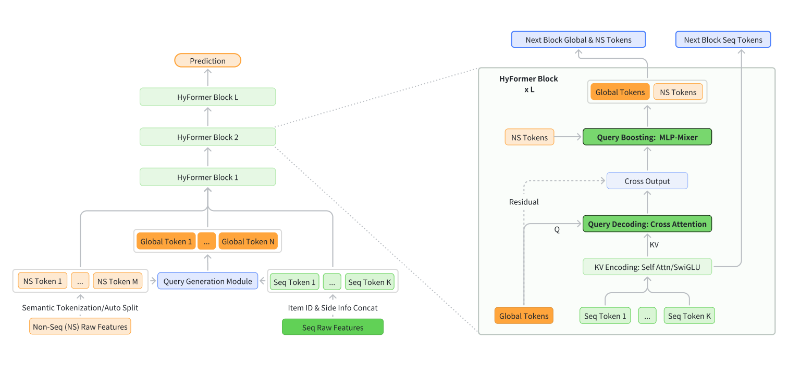
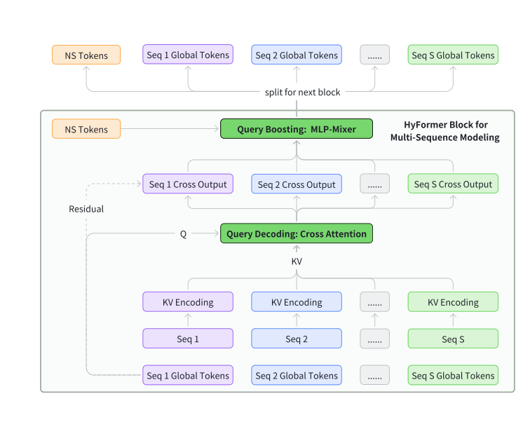
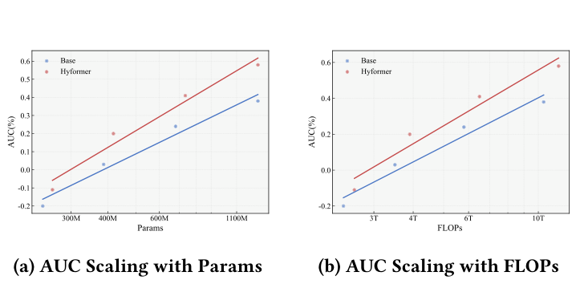

# HyFormer：重新审视 CTR 预估中的序列建模与特征分工

**作者**：Yunwen Huang*（ByteDance AML）、Shiyong Hong*（ByteDance Search）、Xijun Xiao*（ByteDance AML）、Jinqiu Jin*（ByteDance Search）、Xuanyuan Luo（ByteDance AML）、Zhe Wang（ByteDance Search）、Zheng Chai†（ByteDance AML）、Shikang Wu†（ByteDance Search）、Yuchao Zheng（ByteDance AML）、Jingjian Lin（ByteDance Search）

*共同一作；†通讯作者。arXiv:2601.12681v2 [cs.IR]，2026 年 1 月 23 日。

## 摘要

工业级大规模推荐模型（LRM）面临在严格效率约束下联合建模长程用户行为序列与异构非序列特征的挑战。然而，现有架构大多采用解耦式流水线：先用 LONGER 等基于 query token 的序列压缩器压缩长序列，再通过 RankMixer 等 token 混合模块与稠密特征融合，这同时限制了表征容量与交互灵活性。本文提出 HyFormer，一种统一的混合 Transformer 架构，将长序列建模与特征交互紧耦合到单一骨干网中。从序列建模的视角出发，我们重新审视并重新设计了 LRM 中的 query token，将 LRM 建模任务表述为一个交替优化过程，包含两个核心组件：Query Decoding（查询解码）将非序列特征扩展为 Global Token，并对长行为序列的逐层 key-value 表示执行长序列解码；Query Boosting（查询增强）通过高效的 token 混合强化跨查询与跨序列的异构交互。两个互补机制迭代执行，逐层精炼语义表征。在十亿级工业数据集上的大量实验表明，在相近参数量与 FLOPs 预算下，HyFormer 持续优于强大的 LONGER 与 RankMixer 基线，并随参数与 FLOPs 增长展现出更优的扩展行为。高流量生产系统的大规模在线 A/B 测试进一步验证了其有效性，相对已部署的 SOTA 模型取得显著收益。这些结果凸显了 HyFormer 作为工业 LRM 统一建模框架的实用性与可扩展性。

**CCS 概念**：信息系统 → 推荐系统。

**关键词**：特征交互、大规模推荐模型、长序列建模、Scaling Law

## 1 引言

现代工业大规模推荐模型（LRM）运行在日益复杂的环境中，准确预测依赖对长程用户行为历史与丰富异构特征（用户画像、上下文信号、交叉特征）的联合建模。随着用户互动时间跨度延长、特征空间持续扩张，有效整合长序列信号与高维非序列信息已成为大规模推荐与搜索系统的核心挑战。为应对该挑战，近期工业架构大体收敛到一种分离式扩展范式：长序列建模 [1, 18, 29] 与特征交互 [6, 10, 19, 20] 相结合。该范式下，用户长行为序列由专用序列 Transformer 编码以捕捉时序依赖与用户兴趣，压缩后的序列 token 再通过 token 混合或交互模块与其他异构特征混合，实现跨特征推理。这条"先长序列建模、后异构特征交互"的流水线已被证明有效，并成为扩展现代工业 LRM 的主流设计。尽管经验性能强劲，这一主流范式从根本上强制了压缩式、晚融合、单向的交互模式。随着序列长度与模型容量持续增长，两阶段设计的根本局限开始显现，同时制约建模表达力与可扩展性：

- 现有架构中的序列 Transformer 在序列压缩时往往依赖过度简化的 query 表示 [5, 26, 27]。实践中，用于聚合长行为序列的 query token 通常只由候选相关或全局特征的一个小子集派生，限制了建模长期用户兴趣时可以利用的上下文信息量。而直接增加 query token 数量，会在 KV-Cache 与 M-Falcon 机制 [2, 22] 下导致服务效率显著下降。

- 序列压缩 token 与异构非序列 token 的交互通常只发生在模型后期。当前范式下，跨特征推理被推迟到序列压缩之后，导致不同 token 类型之间浅层且隐式的交互。这种延迟融合限制了模型捕捉多条行为序列与异构特征组之间细粒度依赖的能力，并使浅层表征无法从跨域上下文信息中获益。

- 由于交互模块只作用于压缩后的序列表示，增加模型容量或序列长度主要改善孤立组件，而非增强联合表征。结果是加深网络或加大参数带来更低的扩展效率——性能提升相对新增计算预算的增速放缓，因为计算没有被有效转化为更丰富的联合表征。

这些局限促使我们从根本上重新思考长程序列建模与异构特征交互应如何整合。与其把序列编码和 token 混合当作松耦合的两个阶段，不如需要一个统一建模框架，让序列与非序列信号之间实现更深、更早、双向的交互。

本文提出 HyFormer，一种在单一骨干网中统一序列建模与特征交互的混合 Transformer 架构。HyFormer 引入一组 Global Token，充当长行为序列与异构特征之间的共享语义接口。通过堆叠式设计，HyFormer 在两个轻量但富有表达力的机制之间交替：Query Decoding 模块用全局 query token 对长行为序列的逐层 key-value 表示做注意力，让全局上下文直接塑造序列表征；Query Boosting 模块进一步通过高效 token 混合强化跨查询与跨序列交互，逐层渐进地丰富语义表征。该设计使序列建模与特征交互组件之间形成双向信息流，克服了传统解耦流水线的局限。在十亿级工业数据集上的大量实验表明，在相近参数与 FLOPs 预算下，HyFormer 持续优于强大的序列型与 token 混合型基线；此外，HyFormer 相对模型 FLOPs 与参数展现出更优的扩展行为，并在高流量生产系统的大规模在线 A/B 测试中取得显著收益。

总结而言，本文贡献如下：

- 我们指出大规模工业推荐系统中流行的解耦式"序列建模+特征交互"范式的根本局限，分析其单向、晚融合设计如何制约建模容量与可扩展性。
- 我们提出 HyFormer，一种统一的混合 Transformer 架构，通过 Query Decoding 与 Query Boosting 实现长程行为序列与异构特征之间双向、逐层的交互，在真实工业场景取得 SOTA 性能与扩展性。
- 我们在十亿级工业数据集上实证验证了所提模型的有效性与卓越扩展性。目前 HyFormer 已在字节跳动全面部署，每天服务数十亿用户。

## 2 相关工作

### 2.1 传统推荐范式

现代工业 LRM 通常由两大组件构成：行为序列建模与特征交互网络。该范式下，用户行为历史先由专用序列模型编码，其输出再与异构非序列特征一起送入下游交互模块。近期工业系统沿此方向大幅推进了序列建模的扩展性。SIM [12]、ETA [4]、TWIN [3, 13]、TransAct [17]、LONGER [2] 等方法通过高效注意力、层级聚合、KV 缓存与服务友好设计，把序列编码器扩展到数百上千事件。这些工作在大流量下建模长程用户行为时展现了清晰的幂律扩展趋势，但基本保留了两阶段架构，序列编码与特征交互相互解耦。

特征交互方面，DeepFM [7]、xDeepFM [11]、DCNv2 [16] 等早期模型能大规模建模低阶或有界阶数的特征交叉，但交互深度增加后收益递减。Wukong [24]、RankMixer [28] 等近期扩展研究表明，跨模块扩展已成为工业性能的关键驱动。这些模型代表了当前大规模特征交互设计的水平，但在多数生产流水线中，交互堆栈与序列编码器仍然松耦合，造成晚融合，无法对异构信号统一优化。

### 2.2 统一推荐架构

为弥合序列建模与特征交互的割裂，近期研究探索在单一骨干网内处理异构信号的统一架构。HSTU [23] 等层级生成式架构以序列转导为基础、条件化于上下文与候选信号，代表了统一的推荐范式。InterFormer [21] 引入可学习的交互 token，实现序列编码器与交互网络之间的双向信号交换。MTGR [8] 更进一步，把用户、行为、实时与候选特征重组为异构 token，用共享的 Transformer 式骨干网编码，使序列信息与交叉特征得以一致建模。MTGR 之后，OneTrans [25] 方向类似：用单个 Transformer 联合捕捉序列依赖与高阶特征交互，同时用金字塔压缩式结构简化 Transformer，可视为相对 MTGR 的简化版本。

由于 MTGR [8] 与 OneTrans [25] 只是把 query token 数量增加到全部非序列 token 的数量，实践中可以观察到服务效率的显著下降（见第 4 节）。此外，对工业级 LRM 而言，用统一的 Transformer 结构做特征交互通常并不充分 [28]。总体而言，统一架构代表了消解序列模型与特征交互堆栈长期分离的一步，但如何以最小架构开销实现完全统一仍是开放挑战。

## 3 方法

### 3.1 问题定义

设 U 与 I 为用户与物品空间。对用户 $u \in U$，记原始行为历史为 $S = [i_1^{(u)}, \ldots, i_K^{(u)}]$，每个 $i_t^{(u)} \in I$；$u$ 表示伴随的非序列描述信息，如画像属性、上下文信号与交叉特征。给定候选物品 $v \in I$，目标是估计用户 $u$ 与物品 $v$ 互动的概率：

$$P(y = 1 \mid S, u, v) \in [0, 1], \tag{1}$$

其中 $y \in \{0, 1\}$ 表示互动是否发生。模型参数从历史数据 $D = \{(S, u, v, y)\}$ 学习，最小化标准二元交叉熵目标：

$$\mathcal{L} = -\frac{1}{|D|} \sum_{(S,u,v,y) \in D} \left[ y \log \hat{y} + (1 - y) \log(1 - \hat{y}) \right], \tag{2}$$

其中 $\hat{y} = f_\theta(S, u, v)$ 为 LRM 产出的互动概率预测。

### 3.2 总体框架

传统 LRM 架构普遍采用流水线设计：先执行 LONGER [2] 式序列建模，再用包含压缩序列信息的 query token 做 RankMixer [28] 式特征交互。如前所述，这种分离式流水线对序列建模与异构特征交互的建模都不充分。为克服该局限，本工作提出统一混合框架，通过 HyFormer 层堆叠联合建模非序列（NS）token 与长行为序列。

HyFormer 总体架构见图 1。如图所示，每个 HyFormer 层集成两个互补机制：(1) Query Decoding：通过基于 MLP 的 query 生成把非序列与序列特征扩展为多个语义 Global Token（即序列 query），并对长序列 K/V 对执行交叉注意力，使全局信息直接塑造序列 token 的表征；(2) Query Boosting：施加 MLP-Mixer 式 token 混合，强化解码后 query 与非序列 token 之间的交互。

*图 1：HyFormer 架构总览。新架构引入由原序列建模中"候选物品"派生的 Global Token，并通过基于 MLP-Mixer 的特征交互提升长序列的 query 能力，将 LRM 建模任务表述为 Query Decoding 与 Query Boosting 模块交替执行的交替优化过程。原文 Figure 1，第 4 页。*

通过紧耦合全局异构特征混合与高效长序列建模，所提框架相比现有分离式流水线架构获得更丰富的异构交互、对序列结构的更深层利用以及更优的性能-计算成本比。

### 3.3 Query 生成

**3.3.1 输入 token 化。** 遵循 RankMixer [28] 的 token 化策略，输入 token 可按语义分组或自动切分组织。语义分组按内在含义划分 token（如用户、上下文或行为语义）；auto-split 把所有特征展平为单一嵌入后均匀切分、不做显式语义区分。实践中，鉴于我们的输入特征语义角色清晰，HyFormer 采用语义分组以保留结构化归纳偏置并提升可解释性。

**3.3.2 Query 生成。** Query 生成模块将异构非序列特征转换为用于解码长行为序列的语义 query token。所有非序列特征向量 $F_1, F_2, \ldots, F_M \in \mathbb{R}^{1 \times D}$ 拼接后经轻量前馈网络映射。此外，通过对行为序列表征做池化得到全局序列级摘要，作为额外共享输入，处理方式与非序列特征类似。

query 由非序列特征与池化序列摘要组合、经轻量投影生成：

$$Q = \left[ \text{FFN}_1(\text{Global Info}), \ldots, \text{FFN}_N(\text{Global Info}) \right] \in \mathbb{R}^{N \times D}, \tag{3}$$

其中

$$\text{Global Info} = \text{Concat}\left[F_1, \ldots, F_M, \text{MeanPool}(Seq)\right]. \tag{4}$$

为保持服务效率，该模块支持特征选择与可选的 query 压缩，在保持下游解码所需充分表征容量的同时，使生成的 query 数量保持稳定。

在更深的 HyFormer 层中，query 不再经由 MLP 重新生成。每一层复用上一层的 query，实际上是把更深层的交叉注意力输出当作更新后的 query，以渐进更丰富的语义"审问"长序列。

### 3.4 Query Decoding

Query Decoding 模块负责把非序列特征转换为语义 query，并通过交叉注意力从长行为序列中提取 target-aware 信息。借助序列表征编码模块产出的长序列逐层 key-value 表示，Query Decoding 模块用来自 Query 生成模块的多个 query token，通过 multi-query 交叉注意力机制解码 K/V 表示。

**3.4.1 序列表征编码。** HyFormer 支持多种容量-效率折衷的序列编码策略。给定行为序列 $S$，每种策略产出供后续解码使用的逐层 key-value 表示 $(K_l^{(s)}, V_l^{(s)})$。

(i) **Full Transformer 编码 [15]**。建模容量最高时，应用标准 Transformer 编码器：

$$H_l = \text{TransformerEnc}_l(S), \tag{5}$$

通过完整自注意力捕捉细粒度交互与长程依赖。

(ii) **LONGER [2] 式高效编码**。为提升长序列效率，用紧凑短序列与完整历史的交叉注意力替代完整自注意力：

$$H_l = \text{CrossAttn}(S_{\text{short}}, S, S), \tag{6}$$

其中 $S_{\text{short}}$ 是长度 $L_H \ll L_S$ 的紧凑短序列，作为 query；$S$ 同时充当 key 与 value。该表述以 $O(L_H L_S)$ 的复杂度替代 $O(L_S^2)$ 的完整自注意力。

(iii) **Decoder 式轻量编码**。对延迟敏感的场景，序列表示用无注意力的前馈操作变换：

$$H_l = \text{SwiGLU}_l(S), \tag{7}$$

以牺牲上下文容量换取最小计算成本。

所有变体的表征均经线性投影得到该层的 key-value 状态：

$$K_l = H_l W_l^K, \quad V_l = H_l W_l^V. \tag{8}$$

key-value 状态在每层重新计算，使序列特征随解码深度共同演化，同时支持灵活的部署配置。

**3.4.2 经交叉注意力的 Query Decoding。** 给定序列专属 query token 与对应的逐层 key-value 表示，HyFormer 通过交叉注意力执行 Query Decoding。对行为序列 $S$ 在第 $l$ 层，解码后的 query 表示为：

$$\tilde{Q}^{(l)} = \text{CrossAttn}\left(Q^{(l)}, K^{(l)}, V^{(l)}\right), \tag{9}$$

其中 CrossAttn(·) 为标准多头交叉注意力，$Q^{(l)} \in \mathbb{R}^{N \times D}$ 为第 $l$ 层使用的 query token。

该解码步骤让全局非序列特征直接 attend 到长行为序列，把上下文信号注入序列感知的 query 表示。解码后的 query $\tilde{Q}^{(l)}$ 随后作为后续交互与增强模块的语义接口。

### 3.5 Query Boosting

Query Boosting 模块在 query 送入下一层交叉注意力之前增强其表征。解码后，query 已编码序列感知信息，但与静态非序列异构特征的交互仍然不足。Query Boosting 通过显式混合跨 query token 的信息并注入额外非序列特征信号来解决这一不足。

对解码输出，统一 query 表示定义为

$$Q = \left[\tilde{Q}^{(l)}, F_1, \ldots, F_M\right] \in \mathbb{R}^{T \times D}, \tag{10}$$

其中 $T = N + M$，$\tilde{Q}^{(l)} \in \mathbb{R}^{N \times D}$ 为第 $l$ 层得到的解码 query token 集合，其余 $M$ 个 token 对应非序列特征嵌入。

具体地，增强模块施加受 RankMixer [28] 启发的 MLP-Mixer 式 [14] 轻量 token 混合来丰富解码后的 query。每个 query token $q_t \in Q$ 先被划分为 $T$ 个通道子空间：

$$q_t = \left[ q_t^{(1)} \| q_t^{(2)} \| \cdots \| q_t^{(T)} \right], \quad q_t^{(h)} \in \mathbb{R}^{D/T}. \tag{11}$$

对每个子空间索引 $h \in \{1, \ldots, T\}$，MLP-Mixer 通过拼接对应子空间聚合所有 token 位置的信息：

$$\tilde{q}_h = \text{Concat}\left(q_1^{(h)}, q_2^{(h)}, \ldots, q_T^{(h)}\right) \in \mathbb{R}^{D}. \tag{12}$$

收集全部混合 token 得到 token 混合表征

$$\hat{Q} = \left[\tilde{q}_1, \tilde{q}_2, \ldots, \tilde{q}_T\right] \in \mathbb{R}^{T \times D}. \tag{13}$$

混合后的 query 再经轻量的逐 token 前馈模块精炼：

$$\hat{e}{Q} = \text{PerToken-FFN}(\hat{Q}), \tag{14}$$

其中 PerToken-FFN(·) 对每个 query token 施加独立前馈变换，实现子空间粒度的精炼，同时保持线性计算复杂度。

最后施加残差连接以稳定优化并保留原始解码语义：

$$Q_{\text{boost}} = Q + \hat{e}{Q}. \tag{15}$$

增强后的 query 送入下一个 HyFormer 层，使更深的层以渐进更丰富、更具表达力的表示"审问"长行为序列。

> 译注：原文式 (14)(15) 中符号排版为 "e Q"，按上下文应为带帽符号（$\hat{Q}$ 之前的精炼输出），译文保留原文写法。

### 3.6 HyFormer 模块

HyFormer 模块由多层堆叠构成，每层由一个 Query Decoding 块接一个 Query Boosting 块组成。每层中，语义 query 经交叉注意力与长行为序列交互，所得序列感知表征再被精炼，作为更深层的输入。

形式化地，第 $l$ 层的 Query Decoding 块接收上层全局 query $Q^{(l-1)}$，对来自长序列的逐层 key-value 表示 $(K^{(l)}, V^{(l)})$ 执行交叉注意力：

$$\hat{Q}^{(l)} = \text{CrossAttn}\left(Q^{(l-1)}, K^{(l)}, V^{(l)}\right). \tag{16}$$

解码后的 query $\hat{Q}^{(l)}$ 与非序列 token 拼接后送入 Query Boosting 块，施加轻量的逐 token 变换丰富 query 表示：

$$\hat{e}{Q}^{(l)} = \text{QueryBoost}\left(\text{Concat}(\hat{Q}^{(l)}, \text{NS Tokens})\right). \tag{17}$$

堆叠多层后，HyFormer 渐进精炼语义 query，使更深层的层以越来越具表达力的表示抽象长序列。顶层 HyFormer 的输出送入下游 MLP 做最终预测，实现异构非序列特征与长行为序列在 LRM 中的高效灵活整合。

### 3.7 多序列建模

*图 2：HyFormer 的多序列建模。每条序列有专属 Global Token 与独立 KV 编码，跨序列交互通过 query 级 token 混合完成。原文 Figure 2，第 5 页。*

工业推荐场景中，用户行为往往组织为多条异构序列，例如视频观看序列与商品购买序列。由于实际多序列通常具有不同的特征空间与语义表示，我们经实验发现 MTGR [8] 或 OneTrans [25] 采用的简单序列合并会导致性能显著退化（见第 4 节）。因此 HyFormer 不把不同序列合并为单一统一流，而是出于效率与效果考虑，在每个 HyFormer 块中独立处理每条行为序列。如图 2 所示，每条序列构造一组专属 query token，用于对相应序列表征执行 Query Decoding。该设计在解码时保留序列专属语义，同时让跨序列交互留待 query 级 token 混合处理，无需显式拼接序列。

### 3.8 训练与部署优化

**3.8.1 长序列的 GPU Pooling。** 用户长序列特征可能极大，带来显著数据搬运开销（如 Host-to-Device 内存拷贝）与主机内存压力。幸运的是，这类序列中真正唯一的特征 ID 数量有限（通常只占总 token 的 25%）。我们利用该稀疏性做特征去重，大幅降低搬运成本与主机内存占用。具体做法：图执行前，特征存入压缩嵌入表；执行时，构建高性能前向算子直接在 GPU 上重建原始序列特征；反向传播时，配套的反向算子把序列特征的梯度聚合为嵌入表梯度，再向上传播更新稀疏参数。

**3.8.2 异步 AllReduce。** 为减少同步梯度聚合引入的空闲时间，系统启用异步 AllReduce：第 k 步的梯度同步与第 k+1 步的前反向计算重叠。该设计有效消除通信气泡、最大化 GPU 利用率。代价是为稠密参数引入一步滞后：由于其梯度要等异步规约完成才可用，更新规则变为 $W_k = W_{k-1} + g_{k-1}$，即第 k 步稠密参数使用上一步的梯度。相反，稀疏参数在局部梯度算出后立即更新，$W_k = W_{k-1} + g_k$，实际上比稠密参数更新超前一步。尽管这种混合更新调度带来稠密与稀疏参数状态之间较小的时间不一致，经验结果表明该滞后在实践中不损害收敛质量与模型性能。

## 4 实验

### 4.1 实验设置

**4.1.1 数据集。** 我们在字节跳动抖音搜索系统这一真实、大规模工业搜索推荐场景的 CTR 预估任务上评估模型。数据集来自 70 个连续天线的在线用户交互日志子集，共 30 亿样本。每个样本包含用户特征、查询特征、文档特征、交叉特征与若干序列特征。模型使用的三条主要序列定义如下：

- **长期序列**：用户长期搜索与点击行为序列，长度可按需裁剪，本文采用上限 3000；
- **搜索序列**：经 Query Search 模块过滤的用户 top-50 搜索行为物品；
- **Feed 序列**：经 Query Search 模块过滤的用户 top-50 feed 行为物品。

**4.1.2 基线。** 我们与多个强基线比较，分为两类架构范式：传统两阶段模型与统一架构模型。

传统两阶段模型（BaseArch）遵循主流设计：序列建模与特征交互分为先后两个阶段。序列表征先由专用序列建模模块生成，再与其他特征的 token 级表征做交叉。长序列建模用 LONGER [2] 或 Full Transformer [15]；token 化特征之间的交互用 RankMixer [28]、Full Transformer [15]、Wukong [24] 等成熟的特征交互架构。

统一块模型（UniArch）采用联合建模：序列与非序列特征都被 token 化并在单一模型块内同时处理，把序列建模与异构特征交互整合到一个统一阶段。例如 MTGR [8] 将所有特征 token 化并用 Transformer 式骨干联合建模；OneTrans [25] 类似但更简化，采用金字塔压缩结构做骨干。在我们的 MTGR/OneTrans 实现中，MTGR/OneTrans (LONGER) 只做非序列与序列特征之间的交叉注意力、不算序列内部自注意力；MTGR/OneTrans (Full Transformer) 则在序列上做完整自注意力，以更高 FLOPs 追求更好性能。

**4.1.3 评估指标。** 离线评估采用 Query 级 AUC：对每个 query 内的样本计算 AUC [9]，再对所有 query 取平均。同时报告稠密参数量与训练 FLOPs（后者按 batch size 2048 计算）。

**4.1.4 实现细节。** 为实验便利，推荐模型离线评估时冷启动，在线评估时用 checkpoint 预热。所有基线使用相同的 2048 batch size 与优化器设置。所有 MLP-Mixer 模块的输入 token 数对齐到 16。多序列 HyFormer 实现包含 13 个非序列 token 与 3 个全局 token（每序列一个），共 16 个 token。所有模型经相同的超参调优，实验在 64 GPU 集群上进行。

### 4.2 整体性能

**4.2.1 与现有方法比较。** HyFormer 在所有评估模型中取得最高 AUC，同时优于传统两阶段模型（BaseArch）与其他统一块模型（UniArch）。BaseArch 组内性能随组件选择显著变化：特征交互上 RankMixer [28] 一致优于 Self-Attention 与 Wukong [24]；序列建模上，序列内部引入完整自注意力通常有收益。值得注意的是，BaseArch 的最优组合（Full Transformer 序列建模 + RankMixer）仍不及 HyFormer，源于其单向信息流的固有限制。此外，HyFormer 展现出卓越的计算效率：取得最高精度的同时，总 FLOPs 只需 3.9×10¹²（含训练前向与反向），显著低于多数竞争者，包括 MTGR [8] 等高性能模型。整体结果凸显了传统两阶段范式的固有限制。HyFormer、MTGR 等统一架构表明把序列建模与特征交互整合进一致性设计能提升整体效果；但如表中所示，MTGR/OneTrans [8, 25] 依赖 Self-Attention 做特征交互——这种方式常常降低 AUC 并显著牺牲交互模块的计算效率 [28]。HyFormer 无需此类昂贵替换或序列 KV 侧的复杂建模即取得最佳精度，验证了统一块内迭代 query 解码与增强的核心设计原则。另外，MTGR/OneTrans 将 Global Token 与 Seq Token 合并为 key、只用 Global Token 做 query，这使 Global Token 更容易 attend 到自身而非序列 token。相比之下，HyFormer 强制分离的信息流：先把具体序列物品信息压缩吸收进 Global Token，再在不同抽象 Global Token 之间交互，两步过程逐层反复堆叠。此外，HyFormer 的混合架构为未来扩展提供更大灵活性：交互层/维度与序列建模层/维度可独立调整，比把特征交互与序列建模硬绑在单一标准注意力层的方法更具适应性。

表 1：工业数据集上的整体性能。原文 Table 1，第 7 页。

| 范式 | 序列建模 | 特征交互 | AUC↑ | ΔAUC | 参数量（×10⁶） | FLOPs（×10¹²） |
| --- | --- | --- | --- | --- | --- | --- |
| BaseArch | LONGER [2] | RankMixer [14, 28] | 0.6478 | – | 386 | 3.5 |
| BaseArch | LONGER [2] | Full Transformer [15] | 0.6472 | -0.09% | 416 | 6.2 |
| BaseArch | LONGER [2] | Wukong [24] | 0.6465 | -0.20% | 385 | 5.2 |
| BaseArch | Full Transformer [15] | RankMixer [14, 28] | 0.6481 | +0.05% | 388 | 6.6 |
| BaseArch | Full Transformer [15] | Full Transformer [15] | 0.6474 | -0.06% | 418 | 9.3 |
| BaseArch | Full Transformer [15] | Wukong [24] | 0.6468 | -0.15% | 387 | 8.3 |
| UniArch | MTGR/OneTrans（w/ LONGER）[8, 25] | – | 0.6480 | +0.03% | 406 | 6.6 |
| UniArch | MTGR/OneTrans（w/ Full Transformer）[8, 25] | – | 0.6483 | +0.08% | 450 | 21.9 |
| 本文 | HyFormer | – | 0.6489 | +0.17% | 418 | 3.9 |

**4.2.2 消融研究。** 表 2 给出 HyFormer 性能提升主要来源的消融。

第一，对 query 组成的消融。HyFormer 的 query 由三个来源生成：全局非序列特征、多序列池化 token、原始目标特征。实验显示，把 query 回退到只含原始目标特征的状态会严重限制后续深度特征交互，造成 0.08% AUC 下降；从完整 query 中移除跨序列池化 token 也带来 0.05% AUC 损失，确认序列间交互在 HyFormer 结构内贡献显著。

第二，对整体架构变化的消融。恢复基线架构（LONGER + RankMixer，先序列建模再独立特征交互）表明，即使 query 信息更丰富，缺乏深化交互也封顶了收益——只有 0.03% AUC 提升（-0.14% vs -0.17%）。而在为全模型强化交互而设计的 HyFormer 框架内，扩展 query 信息带来明显更大的 0.08% AUC 增益。

第三，对 HyFormer 内多序列建模策略的消融。处理多序列有两种主要范式：通过维度对齐与拼接把序列合并为一个流做联合建模，或保持序列独立分别建模。HyFormer 采用后者，为每条序列使用不同的 query token。实验中观察到序列合并与 query 共享导致 0.06% 的显著 AUC 损失。这印证了 HyFormer 在扩展 query 与实现更广特征交互上的优势。此外，合并迫使异构序列共享全局 token、忽略其差异性，所得表征捕捉的差异化信息远少于 HyFormer 对每条序列的独立建模。我们推测序列合并的这种固有限制也部分解释了 MTGR、OneTrans 等模型为何不及 HyFormer。

总结而言，HyFormer 架构通过为不同序列配置独立 token，提供了灵活的多序列建模框架，无需在各序列间强行对齐侧信息或稀疏维度。该设计在很大程度上保留了序列间的固有差异，还支持向更重要的序列自适应分配更多全局 token——离线实验中已产生可测量的收益。

表 2：HyFormer 组件消融研究。原文 Table 2，第 8 页。

| 消融组 | 配置 | AUC↑ | ΔAUC | 参数量（×10⁶） | FLOPs（×10¹²） |
| --- | --- | --- | --- | --- | --- |
| Query 全局上下文消融 | HyFormer | 0.6489 | – | 418 | 3.9 |
| Query 全局上下文消融 | Query 去掉 Seq Pooling Token | 0.6486 | -0.05% | 415 | 3.9 |
| Query 全局上下文消融 | Query 去掉非序列与 Seq Pooling Token | 0.6484 | -0.08% | 414 | 3.8 |
| Query Boosting 消融 | HyFormer | 0.6489 | – | 418 | 3.9 |
| Query Boosting 消融 | HyFormer 去掉 Global Token | 0.6484 | -0.08% | 414 | 3.8 |
| Query Boosting 消融 | BaseArch 加 Global Token | 0.6480 | -0.14% | 505 | 3.6 |
| Query Boosting 消融 | BaseArch 不加 Global Token | 0.6478 | -0.17% | 387 | 3.5 |
| 多序列建模消融 | HyFormer | 0.6489 | – | 418 | 3.9 |
| 多序列建模消融 | HyFormer + 序列合并 | 0.6485 | -0.06% | 397 | 3.9 |

### 4.3 扩展性分析

本节给出模型性能相对序列侧信息、FLOPs 与参数量的扩展分析。如表 1 整体性能所示，在"先序列建模、后异构特征交互"范式下，LONGER + RankMixer 性能最佳且是当前生产基线，因此扩展实验中以它为对照组（BaseArch），比较 HyFormer 架构的扩展表现。

*图 3：相对 FLOPs 与模型参数的扩展性能。(a) AUC 随参数量（300M-1100M）的扩展；(b) AUC 随 FLOPs（3T-10T）的扩展，HyFormer 斜率显著更陡。原文 Figure 3，第 8 页。*

**4.3.1 参数与 FLOPs。** 我们检验了 HyFormer 架构在 200M 到 1B+ 参数模型规模上的 scaling law，结果见图 3(a)。可以看出，HyFormer 初始即优于基线 LONGER + RankMixer，且总体保持强扩展收益，斜率比基线更陡。这表明 HyFormer 中 LONGER 与 RankMixer 交替堆叠带来的双向信息流，使其在相近参数规模下从深度增加中获得比基线大得多的收益。按计算成本（FLOPs）分析 scaling law 也出现类似规律：图 3(b) 中 AUC 随 FLOPs 稳步提升、呈强幂律趋势。这表明增加计算资源让模型能处理信息更丰富的序列——受益于初始 query 的扩展以及 MLP-Mixer 中特征交互对 query 的反复增强，最终带来更大的 AUC 提升。这些结果表明 HyFormer 的架构设计以扩展效率为先，通过更丰富的异构特征交互实现每参数更大收益，从而形成更陡的性能扩展曲线。

表 3：随序列稀疏维度的扩展。原文 Table 3，第 8 页。

| 序列长度 | 架构 | 序列稀疏维度 | AUC↑ | ΔAUC | ΔAUC 差距 |
| --- | --- | --- | --- | --- | --- |
| 1k | BaseArch | 64 | 0.6478 | – | – |
| 1k | BaseArch | 224 | 0.6484 | +0.09% | – |
| 1k | HyFormer | 64 | 0.6489 | – | – |
| 1k | HyFormer | 224 | 0.6497 | +0.12% | +0.03% |
| 3k | BaseArch | 64 | 0.6486 | – | – |
| 3k | BaseArch | 224 | 0.6490 | +0.06% | – |
| 3k | HyFormer | 64 | 0.6499 | – | – |
| 3k | HyFormer | 224 | 0.6507 | +0.12% | +0.06% |

**4.3.2 稀疏维度。** 我们还分析了模型性能随序列 token 输入维度（稀疏嵌入维度）扩展的变化，即序列侧信息的丰富度。实验表明，无论序列长度如何，丰富序列侧信息对 HyFormer 框架的收益始终大于基线 LONGER + RankMixer。如表 3 所示，对长度 1000 的序列，把稀疏维度从 64 维（三种侧信息：物品 ID、搜索 query 文本分类、时间戳）扩展到 224 维（七种：新增搜索 query ID、作者 ID、事件 ID、播放时长），基线 ΔAUC 为 0.09%，HyFormer 为 0.12%，提升明显更大；该趋势在其他序列长度的实验中同样成立。而且 HyFormer 与 BaseArch 的性能差距随序列变长而扩大：维度扩展的额外收益从 1k 长度的 0.03% 增加到 3k 的 0.06%。这些结果表明扩展序列 key/value 信息在 HyFormer 框架内价值更大，且序列越长优势越明显。收益源于 HyFormer 能把更丰富的全局信息整合进序列 query，加上其 LONGER 与 Mixer 模块之间的双向信息流，共同促成更彻底的特征交互。

### 4.4 在线 A/B 测试

本节给出 HyFormer 模型在抖音搜索平台上的在线 A/B 测试结果，对照组为强大的现有 RankMixer 基线。在线评估采用三个关键指标：人均平均观看时长、人均视频完播数、Query Change Rate。其中 Query Change Rate 量化用户手动把搜索 query 细化为更具体 query 的概率（如从 "iPhone" 改为 "iPhone 17 Pro"），计算如下：

$$\text{query change rate} = \frac{N_{\text{reform}}}{N_{\text{total}}} \tag{18}$$

其中 $N_{\text{reform}}$ 为发生 query 改写的不同用户-query 对数，$N_{\text{total}}$ 为不同用户-query 对总数。该指标是用户负面搜索体验的指示器。

如表 4 所示，在线 A/B 测试确认了关键指标的大幅改进：人均平均观看时长 +0.293%，人均视频完播数 +1.111%，query change rate -0.236%。这些显著收益证明了 HyFormer 在真实十亿用户平台环境中的实用价值与有效性。

表 4：抖音在线 A/B 测试结果。原文 Table 4，第 9 页。

| 在线测试指标 | 增益 |
| --- | --- |
| 人均平均观看时长 ↑ | +0.293% |
| 人均视频完播数 ↑ | +1.111% |
| Query Change Rate ↓ | -0.236% |

## 5 结论

本文提出 HyFormer 架构。与流行的"先长序列建模、后特征交互"的单向信息流范式相反，HyFormer 引入 Global Token，通过特征交互提升 query 能力，重新定义了长序列建模与特征交互的分工。架构在 Query Decoding 与 Query Boosting 两个核心组件之间交替。从序列建模视角看，这对应一个迭代优化过程：交替进行"用 Global Token 解码长序列"与"通过跨特征交互增强 Global Token"。该设计为更彻底的序列建模与特征交互提供了新颖有效的框架，也为多序列建模提供了灵活范式。大量离线与在线实验验证了从单向信息流升级到双向共同演化范式的优越性，也为未来工业 LRM 抬高了扩展天花板。

## 参考文献

> 译注：参考文献按原文保留，标题不翻译。

[1] Fedor Borisyuk et al. 2024. LiRank: Industrial Large Scale Ranking Models at LinkedIn. KDD 2024, 4804–4815.
[2] Zheng Chai et al. 2025. LONGER: Scaling Up Long Sequence Modeling in Industrial Recommenders. arXiv:2505.04421.
[3] Jianxin Chang et al. 2023. TWIN: TWo-stage Interest Network for Lifelong User Behavior Modeling in CTR Prediction at Kuaishou. arXiv:2302.02352.
[4] Qiwei Chen et al. 2022. Efficient long sequential user data modeling for click-through rate prediction. arXiv:2209.12212.
[5] Yufei Feng et al. 2019. Deep session interest network for click-through rate prediction. arXiv:1905.06482.
[6] Huan Gui et al. 2023. HiFormer: Heterogeneous feature interactions learning with transformers for recommender systems. arXiv:2311.05884.
[7] Huifeng Guo et al. 2017. DeepFM: A Factorization-Machine based Neural Network for CTR Prediction. arXiv:1703.04247.
[8] Ruidong Han et al. 2025. MTGR: Industrial-Scale Generative Recommendation Framework in Meituan. CIKM '25, 5731–5738.
[9] David J Hand and Robert J Till. 2001. A simple generalisation of the area under the ROC curve for multiple class classification problems. Machine learning 45, 2, 171–186.
[10] Kirill Khrylchenko et al. 2025. Scaling recommender transformers to one billion parameters. arXiv:2507.15994.
[11] Jianxun Lian et al. 2018. xDeepFM: Combining Explicit and Implicit Feature Interactions for Recommender Systems. KDD '18, 1754–1763.
[12] Pi Qi et al. 2020. Search-based User Interest Modeling with Lifelong Sequential Behavior Data for Click-Through Rate Prediction. arXiv:2006.05639.
[13] Zihua Si et al. 2024. TWIN V2: Scaling Ultra-Long User Behavior Sequence Modeling for Enhanced CTR Prediction at Kuaishou. CIKM '24, 4890–4897.
[14] Ilya O Tolstikhin et al. 2021. MLP-Mixer: An all-mlp architecture for vision. NeurIPS 34, 24261–24272.
[15] Ashish Vaswani et al. 2017. Attention is all you need. NeurIPS 30.
[16] Ruoxi Wang et al. 2021. DCN V2: Improved Deep & Cross Network and Practical Lessons for Web-scale Learning to Rank Systems. WWW '21, 1785–1797.
[17] Xue Xia et al. 2023. TransAct: Transformer-based Realtime User Action Model for Recommendation at Pinterest. KDD '23, 5249–5259.
[18] Songpei Xu et al. 2025. Climber: Toward Efficient Scaling Laws for Large Recommendation Models. CIKM '25, 6193–6200.
[19] Yi Xu et al. 2025. STORE: Semantic Tokenization, Orthogonal Rotation and Efficient Attention for Scaling Up Ranking Models. arXiv:2511.18805.
[20] Liren Yu et al. 2025. HHFT: Hierarchical Heterogeneous Feature Transformer for Recommendation Systems. arXiv:2511.20235.
[21] Zhichen Zeng et al. 2025. InterFormer: Effective Heterogeneous Interaction Learning for Click-Through Rate Prediction. arXiv:2411.09852.
[22] Jiaqi Zhai et al. 2024. Actions speak louder than words: Trillion-parameter sequential transducers for generative recommendations. arXiv:2402.17152.
[23] Jiaqi Zhai et al. 2024. Actions Speak Louder than Words: Trillion-Parameter Sequential Transducers for Generative Recommendations. arXiv:2402.17152.
[24] Buyun Zhang et al. 2024. Wukong: Towards a scaling law for large-scale recommendation. arXiv:2403.02545.
[25] Zhaoqi Zhang et al. 2025. OneTrans: Unified Feature Interaction and Sequence Modeling with One Transformer in Industrial Recommender. arXiv:2510.26104.
[26] Guorui Zhou et al. 2019. Deep interest evolution network for click-through rate prediction. AAAI 33, 5941–5948.
[27] Guorui Zhou et al. 2018. Deep interest network for click-through rate prediction. KDD '18, 1059–1068.
[28] Jie Zhu et al. 2025. RankMixer: Scaling Up Ranking Models in Industrial Recommenders. arXiv:2507.15551.
[29] Pablo Zivic, Hernan Vazquez, and Jorge Sánchez. 2024. Scaling Sequential Recommendation Models with Transformers. SIGIR 2024, 1567–1577.
