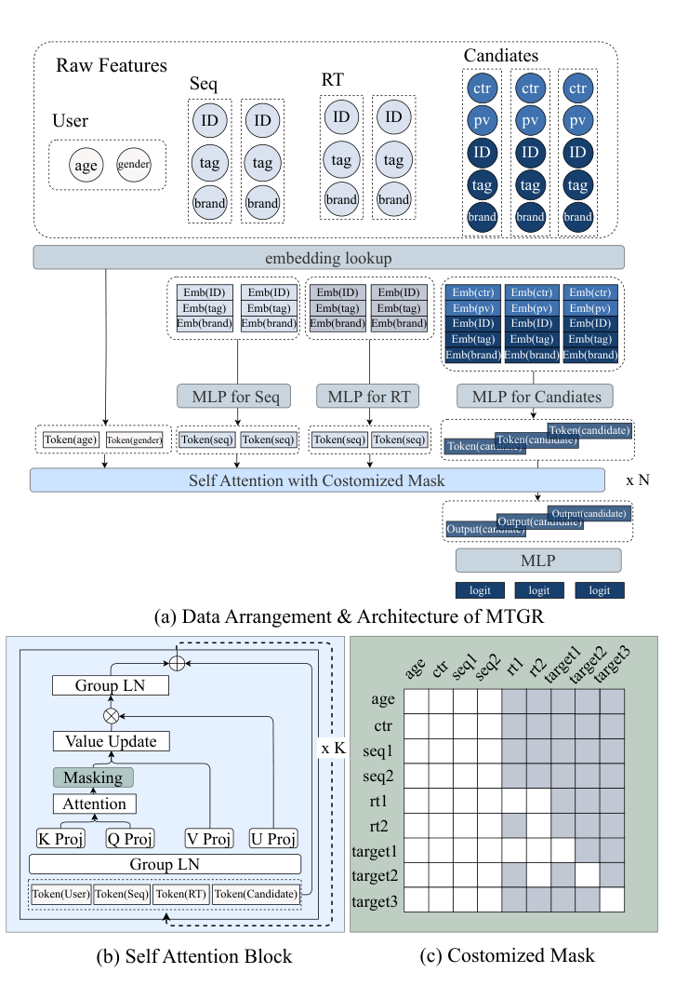
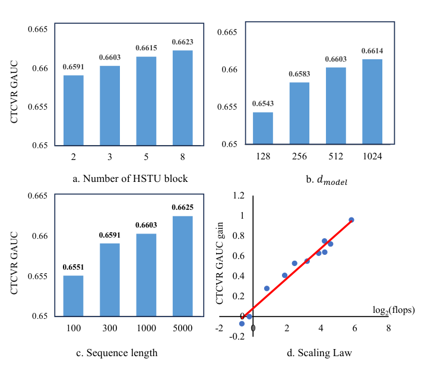

# MTGR 精读：美团把交叉特征塞回生成式推荐，65 倍算力换来两年最大涨幅（CIKM 2025）

> 论文：MTGR: Industrial-Scale Generative Recommendation Framework in Meituan（arXiv:2505.18654v4），美团，CIKM 2025。完整中文译稿见同目录 `../translation/paper.zh-CN.md`。

## 论文要解决的问题

生成式推荐这两年最重要的卖点就是 scaling law：HSTU 在 Meta 验证了三个数量级的幂律扩展，OneRec 在快手验证了端到端取代级联。但美团团队在这篇论文里指出这些方法有一个共同却被轻描淡写的代价——生成式推荐按 token 组织数据、用 next token prediction 建模，这要求丢掉候选与用户之间的交叉特征。而交叉特征（比如"用户对这个候选的历史点击率、曝光次数"）恰恰是外卖、电商这类业务里精心手工构建、效果最猛的一类特征。美团的实测结论很直接：去掉交叉特征会严重损害性能，而且加参数完全补不回来。

另一边，传统 DLRM 的扩展困境也很清楚：扩展用户模块（用户表示对所有候选共享、只推理一次）成本友好，但对特征交互没有直接帮助；扩展交叉模块（特征交互 MLP）直接增强排序能力，但要对每个候选推理，成本随候选数线性增长、延迟不可接受。

MTGR 的答案是：保留 DLRM 的全部特征输入（含交叉特征），用数据重排加上 HSTU 架构拿到 GRM 的扩展性。

## 方法：数据重排 + 定制掩码

**第一步是把交叉特征塞进候选 token。** 原始样本是（用户，候选）对，包含用户画像 U、长期行为序列 S、实时行为序列 R、交叉特征 C 和候选特征 I。MTGR 把 C 并入候选特征组成 [C, I]，然后把同一用户的 K 个候选聚合成一个样本：D = [U, S, R, [C,I]₁, …, [C,I]_K]。用户部分只算一次、K 个候选共享。这个聚合带来两个直接红利：训练样本从"所有曝光对"压缩到"所有用户"；推理从"每候选一次前向"变成"每请求一次前向"——推理成本不再随候选数线性增长，MTGR-large 部署后推理成本反而降了 12%。

然后所有特征 token 化：用户画像每个标量特征一个 token，行为序列每个物品一个 token（特征嵌入拼接后过 MLP 统一到 d_model），候选的 [C, I] 同样组成一个 token。整条序列送进 HSTU 式的自注意力栈。

**第二步是两个针对性设计。** 一是组层归一化（GLN）：User/Seq/RT/Candidate 四类 token 来自不同语义空间，混在一起做 LayerNorm 会互相拉扯，GLN 按域分组归一化、对齐分布后再做 Q/K/V/U 投影。二是动态掩码：聚合窗口与实时行为存在时间重叠（样本里的实时行为可能晚于某些候选的出现时间），简单因果掩码会泄漏未来信息。MTGR 按三类 token 定制可见性——静态序列（画像+长期序列）全注意力；实时序列按时间因果自回归（候选可以看在它之前发生的实时行为）；候选之间互相不可见（对角掩码，保证判别式监督下候选间不串信息）。

图 1 完整展示了数据组织、自注意力块（Group LN → Q/K/V/U 投影 → silu 注意力 → 值更新 → U 门控 → Group LN → 残差 MLP）与掩码矩阵。

*图 1：MTGR 的数据组织与架构。(a) 三个候选与同一用户特征聚合成一条 token 序列；(b) HSTU 式自注意力块；(c) 定制掩码矩阵：静态序列全可见、实时序列因果可见、候选仅对自身可见。来源：论文 Figure 2，第 4 页。*

**第三步是训练框架。** 美团放弃了 TensorFlow，在 TorchRec 上重建：动态哈希表（key/value 解耦，扩容只复制 key）、嵌入查找两步去重、动态 batch size（按序列长度调每卡 BS 解决长尾不均）、三流流水线 + bf16 + cutlass 注意力 kernel。相比原版 TorchRec 吞吐提升 1.6-2.4 倍，100 卡以上扩展良好。

## 实验结果

离线用的是美团真实日志（10 天：2.1 亿用户、430 万物品、237 亿曝光）——作者明确说明公开数据集缺少交叉特征，这也是他们自建数据的理由。基线阵容涵盖了 DLRM 扩展的主流方案：SIM 检索 vs E2E 长序列建模，扩展模块对比 DNN、MoE、Wukong、MultiEmbed、UserTower（qFormer + 16 专家 MoE，最强基线）。

表 1 是离线主结果：最强 DLRM（UserTower-SIM）CTR GAUC 0.6792；UserTower-E2E 反而略降到 0.6787——作者推测是 DLRM 范式下模型复杂度不足以消化全部序列信息、欠拟合。MTGR 即使最小的版本（5.47 GFLOPs，基线 0.86 的 6 倍多）也全面超过所有 DLRM（0.6826）；MTGR-large（55.76 GFLOPs，65 倍）把四个离线指标推到 0.7661/0.6865/0.8862/0.6646，相对最强基线 +0.50%~+1.47%。

消融（Table 4）是这篇论文最有说服力的部分：从 MTGR-small 去掉交叉特征，CTCVR GAUC 从 0.6603 掉到 0.6514——不仅抹平了 MTGR 相对 DLRM 的全部优势，还低于最强 DLRM 基线的 0.6550。交叉特征的贡献大于整个架构升级的贡献，"生成式不能丢交叉特征"这个论点由此从猜测变成量化事实。GLN 与动态掩码各贡献约 0.0016-0.0018 的 GAUC。

图 2 是扩展性实验：HSTU 块数（2→8）、d_model（128→1024）、序列长度（100→5000）三个维度上 CTCVR GAUC 都平滑提升，其中序列长度的收益最大（+0.0074）；把所有配置的 GAUC 增益对 log₂(FLOPs) 作图呈一条直线——幂律扩展在美团场景成立。

*图 2：(a) HSTU 块数、(b) d_model、(c) 序列长度三个维度的扩展曲线；(d) CTCVR GAUC 增益与 log₂(FLOPs) 的线性（幂律）关系。来源：论文 Figure 3，第 7 页。*

**在线 A/B**：美团外卖 2% 流量、日曝光数百万级，基线是持续学习了 2 年的 UserTower-SIM，MTGR 只用最近 6 个月的数据训练。结果（Table 5）：MTGR-small UV_CTCVR +0.04%、medium +0.62%（PV_CTR +2.29%）、large UV_CTCVR +1.02%；摘要口径为成交 +1.22%、CTR +1.31%，是近两年最大涨幅，且 CTCVR GAUC 的离线增益超过了过去一年所有优化的累计。最终 MTGR-large 全量部署：训练成本与 DLRM 持平、推理成本降 12%。

## 工程判断与证据边界

**证据的强度**。这篇论文的论证链完整度很高：消融直接量化了核心论点（交叉特征的贡献 > 架构升级的贡献），扩展性三个维度各自扫了一遍，在线基线是学习 2 年的生产模型且只用 6 个月数据就赢了——"训练数据少一半以上仍然赢"是比较有说服力的部分。边界在于：数据与特征全部私有、无公开数据集实验（作者的理由成立但复现无门）；A/B 未报置信区间；摘要的"成交 +1.22%"与 Table 5 的 UV_CTCVR +1.02% 口径差异未解释；消融只在 MTGR-small 上做，GLN 与动态掩码的增益在 large 上是否保持未验证。

**定位与系列论文的关系**。MTGR 与 OneRec 是生成式推荐的两条岔路：OneRec 走端到端生成、用会话级列表取代级联（快手主场景）；MTGR 保留判别式监督与 CTR/CTCVR 目标、只在数据组织和架构上 token 化（美团外卖排序）。MTGR 的关键洞察是：丢交叉特征是 next token prediction 数据组织方式的副作用，不是生成式的必然代价——把交叉特征并进候选 token、候选间对角掩码，就同时保住了判别式精度与 token 化扩展性。对拥有大量交叉特征资产的团队（外卖、电商、广告几乎都是），MTGR 这条路比 OneRec 式端到端生成的迁移成本低得多。结论里作者预告了多场景统一建模的方向，与 HSTU、OneRec 一起指向同一个终点：推荐基础模型。

**可迁移的组件**。三件套都可以单独借用：交叉特征并入候选 token + 用户级聚合（保精度同时把推理从逐候选降为逐请求）；GLN（多域 token 混编时的低成本对齐手段）；动态掩码三规则（处理聚合窗口与实时行为时间重叠的标准答案）。训练框架部分的动态哈希表与动态 BS 在 MTGRBoost（其引用 [21]）里有更完整的展开。
