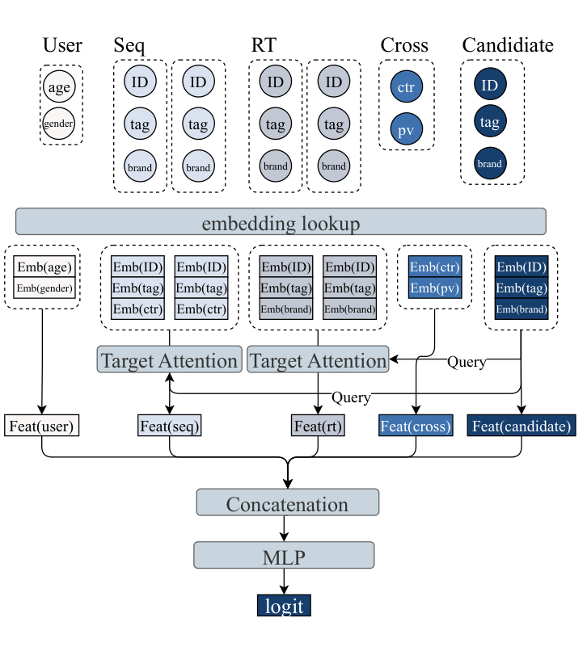
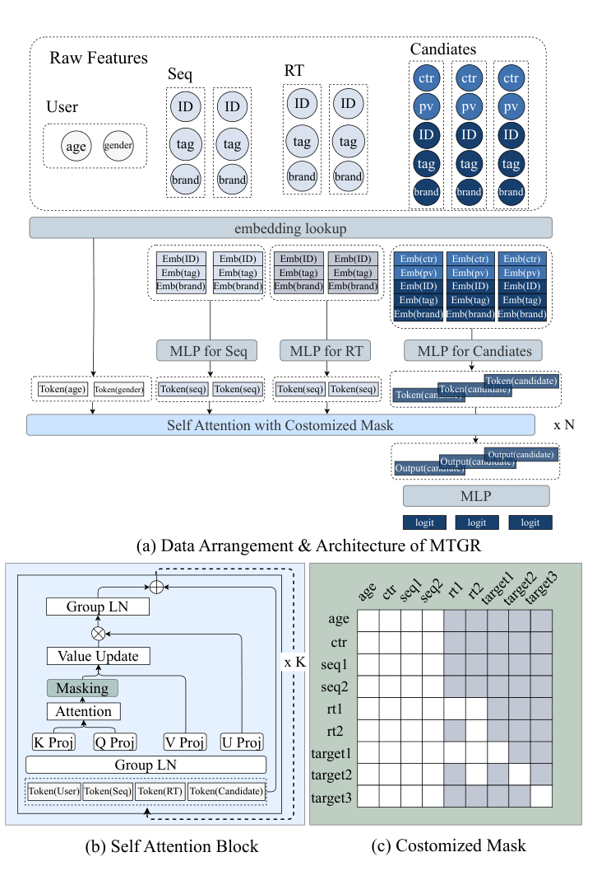
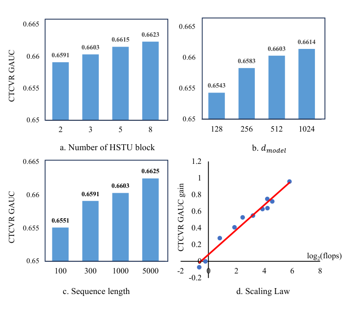

# MTGR：美团工业级生成式推荐框架

**作者**：Ruidong Han, Bin Yin, Shangyu Chen, He Jiang, Fei Jiang, Xiang Li, Chi Ma, Mincong Huang, Xiaoguang Li, Chunzhen Jing, Yueming Han, Menglei Zhou, Lei Yu, Chuan Liu, Wei Lin*（美团，北京；*通讯作者）

CIKM '25，2025 年 11 月 10-14 日，韩国首尔。ACM ISBN 979-8-4007-2040-6/2025/11。arXiv:2505.18654v4。

## 摘要

Scaling law 已在自然语言处理、计算机视觉等众多领域得到充分验证。在推荐系统中，近期工作采用生成式推荐来实现可扩展性，但其生成式方法要求放弃传统推荐模型精心构建的交叉特征（cross features）。我们发现这种做法会显著损害模型性能，且扩模完全无法弥补。本文提出 MTGR（Meituan Generative Recommendation）解决这一问题。MTGR 基于 HSTU [23] 架构建模，能够保留原始深度学习推荐模型（DLRM）的全部特征——包括交叉特征。此外，MTGR 通过用户级压缩实现训练与推理加速，保证高效扩展。我们还提出组层归一化（Group-Layer Normalization，GLN）以增强不同语义空间内的编码效果，并提出动态掩码策略以避免信息泄漏。我们进一步优化训练框架，支持计算复杂度为 DLRM 10 到 100 倍的模型而成本不显著增加。MTGR 单样本前向推理的 FLOPs 达到 DLRM 的 65 倍，取得近两年离线与在线的最大收益。这一突破已成功部署于全球最大的外卖平台美团，承接主要流量。

**CCS 概念**：信息系统 → 推荐系统。
**关键词**：Scaling Law；生成式推荐

## 1 引言

Scaling law 已被证明适用于大多数深度学习任务，包括语言模型 [9]、计算机视觉 [14, 24] 与信息检索 [4]。我们的工作聚焦于有效扩展工业推荐系统的排序模型。在工业推荐系统高 QPS（每秒查询数）与低延迟的要求下，模型扩展通常同时受训练成本与推理时间制约。当前扩展排序模型的研究分为两类：深度学习推荐模型（DLRM）与生成式推荐模型（GRM）。DLRM 对每个用户-物品对独立建模、学习兴趣概率用于排序，通过发展更复杂的映射来扩展。GRM 像 NLP 一样按 token 组织数据，用 Transformer 架构做 next token prediction。

工业推荐系统使用 DLRM 已近十年，输入通常包含大量精心设计的手工特征（如交叉特征¹）以提升性能。但 DLRM 在扩展上有两个显著缺陷：1) 随用户行为指数增长，传统 DLRM 无法高效处理完整的用户行为，往往退而求其次做序列检索或设计低复杂度模块学习，限制模型的学习能力 [1, 15]；2) 基于 DLRM 的扩展在训练与推理上的成本随候选数近似线性增长，开销高得难以承受。

¹交叉特征衡量多个原始特征之间的交互，如用户对目标候选的历史点击率。

对 GRM，近期研究指出其卓越的扩展性 [3, 23]。我们识别出两个关键因素：1) GRM 直接建模用户行为的完整链路，把同一用户的多个曝光样本压缩为一个，显著减少计算冗余，同时相比 DLRM 能端到端编码更长序列；2) GRM 采用带高效注意力计算的 Transformer 架构 [2, 23]，使训练与推理满足工业推荐系统要求。然而，GRM 高度依赖 next token prediction 来建模完整用户行为序列，这要求移除候选与用户之间的交叉特征。我们发现剔除交叉特征会严重损害模型性能，且这种退化完全无法靠扩模弥补。

如何构建一个既利用交叉特征保证效果、又具备 GRM 扩展性的排序模型？为此我们提出美团生成式推荐（MTGR）。相比传统 DLRM 与 GRM，MTGR 取两者之长、去两者之短。MTGR 保持与 DLRM 一致的输入特征，包括交叉特征。特别地，MTGR 通过把用户与候选特征转换为不同 token 来重组特征，形成便于高效扩展的 token 序列；然后把交叉特征纳入候选 token，用判别式损失学习。

MTGR 采用与 [23] 相似的 HSTU（Hierarchical Sequential Transduction Units）架构建模。在 HSTU 中，我们提出组层归一化（GLN）对不同类型的 token 分别归一化，使多源异构信息得以更好的同时建模。此外我们提出动态掩码策略：全注意力、自回归与仅对自身可见相结合，保证性能并避免信息泄漏。

与业界常用的 TensorFlow 不同，MTGR 训练框架基于 TorchRec [8] 构建并针对计算效率优化。具体地，为处理稀疏嵌入条目的实时插入/删除，我们用动态哈希表替换静态表；为提升效率，我们做动态序列平衡解决 GPU 间计算负载不均，并采用嵌入 ID 去重与自动表合并加速嵌入查找；还引入混合精度训练与算子融合等实现优化。相比 TorchRec，优化后的框架训练吞吐提升 1.6-2.4 倍，在 100 块 GPU 以上运行时仍保持良好扩展性。

我们在小规模数据集上验证 MTGR 的扩展性；然后用六个月以上的数据训练三个不同规模的模型，验证离线与在线性能的 scaling law。大版本相比迭代优化多年的 DLRM 基线，单样本前向计算 FLOPs 为其 65 倍，在我们的场景中把成交量提升 1.22%、CTR 提升 1.31%，同时训练成本不变、推理成本下降 12%。MTGR-large 已部署到美团外卖推荐系统，服务数亿用户。

贡献总结如下：

- MTGR 结合 DLRM 与 GRM 之长：保留 DLRM 全部特征（含交叉特征），同时展现 GRM 级的卓越扩展性。
- 我们提出组层归一化与动态掩码策略以取得更好性能。
- 我们对基于 TorchRec 的 MTGR 训练框架做系统优化，提升训练性能。
- 离线与在线实验证明了 MTGR 性能与计算复杂度之间的幂律关系，及其相对 DLRM 的优越性。

## 2 相关工作

### 2.1 深度学习推荐模型

经典 DLRM 结构通常包含众多输入：上下文（时间、地点）、用户画像（性别、年龄）、用户行为序列、以及带大量交叉特征的目标物品。排序模型中两个特别重要的模块是行为序列处理与特征交互学习。行为序列模块 [15, 17, 27] 通常用 target attention 机制捕捉用户历史行为与待估物品的相似性；特征交互模块 [12, 18-20] 设计用于捕捉包括用户与物品在内的不同特征间的交互，产生最终预测。

### 2.2 扩展推荐模型

基于 DLRM 中不同的扩展模块，存在两种思路。其一是扩展交叉模块，即扩展整合用户与物品信息的特征交互模块：[25] 引入可堆叠的 Wukong 层做扩展；[6] 用多嵌入策略解决嵌入坍缩（embedding collapse）从而增强模型扩展性。其二是扩展用户模块，只扩展用户部分，对推理更友好：[7, 26] 只扩展用户表示并缓存或广播给不同待估物品，降低在线推理成本；[16, 22] 为用户表示设计预训练方法，在下游任务中展现扩展性。

DLRM 的对应物是 GRM。[23] 通过 HSTU 验证 scaling law，扩展到万亿级参数；[3] 用语义编码替代传统 ID 表示，把 DPO 优化与基于 Transformer 的框架结合，用统一生成模型取代级联学习框架。

## 3 预备

### 3.1 数据组织

传统上，对一个用户及其 K 个候选，第 i 个"用户-候选对"样本可表示为 $D_i = [U, \vec{S}, \vec{R}, C_i, I_i]$。具体地，$U = [U_1, ..., U_{N_U}]$ 表示用户画像特征（$U_i$），如年龄、性别等，每个特征 $U_i$ 是标量，$N_U$ 为所用特征数。$\vec{S} = [S_1, ..., S_{N_S}]$ 包含用户历史上交互过的物品序列，每个元素 $S_i = [s_1, ..., s_{N_s}]$ 表示一个物品，由所选特征（$s_i$）构成，如物品 ID、标签、物品平均 CTR 等。与 $\vec{S}$ 类似，$\vec{R}$ 记录距当前请求几小时或一天内最近的交互，$\vec{R}$ 表示用户的实时行为与偏好，与 $\vec{S}$ 共享相同的特征。$C = [C_1, ..., C_{N_C}]$ 包含用户与候选之间的交叉特征。$I = [I_1, ..., I_{N_I}]$ 包含候选物品的特征，如物品 ID、标签、品牌。$I$ 依赖候选、在不同用户间共享。

*图 1：传统排序模型的数据组织与流程。以简化特征示例：U 含"年龄""性别"；S 与 R 各含 2 个物品，每物品有"ID""标签""品牌"；C 含"ctr"与"pv"，表示用户对候选的历史 CTR 与曝光次数，使用"ID""标签""品牌"。原文 Figure 1，第 3 页。*

### 3.2 推荐系统中的排序模型

给定输入样本 D，传统推荐系统独立处理各样本。具体地，先嵌入 D 中的特征、把样本转为稠密表示。形式化地，U、C、I 中的特征分别被嵌入并拼接为 $Emb_U \in \mathbb{R}^{K \times d_U}$、$Emb_C \in \mathbb{R}^{K \times d_C}$、$Emb_I \in \mathbb{R}^{K \times d_I}$。对 $\vec{S}$ 与 $\vec{R}$ 中的特征²，每个物品（$S_i$）的特征类似地嵌入并拼接为 $Emb_{S_i} \in \mathbb{R}^{d_s}$，$\vec{S}$ 中的物品在另一维拼接，得到 $Emb_{\vec{S}} \in \mathbb{R}^{N_{\vec{S}} \times d_s}$³。

> 2. 以下描述中，由于 $\vec{S}$ 与 $\vec{R}$ 处理方式相似，为清晰起见只描述 $\vec{S}$ 的建模。
> 3. $N_*$ 表示 $*$ 的序列长度。

为提取历史交互物品与候选间的用户兴趣，通常使用 target attention：以目标为 query、序列特征为 key/value。形式化地，

$$Feat_{\vec{S}} = \text{Attention}(Emb_I, Emb_{\vec{S}}, Emb_{\vec{S}}) \in \mathbb{R}^{K \times d_S} \tag{1}$$

式 1 依据 $I$ 聚合 $\vec{S}$。最后，来自 D 的嵌入与处理后的特征被拼接表示为：

$$Feat_D = [Emb_U, Feat_{\vec{S}}, Feat_{\vec{R}}, Emb_C, Emb_s] \in \mathbb{R}^{K \times (d_U+d_S+d_C+d_I)} \tag{2}$$

$Feat_D$ 进一步送入多层感知机（MLP）为每个样本输出 logit。logit 在训练时用于学习、推理时用于排序。

图 1 展示了传统排序模型下简化的数据组织与流程：特征先被嵌入，前导嵌入按不同方法处理，最后拼接经 MLP 做特征交互，为每个候选生成最终 logit。

### 3.3 推荐系统的扩展困境

模型扩展是排序性能提升的常用手段。一般而言，模型扩展瞄准用户模块与交叉模块的参数。用户模块处理用户特征（含序列特征）并生成用户相关表示；扩展用户模块带来更好的用户表示，且由于用户被所有候选共享、只需推理一次，用户模块的大推理成本不会造成系统过载。但只扩展用户模块无助于用户与物品的特征交互。

相反，另一类方法瞄准交叉模块，即特征拼接后的特征交互 MLP。这些方法更关注用户与候选间的交互以增强排序能力，但交叉模块要对每个候选推理，计算增长随候选数线性扩展，带来不可接受的系统延迟。

传统推荐系统的扩展困境催生新的扩展方式：既要实现用户与候选间高效的特征交互，又要让推理成本随候选数次线性增长。MTGR 通过数据重排与相应架构优化创新了推荐系统的扩展方式。

## 4 MTGR 的数据重排与架构

### 4.1 用户样本聚合提升训练与推理效率

相比 3.1 节的特征分类，对候选中的第 i 个样本，MTGR 把特征组织为 $D_i = [U, \vec{S}, \vec{R}, [C_i, I_i]]$。特别地，交叉特征 C 被安排为候选物品特征的一部分。MTGR 在训练时按特定窗口按用户聚合候选、推理时按请求聚合。由于聚合按同一用户进行，聚合样本可以复用相同的用户表示（$U, \vec{S}, \vec{R}$）。其中 $\vec{R}$ 按交互时间先后顺序排列另一特定窗口内用户的所有实时交互物品。

图 2(a) 展示了聚合：与图 1 只预测一个候选不同，图 2(a) 把三个物品聚进一个样本、复用同一用户表示。形式化地，它为同一用户构成特征表示：

$$D = [U, \vec{S}, \vec{R}, [C, I]_1, ..., [C, I]_K] \tag{3}$$

把候选聚合进一个样本后，MTGR 只需一次计算即产出所有候选的分数，节省大量资源。特别地，用户聚合把训练样本规模从"所有候选"压缩到"所有用户"。推理时，一次请求内的候选按上述方式分组，MTGR 对全部候选排序只做一次推理，而非按候选数次推理。聚合消除了推理成本对候选量的依赖，为模型扩展留下可能与潜力。

式 3 是标量特征与序列特征的组合。为统一输入格式，MTGR 把特征与序列转换为 token。具体地，对 U 中的标量特征，每个特征自然转换为一个独立 token，维度 $Feat_U \in \mathbb{R}^{N_U \times d_{model}}$，$d_{model}$ 是所有 token 的统一维度。对 $\vec{S}$ 与 $\vec{R}$ 的序列特征，每个物品 S 视作一个 token：S 中的特征先嵌入并拼接，再用 MLP 模块统一维度，形式化为 $Feat_{S_i} = \text{MLP}(\text{Concat}(Emb_s)) \in \mathbb{R}^{d_{model}}$；序列中 S 的特征沿另一维拼接，得到 $Feat_{\vec{S}} \in \mathbb{R}^{N_{\vec{S}} \times d_{model}}$。

类似地，候选中每个物品 I 视作一个 token：候选中的特征被嵌入、拼接、经另一个 MLP 转换到统一维度。候选拼接为一系列 token：$Feat_I = \text{Concat}(\text{MLP}(\text{Concat}(Emb_{C_i}, Emb_{I_i}))) \in \mathbb{R}^{N_I}$。最后，来自 U、$\vec{S}$、[C, s] 的 token 拼接，形成长 token 序列：

$$Feat_D = \text{Concat}([Feat_U, Feat_{\vec{S}}, Feat_{\vec{R}}, Feat_I]) \in \mathbb{R}^{(N_U+N_{\vec{S}}+N_{\vec{R}}+N_I) \times d_{model}} \tag{4}$$

### 4.2 统一 HSTU 编码器

来自同一用户的样本聚合为 token 序列，天然适合自注意力处理。受 HSTU [23] 启发，MTGR 使用自注意力层堆叠的 encoder-only 架构建模。

与 LLM 类似，输入 token 序列逐层处理。如图 2 所示，在自注意力块中，输入序列 X 先经组层归一化（Group LN）归一化：同一域（如 U）的特征构成一个组，Group LN 保证来自不同域的 token 在自注意力前具有相似分布、对齐不同域的不同语义空间 $\tilde{X} = \text{GroupLN}(X)$。归一化后的输入投影为 4 种表示：$K, Q, V, U = \text{MLP}_{K/Q/V/U}(\tilde{X})$。Q、K 用于带 silu 非线性激活的多头注意力计算，注意力除以输入特征总长度作平均因子。接着在注意力分数上施加定制掩码（M），应用投影后的 V 做值更新：

$$\tilde{V} = \frac{\text{silu}(K^T Q)}{(N_U + N_{\vec{S}} + N_{\vec{R}} + N_I)} \, M V \tag{5}$$

投影后的 U 与更新后的 $\tilde{V}$ 做点积，再施加一次组层归一化，最后加残差并在其上再放一个 MLP：

$$X = \text{MLP}(\text{GroupLN}(\tilde{V} \odot U)) + X \tag{6}$$

动态掩码。[23] 利用因果掩码做序列建模，但这类实现在 MTGR 中未带来显著提升。此外，由于 $\vec{R}$ 记录用户最近的交互、其时间可能与样本聚合窗口重合，在 MTGR 中使用简单因果掩码可能导致信息泄漏——例如晚间的交互不应暴露给午后的候选，但这些信息可能被聚进同一样本。这一困境要求灵活而高效的掩码。

在 MTGR 中，$U, \vec{S}$ 被视为静态信息（下称"静态序列"），因为其信息来自聚合窗口之前，不会引起因果错误；$\vec{R}$ 是动态的，实时纳入用户的最新交互（$\vec{R}$ 称"动态序列"）。MTGR 对静态序列用全注意力、对 $\vec{R}$ 用带动态掩码的自回归、对候选间用对角掩码。具体地，MTGR 的掩码设三条规则：

- 静态序列对所有 token 可见。
- 动态序列的可见性遵循因果性：每个 token 只对之后出现的 token 可见（包括候选 token）。
- 候选 token (C, I) 只对自身可见。

*图 2：MTGR 的数据组织与架构。(a) 数据组织与整体流程：3 个候选的特征与同一用户的对应特征聚合，特征经嵌入并转为 token，形成带掩码自注意力的输入序列，候选 token 的表示经另一个 MLP 产出 logit。(b) L 层自注意力模块详述：输入序列先经组层归一化与 4 个投影（Q/K/V/U），带定制掩码做自注意力，值更新后与投影的 U 点积，再做组层归一化并加残差。(c) 避免信息泄漏的定制掩码：'rt' 与 'target' 按由近及远排列——用户特征（U, S）对所有 token 可见；'rt' 对其后出现的 token 可见；'target' 仅对自身可见。原文 Figure 2，第 4 页。*

图 2(c) 给出动态掩码示例：'age'、'ctr' 表示来自 U 的特征 token；'seq1'、'seq2' 对应 $\vec{S}$；'rt1'、'rt2' 对应 $\vec{R}$；'target1'-'target3' 为候选。行表示某 token 能使用来自其他 token 的信息，列表示该 token 是否对其他 token 可见。U 与 S 用全注意力，'age' 到 'seq2' 形成白色方块。对 'rt1' 到 'rt2'，假设 'rt1' 晚于 'rt2' 出现，'rt1' 到 'rt2' 构造上三角小白块：'rt1' 能用 'rt2' 的信息，而 'rt1' 对 'rt2' 不可见。此外，假设 'target2' 与 'target3' 早于 'rt1' 出现，故 'rt1' 对它们不可见；'rt2' 早于 'target1' 与 'target2' 而晚于 'target3'，故 'rt2' 对 'target3' 不可见——'target3' 早于所有 'rt' 出现，因此不能使用任何 'rt' 的信息。

## 5 训练系统

为便于 MTGR 模型结构的设计开发、方便引入快速增长的 LLM 社区的更多特性，我们决定不再沿用之前的 TensorFlow 训练框架，而是在 PyTorch 生态内重建训练框架。具体地，我们扩展并优化了 TorchRec 的功能，针对 MTGR 模型特性做增强，最终实现 MTGR 模型的高效训练。相比 TorchRec，优化后的框架训练吞吐提升 1.6-2.4 倍，在 100 块 GPU 以上运行时保持良好扩展性。相比 DLRM 基线，我们实现单样本前向计算 65 倍 FLOPs 而训练成本几乎不变。关键工作如下：

**动态哈希表**。TorchRec 用固定大小的表处理稀疏嵌入，不适合大规模工业流式训练：静态表达到预设容量后无法实时为新用户/物品分配额外嵌入；静态表还常需预留超过实际所需的空间以防 ID 溢出，造成内存资源低效使用。为此我们开发了利用哈希技术的高性能嵌入表，训练期间动态分配空间容纳稀疏 ID。设计采用解耦哈希表架构 [21]，把 key 存储与 value 存储分为独立实体：key 存储提供轻量映射系统，把 key 链接到指向嵌入向量的指针；value 存储包含嵌入向量及额外元数据（如计数器、时间戳）用于淘汰策略。两部分系统实现两个目标：(1) 只复制 key 存储（而非庞大的嵌入）即可动态扩容；(2) key 紧凑排列提升 key 扫描效率。

**嵌入查找**。嵌入查找采用 All-to-all 通信做跨设备嵌入交换。为减少设备间重复 ID 传输，我们实现两步流程，保证通信前后 ID 均唯一。

**负载均衡**。推荐系统中用户行为序列呈长尾分布：少数用户序列很长、多数很短，固定 batch size（BS）训练导致显著计算负载不均。常见解法是序列打包（sequence packing）[10]——把多条短序列合并为长序列，但需要精心调整掩码防止不同序列在注意力计算中互相干扰，实现成本高。我们的直接方案是引入动态 BS：每块 GPU 的本地 BS 根据输入数据的实际序列长度调整，保证相近的计算负载；同时调整梯度聚合策略，按各 GPU 的 BS 对梯度加权，保持与固定 BS 一致的计算逻辑。

**其他优化**。进一步提升训练效率：利用 copy、dispatch、compute 三条流做流水线——copy 流负责 CPU 到 GPU 的输入传输，dispatch 流按 ID 执行表查找，compute 流处理前向计算与反向更新。例如当 compute 流处理 batch T 的前反向时，copy 流同时加载 batch T+1，最小化 I/O 延迟；batch T 反向更新完成后 dispatch 流立即开始 batch T+1 的表查找与通信。此外采用 bf16 混合精度训练，并基于 cutlass 设计专用注意力 kernel 加速训练。

## 6 实验

### 6.1 实验设置

**数据集**。公开数据集普遍使用独立 ID 与属性特征，很少引入交叉特征；而交叉特征在真实场景中非常重要——是我们场景中重要的一类特征，往往经过精心手工构建，包括用户-物品、用户与高层类目、物品与时空信息的交互等。为弥补公开数据集缺失交叉特征的问题，我们基于美团真实工业级推荐系统的日志构建训练数据集。与公开数据集相比，真实数据集包含更丰富的交叉特征与更长的用户行为序列；用工业级数据做实验更能凸显交叉特征对真实推荐系统的重大影响。此外数据量大，允许复杂模型在训练中充分收敛。离线实验收集 10 天数据，统计见表 1；在线实验为与训练超过 2 年的 DLRM 基线对比，构建了跨越 6 个月以上的更长期数据集。

表 1：数据集统计。原文 Table 1，第 6 页。

| 数据集 | #用户 | #物品 | #曝光 | #点击 | #购买 |
| --- | --- | --- | --- | --- | --- |
| 训练 | 0.21 billion | 4,302,391 | 23.74 billion | 1.08 billion | 0.18 billion |
| 测试 | 3,021,198 | 3,141,997 | 76,855,608 | 4,545,386 | 769,534 |

**基线**。DLRM 侧比较两种序列建模方法：基于序列检索的 SIM 与对原始长序列端到端建模的 E2E。扩展性方面对比 DNN、MoE [13]、Wukong [25]、MultiEmbed [6]、UserTower。MoE 用 4 个专家、每专家网络与基础 DNN 复杂度相同；Wukong 与 MultiEmbed 配置为与 MoE 相同的计算复杂度；UserTower 用一组可学习查询并在用户行为上插入一层 qFormer [11] 与另一个 MoE（16 专家）模块，计算复杂度是 MoE 方法的 3 倍，但推理时可对同一用户的多个待估物品共享计算、降低推理成本，在我们的场景中取得良好效果。MTGR 用 E2E 处理全部序列信息。如表 2 所示，设三个不同规模验证 MTGR 的扩展性。

表 2：不同设置与计算复杂度的模型对比。原文 Table 2，第 6 页。

| 模型 | 设置 | 学习率 | GFLOPs/样本 |
| --- | --- | --- | --- |
| UserTower-SIM | – | 8×10⁻⁴ | 0.86 |
| MTGR-small | n_layer=3, d_model=512, n_heads=2 | 3×10⁻⁴ | 5.47 |
| MTGR-medium | n_layer=5, d_model=768, n_heads=3 | 3×10⁻⁴ | 18.59 |
| MTGR-large | n_layer=15, d_model=768, n_heads=3 | 1×10⁻⁴ | 55.76 |

**评估指标**。离线聚焦两个任务：CTR 与 CTCVR（点击转化率），用 AUC [5] 与 GAUC（分组 AUC）评估。GAUC 是按用户平均的 AUC，相比 AUC 更关注模型对同一用户的排序能力。在线关注两个指标：PV_CTR（每次页面曝光的 CTR）与 UV_CTCVR（每用户曝光的 CTCVR），其中 UV_CTCVR 是评估业务增长最关键的指标。

**参数设置**。模型用 Adam 优化器训练。DLRM 每 GPU batch size 2400、8 块 NVIDIA A100；MTGR batch size 96、16 块 NVIDIA A100。如表 2 所示，学习率随模型复杂度增大而降低；随计算复杂度增长，我们按比例增大稀疏参数规模（配置不同嵌入维度）：假设一个 token 由 k 个特征组成，每特征嵌入维度一般取接近 $d_{model}/k$ 的整数。值得注意的是，为防止稀疏参数过度膨胀带来的开销，我们主要增大基数较小的稀疏特征维度、保持极稀疏特征维度不变。最后，$\vec{S}$ 最大长度设为 1000，$\vec{R}$ 设为 100。

### 6.2 整体性能对比

用 10 天数据集评估 MTGR 与其他基线。表 3 展示各模型性能。各模型在不同离线指标上的差异相当一致。基于既往经验，我们场景中离线指标提升 0.001 即视为显著。各 DLRM 版本中，Wukong-SIM 与 MultiEmbed-SIM 优于 MoE-SIM；UserTower-SIM 最佳，UserTower-E2E 相比 UserTower-SIM 略有下降。我们推测在 DLRM 范式下模型复杂度不足以建模全部序列信息、导致欠拟合。我们提出的 MTGR 即使最小版本也超过最强 DLRM；且三个规模的模型展现扩展性，性能随模型复杂度增加平滑提升。

表 3：整体性能。Impr.% 为最优 MTGR 相对最强 DLRM 基线（下划线）的相对提升。原文 Table 3，第 6 页。

| 模型 | CTR AUC | CTR GAUC | CTCVR AUC | CTCVR GAUC |
| --- | --- | --- | --- | --- |
| DNN-SIM | 0.7432 | 0.6679 | 0.8737 | 0.6504 |
| MoE-SIM | 0.7484 | 0.6698 | 0.8750 | 0.6519 |
| MultiEmbed-SIM | 0.7501 | 0.6715 | 0.8766 | 0.6525 |
| Wukong-SIM | 0.7568 | 0.6759 | 0.8800 | 0.6530 |
| UserTower-SIM | <u>0.7593</u> | <u>0.6792</u> | 0.8815 | <u>0.6550</u> |
| UserTower-E2E | 0.7576 | 0.6787 | <u>0.8818</u> | 0.6548 |
| MTGR-small | 0.7631 | 0.6826 | 0.8840 | 0.6603 |
| MTGR-medium | 0.7645 | 0.6843 | 0.8849 | 0.6625 |
| MTGR-large | **0.7661** | **0.6865** | **0.8862** | **0.6646** |
| Impr.% | 0.8956 | 1.0748 | 0.4990 | 1.4656 |

### 6.3 消融研究

基于 MTGR-small 对两个组件做消融：动态掩码与组层归一化（GLN）。结果见表 4。从 MTGR 中去掉任一组件都会导致性能显著下降。

表 4：MTGR 消融研究。原文 Table 4，第 6 页。

| 模型 | CTR AUC | CTR GAUC | CTCVR AUC | CTCVR GAUC |
| --- | --- | --- | --- | --- |
| MTGR-small | 0.7631 | 0.6826 | 0.8840 | 0.6603 |
| 去掉交叉特征 | 0.7495 | 0.6689 | 0.8736 | 0.6514 |
| 去掉 GLN | 0.7606 | 0.6809 | 0.8826 | 0.6585 |
| 去掉动态掩码 | 0.7620 | 0.6810 | 0.8828 | 0.6587 |

*图 3：随 HSTU 块数、d_model 与序列长度增加，MTGR 性能平滑提升；C. 序列长度消融（100/300/1000/5000，CTCVR GAUC 0.6551→0.6625）；D. Scaling Law：CTCVR GAUC 增益与 log₂(FLOPs) 呈线性（幂律）关系。原文 Figure 3，第 7 页。*

图 3 说明动态掩码与 GLN 对 MTGR 的重要性（图 a/b：性能随 HSTU 块数 2→8 与 $d_{model}$ 128→1024 平滑提升，0.6591→0.6623 与 0.6543→0.6614）。此外我们对交叉特征对 MTGR 的重要性做了额外实验：去掉交叉特征后指标显著下滑，甚至抹平了 MTGR-large 相对 DLRM 的全部增益（Table 4：去掉交叉特征后 CTCVR GAUC 0.6514，低于 UserTower-SIM 的 0.6550），凸显交叉特征在真实推荐系统中的关键作用。

### 6.4 扩展性

图 3 展示 MTGR 的扩展性。基于 MTGR-small 测试三个超参数：HSTU 块数、$d_{model}$、输入序列长度。可以看到 MTGR 在不同超参数下都展现良好扩展性。图 3(d) 给出性能与计算复杂度之间的幂律关系：纵轴为相对最佳 DLRM 模型（UserTower-SIM）的 CTCVR GAUC 增益，横轴为计算复杂度相对 UserTower-SIM 的对数倍数。

### 6.5 在线实验

为进一步验证 MTGR 有效性，我们把 MTGR 部署到美团外卖平台，用 2% 流量做 A/B 测试。实验流量每天覆盖数百万次曝光，证明实验的可信度。对比基线是最先进的在线 DLRM 模型（UserTower-SIM），已持续学习 2 年；MTGR 用最近 6 个月数据训练后部署上线对比。

尽管训练数据量显著少于 DLRM，离线与在线指标仍大幅超过 DLRM 基线。如表 5 所示，离线与在线指标均展现扩展性。我们还发现随训练 token 数增加，相对 DLRM 的收益持续放大。最终在 CTCVR GAUC 上，大版本甚至超过过去一年全部优化的累计增益。

模型已在我们场景全量部署，训练成本与 DLRM 持平、推理成本下降 12%。DLRM 的推理成本与候选数近似线性，而 MTGR 对一次请求内的所有候选做用户聚合，推理成本随候选数次线性扩展，帮助我们降低在线推理开销。

表 5：不同版本 MTGR 的离线与在线效果对比。原文 Table 5，第 7 页。

| 模型 | 离线 CTR GAUC diff | 离线 CTCVR GAUC diff | 在线 PV_CTR | 在线 UV_CTCVR |
| --- | --- | --- | --- | --- |
| MTGR-small | +0.0036 | +0.0154 | +1.04% | +0.04% |
| MTGR-medium | +0.0071 | +0.0182 | +2.29% | +0.62% |
| MTGR-large | +0.0153 | +0.0288 | +1.90% | +1.02% |

## 7 结论

本文提出 MTGR——基于 HSTU 探索推荐系统 scaling law 的新排序框架。MTGR 结合 DLRM 与 GRM 之长：允许使用交叉特征保证模型性能，同时具备 GRM 级扩展性。MTGR 已在我们场景部署并产生显著收益。未来我们将探索把 MTGR 扩展到多场景建模，类似大语言模型，建立具备广泛知识的推荐基础模型。

## 参考文献

> 译注：参考文献按原文保留（共 27 条），标题不翻译。代表性文献：HSTU (Zhai et al. 2024, [23])、OneRec (Deng et al. 2025, [3])、Wukong (Zhang et al. 2024, [25])、SIM (Pi et al. 2020, [15])、TWIN V2 (Si et al. 2024, [17])、DCN V2 (Wang et al. 2021, [19])、DIN (Zhou et al. 2018, [27])、TorchRec (Ivchenko et al. 2022, [8])、MTGRBoost (Wang et al. 2025, [21])、qFormer/BLIP-2 (Li et al. 2023, [11])、SRP4CTR (Han et al. 2024, [7])、LUM 三步范式 (Yan et al. 2025, [22])、MultiEmbed/嵌入坍缩 (Guo et al. 2023, [6])。
