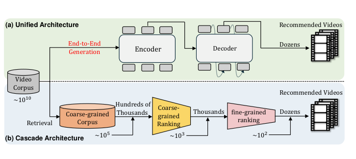
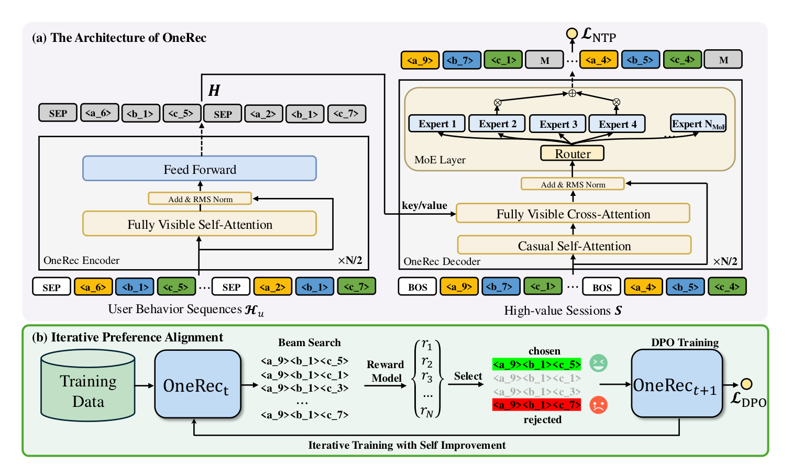
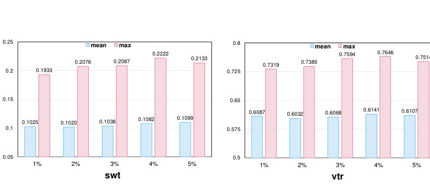

# OneRec 精读：快手用单个生成式模型取代整条推荐级联（arXiv 2502.18965）

> 论文：OneRec: Unifying Retrieve and Rank with Generative Recommender and Preference Alignment（arXiv:2502.18965v1），快手，2025 年 2 月。完整中文译稿见同目录 `../translation/paper.zh-CN.md`。

## 论文要解决的问题

推荐系统二十年来的默认形态是级联漏斗：从约 10¹⁰ 的视频库里召回出 10⁵，粗排压到 10³，精排留 10²，各阶段独立训练、逐级传递——前一阶段的上限就是后一阶段的输入。生成式检索（TIGER、HSTU 这一路）虽然能直接"生成"候选，但在现有系统里都只被当作召回阶段的一个选择器，因为生成精度打不过精心调教的多级 ranker。

OneRec 的主张更彻底：用单个 encoder-decoder 生成式模型直接输出最终推荐列表，把召回、粗排、精排整条流水线换掉。据作者所述，这是首个在真实场景中显著超越现有多阶段系统的端到端生成式推荐。

*图 1：统一架构（上）与级联架构（下）对比：编码器-解码器端到端生成，取代三级漏斗。来源：论文 Figure 1，第 2 页。*

## 三个关键设计

**第一，均衡量化的 Semantic ID。** 物品用与真实行为分布对齐的多模态嵌入表示（与快手 QARM 同源），量化不用 RQ-VAE 而用残差 K-means 加平衡约束——每级码本 8192 个簇、共 3 层，每簇恰好容纳等量视频（Algorithm 1），避免 RQ-VAE 已知的沙漏现象（码字使用分布不均）。

**第二，会话级列表生成。** 这是 OneRec 区别于 TIGER 式逐点生成的核心。预测目标不再是"下一个视频"，而是"下一个会话"——响应用户一次请求的一批 5-10 个视频。训练数据只用高质量会话：实际观看 ≥5 个、总时长超阈值、有点赞收藏分享等互动。这样模型在训练中就隐式学会列表内的连贯性与多样性，取代线上逐点出结果再靠手工规则重排的做法。模型是 T5 式 encoder-decoder：编码器吃 256 条历史行为（Semantic ID 序列），解码器自回归生成 5 个目标物品的语义编码（式 1-4）；decoder 的 FFN 换成 24 选 2 的 MoE，1B 参数推理时只激活 13%。

*图 2：上图为 OneRec 架构（编码器-解码器 + MoE），下图为迭代偏好对齐：束搜索采样 N 个会话，奖励模型选出 chosen/rejected 做下一轮 DPO 训练。来源：论文 Figure 2，第 3 页。*

**第三，IPA 迭代偏好对齐。** 推荐做 DPO 有个天然障碍：一次请求只有一次曝光，拿不到同一请求下的正负偏好对。OneRec 的解法是训练一个会话级奖励模型（target-aware 表示 + 自注意力 + swt/vtr/wtr/ltr 四个预测塔），然后让模型对自己的输出做偏好学习：束搜索为每个用户采 128 个候选会话，RM 打分，最高分为 chosen、最低分为 rejected，构成偏好对。训练时只对 1% 的样本施加 DPO 损失（其余照常 NTP），模型从 M_t 初始化出 M_{t+1}、再生成下一轮偏好数据，迭代自我改进（Algorithm 2）。拒绝样本来自模型自己的束搜索输出——这种"自困难负样本"比随机采样难得多，也是 RM 真正有用的地方：它只需要在同一用户的不同候选会话之间排序，回避了跨用户偏好不可比的问题。

## 实验结果

**离线**（Table 1，评估用 RM 对 swt/vtr/wtr/ltr 打分）。三组对照支撑三个设计的贡献：生成式碾压判别式——TIGER-1B 的 max swt 0.1368 对 SASRec 的 0.0803（+70%）；会话级碾压逐点——OneRec-1B 比 TIGER-1B max swt 再高 1.78%、max ltr 高 3.36%；IPA 碾压一切 DPO 变体——OneRec-1B+IPA 的 max swt 0.1933、max ltr 0.1203，比未对齐基线 +4.04%/+5.43%，而 DPO/IPO/cDPO/rDPO/CPO/simPO 大多连未对齐基线都不如，只有 S-DPO 接近。

图 3 是 DPO 采样比例的消融，用来回答"偏好对齐要花多少算力"：从 1% 加到 5%，各指标收益边际递减，而 DPO 采样服务器的 GPU 消耗与比例线性增长（5% 需 5 倍资源）。1% 比例拿到约 95% 的最大性能、只花 20% 的资源，这是生产配置的依据。

*图 3：DPO 采样比例 r_DPO 从 1% 到 5% 的消融（swt/vtr/wtr/ltr 四指标 mean/max）。1% 之后收益边际递减。来源：论文 Figure 4，第 7 页。*

模型规模上（Figure 6），0.05B 到 1B 一致增益：0.05B→0.1B 最大精度 +14.45%，之后每档再 +5% 左右。预测分布分析（Figure 5）显示 IPA 让最优编码上的概率显著集中，三层 Semantic ID 的熵从 6.00 收敛到 0.048——自回归解码逐层消除不确定性。

**在线 A/B**（Table 2）：快手主场景、1% 主流量，对照现有多阶段系统：OneRec-0.1B 总观看时长 +0.57%，OneRec-1B +1.21%，OneRec-1B+IPA +1.68%、平均单视频观看时长 +6.56%。对快手体量而言这是很大的收益。

## 工程判断与证据边界

**结果可信度**。在线 +1.68% 总观看时长是端到端生成式推荐迄今最有分量的工业验证，但论文未披露置信区间与实验周期；更值得注意的是离线评估的循环依赖：离线指标全部由自训练的 RM 打分，而这个 RM 同时负责生成 DPO 偏好对——RM 的偏差会同时塑造训练目标与评估标尺，论文没有做 RM 质量的独立校验（比如用真实反馈回测）。在线结论不受此影响，但离线数字（尤其 max 口径下 IPA 相对其他 DPO 变体的巨大领先）应打折看待。

**互动指标的短板是作者自己承认的**。结论一节明确写道：除观看时长外，模型在点赞等互动指标上有局限，多目标建模是未来工作。这与对齐目标的设计一致——高质量会话筛选标准以观看时长为主，RM 的目标塔虽多，最终偏好信号仍偏向时长。对以互动为核心的业务，直接照搬这套对齐方案需要重新设计偏好信号。

**基线可比性存疑的部分**。OneRec 输入用多模态对齐嵌入加 QARM 侧信息，而 SASRec/BERT4Rec/FDSA/TIGER 基线的特征配置未说明是否对齐；Semantic ID 用平衡 K-means 替代 RQ-VAE 也没有两者对比的消融。会话长度固定 m=5，无敏感性分析。

**可迁移的组件**。即便不整体替换级联，这篇论文有三件事可以直接借鉴：会话级生成目标（把列表内连贯性/多样性从线上规则搬进训练目标）、自困难负样本 + 迭代 DPO 的后训练范式（对任何自回归推荐器通用，且推荐场景的 RM 只需做组内排序）、以及"DPO 采样比例 1% 起步"的成本标尺（采样服务器的 GPU 消耗线性于比例）。结合前几篇精读：HSTU 解决"序列建模的扩展性"、HyFormer 解决"序列与特征交互的统一"，OneRec 则验证了"推荐单元从物品升级为列表 + 偏好对齐后训练"这条最激进路线的工业可行性——GR 综述里"端到端取代级联"的论断，主要证据就是这篇。
