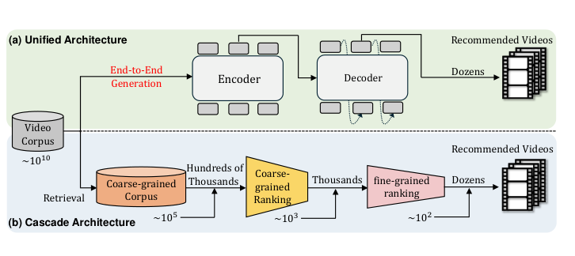
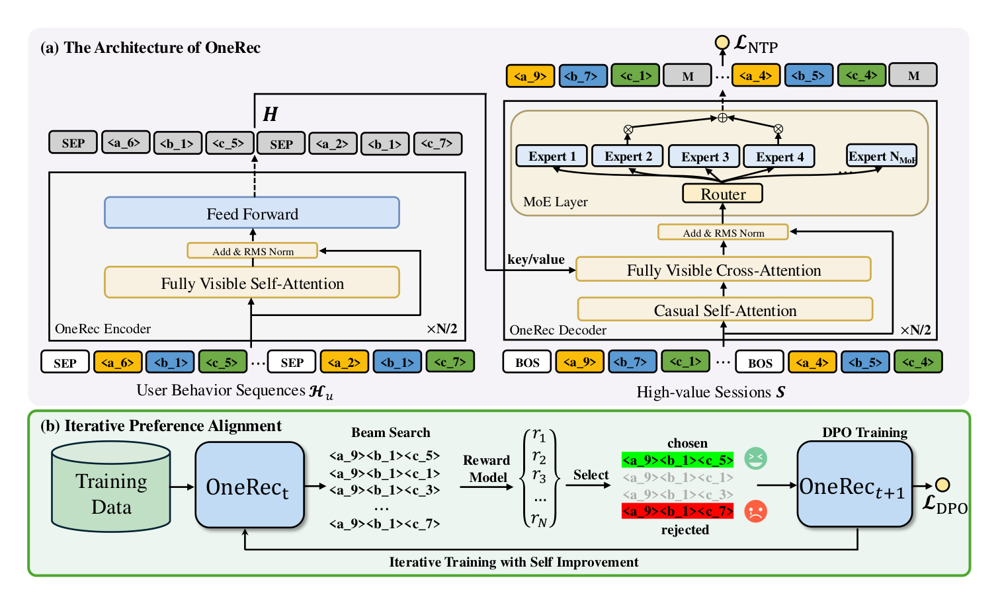
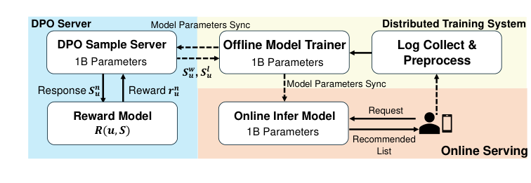
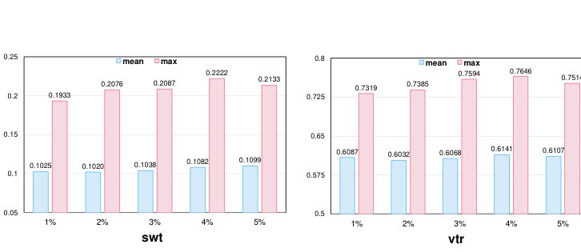
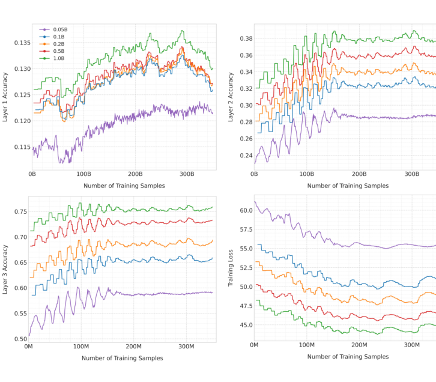
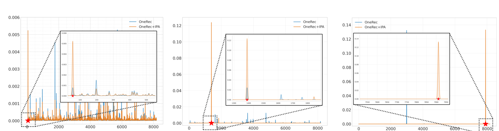

# OneRec：用生成式推荐器与偏好对齐统一召回与排序

**作者**：Jiaxin Deng*、Shiyao Wang*、Kuo Cai*、Lejian Ren*、Qigen Hu*、Weifeng Ding*、Qiang Luo*、Guorui Zhou*†（快手，北京；*共同一作，†通讯作者）

arXiv:2502.18965v1 [cs.IR]，2025 年 2 月 26 日。

## 摘要

近来，基于生成式检索的推荐系统（GRs）以自回归方式直接生成候选视频，成为有前景的新范式。然而，多数现代推荐系统采用"检索-排序"策略，生成模型只在召回阶段充当选择器。本文提出 OneRec，用统一的生成式模型取代级联学习框架。据我们所知，这是首个在真实场景中显著超越现有复杂且精心设计的推荐系统的端到端生成式模型。具体地，OneRec 包含：1）encoder-decoder 结构，编码用户历史行为序列并逐步解码用户可能感兴趣的视频。我们采用稀疏专家混合（MoE）扩展模型容量而不按比例增加计算 FLOPs。2）会话级（session-wise）生成方式。与传统的下一物品预测不同，我们提出会话级生成，比逐点生成更优雅、上下文更连贯——后者依赖手工规则来恰当组合生成结果。3）结合直接偏好优化（DPO）的迭代偏好对齐（IPA）模块，提升生成结果质量。与 NLP 中的 DPO 不同，推荐系统对每个用户的浏览请求通常只有一次展示机会，无法同时获得正负样本。为解决该限制，我们设计奖励模型模拟用户生成，并按推荐系统在线学习属性定制采样策略。大量实验表明，少量 DPO 样本即可对齐用户兴趣偏好并显著提升生成结果质量。我们将 OneRec 部署在快手——一个数亿日活的短视频推荐平台——的主场景，观看时长提升 1.6%，这是相当可观的改进。

**CCS 概念**：信息系统 → 计算广告；多媒体信息系统。
**关键词**：生成式推荐、自回归生成、语义 token 化、直接偏好优化

## 1 引言

为平衡效率与效果，多数现代推荐系统采用级联排序策略 [6, 26, 34, 43]。如图 1(b) 所示，典型级联排序系统采用三阶段流水线：召回 [6, 19, 54]、预排序 [28, 46] 和排序 [2, 3, 15, 16, 33, 52, 53]。每阶段负责从收到的物品中选出 top-k 并传给下一阶段，共同平衡系统响应时间与排序精度的折衷。



*图 1：(a) 本文提出的端到端生成统一架构；(b) 典型级联排序系统，自下而上为召回（约 10⁵）、预排序（约 10³）、排序（约 10²）。原文 Figure 1，第 2 页。*

实践中虽然高效，但现有方法通常将各 ranker 独立对待——每个孤立阶段的效果构成后续排序阶段的上限，限制整体排序系统性能。尽管已有诸多工作 [11, 13, 18, 20, 34, 44] 通过让 ranker 之间交互来提升整体推荐效果，它们仍保持传统级联范式。近来，基于生成式检索的推荐系统（GRs）[36, 45, 51] 以自回归序列生成方式直接生成候选物品标识符，成为有前景的范式。通过用量化 Semantic ID（编码物品语义 [24]）索引物品，推荐器可以利用物品内丰富的语义信息。GR 的生成特性使其适合通过束搜索解码直接挑选候选物品并产出更多样的推荐结果。然而，当前生成式模型只在召回阶段充当选择器——其推荐精度尚不及精心设计的多级级联 ranker。

为应对上述挑战，我们提出面向单阶段推荐的统一端到端生成框架 OneRec。第一，我们提出 encoder-decoder 架构。受大语言模型训练中观察到的 scaling law 启发，我们发现扩展推荐模型容量同样持续提升性能，因此基于 MoE [7, 9, 55] 结构扩展模型参数，显著提升模型刻画用户兴趣的能力。第二，不同于传统的逐点下一物品预测，我们提出会话级列表生成方式，考虑每个会话内物品的相对内容与顺序。逐点生成需要手工策略保证生成结果的连贯性与多样性；会话级学习过程则通过喂给模型偏好数据，让模型自主学习最优会话结构。最后，我们探索用直接偏好优化（DPO）[35] 做偏好学习以进一步提升生成结果质量。为构造偏好对，我们借鉴困难负采样 [37] 的思路，从束搜索结果中创建自生成的困难拒绝样本而非随机采样。我们提出迭代偏好对齐（IPA）策略，基于预训练奖励模型（RM）给出的分数对采样响应排序，识别最优 chosen 与最差 rejected 样本。在大规模工业数据集上的大量实验显示了所提方法的优越性，我们还做了一系列消融实验详细验证各模块的有效性。主要贡献如下：

- 为克服级联排序的局限，我们提出 OneRec——单阶段生成式推荐框架。据我们所知，这是首批能用统一生成模型处理物品推荐并显著超越传统多阶段排序流水线的工业方案之一。
- 我们通过会话级生成方式强调模型容量与目标物品上下文信息的必要性，实现更准确的预测并提升生成物品的多样性。
- 我们提出基于个性化奖励模型的新型自困难负样本选择策略，配合直接偏好优化增强 OneRec 对更广泛用户偏好的泛化。大量离线实验与在线 A/B 测试验证了其有效性与效率。

## 2 相关工作

### 2.1 生成式推荐

近年来，随着生成式模型的显著进步，生成式推荐受到越来越多的关注。传统基于嵌入的检索方法主要依赖双塔模型为每个候选物品计算排序分，并利用高效的 MIPS 或 ANN [14, 17, 21, 31, 38] 检索系统获取 top-k 相关物品；生成式检索（GR）[41] 则把从数据库检索相关文档的问题形式化为序列生成任务，按序生成相关文档 token。文档 token 可以是文档标题、文档 ID 或预训练 Semantic ID [42]。GENRE [8] 率先将 Transformer 架构用于实体检索，基于条件上下文自回归生成实体名。DSI [42] 率先提出为文档分配结构化 Semantic ID、训练 encoder-decoder 模型做生成式文档检索的思想。沿此范式，TIGER [36] 为推荐系统引入生成式物品检索模型的表述。

除生成框架外，如何索引物品也日益受到关注。近期研究聚焦语义索引技术 [12, 36, 42]，旨在基于内容信息索引物品。具体地，TIGER [36] 与 LC-Rec [51] 对物品标题与描述的文本嵌入施加残差量化（RQ-VAE）做 token 化；Recforest [12] 对物品文本嵌入做层级 k-means 聚类获得簇索引作为 token；EAGER [45] 等近期工作则探索把语义与协同信息同时融入 token 化过程。

### 2.2 语言模型的偏好对齐

在大语言模型的后训练 [10] 阶段，基于人类反馈的强化学习（RLHF）[32, 39] 是将 LLM 与人类价值观对齐的主流方法——用表示人类反馈的奖励模型引导强化学习。但 RLHF 存在不稳定与低效的问题。直接偏好优化（DPO）[35] 闭式导出最优策略，可直接用偏好数据优化。此后出现多个改进 DPO 的变体：IPO [1] 用更一般的目标绕过 DPO 的两处近似；cDPO [35] 引入超参数 ϵ 缓解噪声标签影响；rDPO [5] 设计原始二元交叉熵损失的无偏估计；其他变体包括 CPO [47]、simDPO [5] 等，从不同方面增强或扩展 DPO。然而，与传统 NLP 中偏好数据由人类显式标注不同，推荐系统的偏好学习因用户-物品交互数据的稀疏性面临独特挑战，这导致面向推荐的 DPO 改造仍在很大程度上未被探索。与聚焦在用户偏好数据中纳入多负样本（面向 LM 推荐器）的 S-DPO 不同，我们训练奖励模型，并基于奖励模型的分数为不同用户选择个性化偏好数据。

## 3 方法

本节提出 OneRec——以单阶段检索方式生成目标物品的端到端框架。3.1 节介绍工业单阶段生成式推荐流水线的特征工程；3.2 节正式定义会话级生成任务并给出 OneRec 模型架构；3.3 节阐述带个性化奖励模型的自困难负采样能力，以及如何通过直接偏好优化迭代提升模型。OneRec 总体框架见图 2。



*图 2：OneRec 总体框架，含两个阶段：(i) 用会话级数据训练 OneRec 的会话训练阶段；(ii) 利用迭代直接偏好优化与自困难负样本的 IPA 阶段。原文 Figure 2，第 3 页。*

### 3.1 预备

本节从特征工程视角介绍单阶段生成式推荐流水线的构建。用户侧特征方面，OneRec 以正反馈历史行为序列 $H_u = \{v^h_1, v^h_2, \ldots, v^h_n\}$ 为输入，其中 $v$ 表示用户有效观看或交互过（点赞、关注、分享）的视频，$n$ 为行为序列长度。OneRec 的输出是一个视频列表，构成一个会话 $S = \{v_1, v_2, \ldots, v_m\}$，$m$ 为会话内视频数（"会话"的详细定义见 3.2 节）。

对每个视频 $v_i$，我们用与真实用户-物品行为分布对齐的多模态嵌入 $e_i \in \mathbb{R}^d$ 描述 [27]。基于预训练多模态表示，现有生成式推荐框架 [25, 36] 用 RQ-VAE [49] 把嵌入编码为语义 token。但该方法并非最优，因为存在码本分布不均衡——即所谓的沙漏现象（hourglass phenomenon）[23]。我们施加多级均衡量化机制，用残差 K-means 量化算法 [27] 变换 $e_i$。第 1 级（$l=1$）的初始残差定义为 $r^1_i = e_i$。在每一级 $l$，我们有余弦本 $C^l = \{c^l_1, \ldots, c^l_K\}$，$K$ 为码本大小。最近质心节点嵌入的索引由 $s^l_i = \arg\min_k \|r^l_i - c^l_k\|_2^2$ 生成，下一级 $l+1$ 的残差定义为 $r^{l+1}_i = r^l_i - c^l_{s^l_i}$。相应的码本 token 通过层级索引生成：

$$s^1_i = \arg\min_k \|r^1_i - c^1_k\|_2^2, \quad r^2_i = r^1_i - c^1_{s^1_i}$$
$$s^2_i = \arg\min_k \|r^2_i - c^2_k\|_2^2, \quad r^3_i = r^2_i - c^2_{s^2_i}$$
$$\ldots$$
$$s^L_i = \arg\min_k \|r^L_i - c^L_k\|_2^2$$

其中 $L$ 为 Semantic ID 的总层级数。为构建均衡码本 $C^l = \{c^l_1, \ldots, c^l_K\}$，我们对物品集划分采用算法 1 详述的平衡 K-means。给定全量视频集 $V$，该算法把集合划分为 $K$ 个簇，每簇恰好包含 $w = |V|/K$ 个视频。迭代中，每个质心按欧氏距离顺序分配其最近的 $w$ 个未分配视频，再用已分配视频的均值向量重校准质心，直至簇分配收敛。

**算法 1：平衡 K-means 聚类**

```
输入：物品集 V，簇数 K
1  计算 w ← |V|/K
2  随机选择初始化质心 C^l = {c^l_1, ..., c^l_K}
3  repeat
4      初始化未分配集合 U ← V
5      for 每个簇 k ∈ {1, ..., K} do
6          按 U 中物品到质心 c^l_k 的距离升序排序 U；
7          分配 V_k ← U[0 : w-1]；
8          更新质心 c^l_k ← (1/w) Σ_{r^l ∈ V_k} r^l；
9          移除已分配物品 U ← U \ V_k；
10     end
11 until 分配收敛；
输出：优化后的码本 C^l = {c^l_1, ..., c^l_K}
```

### 3.2 会话级列表生成

与只预测下一视频的传统逐点推荐方法不同，会话级生成旨在基于用户历史交互序列生成高价值会话列表，使推荐模型能捕捉推荐列表内视频之间的依赖。具体地，会话指响应用户一次请求而返回的一批短视频，通常含 5 到 10 个视频。会话内视频一般兼顾用户兴趣、连贯性与多样性。我们设计了若干标准识别高质量会话，包括：

- 会话内用户实际观看的短视频数 ≥ 5；
- 用户观看该会话的总时长超过某阈值；
- 用户表现出互动行为，如点赞、收藏或分享视频。

这确保会话级模型从真实用户参与模式中学习，捕捉会话列表内更准确的上下文信息。会话级模型 $\mathcal{M}$ 的目标形式化为：

$$S := \mathcal{M}(H_u) \tag{1}$$

其中 $H_u$ 由 Semantic ID 表示：$H_u = \{(s^1_1, s^2_1, \cdots, s^L_1), (s^1_2, s^2_2, \cdots, s^L_2), \cdots, (s^1_n, s^2_n, \cdots, s^L_n)\}$，$S = \{(s^1_1, s^2_1, \cdots, s^L_1), (s^1_2, s^2_2, \cdots, s^L_2), \cdots, (s^1_m, s^2_m, \cdots, s^L_m)\}$。

如图 2(a) 所示，与 T5 [48] 架构一致，我们的模型采用基于 Transformer 的框架，含两个主要组件：建模用户历史交互的编码器和生成会话列表的解码器。具体地，编码器利用堆叠的多头自注意力与前馈层处理输入序列 $H_u$，记编码后的历史交互特征为 $H = Encoder(H_u)$。解码器以目标会话的 Semantic ID 为输入，自回归地生成目标。为在经济成本合理的前提下训练更大的模型，解码器中的前馈网络（FFN）采用基于 Transformer 的语言模型常用的 MoE 架构 [7, 9, 55]，把第 $l$ 个 FFN 替换为：

$$H^{l+1}_t = \sum_{i=1}^{N_{MoE}} \left( g_{i,t} \, FFN_i(H^l_t) \right) + H^l_t, \tag{2}$$

$$g_{i,t} = \begin{cases} s_{i,t}, & s_{i,t} \in \text{Topk}(\{s_{j,t} \mid 1 \le j \le N\}, K_{MoE}) \\ 0, & \text{否则} \end{cases}, \quad s_{i,t} = \text{Softmax}_i\left( H^l_t \, T e^l_i \right),$$

其中 $N_{MoE}$ 为专家总数，$FFN_i(\cdot)$ 为第 i 个专家 FFN，$g_{i,t}$ 为第 i 个专家的门控值。门控值 $g_{i,t}$ 是稀疏的：$N_{MoE}$ 个门控值中只有 $K_{MoE}$ 个非零。该稀疏性保证 MoE 层的计算效率，每个 token 只被分配到 $K_{MoE}$ 个专家上计算。

训练时，我们在编码开头加入起始 token $s_{[\text{BOS}]}$ 构造解码器输入：

$$\bar{S} = \{s_{[\text{BOS}]}, s^1_1, s^2_1, \cdots, s^L_1, s_{[\text{BOS}]}, s^1_2, s^2_2, \cdots, s^L_2, \cdots, s_{[\text{BOS}]}, s^1_m, s^2_m, \cdots, s^L_m\} \tag{3}$$

我们对目标会话的 Semantic ID 做 next-token prediction，采用交叉熵损失。NTP 损失 $\mathcal{L}_{NTP}$ 形式化为：

$$\mathcal{L}_{NTP} = -\sum_{i=1}^{m} \sum_{j=1}^{L} \log P\left(s^{j+1}_i \mid [s_{[\text{BOS}]}, s^1_1, s^2_1, \cdots, s^L_1, \cdots, s_{[\text{BOS}]}, s^1_i, \cdots, s^j_i]; \Theta\right). \tag{4}$$

在会话级列表生成任务上训练一定量后，得到种子模型 $\mathcal{M}_t$。

### 3.3 基于奖励模型的迭代偏好对齐

3.2 节定义的高质量会话提供了宝贵的训练数据，让模型学到什么是好会话，从而保证生成视频的质量。在此之上，我们希望用直接偏好优化（DPO）进一步增强模型能力。传统 NLP 场景中偏好数据由人类显式标注；推荐系统的偏好学习则因用户-物品交互数据的稀疏性面临独特挑战，这需要奖励模型（RM）。我们在 3.3.1 节引入会话级奖励模型，在 3.3.2 节提出实现模型自我改进的迭代直接偏好优化。

**3.3.1 奖励模型训练。** 我们用 $R(u, S)$ 表示为不同用户选择偏好数据的奖励模型。输出 $r$ 表示用户 $u$（通常由用户行为表示）对会话 $S = \{v_1, v_2, \ldots, v_m\}$ 偏好对应的奖励。为让 RM 具备会话排序能力，我们先提取 $S$ 中每个物品 $v_i$ 的 target-aware 表示 $e_i = v_i \odot u$，其中 $\odot$ 表示 target-aware 操作（如面向用户行为的 target attention），得到会话 $S$ 的 target-aware 表示 $h = \{e_1, e_2, \cdots, e_m\}$。然后会话内物品通过自注意力层交互，融合不同物品间的必要信息：

$$h_f = \text{SelfAttention}(h W^Q_s, h W^K_s, h W^V_s) \tag{5}$$

接着用不同的塔对多目标奖励做预测，RM 用丰富的推荐数据预训练：

$$\hat{r}_{swt} = \text{Tower}_{swt}(\text{Sum}(h_f)), \; \hat{r}_{vtr} = \text{Tower}_{vtr}(\text{Sum}(h_f)),$$
$$\hat{r}_{wtr} = \text{Tower}_{wtr}(\text{Sum}(h_f)), \; \hat{r}_{ltr} = \text{Tower}_{ltr}(\text{Sum}(h_f)),$$

其中 $\text{Tower}(\cdot) = \text{Sigmoid}(\text{MLP}(\cdot))$。 (6)

得到所有估计奖励 $\hat{r}_{swt}, \ldots$ 及每个会话的真实标签 $y_{swt}, \ldots$ 后，直接最小化二元交叉熵损失训练 RM。损失函数 $\mathcal{L}_{RM}$ 定义为：

$$\mathcal{L}_{RM} = -\sum^{x_{tr}}_{swt,\ldots} \left( y_{x_{tr}} \log(\hat{r}_{x_{tr}}) + (1 - y_{x_{tr}}) \log(1 - \hat{r}_{x_{tr}}) \right) \tag{7}$$

**3.3.2 迭代偏好对齐。** 基于预训练 RM $R(u, S)$ 与当前 OneRec $\mathcal{M}_t$，我们对每个用户用束搜索生成 $N$ 个不同响应：

$$S^n_u \sim M_t(H_u), \quad \text{对所有 } u \in U \text{ 与 } n \in [N], \tag{8}$$

其中 $[N]$ 表示 $\{1, 2, \ldots, N\}$。然后基于 RM $R(u, S)$ 计算每个响应的奖励：

$$r^n_u = R(u, S^n_u) \tag{9}$$

接着选奖励最高的获胜响应 $(S^w_u, H_u)$ 与奖励最低的落选响应 $(S^l_u, H_u)$ 构成偏好对 $D^{pairs}_t = (S^w_u, S^l_u, H_u)$。给定偏好对，我们训练新模型 $M_{t+1}$——由 $M_t$ 初始化，用结合 DPO 损失 [35] 的损失函数从偏好对学习。每个偏好对对应的损失为：

$$\mathcal{L}_{DPO} = \mathcal{L}_{DPO}(S^w_u, S^l_u \mid H_u) = -\log\sigma\left( \beta \log \frac{M_{t+1}(S^w_u \mid H_u)}{M_t(S^w_u \mid H_u)} - \beta \log \frac{M_{t+1}(S^l_u \mid H_u)}{M_t(S^l_u \mid H_u)} \right). \tag{10}$$

如算法 2 与图 2(b) 所示，整体流程是训练一列模型 $M_t, \ldots, M_T$。为缓解束搜索推理的计算负担，我们只随机采样 $r_{DPO} = 1\%$ 的数据做偏好对齐。每个后续模型 $M_{t+1}$ 从前一模型 $M_t$ 初始化，用 $M_t$ 生成的偏好数据 $D^{pairs}_t$ 训练。

**算法 2：迭代偏好对齐（IPA）**

```
输入：响应数 N，预训练 RM R(u, S)，种子模型 M_t，
      DPO 比例 r_DPO，总 epoch 数 T，每 epoch 样本数 N_sample
1  for epoch ← t to T do
2      for sample ← 1 to N_sample do
3          if rand() < r_DPO then
4              用 M_t 生成 N 个响应：
5              for i ← 1 to N do
6                  S^i_u ~ M_t(H_u)；
7                  r^i_u ← R(u, S^i_u)；
8              end
9              选择最优与最差响应：
10             S^w_u ← S_{argmax_i r^i_u}；
11             S^l_u ← S_{argmin_i r^i_u}；
12             计算 NTP 与 DPO 损失：
13             L ← L_NTP + λ L_DPO；
14         else
15             计算 NTP 损失：
16             L ← L_NTP；
17         end
18         更新参数：
19         Θ ← Θ − α ∇_Θ L；
20     end
21     更新模型快照：M_{t+1} ← M_t；
22 end
输出：优化后的参数 Θ
```

## 4 系统部署

OneRec 已成功落地真实工业场景。为平衡稳定性与性能，我们部署 OneRec-1B 提供在线服务。如图 3 所示，部署架构包含三个核心组件：1）训练系统；2）在线服务系统；3）DPO 样本服务器。系统把收集到的交互日志作为训练数据，先用 next token prediction 目标 $\mathcal{L}_{NTP}$ 训练种子模型；收敛后加入 DPO 损失 $\mathcal{L}_{DPO}$ 做偏好对齐，并利用 XLA 与 bfloat16 混合精度训练优化计算效率与内存占用。训练好的参数同步到在线推理模块与 DPO 采样服务器，用于实时服务与基于偏好的数据选择。为增强推理性能，我们实施两项关键优化：KV cache 解码机制配合 float16 量化降低 GPU 内存开销；beam size 为 128 的束搜索配置以平衡生成质量与延迟。得益于 MoE 架构，推理时只有 13% 的参数被激活。



*图 3：OneRec 在线部署框架：分布式训练系统、在线服务与 DPO 样本服务器三组件协同。原文 Figure 3，第 5 页。*

## 5 实验

本节先在离线设置下比较 OneRec 与逐点方法及多个 DPO 变体，然后对所提模块做消融实验验证有效性，最后把 OneRec 部署上线、在快手做 A/B 测试进一步验证性能。

### 5.1 实验设置

**5.1.1 实现细节。** 模型用 Adam 优化器训练，初始学习率 2×10⁻⁴，使用 NVIDIA A800 GPU。DPO 采样比例 $r_{DPO}$ 全程设为 1%，束搜索为每个用户生成 $N = 128$ 个不同响应；Semantic ID 聚类每层码本 $K = 8192$ 个簇、码本层数 $L = 3$；MoE 架构含 $N_{MoE} = 24$ 个专家，每次前向经 top-k 选择激活 $K_{MoE} = 2$ 个专家；会话建模取 $m = 5$ 个目标会话物品、$n = 256$ 条历史行为作为上下文。

**5.1.2 基线方法。** 采用以下代表性推荐模型、DPO 及其变体作为基线：

- **SASRec** [22]：单向 Transformer 架构捕捉用户-物品交互中的序列依赖，做下一物品预测。
- **BERT4Rec** [40]：双向 Transformer + 掩码语言建模，通过序列重建学习上下文物品表示。
- **FDSA** [50]：双自注意力通路，联合建模物品级转移与特征级变换模式。
- **TIGER** [36]：层级语义标识符 + 生成式检索，通过自回归序列生成做序列推荐。
- **DPO** [35]：经隐式奖励建模从人类反馈数据导出闭式奖励函数，形式化偏好优化。
- **IPO** [1]：理论基础更完备的偏好优化框架，绕过标准 DPO 的近似。
- **cDPO** [30]：引入标签翻转率参数 ϵ 的鲁棒变体，应对噪声偏好标注。
- **rDPO** [5]：用重要性采样开发无偏损失估计器，降低偏好优化方差。
- **CPO** [47]：通过序列似然奖励与监督微调目标联合训练，统一对比学习与偏好优化。
- **simPO** [29]：采用序列级奖励间隔、经归一化概率平均消除参考模型依赖。
- **S-DPO** [4]：通过困难负采样与多物品对比学习把 DPO 适配到推荐系统，提升排序精度。

**5.1.3 评估指标。** 我们用若干关键指标评估模型，各自衡量模型输出的不同侧面；每轮迭代在随机抽取的测试用例集上评估。为估计每个用户-会话对各种交互的概率，我们用预训练奖励模型评估推荐会话的价值，计算不同目标指标的平均奖励：会话观看时长（swt）、观看概率（vtr）、关注概率（wtr）与点赞概率（ltr）。其中 swt 与 vtr 属于观看时长类指标，wtr 与 ltr 属于互动类指标。

### 5.2 离线性能

表 1 给出 OneRec 与各基线的全面比较。观看时长类指标中我们主要关心会话观看时长（swt），互动类指标中关心点赞概率（ltr）。结果揭示三个关键观察：

第一，所提会话级生成方式显著优于传统点积方法与 TIGER 式逐点生成方法。OneRec-1B 相比 TIGER-1B 的最大 swt 高 1.78%、最大 ltr 高 3.36%。这证明会话级建模在保持推荐间上下文连贯性上的优势，而逐点方法难以在生成输出的连贯性与多样性之间取得平衡。

第二，很小比例的 DPO 训练即带来可观收益。仅 1% DPO 训练比例（$r_{DPO}$）下，OneRec-1B+IPA 的最大 swt 超基础版 OneRec-1B 4.04%、最大 ltr 超 5.43%。这表明有限的 DPO 训练即可有效对齐模型与期望的生成模式。

第三，所提 IPA 策略优于多种现有 DPO 变体。如表 1 所示，IPA 相对其他 DPO 实现取得更优性能。值得注意的是，部分 DPO 基线甚至不及未对齐的 OneRec-1B，说明对自生成输出做迭代挖掘的偏好选择，比其他方法更有效。

表 1：OneRec（绿色）与逐点方法（棕色）、listwise 方法（蓝色）、偏好对齐方法（黄色）的离线性能。最优加粗、次优下划线。↑ 表示越高越好，↓ 表示越低越好。原文 Table 1，第 6 页。

| 方法 | swt mean↑ | swt max↑ | vtr mean↑ | vtr max↑ | wtr mean↑ | wtr max↑ | ltr mean↑ | ltr max↑ |
| --- | --- | --- | --- | --- | --- | --- | --- | --- |
| **逐点判别式方法** | | | | | | | | |
| SASRec | 0.0375±0.002 | 0.0803±0.005 | 0.4313±0.013 | 0.5801±0.013 | 0.00294±0.001 | 0.00978±0.001 | 0.0314±0.002 | 0.0604±0.004 |
| BERT4Rec | 0.0336±0.002 | 0.0706±0.004 | 0.4192±0.014 | 0.5633±0.013 | 0.00281±0.001 | 0.00932±0.001 | 0.0316±0.002 | 0.0606±0.004 |
| FDSA | 0.0325±0.002 | 0.0683±0.005 | 0.4145±0.015 | 0.5588±0.014 | 0.00271±0.001 | 0.00921±0.001 | 0.0313±0.002 | 0.0604±0.003 |
| **逐点生成式方法** | | | | | | | | |
| TIGER-0.1B | 0.0879±0.007 | 0.1286±0.010 | 0.5826±0.016 | 0.6625±0.017 | 0.00277±0.001 | 0.00671±0.001 | 0.0316±0.004 | 0.0541±0.007 |
| TIGER-1B | 0.0873±0.006 | 0.1368±0.010 | 0.5827±0.015 | 0.6776±0.015 | 0.00292±0.001 | 0.00758±0.001 | 0.0323±0.004 | 0.0579±0.008 |
| **Listwise 生成式方法** | | | | | | | | |
| OneRec-0.1B | 0.0973±0.010 | 0.1501±0.015 | 0.6001±0.021 | 0.6981±0.021 | 0.00326±0.001 | 0.00870±0.001 | 0.0349±0.009 | 0.0642±0.015 |
| OneRec-1B | 0.0991±0.008 | 0.1529±0.012 | 0.6039±0.020 | 0.7013±0.020 | 0.00349±0.001 | 0.00919±0.002 | 0.0360±0.005 | 0.0660±0.008 |
| **Listwise 生成式 + 偏好对齐** | | | | | | | | |
| OneRec-1B+DPO | 0.1014±0.010 | 0.1595±0.015 | 0.6127±0.017 | 0.7116±0.016 | 0.00339±0.001 | 0.00896±0.001 | 0.0351±0.004 | 0.0644±0.008 |
| OneRec-1B+IPO | 0.0979±0.003 | 0.1528±0.005 | 0.6000±0.007 | 0.7012±0.007 | 0.00335±0.001 | 0.00905±0.001 | 0.0350±0.003 | 0.0654±0.004 |
| OneRec-1B+cDPO | 0.0993±0.006 | 0.1547±0.008 | 0.6030±0.011 | 0.7030±0.009 | 0.00339±0.001 | 0.00901±0.001 | 0.0355±0.006 | 0.0652±0.009 |
| OneRec-1B+rDPO | 0.1005±0.006 | 0.1555±0.008 | 0.6071±0.014 | 0.7059±0.011 | 0.00339±0.001 | 0.00899±0.001 | 0.0357±0.004 | 0.0657±0.006 |
| OneRec-1B+CPO | 0.0993±0.008 | 0.1538±0.012 | 0.6045±0.021 | 0.7029±0.018 | 0.00343±0.001 | 0.00911±0.002 | 0.0357±0.008 | 0.0659±0.014 |
| OneRec-1B+simPO | 0.0995±0.008 | 0.1536±0.013 | 0.6047±0.016 | 0.7022±0.015 | 0.00349±0.001 | 0.00918±0.001 | 0.0360±0.005 | 0.0659±0.008 |
| OneRec-1B+S-DPO | 0.1021±0.008 | 0.1575±0.013 | 0.6096±0.016 | 0.7070±0.015 | 0.00345±0.001 | 0.00909±0.001 | 0.0361±0.004 | 0.0659±0.008 |
| OneRec-1B+IPA | **0.1025**±0.009 | **0.1933**±0.017 | **0.6141**±0.020 | **0.7646**±0.021 | **0.00354**±0.001 | **0.00992**±0.001 | **0.0397**±0.004 | **0.1203**±0.010 |

> 译注：原文说明最优加粗、次优下划线；上表的加粗由译者依据数值核对标注（最优列均为 OneRec-1B+IPA 行），数值与原文一致。

### 5.3 消融研究

**5.3.1 DPO 采样比例消融。** 为研究 DPO 训练中采样比例 $r_{DPO}$ 的影响，我们在受控条件下把比例从 1% 变到 5%。如图 4 所示，消融结果表明增大采样比例在多个评估目标上只带来边际改进；1% 基线之上的收益在计算开销增加的情况下仍不显著。值得注意的是，DPO 样本服务器推理的 GPU 资源消耗与该比例呈线性关系：5% 比例需要 5 倍于 1% 基线的 GPU 资源。这一扩展特性确立了计算效率与模型性能的明确折衷。因此，在权衡最优折衷后，训练采用 1% 的 DPO 采样比例——以更高比例所需计算资源的约 20%，取得观测最大性能的平均 95%。



*图 4：DPO 采样比例 r_DPO 的消融。1% 比例的 DPO 训练带来显著收益，继续增大采样比例改进有限。原文 Figure 4，第 7 页。*

**5.3.2 模型规模消融。** 我们评估 OneRec 在模型规模增大时的表现。如图 6 所示，从 0.05B 扩展到 1B 取得一致的精度增益，展现一致的扩展特性。具体地，相比 OneRec-0.05B，OneRec-0.1B 取得最大 14.45% 的显著精度增益，扩展到 0.2B、0.5B、1B 分别再获得 5.09%、5.70%、5.69% 的额外精度增益。



*图 6：OneRec 在模型规模扩展上的表现。参数扩大时性能持续受益（图中为三层 Semantic ID 各自的逐层准确率与训练损失曲线）。原文 Figure 6，第 8 页。*

### 5.4 OneRec 的预测动态

如图 5 所示，我们展示了 8192 个编码在Semantic ID各层的预测概率分布，红色星号标记奖励值最高物品的 Semantic ID。与 OneRec 基线相比，OneRec+IPA 的预测分布出现明显的置信度偏移，说明所提偏好对齐策略有效促使基础模型产生偏好的生成模式。我们还观察到第一层的概率分布比后续层更分散（第一层熵 = 6.00，第二层平均熵 = 3.71，第三层熵 = 0.048），分布逐层趋于集中。这种层级化的不确定性下降可归因于自回归解码机制：初始层的预测从前序解码步骤继承更高的不确定性，而后面的层受益于累积上下文对决策空间的约束。



*图 5：Semantic ID 三层 softmax 输出概率分布。红星为奖励值最高物品的 Semantic ID；OneRec+IPA 相比基线在最优编码上出现明显置信度集中。原文 Figure 5，第 8 页。*

### 5.5 在线 A/B 测试

为评估 OneRec 的在线表现，我们在快手主页视频推荐场景做了严格的在线 A/B 测试，以 1% 主流量对比 OneRec 与现有多阶段推荐系统。我们用总观看时长（Total Watch Time）衡量用户观看视频的总时长，用平均单视频观看时长（Average View Duration）衡量用户在被推荐会话曝光后单个视频的平均观看时长。在线评估显示，OneRec 取得总观看时长 +1.68%、平均单视频观看时长 +6.56% 的提升，表明 OneRec 取得显著更好的推荐结果，为平台带来可观的收益增量。

表 2：在线 A/B 测试中 OneRec 相对现有多阶段系统的绝对提升。原文 Table 2，第 8 页。

| 模型 | 总观看时长 | 平均单视频观看时长 |
| --- | --- | --- |
| OneRec-0.1B | +0.57% | +4.26% |
| OneRec-1B | +1.21% | +5.01% |
| OneRec-1B+IPA | +1.68% | +6.56% |

## 6 结论

本文聚焦介绍单阶段生成式推荐的工业解决方案。我们的方案确立了三个关键贡献：第一，通过 MoE 架构以高计算效率有效扩展模型参数，为大规模工业推荐提供可扩展蓝图；第二，我们发现了以会话级生成方式建模目标物品上下文信息的必要性，证明上下文序列建模本质上比孤立的逐点方式更好地捕捉用户偏好动态；第三，我们提出迭代偏好对齐（IPA）策略提升 OneRec 对多样用户偏好模式的泛化。大量离线实验与在线 A/B 测试验证了 OneRec 的有效性与效率。此外，对在线结果的分析显示，除用户观看时长外，我们的模型在点赞等互动指标上仍有局限。未来工作旨在增强端到端生成式推荐的多目标建模能力，以提供更好的用户体验。

## 参考文献

> 译注：参考文献按原文保留（共 55 条），标题不翻译。代表性文献：TIGER (Rajput et al. 2023)、DPO (Rafailov et al. 2024)、RQ-VAE/SoundStream (Zeghidour et al. 2021)、DSI (Tay et al. 2022)、LC-Rec (Zheng et al. 2024)、QARM (Luo et al. 2024)、S-DPO (Chen et al. 2024)、MoE (Dai et al. 2024 DeepSeekMoE; Du et al. 2022 GLaM)、沙漏现象 (Kuai et al. 2024)、simPO (Meng et al. 2024)、CPO (Xu et al. 2024)。
