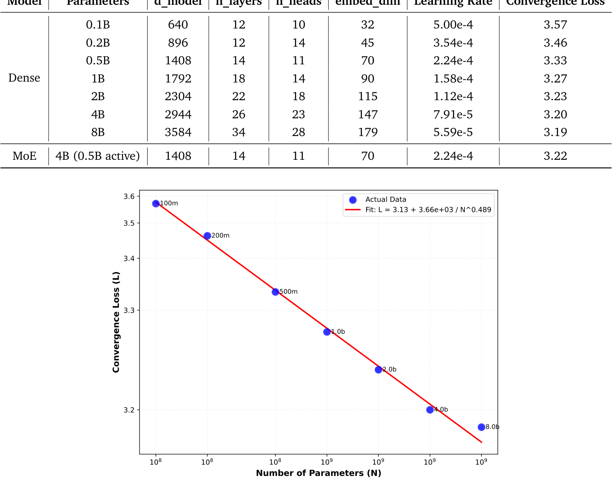

# OneRec-V2 技术报告精读：砍掉编码器、用真实反馈做 RL，生成式推荐扩到 8B（快手）

> 论文：OneRec-V2 Technical Report（arXiv:2508.20900v4），快手 OneRec 团队，2025 年 10 月。完整中文译稿见同目录 `../translation/paper.zh-CN.md`。前作 OneRec-V1 的精读见同系列。

## 论文要解决的问题

OneRec-V1 验证了端到端生成式推荐可以取代级联流水线，但技术报告坦率地暴露了两个结构性问题。

第一个是算账算出来的：V1 的 encoder-decoder 里，解码器参数虽然比编码器多，计算负载却压在编码器上——它要处理几百上千条用户行为序列，而解码器只生成 3 个语义 token。上下文长度 512 时，97.66% 的 FLOPs 花在"理解用户"上，真正做推荐决策的目标解码只占 2.34%；把上下文加长到 3000，这个比例跌到 0.41%。算力花不到刀刃上，模型就没法有效扩展。

第二个是 RL 的：V1 的偏好对齐完全依赖奖励模型，而 RM 路线有两个先天缺陷——on-policy 采样只覆盖 1% 的用户（算力不够给所有人 rollout 打分），以及代理奖励信号固有的 reward hacking 风险。

OneRec-V2 的两个改进分别对着这两个问题：架构上砍掉编码器换成 Lazy Decoder-Only，把模型从 0.5B 扩到 8B；对齐上绕过 RM，直接用真实用户反馈做强化学习。

## Lazy Decoder-Only：计算全部给目标解码

先看数据组织这个前提。推荐的自回归训练样本有三种组织方式：按曝光切分会让同一行为模式（A→B）被冗余训练；按用户全历史组织则会泄漏未来信息（训练 t₃ 时刻的样本时，模型已经见过 t₄ 的行为）。OneRec 的选择是按时间组织、只对最新曝光的物品施加损失。这个设定下历史行为只充当条件信息，OneRec-V1 为此用了编码器；V2 的思路是把这条逻辑推到底——既然历史上下文只是静态条件，就不值得为它做完整 Transformer 计算。

Lazy Decoder 的做法（图 1）：Context Processor 把用户静态画像、短期行为、长期行为三路特征直接变换成一组静态 K/V 对（式 1-4），解码器的交叉注意力不带 K/V 投影层（w/o w_k, w_v）——K/V 不是从隐状态投影出来的，而是上下文切分归一化后直接供给。再叠加三个减法：跨层共享 K/V（每 N_layer/L_kv 个连续块共用一组）、key 与 value 绑定（v=k）、GQA 分组查询。深层 FFN 换成 DeepSeek-V3 式无辅助损失负载均衡的 MoE。

效果用数字说话（Table 2）：1B 参数下，Lazy Dec-Only 每样本 18.89 GFLOPs、激活内存 1.24B，收敛损失 3.27；V1 的 Enc:Dec=1:1 架构是 296.36 GFLOPs、17.63B、损失 3.28。计算量降 94%、训练资源降 90%，损失持平。两项效率消融都支持"放心省"：K/V 从 18 组共享到 1 组、GQA 从 14 组减到 1 组，收敛损失纹丝不动（Table 3/4），GQA 甚至把交叉注意力 KV 内存从 94M 压到 7M。

## 推荐系统的 scaling law

算力省下来之后，V2 做了这个领域少有的系统 scaling 实验：稠密模型从 0.1B 一路扩到 8B，收敛损失从 3.57 单调降到 3.19，且与固定数据量下简化的 Chinchilla 律 L(N) = E + A/N^α 拟合极好——E=3.13、A=3660、α=0.489（图 2）。MoE 变体（4B 总参、每 token 激活 0.5B）损失 3.22，优于 2B 稠密模型（3.23），计算量却与 0.5B 稠密相当。

这张 scaling 曲线的意义在于：生成式推荐的扩展不再靠试，可以像 LLM 一样按公式预算算力、预测收益。配合 HSTU 报告的三数量级 scaling 证据，"推荐模型遵从 scaling law"正在从主张变成可复用结论。

*图 2：稠密模型 scaling law 曲线，0.1B 到 8B 的收敛损失紧贴拟合线 L(N)=3.13+3660/N^0.489。来源：论文 Figure 6，第 12 页。*

## 对齐：从奖励模型到真实用户反馈

V1 用 RM 做 DPO，V2 换了思路：OneRec 已全量部署，模型自己推荐的内容有海量真实曝光与反馈，直接拿真实信号当奖励，不需要 rollout 打分，也没有代理奖励被 hack 的问题。

**时长感知奖励塑形**解决"播放时长被视频长度带偏"的老问题：把用户历史视频按 log_β(d+ε) 分桶，目标视频的播放时长在同等时长桶内的分位数 q_i 作为偏好得分；batch 内 top 25% 分位为正样本（A=+1），显式负反馈（不喜欢）A=-1，其余过滤。优势值直接赋 ±1、不做归一化——作者的理由是样本定义已足够严格，再归一化反而引入不一致。

**GBPO**（梯度有界策略优化）解决 RL 稳定性。一个被传统裁剪方法忽视的现象：曝光样本里来自传统流水线的部分取不到旧策略概率，π_old 只能取当前策略（比例恒为 1），此时 ECPO/GRPO 的裁剪不生效，而负样本的梯度正比于 1/π_θ——模型本来就不喜欢的视频（π_θ 小）反而收到最大的抑制梯度，容易训崩（图 3 左，梯度范数冲到 4+）。GBPO 的解法是彻底去掉比例裁剪，改为给 π_old 设动态界：正样本界为 max(π_old, sg(π_θ))，负样本为 max(π_old, 1-sg(π_θ))——用 BCE 损失"负样本概率越小梯度越小"的天然稳定性为 RL 梯度封顶（图 3 右，梯度范数压平在 0.1 附近）。所有样本的梯度都保留，鼓励探索。

**在线验证分两层**。第一层（Table 6）验证样本来源：只用传统流水线样本时，时长类指标涨但互动跌（Video View -0.9%、评论 -5.0%）——时长奖励与停留时长强相关、与其他目标错位；纳入 OneRec 自身生成的样本（on-policy）后所有指标转正（评论 +6.4%）。自生成样本的自我迭代优化在推荐场景得到验证。第二层（Table 7）对比三种奖励：RM 组偏爱互动指标（评论 +15.5%），用户反馈组偏爱停留时长，Hybrid 各项略降但最均衡——奖励定义决定模型偏好，这与 V1 结论一致。

## 在线结果与生态代价

最终部署（Table 8）：快手/快手极速版主场景、5% 流量一周、1B 模型、上下文 3000、beam 512、L20 GPU 上延迟 36ms、MFU 62%。相对 V1：App 停留时长 +0.467%/+0.741%，LT7 +0.069%/+0.034%，点赞/关注/评论/收藏/转发全面正向（+2.1%~+8.0%）——V1 遗留的互动指标短板在 V2 被补上了。

附录 D 的补充实验更激进也更重要：另开 1% 流量、关闭缓存、全部请求走 OneRec-V2。此时互动指标暴涨到 +9.6%~+29.2%，但两个生态指标亮红灯：冷启动视频播放暴跌 44.7%/36.7%，内容簇密度上升 11.7%/7.9%。团队把这个问题公开写进了报告——生成式模型的马太效应在接近全量投放时显性化，头部内容挤压新内容。这是端到端推荐落地必须面对的系统性风险，比任何单项指标涨跌都值得警惕。

## 工程判断与证据边界

**证据的边界**。架构决策与 scaling 全部以生成损失（L_Gen）为标尺，损失与推荐质量之间的链条没有闭合验证——8B 模型没有线上结果，线上跑的是 1B。A/B 只报相对 V1 的提升，无置信区间与实验周期；5% 流量组内再按 25% 降级流量分层的设计，也使归因解释多了一层。GBPO 与 ECPO/CISPO 的对比只有训练梯度范数曲线，没有指标级对照，其"更优"目前只体现在稳定性上。

**可迁移的组件**。这篇报告对业界的价值按优先级排：其一，"上下文编码是成本中心"的算账方法（Table 1 + 附录 B 的 FLOPs 分解）适用于任何生成式推荐架构评审；其二，Context Processor + 静态 K/V + 跨层共享 + GQA 的组合拳，省算力的同时损失不掉，可以直接移植；其三，时长感知奖励塑形（log 分桶 + 同桶分位数）与 GBPO 的梯度分析，对任何准备在推荐场景做 on-policy RL 的团队都是现成的避坑指南；其四，1B 模型 + 3000 上下文 + 36ms 延迟 + MFU 62% 的部署参数，给同类系统立了性能标尺。

**与系列前作的连线**。对照 V1：会话级生成目标与 Semantic ID 框架延续，变化在编码器被裁掉、DPO 换成了真实反馈 GBPO；对照 HSTU/HyFormer：三方在"上下文作为静态条件、算力集中于目标"上殊途同归，但 V2 是唯一给出 scaling law 拟合参数（α=0.489）并扩到 8B 的。冷启动 -44.7% 则是全系列论文里第一次把生态代价摆上台面的数据——生成式推荐的下一步，多半不在继续扩参数，而在给探索与冷启动留出系统性空间。
