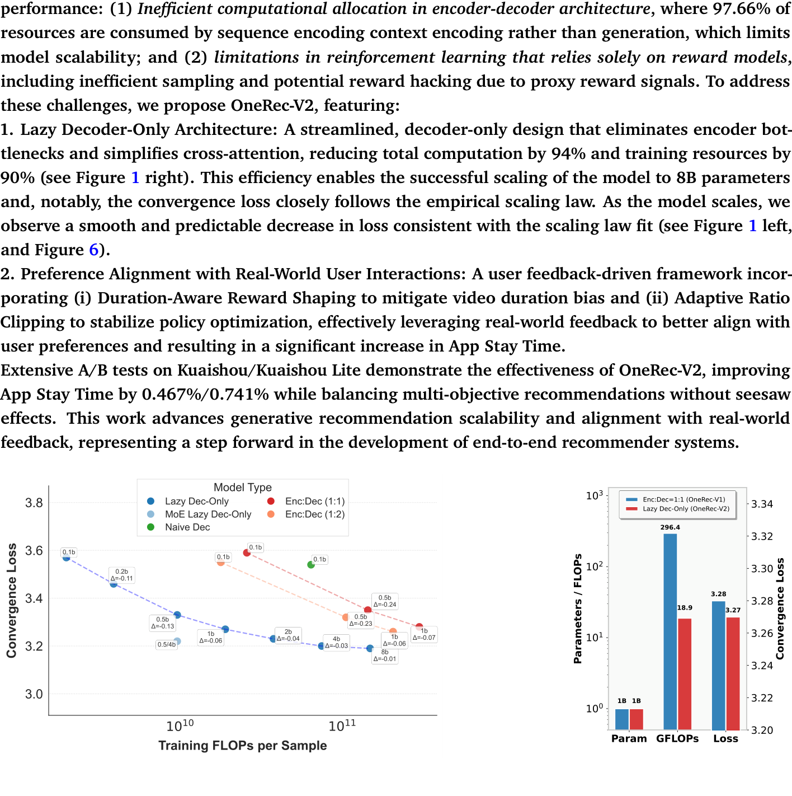
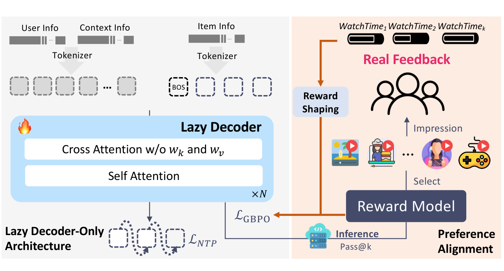
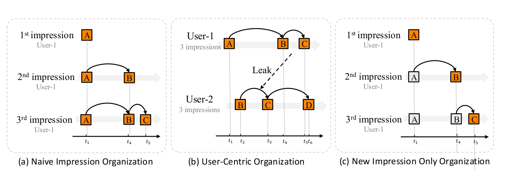
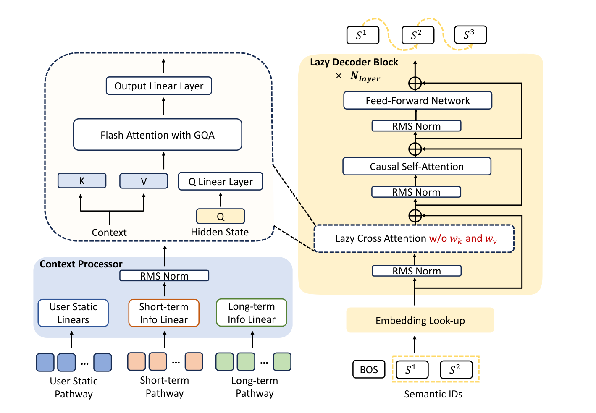
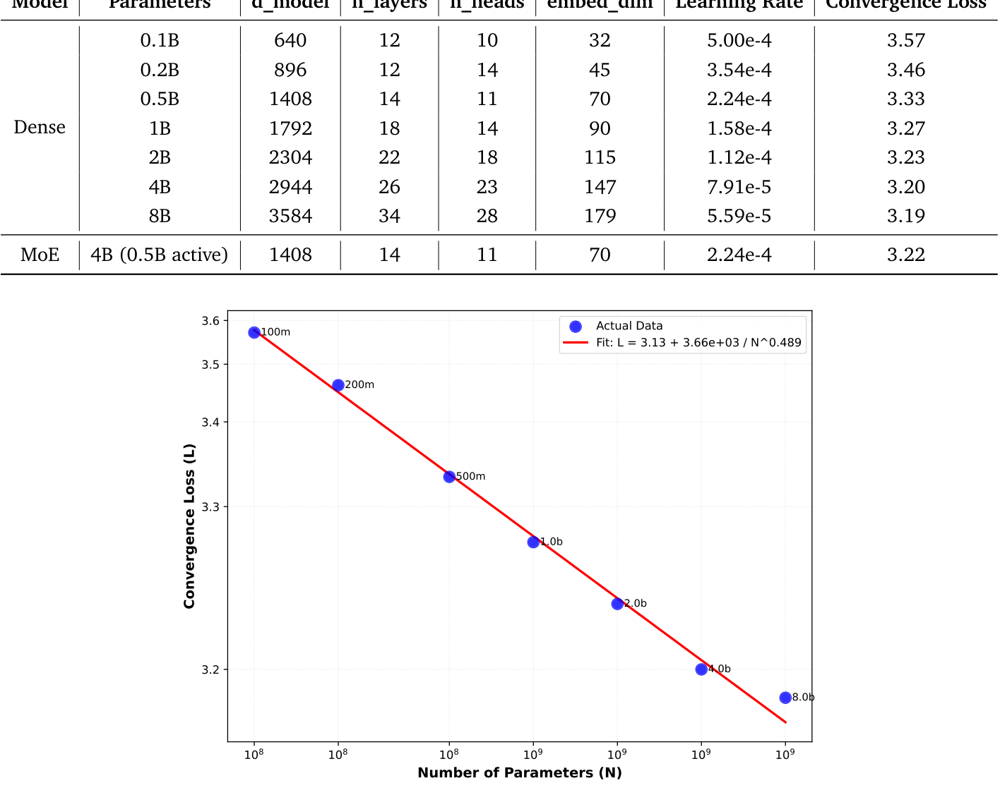
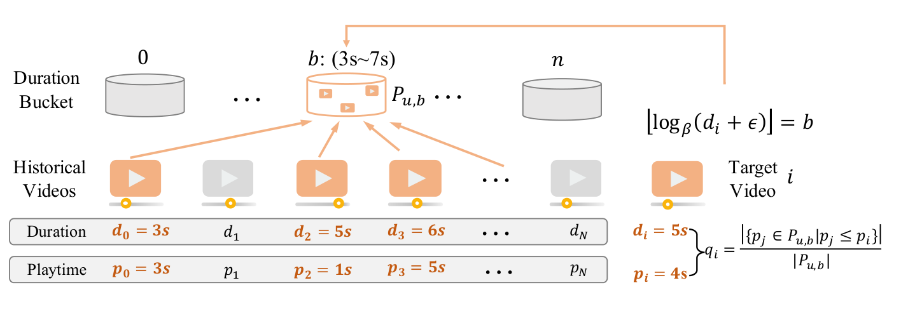
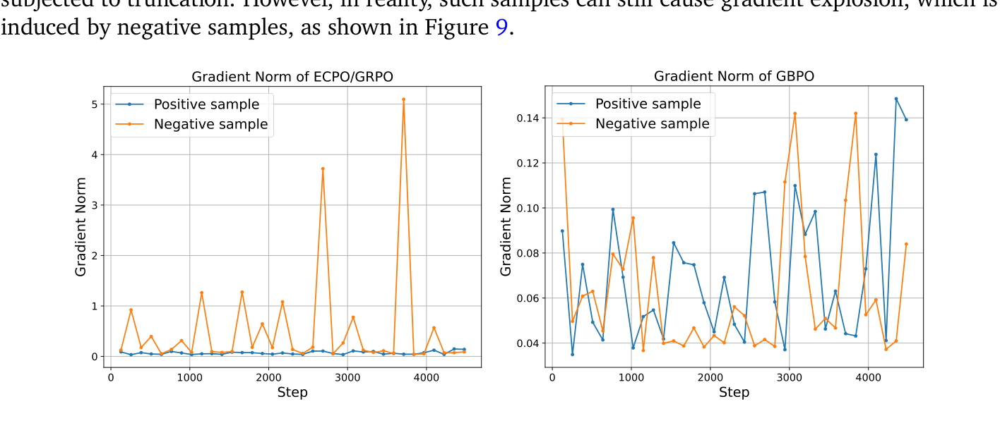
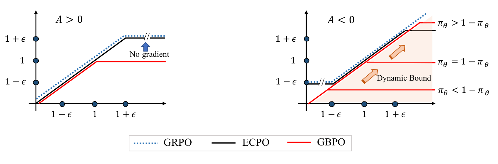

# OneRec-V2 技术报告

**作者**：OneRec Team（快手）

arXiv:2508.20900v4 [cs.IR]，2025 年 10 月 28 日。© 2025 Kuaishou。

## 摘要

生成式 AI 的最新突破通过实现端到端生成，从根本上改变了推荐系统。OneRec 是一个工业规模的生成式推荐框架，它把推荐重构为自回归生成任务，支持对最终目标的直接优化并实现高模型浮点利用率（MFU）。OneRec-V1 在真实部署中已取得显著成功，但两个关键挑战阻碍其扩展性与性能：(1) encoder-decoder 架构中计算分配低效——97.66% 的资源消耗在序列（上下文）编码而非生成上，限制模型扩展；以及 (2) 仅依赖奖励模型的强化学习存在局限，包括采样低效以及代理奖励信号导致的潜在奖励劫持（reward hacking）。为此，我们提出 OneRec-V2，其特性为：

1. **懒解码器（Lazy Decoder-Only）架构**：精简的 decoder-only 设计，消除编码器瓶颈并简化交叉注意力，总计算量降低 94%、训练资源降低 90%（见图 1 右）。这一效率使模型成功扩展到 8B 参数，且收敛损失紧贴经验 scaling law。随模型扩展，我们观察到损失平滑、可预期地下降，与 scaling law 拟合一致（见图 1 左与图 6）。
2. **基于真实世界用户反馈的偏好对齐**：用户反馈驱动的框架，包含 (i) 时长感知奖励塑形（Duration-Aware Reward Shaping），缓解视频时长偏差；以及 (ii) 自适应比例裁剪（Adaptive Ratio Clipping），稳定策略优化，有效利用真实反馈更好地对齐用户偏好，带来 App 停留时长的显著提升。

在快手/快手极速版的大量 A/B 测试证明了 OneRec-V2 的有效性：App 停留时长分别提升 0.467%/0.741%，同时平衡多目标推荐、无跷跷板效应。这项工作推进了生成式推荐的扩展性及与真实反馈的对齐，是端到端推荐系统发展的一步。

*图 1：左：各架构从 0.1B 到 8B 参数的 scaling 曲线，Lazy Decoder-only 模型展现最优扩展效率（0.1b/0.2b/0.5b/1b/2b/4b/8b 的拟合斜率标注于图中）；右：1B 参数下 OneRec-V1（Enc:Dec=1:1，296.4 GFLOPs）与 OneRec-V2（Lazy Dec-Only，18.9 GFLOPs）的对比。原文 Figure 1，第 1 页。*

## 目录

1. 引言（第 3 页）
2. Lazy Decoder-Only 架构（第 5 页）
3. 基于真实世界用户反馈的偏好对齐（第 13 页）
4. 在线 A/B 测试（第 20 页）
5. 结论、局限与未来方向（第 21 页）
附录 A 贡献者、B 不同架构的计算复杂度、C 实验结果、D 关闭缓存的线上表现（第 25-28 页）

## 1. 引言

生成式 AI 在众多领域催化了范式转变（Achiam et al., 2023; Guo et al., 2025; Yang et al., 2025a）。传统级联推荐架构虽经持续演进，仍受制于根本瓶颈：多阶段设计导致算力碎片化与优化目标错位。生成式推荐把推荐重构为端到端序列生成问题（Badrinath et al., 2025; Chen et al., 2024; Cui et al., 2022; Feng et al., 2022; Han et al., 2025; Kong et al., 2025; Rajput et al., 2023; Yang et al., 2025b; Zhai et al., 2024; Zhou et al., 2025）。这一统一方法支持对最终目标的直接优化，实现高 MFU，并推动推荐系统与大型基础模型社区更紧密地融合。

OneRec-V1（Zhou et al., 2025）在工业部署中已相当成功，但其扩展性与性能仍有 unlock 空间：

**(1) encoder-decoder 架构中计算分配低效。** OneRec-V1 采用 encoder-decoder 框架：用户历史交互序列由编码器处理，再经交叉注意力供解码器使用。尽管 V1 解码器参数多于编码器，计算负载却主要压在编码器上——它处理长用户交互序列而解码器输入短得多。如 2.1 节所示，上下文长度 512 时，上下文编码消耗总 FLOPs 的 97.66%，解码器的目标物品生成只占 2.34%。这种失衡带来扩展难题：大部分计算预算花在序列编码而非"推荐决策成形"的关键生成过程上。同等计算预算下，失衡的资源分配限制模型向更大架构有效扩展的潜力。

**(2) 仅依赖奖励模型的强化学习存在局限。** 尽管 OneRec-V1 已证明基于奖励模型的 RL 对策略优化的有效性，该方法有两个固有挑战。其一，采样效率有限：依赖奖励模型的方法需要额外算力做在线生成与打分，只能对一小部分用户采样以近似全局行为。其二，存在奖励劫持（reward hacking）风险：策略可能学会利用奖励模型中无法转化为真实改进的特定模式或偏差。引入真实用户反馈解决这些固有问题，可以更好地把策略与用户偏好对齐并改进结果。此外，OneRec 的大规模部署为"连续反馈闭环内的策略优化实现自我改进"提供了关键机会。

本文提出 OneRec-V2，通过懒解码器架构与基于真实用户反馈的偏好对齐解决上述根本局限。如图 2 所示，关键贡献为：

1. **Lazy Decoder-Only 架构**。精简的 decoder-only 架构，消除传统 encoder-decoder 的计算瓶颈。移除编码器组件并简化交叉注意力（去掉 K/V 投影层）后，懒解码器实现计算需求降低 94%、实际训练资源降低 90%，同时支持同等计算预算下 16 倍的模型参数（0.5B 到 8B）。如图 1 所示，该架构不仅让 decoder-only Transformer 在工业级推荐系统中变得实用高效，还展现强扩展能力：收敛损失在大范围模型规模上紧贴 Hoffmann et al. (2022) 提出的理论 scaling law。这为未来大型生成式推荐模型的发展提供经验与理论双重指导。
2. **基于真实世界用户反馈的偏好对齐**。我们引入完整的后训练框架，直接利用真实用户反馈信号，解决生成式推荐系统中奖励建模的根本挑战。(i) 时长感知奖励塑形：通过考虑视频时长差异缓解原始观看时长信号的固有偏差，确保奖励信号反映内容质量而非时长本身；(ii) 自适应比例裁剪：在策略优化过程中有效降低训练方差同时保留收敛保证。实验显示 App 停留时长显著提升。值得注意的是，纳入 OneRec 自身推荐产生的流量分布模式后，线上表现被进一步放大，说明模型优化与真实用户行为分布的对齐在改善。

在快手/快手极速版（4 亿日活）的大量在线 A/B 测试中，OneRec-V2 相比 OneRec-V1 取得显著提升：App 停留时长分别 +0.467%/+0.741%，同时有效平衡多个推荐目标、无跷跷板效应。

本文余下部分首先详述 OneRec-V2 架构与预训练实验结果（第 2 节），随后给出后训练方法（第 3 节），再通过在线 A/B 测试做全面评估（第 4 节），最后以局限讨论与未来研究方向收尾（第 5 节）。

*图 2：OneRec-V2 的总体架构与后训练框架。左侧为 Lazy Decoder-Only 架构（交叉注意力不带 w_k 与 w_v 投影），右侧为后训练偏好对齐流程（奖励模型推理 + 真实反馈 + 奖励塑形 + L_GBPO）。原文 Figure 2，第 4 页。*

## 2. Lazy Decoder-Only 架构

本节介绍基于懒解码器的架构。2.1 节阐述 OneRec 模型架构的演进路径与思考；2.2 节给出 OneRec-V2 的懒 decoder-only 架构——在显著降低计算复杂度与内存占用的同时取得更低生成损失；2.3 节给出验证懒 decoder-only 设计优越性的全面实验结果，并探讨生成式推荐系统的 scaling law。

### 2.1. 设计原则

自回归模型已成为现代自然语言处理的主导范式，驱动 GPT（Brown et al., 2020; Radford et al., 2019）、LLaMA（Touvron et al., 2023a,b）等 SOTA 大语言模型。它们展现出卓越的扩展性（Hoffmann et al., 2022; Kaplan et al., 2020），成功源于优雅的简洁性：以自回归方式处理序列的统一架构。结合大规模预训练能力（Devlin et al., 2019; Raffel et al., 2020），基于 Transformer 的自回归模型已成为生成式 AI 应用的事实标准。

把这类架构适配到推荐系统，第一步是构造自回归训练的"文档"。惯例上，推荐系统训练样本按时间顺序的曝光组织。但与标准 Next Token Prediction 目标结合时会产生冗余（见图 3a）：模式 A→B 在多个曝光中被重复训练。一种避免方式是用户中心组织——每个训练样本涵盖用户的完整交互历史（图 3b），但带有时序数据泄漏（Ji et al., 2023）与流行度偏差的潜在风险，已有大量研究试图缓解（Gangwar and Jain, 2021; Gharahighehi et al., 2021; Huang et al., 2022; Klimashevskaia et al.; Zhu et al., 2021）。

为解决上述问题，我们提出按时间顺序组织数据、但只对最新曝光的物品施加训练损失（图 3c，灰色物品不参与 next token prediction）。由于历史曝光物品与最新曝光物品的工作方式不同，我们在之前的 OneRec-V1（Zhou et al., 2025）中选择了 Encoder-Decoder 架构。

*图 3：Naive Impression Organization：模式 A→B 在多个曝光中被冗余训练；User-Centric Organization：在时刻 t₃ 训练 User-2 的数据时，模型已从 User-1 在 t₄ 的未来交互学到 B→C 模式（泄漏）；New Impression Only Organization：只在最新曝光上训练。原文 Figure 3，第 5 页。*

如表 1 所示，我们对计算细节做了初步分析。计算可分为两类：上下文编码与目标解码。

**定义 1（上下文编码）**：处理与变换用户上下文特征的计算操作，具体包括：(i) 编码器中的上下文变换操作，(ii) 解码器交叉注意力中的上下文投影操作。

**定义 2（目标解码）**：处理与变换解码器中目标物品语义 token 的计算操作，具体包括：(i) 捕捉语义 token 间依赖的自注意力，(ii) 施加非线性变换的前馈网络（FFN），(iii) 交叉注意力中的 query 与输出变换。

表 1：用于损失相关目标解码的计算占比（按 1B 参数模型计算）。context 指不直接参与损失计算的用户特征 token。原文 Table 1，第 6 页。

| 架构 | 指标 | Context Length N=512 | N=3000 |
| --- | --- | --- | --- |
| Encoder-Decoder (0.5B:0.5B) | 总计算量 (GFLOPs) | 346 | 1988 |
| Encoder-Decoder (0.5B:0.5B) | 上下文编码 (GFLOPs) | 338 | 1980 |
| Encoder-Decoder (0.5B:0.5B) | 目标解码 (GFLOPs) | 8.1 | 8.1 |
| Encoder-Decoder (0.5B:0.5B) | 目标占比 | 2.34% | 0.41% |
| Naive Decoder-Only (1B) | 总计算量 (GFLOPs) | 632 | 3618 |
| Naive Decoder-Only (1B) | 上下文编码 (GFLOPs) | 614 | 3600 |
| Naive Decoder-Only (1B) | 目标解码 (GFLOPs) | 18 | 18 |
| Naive Decoder-Only (1B) | 目标占比 | 2.85% | 0.49% |
| Lazy Decoder-Only (1B) | 总计算量 (GFLOPs) | 18 | 18 |
| Lazy Decoder-Only (1B) | 目标占比 | ≈100% | ≈100% |

根据表 1，参数量相同时 Encoder-Decoder 比经典 Decoder-Only 节省近一半计算。但两种架构仍存在计算低效：大部分计算分配给了不直接贡献损失的 token。典型上下文长度 N=512（OneRec-V1）下，不到 3% 的总 FLOPs 贡献损失，且随上下文变长该比例愈发可忽略。详细计算分析见附录 B。为把计算完全集中在目标物品的语义 token 上、从而高效扩展到更大模型，我们提出 Lazy Decoder-Only 架构。

### 2.2. 总体架构

本节给出新架构（见图 4），它通过两项关键创新从根本上重新设想生成式推荐器的设计。

第一，我们提出懒 decoder-only 架构，既不同于传统 encoder-decoder 也不同于朴素 decoder-only。我们的设计把上下文视为静态条件信息、只通过交叉注意力访问，消除冗余计算的同时保留捕捉复杂用户-物品交互的能力。

第二，我们引入极其高效的懒交叉注意力机制——不带 key-value 投影。结合分组查询注意力（GQA）（Ainslie et al., 2023），该设计大幅降低内存占用，支持高效处理长用户历史。

#### 2.2.1. Context Processor

为有效整合异构多模态用户行为信号，我们设计了统一模块 Context Processor，使其与下游基于注意力的解码器块无缝衔接。

具体地，用户画像与行为等异构输入被拼接为统一序列，即上下文（context）。上下文中每个物品被处理到相同维度：

$$d_{\text{context}} = S_{kv} \cdot L_{kv} \cdot G_{kv} \cdot d_{head}, \tag{1}$$

其中 $d_{head}$ 为注意力头维度，$G_{kv}$ 为 key-value 头组数，$S_{kv}$ 为 key-value 拆分系数，$L_{kv}$ 为 key-value 层数。

上下文表示被变换为注意力机制所需的逐层 key-value 对。我们沿特征维度切分上下文张量，生成 $L_{kv}$ 组 key-value 对：

$$\text{Context} = [C_0, C_1, \ldots, C_{S_{kv}\cdot L_{kv}-1}], \tag{2}$$

其中 $C_{S_{kv}\cdot L_{kv}-1} \in \mathbb{R}^{G_{kv}\cdot d_{head}}$。为简洁起见省略序列维度。

对每层 $l \in \{0, 1, \ldots, L_{kv}-1\}$，计算归一化的 key-value 对：

$$k^l = \text{RMSNorm}_{k,l}(C_{l \cdot S_{kv}}), \tag{3}$$

$$v^l = \begin{cases} \text{RMSNorm}_{v,l}(C_{l \cdot S_{kv}+1}), & S_{kv} = 2\text{（分离 key-value）} \\ k^l, & S_{kv} = 1\text{（共享表示）} \end{cases} \tag{4}$$

Context Processor 的最终输出为 $\{(k^0, v^0), \ldots, (k^{L_{kv}-1}, v^{L_{kv}-1})\}$。

*图 4：懒 decoder-only 生成式推荐器架构。Context Processor 把异构用户特征通路（用户静态/短期/长期）变换为统一上下文表示，归一化后产出供交叉注意力使用的层共享 key-value 对；Lazy Decoder 处理 BOS 与目标物品的语义 ID token，每个块包含：不带 K/V 投影的懒交叉注意力（支持 GQA）、因果自注意力与前馈网络。原文 Figure 4，第 7 页。*

#### 2.2.2. Lazy Decoder Block

**Tokenizer**。对每个目标物品，采用与 OneRec-V1 一致的语义 tokenizer 生成 3 个语义 ID，刻画物品多面特征。训练时使用前 2 个 ID 并在序列前加起始符 BOS 构成输入序列；token 索引经嵌入表映射得到初始隐表示：

$$h^{(0)} = \text{Embed}([\text{BOS}, s_1, s_2]) \in \mathbb{R}^{3 \times d_{model}}. \tag{5}$$

**块结构**。懒解码器由 $N_{layer}$ 个堆叠 Transformer 块组成，每块包含交叉注意力、自注意力与前馈三个模块。第 $l$ 层的变换定义为：

$$h^{(l)}_{\text{cross}} = h^{(l-1)} + \text{CrossAttn}\left(\text{RMSNorm}(h^{(l-1)}), k^{l_{kv}}, v^{l_{kv}}\right), \tag{6}$$

$$h^{(l)}_{\text{self}} = h^{(l)}_{\text{cross}} + \text{SelfAttn}\left(\text{RMSNorm}(h^{(l)}_{\text{cross}})\right), \tag{7}$$

$$h^{(l)} = h^{(l)}_{\text{self}} + \text{FFN}^{(l)}\left(\text{RMSNorm}(h^{(l)}_{\text{self}})\right), \tag{8}$$

其中 RMSNorm 为均方根层归一化，用于训练稳定性。

为在保持计算效率的同时增强模型容量，我们采用混合架构：较深层的稠密前馈网络替换为专家混合（MoE）模块。遵循 DeepSeek-V3（Liu et al., 2024），采用无辅助损失的负载均衡策略保证专家高效利用。

**懒交叉注意力：KV 共享**。为提升参数与计算效率，多个懒解码器块共享由 Context Processor 导出的同一组 key-value 对。对当前层 $l$，对应 key-value 索引为：

$$l_{kv} = \left\lfloor l \cdot \frac{L_{kv}}{N_{layer}} \right\rfloor, \tag{9}$$

其中 $N_{layer}$ 为懒解码器块总数。该设计保证每连续若干块共享相同的上下文表示 $(k^{l_{kv}}, v^{l_{kv}})$，其中 $k^{l_{kv}}, v^{l_{kv}} \in \mathbb{R}^{(N_s+T_{short}+T_{long}) \times G_{kv} \times d_{head}}$。

我们进一步采用统一 key-value 表示（$v^l = k^l$ 对所有层成立）提升参数效率——观察到绑定的 key-value 投影能在降低模型内存占用的同时保持相当的性能。

**懒交叉注意力：分组查询注意力（GQA）**。query 投影保持 $H_q = d_{model}/d_{head}$ 个注意力头，而 key-value 对只用 $G_{kv}$ 个头组（通常 $G_{kv} < H_q$）。该设计显著降低上下文表示的内存占用与注意力计算中的访存需求，支持高效扩展到更长上下文与更大 batch。

**输出层**。最后一个解码器块的最终隐表示经位置专属 RMSNorm 与线性层，生成每个语义 ID 的预测。训练时优化模型最大化目标物品语义 ID $[s_1, s_2, s_3]$ 的似然。

### 2.3. 实验结果

为验证懒 decoder-only 架构的有效性，我们从多维度做全面评估：系统性地与经典架构对比、考察关键架构创新的影响、并探索稠密与稀疏模型变体的扩展特性。所有实验在快手 2025 年 8 月 10-14 日的曝光数据上以流式训练进行，采样率与全局 batch size 一致。除非另有说明，默认 $L_{kv}=1$、$S_{kv}=1$、$d_{head}=d_{model}/N_{head}$、$G_{kv}=N_{head}$、$(N_s+T_{short}+T_{long}) \approx 512$。线上部署用 1B 参数模型，长期用户行为序列长度扩到 $(N_s+T_{short}+T_{long}) \approx 3000$。

#### 2.3.1. 架构对比

我们比较生成式推荐的三种架构范式：encoder-decoder（OneRec-V1）、朴素 decoder-only 与我们提出的懒 decoder-only。对每个模型评估三个语义 token 的平均生成损失：

$$\mathcal{L}_{Gen} = -\frac{1}{3}\sum_{i=1}^{3} \log p(s_i \mid \text{BOS}, s_{<i}, \text{Context}), \tag{10}$$

其中 $s_i$ 为目标物品第 i 个语义 ID，BOS 为起始符，context 为 Context Processor 的输出（含用户静态与行为特征）。该损失与 OneRec-V1 不同：我们用三个 token 的平均，V1 用总和。

表 2 与图 5 给出不同模型规模下的计算需求与收敛表现。尽管 FLOPs 与激活内存显著更少，懒 decoder-only 架构取得了与传统方法相当的损失。

表 2：不同架构跨模型规模的对比（0.5B/1B 的朴素 Decoder-Only 因算力限制未做；激活数按 batch size 512 计算）。原文 Table 2，第 10 页。

| 架构 | 总参数 | GFLOPs | 激活数 | 收敛损失 |
| --- | --- | --- | --- | --- |
| Enc:Dec=1:1 | 0.1B | 25.64 | 4.21B | 3.59 |
| Enc:Dec=1:2 | 0.1B | 17.72 | 2.92B | 3.55 |
| Naive Dec-Only | 0.1B | 63.78 | 7.52B | 3.54 |
| Lazy Dec-Only | 0.1B | 1.98 | 0.31B | 3.57 |
| Enc:Dec=1:1 | 0.5B | 142.73 | 10.79B | 3.35 |
| Enc:Dec=1:2 | 0.5B | 104.73 | 7.94B | 3.32 |
| Naive Dec-Only | 0.5B | 317.68 | 19.28B | * |
| Lazy Dec-Only | 0.5B | 9.55 | 0.77B | 3.33 |
| Enc:Dec=1:1 | 1B | 296.36 | 17.63B | 3.28 |
| Enc:Dec=1:2 | 1B | 204.21 | 12.20B | 3.26 |
| Naive Dec-Only | 1B | 634.83 | 31.53B | * |
| Lazy Dec-Only | 1B | 18.89 | 1.24B | 3.27 |

> 译注：表中 * 表示未进行该实验。

> 图 5（第 9 页）：不同架构在三个模型规模下的训练曲线。Lazy Decoder-Only 以约 10 倍更少的 FLOPs 取得相近损失。详见整页参考图 page-09.png。

#### 2.3.2. Key-Value 共享

Context Processor 引入两个参数灵活控制上下文总维度：$L_{kv}$ 与 $S_{kv}$。$L_{kv}$ 决定跨层的不同上下文表示数量，每 $N_{layer}/L_{kv}$ 个连续解码块共享同一组 key-value 对；$S_{kv}$ 控制 key 与 value 共享表示（=1）还是分开投影（=2）。该设计在保持生成任务相当性能的同时降低计算成本与激活内存。我们在 1B 稠密懒解码模型（$N_{layer}=18$）上消融这些设计。

图 11a 表明激进的 key-value 共享在整个训练过程中保持有竞争力的损失，验证了高效上下文处理策略。

表 3：key-value 共享策略对模型效率与性能的影响（激活数按 batch size 512 计算）。原文 Table 3，第 11 页。

| Lkv | Skv | GFLOPs | 激活数 | 收敛损失 |
| --- | --- | --- | --- | --- |
| 1 | 1 | 18.89 | 1.24B | 3.27 |
| 1 | 2 | 19.19 | 1.33B | 3.27 |
| 3 | 1 | 19.49 | 1.42B | 3.27 |
| 9 | 1 | 21.27 | 1.99B | 3.27 |
| 18 | 1 | 23.95 | 2.83B | 3.27 |

#### 2.3.3. 分组查询注意力（GQA）

GQA 在多个 query 头之间共享 key-value 头。在懒解码架构中，该优化降低激活内存与交叉注意力操作的访存瓶颈，从而以极小的模型质量代价提升训练吞吐。我们在 1B 稠密懒解码模型（14 个注意力头）上考察 $G_{kv} \in \{1, 2, 7\}$ 的影响。

表 4 与图 11b 表明不同分组数的 GQA 取得与全注意力几乎相同的性能，同时大幅降低内存需求。

表 4：分组查询注意力对模型效率与性能的影响（激活数与交叉注意力 KV 大小按 batch size 512 计算）。原文 Table 4，第 11 页。

| Gkv | GFLOPs | 激活数 | KV 大小 | 收敛损失 |
| --- | --- | --- | --- | --- |
| 14 | 18.89 | 1.24B | 94M | 3.27 |
| 7 | 18.74 | 1.19B | 47M | 3.28 |
| 2 | 18.64 | 1.16B | 13M | 3.28 |
| 1 | 18.62 | 1.15B | 7M | 3.27 |

#### 2.3.4. 模型扩展

我们在懒 decoder-only 架构上做全面扩展实验，考察稠密与稀疏配置在不同模型规模下的算力-性能折衷。

**稠密模型扩展**。探索 0.1B 到 8B 参数的稠密懒解码模型的扩展性质。表 5 给出各配置的架构超参与收敛损失。

**稀疏专家混合（MoE）**。为更高效扩展，我们考察 MoE 变体：用稀疏专家路由替换稠密前馈网络。MoE 配置为 53 个路由专家加 1 个共享专家，总参数 4B（每 token 激活 0.5B），每 token top-3 专家路由，MoE 中间维度 1408。稀疏模型保持与 0.5B 稠密模型相同的基础架构，把前 2 个懒解码块之后的前馈层替换为 MoE 层。

表 5：模型扩展实验的超参配置与收敛损失。原文 Table 5，第 12 页。

| 类型 | 参数量 | d_model | n_layers | n_heads | embed_dim | 学习率 | 收敛损失 |
| --- | --- | --- | --- | --- | --- | --- | --- |
| Dense | 0.1B | 640 | 12 | 10 | 32 | 5.00e-4 | 3.57 |
| Dense | 0.2B | 896 | 12 | 14 | 45 | 3.54e-4 | 3.46 |
| Dense | 0.5B | 1408 | 14 | 11 | 70 | 2.24e-4 | 3.33 |
| Dense | 1B | 1792 | 18 | 14 | 90 | 1.58e-4 | 3.27 |
| Dense | 2B | 2304 | 22 | 18 | 115 | 1.12e-4 | 3.23 |
| Dense | 4B | 2944 | 26 | 23 | 147 | 7.91e-5 | 3.20 |
| Dense | 8B | 3584 | 34 | 28 | 179 | 5.59e-5 | 3.19 |
| MoE | 4B（激活 0.5B） | 1408 | 14 | 11 | 70 | 2.24e-4 | 3.22 |

**结果与分析**。图 7 展示不同模型配置的训练动态。我们还给出不同规模模型损失随训练预算下降的曲线（图 12）。

实验结果与理论 scaling law 高度吻合。Chinchilla scaling law 的一般表达式为 $\hat{L}(N, D) \triangleq E + \frac{A}{N^\alpha} + \frac{B}{D^\beta}$（$N$ 为模型参数数，$D$ 为训练 token 数；Hoffmann et al. (2022)）。我们的实验设置固定 $D$，此时 $\frac{B}{D^\beta}$ 为常数、可吸收进截距 $E$。因此固定数据下 scaling law 简化为：

$$\hat{L}(N) \triangleq E' + \frac{A}{N^\alpha}$$

经验结果与该函数形式拟合极好：$E = 3.13$、$A = 3660$、$\alpha = 0.489$（见图 6）。

*图 6：稠密模型 scaling law 曲线。拟合式 $\hat{L}(N) = E + A/N^\alpha$，其中 E=3.13、A=3660、α=0.489；0.1B 至 8B 各规模的收敛损失点紧贴拟合线。原文 Figure 6，第 12 页。*

4B 总参数（激活 0.5B）的 MoE 变体收敛损失 3.22，优于 2B 稠密模型，同时计算需求与 0.5B 稠密基线相当；相对 0.5B 稠密模型损失降低 0.11，证明稀疏架构对推荐任务的有效性。

这些结果表明懒解码架构扩展有效，MoE 变体对算力直接关系到服务成本与延迟的工业级推荐系统部署尤其有吸引力。

> 图 7（第 13 页）：懒解码架构跨模型规模的训练动态，收敛损失从 3.57（0.1B）降到 3.19（8B）；4B MoE 变体（激活 0.5B，图中记为 4BA0.5B）在保持计算效率的同时取得有竞争力的表现。详见整页参考图 page-13.png。

## 3. 基于真实世界用户反馈的偏好对齐

本节介绍 OneRec-V2 的后训练阶段。监督微调（SFT）阶段与 OneRec-V1 相同：用流式曝光数据做在线 $\mathcal{L}_{Gen}$ 损失训练，与预训练损失一致，主要目的是捕捉用户实时兴趣变化、防止模型偏离预训练过远。OneRec-V1 的 RL 阶段完全基于奖励模型；OneRec-V2 引入以用户反馈信号为奖励的 RL。

### 3.1. 基于用户反馈信号的强化学习

基于用户反馈定义奖励可以避免奖励劫持问题，也不需要额外模型计算开销。但仍面临如何组合多目标、正标签稀疏等挑战。在短视频推荐场景，每个视频的播放时长是最稠密的反馈信号，且与最重要的在线指标（如 App 停留时长与 LT7（7 日留存））紧密相关。因此我们基于播放时长设计一个简单而有效的奖励。

#### 3.1.1. 时长感知奖励塑形

视频播放时长是用户满意度的有用指标，但天然被视频时长带偏。为消除偏差，我们提出时长感知奖励塑形机制（见图 8）：把播放时长与该用户历史上时长相近的视频做对比来归一化。由于视频时长呈长尾分布，我们用对数策略把历史视频分桶——指数加宽的区间产生更均衡、更有意义的同侪组。分桶函数 $\mathcal{F}(d)$ 把时长 $d$ 的视频映射到离散桶索引 $b \in B$：

$$\mathcal{F}(d) = \lfloor \log_\beta(d + \epsilon) \rfloor$$

其中 $\beta$ 为控制桶粒度的可配置对数底，$\epsilon$ 为处理极短时长时保证数值稳定的小常数（如 10⁻⁶）。

设 $H_u = \{(d_k, p_k)\}_{k=1}^N$ 为用户 $u$ 的历史交互序列（$d_k$ 为视频时长、$p_k$ 为观测播放时长）。对每个时长桶 $b$，定义播放时长的经验分布：

$$P_{u,b} = \{p_j \mid (d_j, p_j) \in H_u, \mathcal{F}(d_j) = b\}$$

给定目标视频 $i$（时长 $d_i$、播放时长 $p_i$），先确定其桶 $b = \mathcal{F}(d_i)$，再把时长归一化的参与度得分计算为 $p_i$ 在用户历史分布 $P_{u,b}$ 中的经验百分位：

$$q_i = \frac{|\{p_j \in P_{u,b} \mid p_j \le p_i\}|}{|P_{u,b}|}$$

*图 8：时长感知奖励塑形。用户观看历史中的视频按时长分桶，目标视频的播放时长在其对应桶内的分位数作为用户偏好得分。原文 Figure 8，第 14 页。*

我们基于该得分挑选最有价值的样本作为正样本：在一个 batch 中，把 $q_i$ 降序排序后取 25% 分位（top quartile）作为阈值 $\tau_b$。对有显式负反馈（如"不喜欢"动作，$neg_i = 1$）的样本置 $A_i = -1$；其余样本被过滤，等价于 $A_i = 0$。注意我们直接赋予优势值、不做归一化——因为正负样本的定义已足够严格，再做归一化可能引入优化不一致、降低性能。形式化定义如下：

$$A_i = \begin{cases} +1, & q_i > \tau_B \text{ 且 } neg_i = 0 \\ -1, & neg_i = 1 \\ 0, & \text{其他} \end{cases}$$

该策略有效筛出高质量正样本并纳入直接负信号，产生更准确的用户偏好信号。

#### 3.1.2. 强化学习

**梯度有界策略优化（GBPO）**。强化学习的有效性与稳定性近来是 LLM 社区的研究热点。关键挑战是在保持梯度稳定的同时增强探索以提升性能。本节介绍我们新提出的强化学习方法 GBPO（Gradient-Bounded Policy Optimization）：

$$J_{GBPO}(\theta) = -\mathbb{E}_{u \sim P(U), \{o_i\}_{i=1}^G \sim \pi^{old}_{\theta}} \left[ \frac{1}{G} \sum_{i=1}^{G} \frac{\pi_\theta(o_i \mid u)}{\pi'^{old}_\theta(o_i \mid u)} \cdot A_i \right], \tag{11}$$

$$\pi'^{old}_\theta(o_i \mid u) = \begin{cases} \max(\pi^{old}_\theta, \; sg(\pi_\theta)), & A_i \ge 0 \\ \max(\pi^{old}_\theta, \; 1 - sg(\pi_\theta)), & A_i < 0 \end{cases} \tag{12}$$

从公式可见，GBPO 去掉了对比例的裁剪操作，改为对 $\pi^{old}_\theta$ 施加动态界。GBPO 有两大优势：

- **全样本利用**：保留所有样本的梯度，鼓励模型更多样化探索。
- **有界梯度稳定**：用 BCE（二元交叉熵）损失的梯度为 RL 梯度设界，增强 RL 训练稳定性。

**既有基于裁剪的工作**。先简要回顾 LLM 的现有 RL 方法。GRPO/PPO（Schulman et al., 2017; Shao et al., 2024）通过裁剪操作丢弃策略比例过大或过小的样本，防止过于激进训练。DAPO（Yu et al., 2025）通过 clip higher 放宽样本限制，尤其纳入更多低概率或高熵 token，在增加多样性的同时提升 RL 性能。这些研究表明放宽裁剪约束、纳入更多样本可以鼓励更多样的探索并改进性能。

然而这些方法对梯度稳定性的考虑并不完整。尤其对负样本，策略比例缺少上界容易导致梯度爆炸、模型性能崩溃。Dual-clip（Ye et al., 2020）对负样本的策略比例施加截断，虽改善稳定性但丢弃过多负样本、拖慢收敛。ECPO（Zhou et al., 2025）不对比率 $\pi_\theta/\pi^{old}$ 而直接对 $\pi^{old}$ 施加裁剪，缓解负样本上的梯度爆炸，在保留更大比例训练样本的同时改进优化稳定性。类似地，CISPO（Chen et al., 2025）与 GPPO（Su et al., 2025）采用相关技术把比例保持在合理范围内、同时保留更多样本的梯度信号。OneRec-V1 采用 ECPO（Early Clipped GRPO），正式定义为：

$$J_{ECPO}(\theta) = -\mathbb{E}\left[ \frac{1}{G} \sum_{i=1}^{G} \min\left( \frac{\pi_\theta(o_i \mid u)}{\pi'^{old}_\theta(o_i \mid u)} A_i, \; \text{clip}\left(\frac{\pi_\theta(o_i \mid u)}{\pi'^{old}_\theta(o_i \mid u)}, 1-\epsilon, 1+\epsilon\right) A_i \right) \right], \tag{13}$$

$$\pi'^{old}_\theta(o_i \mid u) = \max\left( \frac{sg(\pi_\theta(o_i \mid u))}{1 + \epsilon + \delta}, \; \pi^{old}_\theta(o_i \mid u) \right), \quad \delta > 0. \tag{14}$$

**梯度分析**。曝光样本既包括 OneRec 生成的，也包括来自传统流水线的。对 OneRec 生成的曝光样本，我们用曝光时刻的生成概率作 $\pi^{old}$。对来自传统流水线的样本，由于流水线复杂、无法获得其概率，我们把 $\pi^{old}$ 简化为 OneRec 模型当前的生成概率，即 $\pi^{old} = sg(\pi_\theta)$，此时策略比例恒为 1。

传统 RL 方法把比例为 1 的样本视为训练稳定、不做截断。但实际上这类样本仍可能引起梯度爆炸——由负样本诱发，如图 9 所示。

从梯度视角，对这些样本的特定 token $i$：

$$J^i_{ECPO}(\theta) = -A_i \cdot \frac{\pi_\theta}{sg(\pi_\theta)}, \tag{15}$$

$$\frac{\partial J^i_{ECPO}(\theta)}{\partial \theta} = -A_i \cdot \frac{1}{\pi_\theta} \frac{\partial \pi_\theta}{\partial \theta}, \tag{16}$$

即当前 token 概率 $\pi_\theta$ 越小，梯度越大。对正样本，概率小意味着提升空间大，梯度大是合理的；但对负样本，概率小意味着抑制空间小，梯度过大容易导致过拟合甚至崩溃。这一现象说明传统裁剪方法无法彻底解决 RL 梯度不稳定问题——比例为一时无法避免梯度爆炸。BCE 损失同样对负样本有惩罚，但其梯度比 RL 损失稳定得多：

$$\mathcal{L}_{BCE}(y, p_\theta) = -[y \cdot \log(p_\theta) + (1-y) \cdot \log(1-p_\theta)], \tag{17}$$

$$\frac{\partial \mathcal{L}_{BCE}}{\partial \theta} = \begin{cases} -\frac{1}{p_\theta} \frac{\partial p_\theta}{\partial \theta}, & y = 1 \\ \frac{1}{1-p_\theta} \frac{\partial p_\theta}{\partial \theta}, & y = 0 \end{cases} \tag{18}$$

*图 9：GBPO 与传统比例裁剪方法（ECPO/GRPO）的梯度范数对比。负样本训练中 GBPO 的梯度显著更稳定。原文 Figure 9，第 16 页。*

对负样本，当前模型概率越小、抑制它们时的梯度越小，模型更稳定。基于这一观察，我们提出 GBPO：用更稳定的 BCE 梯度为 RL 梯度设界。差异见图 10。

*图 10：GBPO 示意。x 轴为 π_θ/π_θ^old，y 轴为裁剪后的 π_θ/π_θ^old；"//" 表示无梯度。与传统比例裁剪相比，GBPO 的主要差异：1. 不丢弃任何样本的梯度；2. 对负样本，比例的界基于与 π_θ 相关的动态界。原文 Figure 10，第 17 页。*

#### 3.1.3. 实验

**实验设置**。本节实验验证所定义用户反馈信号的有效性。为快速验证，所有实验在 0.5B 模型、上下文长度 512 的设置下进行，基线为 OneRec-V1。OneRec-V1 实验设置中，实验组在线流量只占总量的极小部分，训练样本几乎全部来自传统推荐流水线。LLM 领域已证明用自生成样本训练可带来自我改进（He et al., 2025）。随着 OneRec 目前服务 25% 总流量，我们有足够数据在我们的设定下验证该假设。为此设计两组实验对比：

- **w/o OneRec Samples**：只用传统推荐流水线生成的样本做强化学习，样本来源与 OneRec-V1 对齐。
- **w/ OneRec Samples**：纳入 OneRec 流水线生成的样本（含当前模型实验组生成的样本），即引入 on-policy 强化学习。

如前所述，RL 正样本为时长感知奖励得分 top 25% 分位的视频，负样本由显式负反馈（如"不喜欢"）确定。两组的训练样本总量基本一致。RL 损失为 GBPO（式 11）。结果见表 6。

**结果分析**。由表 6 可得以下观察。只用传统流水线样本（与 OneRec-V1 相同样本源）时，引入基于用户反馈的 RL 显著提升时长类指标（App 停留时长、Watch Time），但替换掉部分其他指标如 Video View——说明时长感知奖励确实与 App 停留时长强相关。纳入 OneRec 流水线样本后，几乎所有指标显著提升，Video View 尤其由负转正。这表明基于用户反馈的强化学习能够自我迭代优化，充分利用用户反馈信号提升用户体验。

表 6：基于用户反馈信号 RL 的在线 A/B 测试结果（相对 OneRec-V1 基线的相对提升）。原文 Table 6，第 18 页。

| 场景 | 在线指标 | w/o OneRec Samples | w/ OneRec Samples |
| --- | --- | --- | --- |
| 快手 | App 停留时长 | +0.165% | +0.227% |
| 快手 | 观看时长 | +1.054% | +0.648% |
| 快手 | 视频播放数 | -0.901% | +0.716% |
| 快手 | 点赞 | -0.186% | +2.897% |
| 快手 | 关注 | +2.274% | +3.661% |
| 快手 | 评论 | -4.982% | +6.392% |
| 快手 | 收藏 | -0.817% | +1.232% |
| 快手 | 转发 | -2.162% | +3.426% |
| 快手极速版 | App 停留时长 | +0.159% | +0.353% |
| 快手极速版 | 观看时长 | +0.396% | +0.104% |
| 快手极速版 | 视频播放数 | -2.231% | +0.575% |
| 快手极速版 | 点赞 | -0.534% | +4.956% |
| 快手极速版 | 关注 | +1.809% | +4.800% |
| 快手极速版 | 评论 | -4.860% | +5.067% |
| 快手极速版 | 收藏 | -0.377% | +2.701% |
| 快手极速版 | 转发 | +0.775% | +5.783% |

### 3.2. 用户反馈信号 vs 奖励模型

#### 3.2.1. 奖励模型的局限

本节对比 OneRec-V1 依赖奖励模型的 RL 与用户反馈信号驱动的 RL。OneRec-V1 虽通过大量实验证明了 RL 的有效性，但性能受限于有限的采样概率：资源约束下 on-policy rollout 只能覆盖一小部分用户（1%）。此外奖励模型易受奖励劫持。用户反馈信号直接反映真实用户偏好，可降低奖励劫持风险。但在 OneRec 全面部署之前，生成样本的大规模真实用户反馈并不存在；OneRec 全面部署后，这些信号才能被更有效地用于精确的自我迭代优化。上一节已证明时长感知反馈信号的有效性，现在对比用户反馈与奖励模型的表现。

#### 3.2.2. 实验

**实验设置**。设三组对比实验：Reward Model、User Feedback Signals、Hybrid。模型设置与 3.1.3 节相同。评估指标与之前实验一致，含时长类与互动类指标。App 停留时长最重要，其余指标作为用户体验参考。表 7 结果为各组相对 OneRec-V1 的表现。

- **Reward Model**：引入基于奖励模型的 RL，与 OneRec-V1 的主要差别在预训练生成模型架构——V1 用 Encoder-Decoder，V2 用本文的 Lazy Decoder。
- **User Feedback Signals**：引入基于用户反馈的 RL 并纳入自生成样本，与上节"w/ OneRec Samples"设置相同。
- **Hybrid**：同时引入奖励模型与用户反馈信号，两类样本相互独立：前者是模型自身 rollout 采样得到的样本，后者是此前已曝光给用户的样本。

表 7：OneRec-V2 RL 训练的在线 A/B 测试结果（相对 OneRec-V1）。原文 Table 7，第 19-20 页。

| 场景 | 在线指标 | Reward Model | User Feedback Signals | Hybrid |
| --- | --- | --- | --- | --- |
| 快手 | App 停留时长 | +0.269% | +0.299% | +0.283% |
| 快手 | 观看时长 | +0.537% | +0.610% | +0.118% |
| 快手 | 视频播放数 | +0.505% | +0.647% | +0.647% |
| 快手 | 点赞 | +6.552% | +2.435% | +7.010% |
| 快手 | 关注 | +7.265% | +2.007% | +8.458% |
| 快手 | 评论 | +15.472% | +0.944% | +8.763% |
| 快手 | 收藏 | +1.856% | +1.401% | +9.739% |
| 快手 | 转发 | +12.024% | +0.803% | +5.270% |
| 快手极速版 | App 停留时长 | +0.163% | +0.213% | +0.207% |
| 快手极速版 | 观看时长 | +0.503% | +0.172% | -0.398% |
| 快手极速版 | 视频播放数 | +0.457% | +0.056% | +0.083% |
| 快手极速版 | 点赞 | +7.798% | +4.008% | +6.267% |
| 快手极速版 | 关注 | +12.242% | +4.421% | +11.705% |
| 快手极速版 | 评论 | +11.284% | +3.958% | +7.002% |
| 快手极速版 | 收藏 | +4.468% | +1.731% | +3.495% |
| 快手极速版 | 转发 | +15.919% | +7.704% | +6.670% |

**结果分析**。由表 7 可总结如下观察：

- 奖励模型设置下，OneRec-V2 显著优于 OneRec-V1，进一步确认 Lazy Decoder 架构的优势。
- 无论基于奖励模型还是用户反馈，RL 都带来时长与互动指标的双收益。但奖励模型偏好互动指标提升，真实用户反馈偏好 App 停留时长增长——因为奖励模型输出的奖励是多推荐目标的融合，而基于用户反馈定义的奖励主要由视频播放时长计算。这也说明不同的奖励定义导致不同的模型偏好，与 OneRec-V1 的结论一致。
- 两者结合（Hybrid）时，虽然时长与互动各自的具体增益不及单一策略，但性能损失很小，且 App 停留时长与互动指标之间的平衡得到改善。这是因为两种单独策略的收益部分重叠，组合虽无法完美叠加，却能互补。这也凸显了多样化奖励信号的重要性。我们将在未来对奖励信号的多样性与准确性做进一步研究。

## 4. 在线 A/B 测试

我们将 OneRec-V2 部署到快手两大短视频场景：快手主 feed 与快手极速版 feed——平台流量最高的环境、服务 4 亿日活。评估采用 5% 流量实验组、为期一周的观察。模型为 1B 参数版本，上下文长度 3000，beam size 512。线上推理使用 L20 GPU，延迟 36ms，MFU 62%。为降低系统复杂度，该版本只纳入用户反馈信号。主要评估指标为 App 停留时长（衡量用户总参与时长）与 LT7（7 日用户生命周期留存）。

如表 8 所示，OneRec-V2 在两个平台都取得显著提升。此外 OneRec-V2 在所有用户互动指标（点赞、关注、评论等）上都有显著增益，展示其引导多任务推荐系统走向更均衡状态的能力，同时有效缓解竞争目标间的跷跷板效应。

表 8：在线 A/B 测试中 OneRec-V2 相对 OneRec-V1 的相对提升。原文 Table 8，第 20 页。

| 场景 | 在线指标 | OneRec-V2 |
| --- | --- | --- |
| 快手 | App 停留时长 | +0.467% |
| 快手 | LT7 | +0.069% |
| 快手 | 观看时长 | +1.367% |
| 快手 | 视频播放数 | +0.331% |
| 快手 | 点赞 | +3.924% |
| 快手 | 关注 | +4.730% |
| 快手 | 评论 | +5.394% |
| 快手 | 收藏 | +2.112% |
| 快手 | 转发 | +3.183% |
| 快手极速版 | App 停留时长 | +0.741% |
| 快手极速版 | LT7 | +0.034% |
| 快手极速版 | 观看时长 | +0.762% |
| 快手极速版 | 视频播放数 | +0.259% |
| 快手极速版 | 点赞 | +5.393% |
| 快手极速版 | 关注 | +5.627% |
| 快手极速版 | 评论 | +5.013% |
| 快手极速版 | 收藏 | +3.202% |
| 快手极速版 | 转发 | +7.958% |

为进一步验证发现，我们做了关闭缓存的补充实验：另设 1% 实验组，全部流量请求 OneRec-V2（详细结果见附录 D）。该全面评估确认用户参与指标的大幅提升——点赞、关注、评论、转发等互动指标跨平台取得 9.6% 到 29.2% 的显著增益。但这些结果也揭示了重要的生态层面考量：冷启动视频播放大幅下降（快手/快手极速版分别为 44.7% 与 36.7%），簇密度显著上升。

## 5. 结论、局限与未来方向

本文在 OneRec-V1 的基础上介绍 OneRec-V2，深入研究其扩展与奖励系统设计。关于扩展，我们发现尽管 OneRec-V1 用 MoE 在解码器分配了大量参数，上下文编码过程因序列长度差异消耗了大部分计算资源，阻碍进一步扩展与性能提升。因此我们重新思考模型架构，提出懒 decoder-only 架构——把计算转移到解码阶段，支持进一步扩模（目前已扩到 8B）。此外我们开发了有效利用真实用户反馈对齐用户偏好的方法：与 V1 仅依赖奖励模型不同，我们纳入真实用户反馈信号，通过创新设计建立短期视频观看时长与长期满意度的关联，并用 GBPO 实现高度稳定的训练。严格的 A/B 实验证明了该框架的有效性。不过系统仍有改进空间，例如：

1. **扩展**：模型从 0.1B 扩到 8B 参数时损失持续下降，与 Hoffmann et al. (2022) 的经验 scaling law 吻合得极好（图 6）。这验证了所选架构的有效性，也表明进一步扩展与架构创新有望带来更好性能。
2. **奖励系统**：我们新近把真实用户反馈纳入奖励系统并被证明有效。但当前方案建立的是连接短期与长期回报的规则，而非让模型直接优化长期价值。我们将朝这个方向优化，使模型实现对长期价值的自我强化。

除在快手视频推荐取得收益外，OneRec-V2 已部署到多个业务场景并产生可观回报，例如本地生活（Wei et al., 2025）。我们相信通过更多研究者与工程师的迭代、验证与优化，该系统还能进一步改进。

## 参考文献

> 译注：参考文献按原文保留（第 22-24 页），标题不翻译。代表性文献：OneRec-V1 (Zhou et al. 2025, arXiv:2506.13695)、HSTU (Zhai et al. 2024)、TIGER (Rajput et al. 2023)、Chinchilla scaling laws (Hoffmann et al. 2022)、DeepSeek-V3 (Liu et al. 2024)、GQA (Ainslie et al. 2023)、GRPO (Shao et al. 2024)、PPO (Schulman et al. 2017)、DAPO (Yu et al. 2025)、ECPO（Zhou et al. 2025，即 OneRec-V1 报告）、Dual-clip (Ye et al. 2020)、CISPO (Chen et al. 2025 Minimax-M1)、GPPO (Su et al. 2025 Klear-Reasoner)、OneRec-本地生活 (Wei et al. 2025, arXiv:2508.14646)。

## 附录 A. 贡献者

> 译注：核心贡献者 28 人与贡献者 47 人名单按原文保留（字母序），详见原文第 25 页。

## 附录 B. 不同架构的计算复杂度

**预备**。实际推荐系统中多个物品同时曝光。一个关键优化是公共上下文压缩：向同一用户曝光 k 个推荐物品时，共享上下文信息（用户画像、历史行为）只需处理一次、可被所有目标物品复用。这将每个物品的有效上下文长度从 N 降到约 N/k。快手中 k=5。

Transformer 块（Vaswani et al., 2017）的主要计算组件包括：(1) 前馈网络（FFN）；(2) 注意力投影（$W_q, W_k, W_v, W_o$）；(3) 注意力分数计算。其计算复杂度分别为：

FFN：$O(L \cdot d_{model} \cdot d_{ff}) \approx O(L \cdot 4d^2_{model})$ (19)

注意力投影：$O(L \cdot 4d^2_{model})$ (20)

注意力分数：$O(L^2 \cdot d_{model})$ (21)

其中 $L$ 为这些模块处理的 token 数，$d_{model}$ 为模型隐藏维度。注意 FFN 与注意力投影都可近似为 $O(L \cdot D)$，$D$ 为对应模块的参数量。

**Encoder-Decoder 架构**。分析编码器与解码器各 0.5B 参数的模型。以压缩上下文长度 N/5 训练时，浮点运算（FLOPs）分解如下（因子 6 同时计入乘加运算贡献的 2 与前反向比贡献的 3；交叉注意力的上下文投影矩阵 $(W_k, W_v)$ 位于解码器内，约占解码器参数的 10%，即 0.05B）：

- 上下文变换（编码器）：$6 \times 0.5B \times \frac{N}{5} = 0.6N$ GFLOPs (22)
- 上下文投影（交叉注意力）：$6 \times 0.05B \times \frac{N}{5} = 0.06N$ GFLOPs (23)
- 上下文解码合计：$0.6N + 0.06N = 0.66N$ GFLOPs (24)
- 目标解码：$6 \times 0.45B \times 3 = 8.1$ GFLOPs (25)
- 总计算：$0.66N + 8.1$ GFLOPs (26)

注意力分数计算在此忽略。考虑具体配置（9 编码器层 + 9 解码器层，$d_{model}=1792$）：编码器注意力分数为 $6 \times 9 \times (\frac{N}{5})^2 \times 1792 = 3.8N^2$ KFLOPs，解码器为 $6 \times 9 \times 3 \times N \times 1792 = 290N$ KFLOPs。当 N=512 时，它们比 FFN 与注意力投影小几个数量级。

**朴素 Decoder-Only 架构**。对 1B 参数、以因果掩码处理 N/5+3 个 token 的 decoder-only 模型：

- 上下文解码：$6 \times 1B \times \frac{N}{5} = 1.2N$ GFLOPs (27)
- 目标解码：$6 \times 1B \times 3 = 18$ GFLOPs (28)
- 总计算：$1.2N + 18$ GFLOPs (29)

## 附录 C. 实验结果

我们研究了 OneRec-V2 模型的模型规模、算力预算与训练损失之间的关系。图 12 展示各规模模型的平滑生成训练损失曲线随总算力（以 FLOPs 计）的变化。具体地，更大的模型需要更多计算资源才能达到相同损失值，但也会收敛到更低的损失点——与大语言模型领域的观察一致。

> 图 11（第 27 页）：不同交叉注意力配置的训练损失曲线。key-value 共享（左）与分组查询注意力（右）策略对收敛损失影响极小，同时显著提升计算效率。图 12（第 27 页）：各规模模型的损失-算力曲线，橙线连接不同模型达到的最小损失点。详见整页参考图 page-27.png。

## 附录 D. 关闭缓存的线上表现

如第 4 节所述，实验组流量为 5%，其中 25% 的降级流量应用 OneRec-V2。为更严格的对比，另分配 1% 实验组并关闭缓存（该组全部流量请求 OneRec-V2）。性能见表 9。

当全部流量请求 OneRec-V2 时，我们观察到关键参与指标的大幅改善，包括观看时长与用户互动指标。具体地，点赞、关注、评论、转发等互动指标跨平台取得 9.6% 到 29.2% 的显著增益。但某些生态层面的指标呈现令人担忧的趋势： notably 冷启动视频播放显著退化（快手/快手极速版分别 -44.7% 与 -36.7%），簇密度大幅上升（+11.7% 与 +7.9%）。这是一个需要在未来方向中认真对待的关键挑战。

表 9：OneRec-V2 相对 OneRec-V1 的相对提升（该组全部流量请求 OneRec-V2）。原文 Table 9，第 28 页。

| 场景 | 在线指标 | OneRec-V2 |
| --- | --- | --- |
| 快手 | App 停留时长 | +0.405% |
| 快手 | 观看时长 | +0.513% |
| 快手 | 视频播放数 | +0.938% |
| 快手 | 点赞 | +15.024% |
| 快手 | 关注 | +15.755% |
| 快手 | 评论 | +29.249% |
| 快手 | 收藏 | +9.640% |
| 快手 | 转发 | +24.741% |
| 快手 | 冷启动视频播放 | -44.704% |
| 快手 | 簇密度 | +11.692% |
| 快手极速版 | App 停留时长 | +0.958% |
| 快手极速版 | 观看时长 | +2.456% |
| 快手极速版 | 视频播放数 | -1.121% |
| 快手极速版 | 点赞 | +12.783% |
| 快手极速版 | 关注 | +21.376% |
| 快手极速版 | 评论 | +16.975% |
| 快手极速版 | 收藏 | +12.886% |
| 快手极速版 | 转发 | +30.957% |
| 快手极速版 | 冷启动视频播放 | -36.730% |
| 快手极速版 | 簇密度 | +7.933% |
