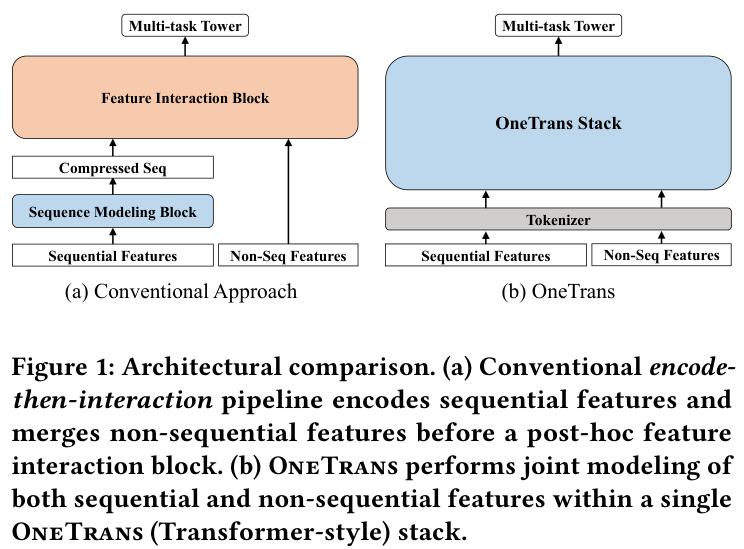
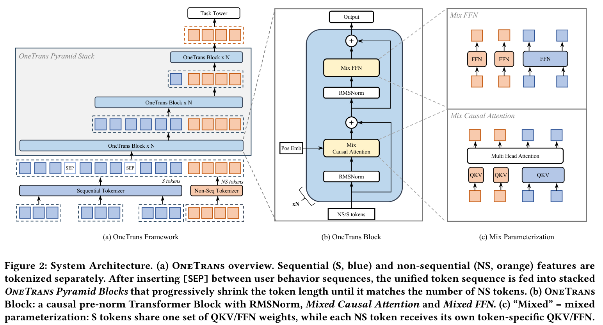
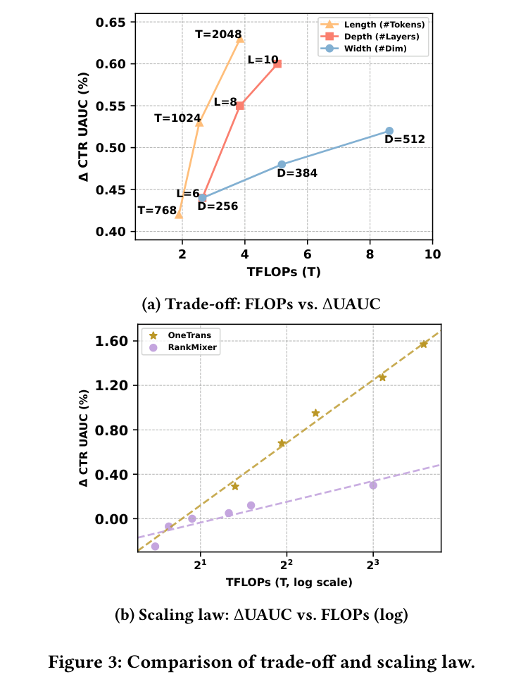

# OneTrans 详细解读：统一行为序列、特征交互与可缓存排序计算

> 基于用户提供的 **OneTrans.2510.26104v3.pdf**，共 9 页，版本日期为 2026 年 2 月 2 日。本文讲解方法、公式、实验及工程含义；[完整中文译稿](../translation/paper.zh-CN.md) 单独保存。文中示例、推导和伪代码用于解释，不是作者公开实现。末节集中讨论证据边界和落地建议。

## 1. 这篇论文研究的是哪一层推荐问题？

OneTrans 研究**排序模型**。一次请求已经有数百个候选商品，模型利用用户历史、用户特征、商品特征和上下文，对每个候选预测点击率和点击后转化率：

\[
\mathrm{CTR}_{u,i}=P(\mathrm{click}=1\mid S,NS),
\]

\[
\mathrm{CVR}_{u,i}=P(\mathrm{conv}=1\mid\mathrm{click}=1,S,NS).
\]

这里：

- \(S\)：用户行为序列，可以有点击、加购、购买等多种来源。
- \(NS\)：非序列特征，包含用户画像、候选商品属性、上下文，以及部分预聚合特征。
- 输出：候选级概率或得分，随后交给排序与业务决策。

因此，尽管模型采用因果 Transformer、KV 缓存、统一 token 输入，**它没有在本文中自回归生成商品 ID、Semantic ID 或推荐列表**。因果掩码是模型的信息依赖与计算复用设计，不等于任务已经变成生成式推荐。原文在相关工作中也将 GR/HSTU 与依赖丰富非序列特征的 DLRM 路线区分开来。（原文第 3 页，§2—3，证据 E02）

可以把本文的目标概括为：

> 保留 DLRM 排序所需的丰富特征，让行为序列建模和特征交互共用一套可扩展的 Transformer 计算骨干，并让昂贵的用户历史计算能够被多个候选复用。

## 2. 从“压缩历史后交互”到“多层读取历史”

### 2.1 传统两模块流水线

常见排序系统的结构是：

```text
用户行为序列 → DIN / Transformer 等序列模块 → 历史摘要
                                                     ↓
用户、商品、上下文特征 ──────────────────→ 特征交互模块 → 任务塔
```

例如，DIN 先按候选商品聚合历史，得到一个候选相关向量；再把它与用户特征、商品特征等拼接，交给 DCNv2、RankMixer 等模块。

这意味着，后续特征交互层接收到的历史证据，通常已经被压缩到少数向量中。不同层、不同特征组合要访问历史时，需要经过这个摘要接口。

图 1 展示了论文希望改变的模块边界。



*图 1：传统先编码、后交互与 OneTrans 的架构比较。来源：原文 Figure 1，第 2 页。*

左侧先形成压缩序列表示，再执行特征交互；右侧将行为 token 与非序列 token 一起输入同一个堆栈。模型扩大时，主要调节统一堆栈的层数、宽度和输入长度。

### 2.2 OneTrans 中序列信息如何进入交互

输入不再只是“一个历史摘要 + 一堆静态特征”，而是：

\[
X^{(0)}=[s_1,s_2,\ldots,s_T,n_1,n_2,\ldots,n_M].
\]

\(s_t\) 是历史事件 token，\(n_j\) 是非序列 token。每个 OneTrans 层都会更新 token。尚未被金字塔裁剪掉的历史状态，可以在后续层继续作为 K/V 被读取；NS token 则逐层积累历史证据和其他 NS token 的信息。

NS token 的查询向量在不同层会发生变化，因此它对历史的聚合可以随层数变化。例如，较浅层读取局部兴趣，较深层基于已经融合的候选特征形成新的查询，再读取历史。这个示例只解释多层注意力的表达能力，不表示论文验证了某层确切负责哪种兴趣。

这一点与“序列编码器只在交互开始前输出一次摘要”的接口不同。（原文 §3.1、图 2，E01—E02）

## 3. 输入层：把行为和数百个特征组织成 token

### 3.1 这里的 tokenizer 不做自然语言分词

在本文中，tokenizer 是把推荐特征映射成固定维度向量的输入适配器。

| 对象 | token 来源 | 含义 |
| --- | --- | --- |
| S token | 历史事件 ID 与侧信息的嵌入，经投影得到 | 一次行为事件的表示 |
| NS token | 用户、商品、上下文等特征经分组或自动切分得到 | 一组显式特征或一个学习到的隐空间槽位 |
| [SEP] | 可学习向量 | 标识行为序列边界 |

所有 token 最终具有同样的维度 \(d\)，从而能进入同一注意力计算。

### 3.2 序列 token：先按来源对齐，再合并

对第 \(i\) 种行为序列：

\[
S_i=[e_{i1},\ldots,e_{iL_i}],
\]

事件 \(e_{ij}\) 由物品 ID 与类别、价格等侧信息的嵌入拼接构成。不同来源的原始维度可能不同，因此先用该来源专属的投影：

\[
\widetilde S_i=[\mathrm{MLP}_i(e_{i1}),\ldots,\mathrm{MLP}_i(e_{iL_i})]
\in\mathbb R^{L_i\times d}.
\]

这里有两级“共享”需要区分：

- **输入层**：同一种序列内部共享 \(\mathrm{MLP}_i\)，不同序列来源可以使用不同 MLP。
- **OneTrans 主干层**：不同来源的 S token 一起共享主干 QKV/FFN 参数。

也就是说，来源差异先由输入适配器及类型信息表达，主干不为每个历史位置单独配置参数。

### 3.3 多行为序列如何合并

论文比较两种方式。

**方式 A：按时间融合。**

```text
09:00 点击 A → 09:02 点击 B → 09:05 加购 A → 09:08 购买 A
```

将不同来源事件按时间交错排列，并加入序列类型标识。这使因果顺序对应真实的行为先后关系。

**方式 B：按行为意图强度拼接。**

```text
购买序列 → [SEP] → 加购序列 → [SEP] → 点击序列
```

高意图行为在前，后面的低意图行为可以在因果注意力中读取前面的高意图证据。

方式 B 适用于无法可靠按时间融合的情况。方式 A 在本文实验中更好：切换为不感知时间戳融合后，CTR UAUC 的报告增量为 −0.22%，CVR UAUC 为 −0.21%。（原文 §3.2.2、表 3，E03）

### 3.4 非序列 token：人工分组与 Auto-Split

**人工分组**可以把特征划分为用户组、商品组、上下文组等。对每组拼接后单独投影：

\[
n_j=\mathrm{MLP}_j(\mathrm{concat}(g_j)).
\]

这种方案的 token 有明确的人工语义边界。

**Auto-Split** 则先把所有非序列特征拼起来，一次性输出 \(M d\) 维向量，再 reshape 为 \(M\) 个 \(d\) 维 token：

\[
z=\mathrm{MLP}(\mathrm{concat}(NS))\in\mathbb R^{Md},
\qquad N=\mathrm{reshape}(z,[M,d]).
\]

后一个写法是对论文式（7）的形状展开。它不是对输入特征原样等长切片，而是**投影后切分**。

例如，\(M=12,d=256\) 时，MLP 输出 3072 维，再转为 `[12,256]`。这个例子与论文小模型的尾部规模相呼应，但具体 MLP 层数与输入维度未在文中给出。

Auto-Split 的两个直接特点是：

1. 每个输出槽位可以组合来自多个特征来源的信息，无需遵守人工分组。
2. 使用单个稠密投影，减少多个小 MLP 带来的内核启动开销。

论文的按组替代方案相对 Auto-Split：参数量由 91M 变为 78M，训练计算量由 2.64T 变为 2.35T，CTR UAUC 报告 −0.30%。（原文 §3.2.1、表 3）

## 4. OneTrans 层：共享历史参数，保留 NS 槽位专属参数

图 2 将输入、主干和参数化方式放在一起。



*图 2：OneTrans 系统架构。来源：原文 Figure 2，第 3 页。蓝色是 S token，橙色是 NS token。*

图中蓝色 token 随层数增加逐步减少，橙色 token 保留到顶层；右侧显示蓝色 token 共享 QKV/FFN，而每个橙色槽位使用自己的 QKV/FFN。

### 4.1 标准残差骨架

不考虑长度裁剪时，一层的主要计算为：

\[
Z=X+\mathrm{MixedMHA}(\mathrm{RMSNorm}(X)),
\]

\[
X'=Z+\mathrm{MixedFFN}(\mathrm{RMSNorm}(Z)).
\]

这是 pre-norm Transformer 的结构：先归一化，再经过注意力或 FFN，最后与残差相加。

论文使用 RMSNorm，理由是行为 token 与非序列 token 的取值范围、统计分布差异明显，需要在进入注意力前稳定尺度。（原文 §3.3，E04）

### 4.2 QKV 为什么不全部共享？

对于序列 token：

\[
q_t=W_S^Q s_t,\quad k_t=W_S^K s_t,\quad v_t=W_S^V s_t.
\]

对于第 \(j\) 个 NS 槽位：

\[
q_j=W_{NS,j}^Q n_j,\quad
k_j=W_{NS,j}^K n_j,\quad
v_j=W_{NS,j}^V n_j.
\]

FFN 也采用相同区分：S token 共享 FFN，NS 槽位各自拥有 FFN。

“token 专属”指**槽位专属**，不是为每一个商品 ID、用户 ID 或每一个请求生成一套新权重。同一个 NS 槽位的权重在不同样本之间共享。若使用 Auto-Split，这些槽位可以理解为学习出来的不同表示通道，不必一一对应“用户”“商品”等人工语义。

该设计让一个槽位的“如何提问”和“如何变换读到的信息”可以区别于其他槽位，同时避免给上千个历史位置各自配置权重。

### 4.3 参数量与计算量为什么不同比例变化？

下面是解释性的数量级估算，不用于精确还原论文的 91M 或 330M。

假设 FFN 隐藏维度为 \(rd\)，忽略偏置、归一化、输出投影等项，每套 QKV 和两层 FFN 约有：

\[
P_{\mathrm{set}}\approx 3d^2+2rd^2.
\]

S 侧一套，NS 侧 \(M\) 套：

\[
P_{\mathrm{mixed}}\approx(M+1)(3+2r)d^2.
\]

但一个 NS 槽位只执行自己的那套权重，不会同时执行所有槽位的 FFN。若总 token 数为 \(T+M\)，其逐 token 投影/FFN 运算仍大致随 \((T+M)d^2\) 增长，而不是再整体乘 \(M+1\)。

这解释了表 3 的现象：完全共享参数后，参数量从 **91M 减至 24M**，但报告的训练计算量仍为 **2.64T**。同样数量的 token 仍需要被处理，只是多个槽位复用同一套参数。（E10）

## 5. 因果掩码决定了模型能交换什么信息

### 5.1 写出允许读取的位置

设输入为：

```text
s1, s2, s3, n1, n2
```

按常见包含当前位置的因果掩码，读取关系为：

| Query \ Key | s1 | s2 | s3 | n1 | n2 |
| --- | --- | --- | --- | --- | --- |
| s1 | ✓ |  |  |  |  |
| s2 | ✓ | ✓ |  |  |  |
| s3 | ✓ | ✓ | ✓ |  |  |
| n1 | ✓ | ✓ | ✓ | ✓ |  |
| n2 | ✓ | ✓ | ✓ | ✓ | ✓ |

论文用“preceding/earlier”描述先前位置，没有单独列出对角线约定；这里用常见实现辅助说明，跨 S/NS 的依赖方向不受对角线取法影响。

关键关系是：

- S 可以读此前 S。
- 每个 NS 可以读全部 S。
- NS 可以读此前 NS。
- **S 不能读后面的 NS；较早 NS 不能读后面的 NS。**

因此，序列表示保留候选无关性；候选相关的目标注意力发生在 NS 侧。一个包含商品特征的 NS query，可以从同一份用户历史 K/V 中挑出与该商品相关的证据。（原文 §3.3.1，E05）

### 5.2 同一个 Attention 同时承担几类交互

对任意 query，注意力可写为：

\[
a_i=\mathrm{softmax}\left(\frac{q_iK^\top}{\sqrt{d_h}}+\mathcal M_i\right)V.
\]

这里的标准注意力公式是解释性补写，论文着重规定混合 QKV 参数化和因果约束。

由于 K/V 里同时可能包含不同来源的 S 和之前的 NS，模型在同一个操作中实现：

- 同一行为序列的历史依赖；
- 不同类型行为之间的依赖；
- 非序列槽位之间的交互；
- 候选相关查询对用户历史的聚合。

“统一”落实在一套 token 空间、一套逐层运算和一个计算图中，并不要求每对 token 都能互相双向读取。

### 5.3 因果性与缓存是配套设计

对固定用户历史，S 侧状态不依赖候选商品。于是同一请求中，对商品 A、B、C 打分时，S 侧中间状态完全相同，可以复用。

若改成对全部 `[S;NS]` 做全注意力，S 状态就可能受到候选 NS 影响。不同商品对应不同 S 状态，跨候选共享历史缓存的条件便被破坏。

表 3 中，全注意力相对因果注意力的四项变化仅为 +0.00%、+0.01%、−0.03%、+0.06%。作者据此采用能够保留缓存能力的因果方案。（E12）

## 6. 金字塔：当前层先读全，再缩短输出

### 6.1 为什么上千个历史 token 不必层层保留？

深层特征交互主要需要将历史信息提炼到 NS token。若每一层都为全部历史事件计算输出，会继续承担完整注意力、FFN 和激活存储成本。

OneTrans 让较深层只保留尾部的一部分历史 token，以及所有 NS token。保留下来的 token 已经在前一层聚合过更早的历史，能够继续携带这些信息。

### 6.2 关键区别：裁 query，而非先删除全部旧 K/V

设某层输入长度为 \(L\)，希望输出长度为 \(L'\)：

\[
Q=\mathrm{Proj}_Q(X_{L-L'+1:L}),
\qquad K=\mathrm{Proj}_K(X_{1:L}),
\qquad V=\mathrm{Proj}_V(X_{1:L}).
\]

注意力权重矩阵由 \(L\times L\) 变为 \(L'\times L\)。

```text
当前完整输入： [s1 s2 s3 s4 s5 s6 n1 n2]
K/V 来源：    [s1 s2 s3 s4 s5 s6 n1 n2]
Query 来源：              [s5 s6 n1 n2]
本层输出：                 [s5' s6' n1' n2']
下一层输入：               [s5' s6' n1' n2']
```

在这一层里，保留的 query 仍能读取 s1—s4。只有在输出形成后，s1—s4 才不再作为下一层独立 token 出现。它们的信息可以通过聚合进入保留状态，但独立表示不再保留。

因此，本文的金字塔裁剪与“先截断到最后几条行为，再开始建模”有明显区别。（原文 §3.4，式 14，E06）

### 6.3 复杂度变化

忽略头数常数，标准注意力中 QK 和 AV 的主要运算约为：

\[
O(L^2d).
\]

缩短 query 后为：

\[
O(LL'd).
\]

FFN 只对保留的 \(L'\) 个输出执行，成本约为：

\[
O(L'rd^2).
\]

例如，某层从 1024 个输入缩到 256 个输出，仅从注意力交互矩阵元素数看，规模变成原来的四分之一。但 K/V 投影仍需覆盖 1024 个输入，总层耗时不会机械地降为四分之一。

### 6.4 如何理解顶层只有 NS token？

最终目标是：

\[
[S;NS]\to[S_{\mathrm{tail}};NS]\to\cdots\to[NS].
\]

行为 token 先参与信息整合，最后由 NS token 承载用于预测的状态。论文称最终状态送入任务专属预测头，但没有明确给出任务塔前是拼接、池化还是其他读出方式。

小模型采用 6 层、\(d=256\)；大模型采用 8 层、\(d=384\)。原文描述从 1190/1500 缩至 12/16，具体逐层裁剪表并未提供；精确复现时不能自行把某一组插值长度当作论文原始配置。

## 7. KV 缓存：区分跨候选和跨请求

### 7.1 跨候选：一份历史服务多个商品

不复用时，给 \(C\) 个候选打分，可能重复计算同一份历史：

\[
\mathrm{Cost}_{\mathrm{naive}}
\approx C\cdot(\mathrm{Cost}_S+\mathrm{Cost}_{NS}).
\]

复用历史前缀后：

\[
\mathrm{Cost}_{\mathrm{cached}}
\approx\mathrm{Cost}_S+C\cdot\mathrm{Cost}_{NS}.
\]

这是根据依赖关系给出的分解式。候选之间共享的昂贵历史计算从 \(C\) 次变成 1 次，但候选自身仍要各自计算。

按照原文的两阶段组织：

1. **S 阶段**：逐层处理用户历史，保存各层 S 侧 K/V 及复用所需状态。
2. **NS 阶段**：每个候选计算自己的 NS，在每层读取对应层的历史缓存，并继续执行 NS 内部因果交互和专属 FFN。

这里应理解为**每一层的缓存**，不是只在最底层保存一份原始事件 embedding。上层 NS query 需要与该层语义空间中的 K/V 交互。

### 7.2 一个依赖等价的教学伪代码

下面只展示跨候选复用与逐层读取；不包含批处理、梯度实现、位置编码及缓存生命周期细节。

```python
# 每个请求共享一次历史计算
s = sequence_tokenizer(user_history)
cache = []
for layer, keep_s in zip(layers, schedule):
    # 为该层完整 S 输入计算 K/V；仅保留指定尾部 S query 的输出
    s_kv, s = layer.encode_s_prefix(s, keep_s=keep_s)
    cache.append(s_kv)

# 各候选 NS 使用相同的各层历史缓存
for candidate in candidates:
    n = ns_tokenizer(user_features, candidate, context)
    for layer, s_kv in zip(layers, cache):
        # NS query 读取所有 S K/V，并读取此前的 NS K/V
        n = layer.update_ns(n, s_kv, causal_within_ns=True)
    scores[candidate] = task_heads(n)
```

只要 S 不读 NS，先把全部 S 层算完再算各候选 NS，在依赖关系上可以成立。实际高性能实现可能将多个候选一起批量执行。

### 7.3 候选相关序列为什么不能直接共享？

有些序列来自候选条件检索，例如 SIM 风格方法为商品 A 和商品 B 找到的历史子集不同。它们不是固定的用户历史前缀。

原文将这类候选专属序列先池化，再放进 NS token。这样 S 侧仍保持候选无关，代价是这部分序列不再全部保留为共享主干中的原始事件 token。（原文 §3.5.1，E17）

### 7.4 跨请求：只处理新增行为

若用户下一次请求只在历史末尾增加了少量事件，既有因果前缀原则上不需要被新事件反向改写。论文利用这一点复用上次的 K/V，只计算新增行为的部分。

需要区别：

- 跨候选：同一请求内，同一份历史对应多个候选。
- 跨请求：不同请求之间，复用同一用户过去已计算的历史。

前者主要依靠“历史与候选无关”；后者还需要历史能够稳定追加、缓存与模型版本和序列位置一致。相关工程限制在末节展开。

## 8. 训练与评估：论文实际报告了什么？

### 8.1 数据和模型规模

| 项目 | 论文报告 |
| --- | --- |
| 曝光样本 | 29.1B，即约 291 亿 |
| 去重用户 | 27.9M，即约 2790 万 |
| 去重物品 | 10.2M，即约 1020 万 |
| 日均曝光 | 118.2M ± 14.3M |
| 日活用户 | 2.3M ± 0.3M |
| OneTransS | 6 层，d=256，4 头，91M 参数 |
| OneTransL | 8 层，d=384，330M 参数 |
| 训练设备 | 16 张 H100，数据并行 all-reduce |
| batch size | 训练每 GPU 2048；推理每 GPU 100 |

参数量**不包含稀疏嵌入表**；TFLOPs 是 batch size=2048 的训练计算口径，不能读成“一次线上请求需要这么多 FLOPs”。

### 8.2 Next-batch 评估的意义

论文对每个按时间到达的 batch：

1. 先在 eval 模式下预测并记录结果；
2. 再使用这个 batch 更新模型。

因此，某条样本不会先参与本次更新再接受评估。模型会随时间连续学习，后续 batch 的预测可以受前面数据的训练影响。

每天从当日预测计算指标，再对每天做宏平均。它与“训练完固定模型，在静态测试集上跑一次”的协议不同。比较模型时，应保持数据顺序与更新节奏一致。

### 8.3 UAUC 的权重

论文明确采用按曝光加权的用户级 AUC，可解释为：

\[
\mathrm{UAUC}=\frac{\sum_{u\in\mathcal U_{\mathrm{valid}}}w_u\,\mathrm{AUC}_u}
{\sum_{u\in\mathcal U_{\mathrm{valid}}}w_u},
\]

其中 \(w_u\) 对应用户曝光数。该式用于解释权重含义；原文没有给出有效用户筛选的完整实现，例如单类标签用户如何处理。

全局 AUC 和 UAUC 分别关注全体样本区分能力与用户内部排序能力，二者应同时查看。论文特别指出 CVR UAUC 因用户级样本偏少而波动较大。

### 8.4 损失函数的已知与未知

论文定义了 CTR/CVR 概率预测任务，但**没有给出具体训练损失公式**、多任务权重和 CVR 样本掩码。

对于二分类排序任务，BCE 是常见实现选择。例如：

\[
\ell(y,p)=-y\log p-(1-y)\log(1-p),
\]

\[
\mathcal L=\lambda_{\mathrm{CTR}}\mathcal L_{\mathrm{CTR}}
+\lambda_{\mathrm{CVR}}\mathcal L_{\mathrm{CVR}}.
\]

以上只是背景性示例，**不能作为 OneTrans 已报告的训练设置**。同样，CTR×CVR 的融合打分、ESMM、额外蒸馏、负采样和校准策略都不能由本文推定。

## 9. 实验结果：先分清基线，再读增量

### 9.1 离线主表

下表来自原文表 2。基线为绝对指标，其余为论文报告的百分比增量。**原文未定义离线增量的换算公式，以下不将其换算为百分点或绝对 AUC。**

| 模型 | CTR AUC | CTR UAUC | CVR AUC | CVR UAUC | 参数 M | 训练 TFLOPs |
| --- | ---: | ---: | ---: | ---: | ---: | ---: |
| DCNv2 + DIN 基线 | 0.79623 | 0.71927 | 0.90361 | 0.71955 | 10 | 0.06 |
| Wukong + DIN | +0.08% | +0.11% | +0.14% | +0.11% | 28 | 0.54 |
| HiFormer + DIN | +0.11% | +0.18% | +0.23% | −0.20% | 108 | 1.35 |
| RankMixer + DIN | +0.27% | +0.36% | +0.43% | +0.19% | 107 | 1.31 |
| RankMixer + StackDIN | +0.40% | +0.37% | +0.63% | −1.28% | 108 | 1.43 |
| RankMixer + LONGER | +0.49% | +0.59% | +0.47% | +0.44% | 109 | 1.87 |
| RankMixer + Transformer | +0.57% | +0.90% | +0.52% | +0.75% | 109 | 2.51 |
| OneTransS | +1.13% | +1.77% | +0.90% | +1.66% | 91 | 2.64 |
| OneTransL | +1.53% | +2.79% | +1.14% | +3.23% | 330 | 8.62 |

最接近“相近预算换架构”的比较是：

- RankMixer+Transformer：109M、2.51T。
- OneTransS：91M、2.64T。

OneTransS 的计算量约高 5.2%，非稀疏嵌入参数更少，四项指标均更好。相对之下，OneTransL 的 8.62T 是 OneTransS 的约 3.27 倍，属于进一步扩容结果。（原文表 2，E08—E09）

### 9.2 消融表

原文表 3 均以 OneTransS 为参照：

| 变体 | CTR AUC | CTR UAUC | CVR AUC | CVR UAUC | 参数 M | TFLOPs |
| --- | ---: | ---: | ---: | ---: | ---: | ---: |
| 改用人工分组 tokenizer | −0.10% | −0.30% | −0.12% | −0.10% | 78 | 2.35 |
| 不感知时间戳融合 | −0.09% | −0.22% | −0.20% | −0.21% | 91 | 2.64 |
| 不感知时间戳融合，去掉 SEP | −0.13% | −0.32% | −0.29% | −0.33% | 91 | 2.62 |
| 全 token 共享参数 | −0.15% | −0.29% | −0.14% | −0.29% | 24 | 2.64 |
| 改用全注意力 | +0.00% | +0.01% | −0.03% | +0.06% | 91 | 2.64 |
| 不用金字塔 | −0.05% | +0.06% | −0.04% | −0.42% | 92 | 8.08 |

作者据此总结：Auto-Split、时间顺序融合、SEP 和 NS 专属参数有利于效果；因果注意力与全注意力效果接近；金字塔能够大幅减少计算。

关闭金字塔后，训练计算量为原来的约 **3.06 倍**。倒过来看，启用金字塔相对该配置节省约 **67.3%** 的训练 FLOPs；四个效果指标有涨有跌，并非每项都提升。该 FLOPs 比较与表 4 的实际耗时变化是两种不同口径，不应混用。（E10—E12）

### 9.3 系统优化

原文表 4：

| 变体 | 训练耗时 | 训练峰值内存 | 推理 p99 | 推理峰值内存 |
| --- | ---: | ---: | ---: | ---: |
| 未优化 OneTransS | 407 ms | 53.13 GB | 54.00 ms | 1.70 GB |
| + 金字塔 | −28.7% | −42.6% | −8.4% | −6.9% |
| + 跨请求 KV 缓存 | −30.2% | −58.4% | −29.6% | −52.9% |
| + FlashAttention | −50.1% | −58.9% | −12.3% | −11.6% |
| + 混合精度与重计算 | −32.9% | −49.0% | −69.1% | −30.0% |

这些数字按论文表格原样呈现，不把各行视作已明确的可累加收益。

FlashAttention-2 主要减少注意力计算中的中间矩阵物化和显存读写。它与金字塔解决不同问题：金字塔直接缩小 query 数，FlashAttention 优化已有注意力运算的执行方式。混合精度降低数据与算术开销，训练激活重计算则用额外计算换取内存。（原文 §3.5.2、表 4，E13）

最终 OneTransL 相对 DCNv2+DIN 的效率表为：

| 指标 | DCNv2+DIN | OneTransL |
| --- | ---: | ---: |
| 训练 TFLOPs | 0.06 | 8.62 |
| 参数 M，不含稀疏嵌入 | 10 | 330 |
| MFU，按原表数值 | 13.4 | 30.8 |
| 推理 p99 | 13.6 ms | 13.2 ms |
| 训练内存 | 20 GB | 32 GB |
| 推理内存 | 1.8 GB | 0.8 GB |

这是**完整系统配置下**的测量，不能仅从训练 FLOPs 比值推断线上延迟。线上存在共享计算、不同 batch、精度与不同算子执行效率。（原文表 5，E14）

### 9.4 线上：5.68% 对应哪个场景、什么对照？

线上对照为 **RankMixer+Transformer**，不是 DCNv2+DIN。对照约 100M 参数，且不使用序列 KV 缓存；实验组为 330M 的 OneTransL，并采用系统优化。

流量按用户／账号哈希随机分组；两组均使用过去 1.5 年生产数据训练。原文称使用用户级分层 bootstrap，计算双侧 95% 置信区间。

| 场景 | click/u | order/u | GMV/u | p99 延迟 |
| --- | ---: | ---: | ---: | ---: |
| Feeds：首页信息流 | +7.737%** | +4.351%* | +5.685%* | −3.91% |
| Mall：包含 Feeds 的整体场景 | +5.143%** | +2.577%** | +3.670%* | −3.26% |

\* \(p<0.05\)，\*\* \(p<0.01\)。线上百分比明确为相对变化。（原文表 6，E15）

所以摘要中的“人均 GMV 提升约 5.68%”具体指 **Feeds 相对 RankMixer+Transformer 的结果**。Mall 整体为约 3.67%。

文末还报告：用户活跃天数 +0.7478%，冷启动商品 order/u +13.59%。这两项没有给出与表 6 同样完整的分场景说明。（E18）

## 10. Scaling：论文观察到什么规律？

图 3(a) 比较三种扩展方向的效果—计算权衡，图 3(b) 比较不同骨干的扩展曲线。



*图 3：模型扩展的计算收益权衡与缩放趋势。来源：原文 Figure 3，第 7 页。*

图 3(a) 中，长度从 768、1024 增至 2048，深度从 6、8 增至 10，宽度从 256、384 增至 512。按图中测量点，作者认为：

1. **增加历史长度**能引入更多行为证据，计算收益权衡最好。
2. **增加深度**相对加宽更有利于效果，但引入更多串行计算。
3. **增加宽度**更容易利用硬件并行，但本组实验中的效果增幅较小。

图 3(b) 的横轴为训练 FLOPs 的对数，纵轴为 CTR ΔUAUC。OneTrans 的拟合趋势更陡。其比较方案是联合加深、加宽 OneTrans，而在 RankMixer+Transformer 中主要扩展 RankMixer 侧，直至 1B 参数。

作者将这一趋势解释为统一骨干在参数与计算利用上的优势，同时指出继续扩大模型仍受在线效率约束。（原文 §4.5，E16）

## 11. 工程判断与证据边界

以下为基于论文的分析和建议，与作者直接报告的事实分开。

### 11.1 最有价值的设计组合

OneTrans 的工程吸引力来自几个条件同时成立：

- 行为保留为 token，NS 能在多个层次读取历史证据。
- 历史前缀保持候选无关，计算可跨多个候选共享。
- NS 使用专属参数，给异构特征保留不同变换通道。
- 金字塔减少深层 token 数，控制长历史计算成本。
- 主干使用成熟 Transformer 算子，可以利用现成 GPU 优化。

其中，**相近计算量下 OneTransS 优于 RankMixer+Transformer**，以及**关闭金字塔后计算明显增加而效果没有一致改善**，是本文最直接的架构与效率证据。

线上结果进一步表明整套方案有生产价值，但它检验的是“架构 + 容量 + 服务优化”的整体替换，不能将全部 GMV 收益分配给其中某一个设计。

### 11.2 “双向信息交换”不能按字面理解为 S 与 NS 互读

引言称统一主干实现双向信息交换，但第 3 节给出的排列与因果掩码明确是：

\[
S\longrightarrow NS,
\qquad NS\not\longrightarrow S.
\]

这里箭头表示前向信息流。NS query 会决定从 S 读取哪些信息，属于候选条件化的读取；这不等于它把候选信息写回了 S 的隐藏状态。

训练时来自候选任务的梯度当然能更新共享 S 编码参数，但**反向梯度传播**与**前向表示对候选的依赖**是两回事。缓存要求的是后一种依赖不存在。

因此，适合用来理解其实现的模型是：

> **一个候选无关、可缓存的因果历史前缀，加上一个候选相关、异构参数化的短后缀。**

这个理解既符合公式，又能解释多层目标注意力、NS 交互和缓存。论文没有证明“严格双向交互是统一收益的来源”，全注意力消融也不支持必须存在这种双向路径。

### 11.3 各消融的归因有多强？

**混合参数化**：全共享模型从 91M 减到 24M，质量下降可能包含专属结构与容量减少两种原因。要隔离“异构专属参数”的作用，应该补充同参数规模的共享基线，例如加宽共享 FFN，或控制其有效计算预算。

**Auto-Split**：按组变体为 78M、2.35T，Auto-Split 为 91M、2.64T。实验支持当前配置下 Auto-Split 更好，但没有完全隔离 tokenizer 接口、参数容量与计算量的影响。

**SEP**：应比较表 3 的第二、第三行，才能讨论“不感知时间戳融合内部去掉 SEP”的增量影响。两行 CTR UAUC 从 −0.22% 变成 −0.32%，差值是原表增量尺度上的 0.10 个单位；不能把第三行相对默认模型的全部损失都归因于 SEP。正文还将第三行写成感知时间戳融合，与表格冲突。

**金字塔**：该消融的效率价值明确，但未展示详细长度 schedule 搜索、不同历史长度分布、稀有早期行为保留率。不能从当前结果推出“任意尾部裁剪都无损”。

### 11.4 NS 顺序是一个未展开的建模超参数

因果掩码使早期 NS 不能读取后期 NS。人工分组时，“用户→商品→上下文”与“商品→用户→上下文”的可达路径不同；Auto-Split 时，则由隐空间槽位承担这种不对称性。

如果最后把所有 NS 状态交给预测头，预测头可以同时看到它们，但这仍不等于注意力层内部完全对称。具体读出方式、槽位顺序和位置编码会影响表现，论文未充分说明。

复现时可以把 NS 槽位数与顺序作为明确配置，并记录最终用哪些状态读出，而不要把它们当作无关的实现细节。

### 11.5 跨请求缓存比跨候选缓存更难保证精确等价

跨候选复用只需保证同请求历史完全一致。跨请求还涉及：

1. **事件追加顺序**：按时间融合时，迟到事件可能插入已有前缀中间；按意图拼接时，新增购买可能插到购买段末端，却位于旧点击段之前，都不一定是统一序列的纯末尾追加。
2. **位置编码稳定性**：若历史窗口滑动后重新编号，旧 token 的位置表示可能变化。
3. **金字塔调度**：若每层保留长度随总历史长度变化，过去没有保留的中间位置可能在新调度下变成所需输入，旧缓存未必足够。
4. **历史修订**：去重、删除、补录和隐私撤回都可能改变前缀。
5. **模型版本**：新模型、更新后的 embedding 或归一化配置，与旧缓存不天然兼容。
6. **时间特征**：若事件表示含“距当前请求时间”之类不断变化的特征，即使原始事件未变，其 token 也可能变化。

这些都不否定缓存方案，但说明原文的“用户行为仅追加”是一项重要前提，不是所有生产特征流水线自动满足的事实。

### 11.6 不能把 O(ΔL) 读成完整增量注意力成本

假设历史长度为 \(T\)，新增 \(\Delta T\) 个事件。缓存避免重新计算旧 token 的投影、FFN 和旧 query 输出，但新 query 仍需读取历史 K/V。

对于普通稠密注意力，一层新增历史 token 的主要计算可粗略写成：

\[
O(\Delta T\,d^2)
+O(\Delta T\,T\,d)
+O((\Delta T)^2d).
\]

这个解释性式子忽略 FFN 扩展系数、头数和金字塔逐层长度差异，用于指出 \(T\) 仍出现在历史读取成本中。它不是论文给出的复杂度公式。

同理，候选数从 \(C\) 增长时，**共享 S 侧**可以维持一次计算，但 \(C\) 份 NS 查询、NS FFN 与打分仍存在。更严谨的总成本解释是第 7 节的：

\[
\mathrm{Cost}_S+C\cdot\mathrm{Cost}_{NS}.
\]

### 11.7 缓存还需要内存和带宽预算

每层保存 K 和 V，若该层缓存历史长度为 \(T_\ell\)，每个元素占 \(b\) 字节，则单用户理论 KV 数据量约为：

\[
\mathrm{Bytes}_{KV}\approx 2bd\sum_{\ell=1}^{D}T_\ell.
\]

这是忽略元数据、对齐、复制和其他状态的估算。若举例使用 8 层、d=384、每层 1500 token、2 字节精度，不做金字塔缩短，约为 **18.4 MB（十进制）/用户**。该例并非 OneTransL 的实际缓存内存报告。

金字塔可以减小高层缓存，但用户规模大时，跨请求缓存仍需考虑：

- GPU、CPU 或远端缓存的存储层级；
- 活跃用户命中率与 TTL；
- 缓存读取的带宽和尾延迟；
- 模型升级时的失效策略；
- 历史变化后的局部重建或全量回退。

论文表 5 的推理峰值内存不能替代“所有活跃用户的常驻缓存容量”统计。

### 11.8 训练缓存需要保留正确梯度

同一个训练步骤内，多个候选共享同一个 S 前缀计算图，是一种自然的精确复用方式：各候选损失对共享状态的梯度应正确累加。

若将 S 的 K/V 直接 detach，再给不同候选使用，会改变主干收到的训练信号；若跨参数更新步骤复用旧 K/V，又会引入参数陈旧问题。原文报告了训练效率收益，但没有展开图共享、分布式分组、跨步缓存和梯度生命周期协议。

因此，复现时应先验证“同一步、同请求的共享计算”等价，再考虑更激进的跨请求训练缓存。

### 11.9 金字塔实现中最容易出错的是矩形因果 mask

当 query 只取尾部时，局部 query 下标与原始序列位置不同。

例如，K 长度为 8，Q 只取末尾 2 个位置。Q 的第 0 行其实对应原序列第 6 个位置，它应该能读前 7 个 K，而不是只读第 1 个 K。

正确因果关系应按保留 query 的原位置计算：

\[
\mathrm{allow}(q_i,k_j)\iff j\le\mathrm{original\_position}(q_i).
\]

不同注意力库对矩形 causal mask 的对齐语义可能不同，不能只写 `causal=True` 就假定正确。需要测试：

- 未裁剪 query 与裁剪 query 的对应输出是否一致；
- K/V 保留范围是否正确；
- 残差是否使用同一组尾部位置；
- NS 权重是否按稳定槽位选择，而非裁剪后的偶然绝对下标；
- 位置编码在裁剪后是否保持一致。

### 11.10 效率结果需要限定口径

**表 4 优化项不应求和或连乘。** 表题写相对未优化模型，但逐行 `+` 的写法没有明确交代是独立启用还是累积启用，不能计算一个“总下降百分比”冒充原文结论。

**推理收益不能归给训练激活重计算。** 推理通常没有反向激活重计算，表 4 将它与混合精度合并报告；推理加速更合理的解释是精度、执行路径等组合变化，但缺乏拆项数据，无法分配比例。

**训练 FLOPs、MFU 和 p99 不是同一个指标。** FLOPs 高不必然意味着延迟高；算子融合、共享前缀、batch 和访存效率都会改变实际表现。反过来，某种工作负载下 p99 接近，也不表示模型在低并发、不同候选数或不同缓存命中率下仍等价。

**基线必须对应。** 13.6→13.2 ms 来自与 DCNv2+DIN 的表 5；线上 −3.91%/−3.26% 来自与 RankMixer+Transformer 的表 6，不能把两者合并推算一个共同的绝对线上时延。

### 11.11 线上证据足以支持什么？

论文报告用户级随机化与显著性，支持“该生产系统整体替换后获得业务收益”的结论。但独立重算或推广还缺少：

- A/B 持续时间、流量比例和用户数；
- 置信区间端点与具体方差处理；
- 订单、GMV 的归因窗口及异常值处理；
- 各场景的缓存命中率和候选规模；
- 冷启动商品定义及样本组成；
- 多任务权重、校准和线上融合策略。

Feeds 是 Mall 的组成部分，因此二者不是完全独立的复现证据。活跃天数和冷启动收益也不应在缺少定义时外推为所有业务中的确定性改善。

### 11.12 Scaling 证据属于测量区间内的经验规律

图 3 提供了有价值的扩容方向，但没有完整公开原始测量表、重复实验方差、拟合参数或样本外预测。

并且，OneTrans 和 RankMixer+Transformer 的扩容方式不同：一个联合扩展统一骨干，一个主要扩展 RankMixer 侧。这种比较适合说明两条实际工程路线的收益差异，尚不足以证明任意公平联合扩展的分离模型都必然更差。

更稳妥的结论是：**在作者测量的配置与计算区间内，OneTrans 呈现较好的效果—计算趋势；不能据此无限外推。**

### 11.13 一个分阶段复现路线

以下是工程建议，不是论文报告的实施计划。

**第一阶段：固定样本和特征，只验证统一主干。**

- 使用与现有排序基线完全相同的样本、标签窗口和评估协议。
- 实现来源投影、Auto-Split、共享 S／专属 NS 参数及因果掩码。
- 明确损失、CVR 样本掩码、任务权重和最终读出，记录所有论文未公开的选择。
- 暂不启用跨请求缓存，先确认训练数值稳定与效果方向。

**第二阶段：验证依赖与等价性。**

- 改变候选，验证 S 侧状态不变。
- 比较“每候选独立计算”与“共享 S 前缀”的输出及梯度。
- 在数值容差内验证缓存前后等价，不将混合精度误差与结构错误混淆。

**第三阶段：加入金字塔。**

- 用可解释的逐层长度表，明确哪些层保留哪些位置。
- 验证矩形 mask、残差索引与位置编码。
- 报告效果、训练时间、峰值内存和推理 p99，避免只报 FLOPs。

**第四阶段：完善系统优化。**

- 分开测量 FlashAttention、混合精度、训练激活重计算。
- 分开测量跨候选和跨请求缓存。
- 按候选数、历史长度、缓存命中率、冷缓存／热缓存测试。

**第五阶段：控制预算后扩容与线上验证。**

- 比较等参数、等训练计算量与等线上延迟三种预算。
- 依次扩长、加深、加宽，而非一次修改所有变量。
- 线上以用户随机化测试整体收益，同时监控校准、冷启动、长尾、多样性和异常尾延迟。

### 11.14 总体判断

OneTrans 为工业排序提供了一种清晰的统一方式：**把候选无关的行为前缀和候选相关的异构特征后缀放进同一个因果 Transformer，用逐层读取、混合参数化、金字塔和缓存协调效果与成本。**

对已有大量静态特征、需要同时建模长历史与高阶交互、且一个请求要评分较多候选的系统，这条路线具有实际参考价值。对候选极少、历史很短、请求间历史不稳定，或缓存系统成本很高的场景，收益需要重新测量。

阅读本文时应记住三条边界：它是排序模型；严格因果输入不具备 S 与 NS 的前向双向互读；线上 5.68% 来自 Feeds 场景下包含容量和系统优化的整体替换。

---

## 原文定位与配套文件

- 原文：[本地 PDF](../source/paper.pdf) · [arXiv v3](https://arxiv.org/abs/2510.26104v3)。
- 全文译稿：[paper.zh-CN.md](../translation/paper.zh-CN.md)。
- 证据、资产与未决项：[reading-record.md](../reading-record.md)。
- 核心方法：第 3—5 页，§3，式（1）—（14）、图 2。
- 离线与消融：第 6—7 页，表 2、表 3。
- 效率、线上与结论：第 8 页，表 4—6、§4.5—5。
