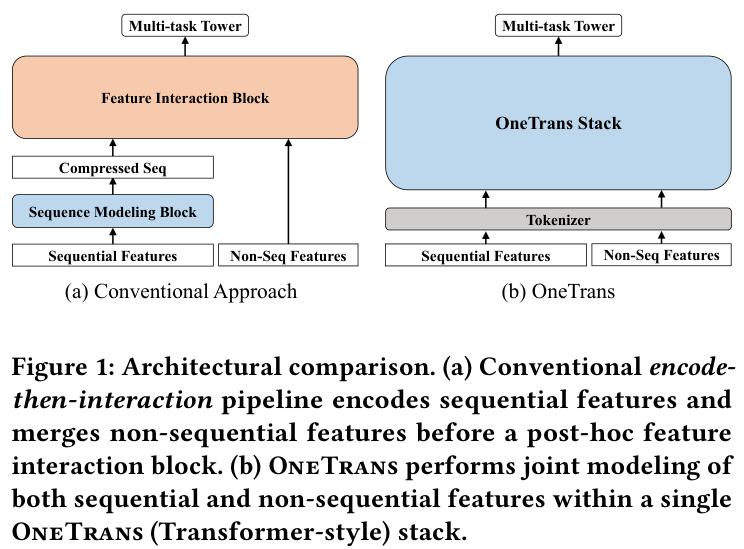
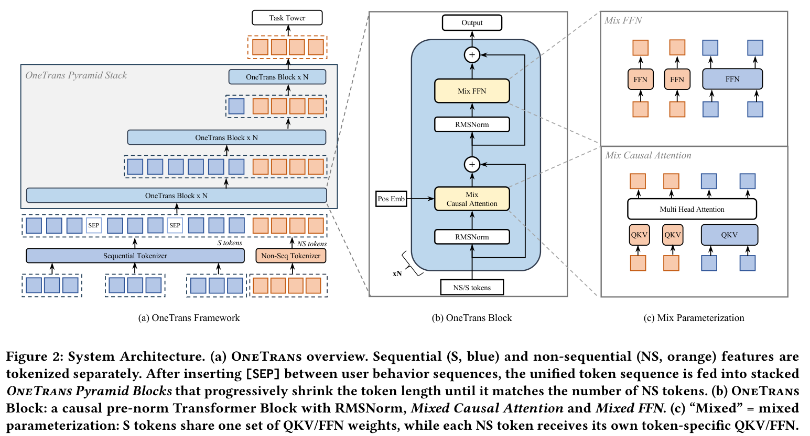
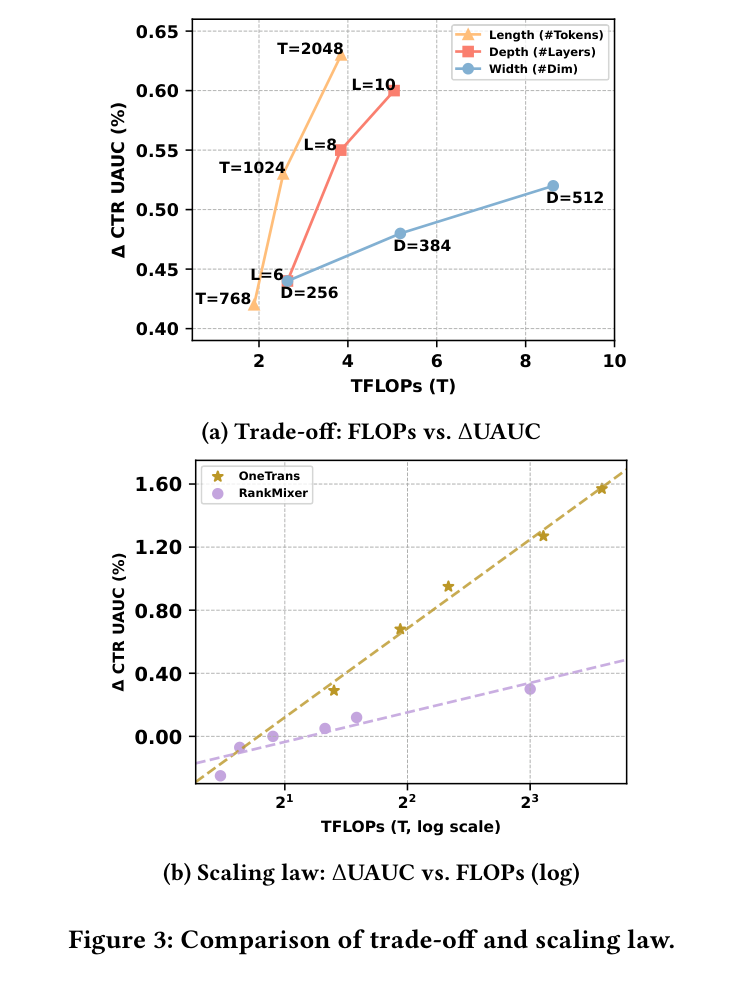

# OneTrans：在工业推荐系统中用一个 Transformer 统一特征交互与序列建模

> 原文：[arXiv:2510.26104v3](https://arxiv.org/abs/2510.26104v3)，PDF 标注版本日期为 2026 年 2 月 2 日。本文按用户提供的本地 PDF 翻译，保留原文章节、全部 14 个编号公式、3 幅图、6 张表和参考文献编号。译注与论文正文明确区分。原文共 9 页，没有附录。

## 作者与出版信息

- **Zhaoqi Zhang***：南洋理工大学、字节跳动，新加坡；zhaoqi.zhang@bytedance.com。
- **Haolei Pei***：字节跳动，新加坡；haolei.pei@bytedance.com。
- **Jun Guo***：字节跳动，新加坡；jun.guo@bytedance.com。
- **Tianyu Wang**：字节跳动，新加坡；tianyu.wang01@bytedance.com。
- **Yufei Feng**：字节跳动，中国杭州；fengyihui@bytedance.com。
- **Hui Sun**：字节跳动，中国杭州；sunhui.sunh@bytedance.com。
- **Shaowei Liu†**：字节跳动，新加坡；liushaowei.nphard@bytedance.com。
- **Aixin Sun†**：南洋理工大学，新加坡；axsun@ntu.edu.sg。

\* 同等贡献。† 通讯作者。

原文脚注：已被 The Web Conference 2026（WWW 2026）接收，正式定稿版本即将发布。

许可：Creative Commons Attribution 4.0 International（CC BY 4.0）。© 2025，版权由作者持有。

**ACM 引用格式**：Zhaoqi Zhang、Haolei Pei、Jun Guo、Tianyu Wang、Yufei Feng、Hui Sun、Shaowei Liu 和 Aixin Sun，2025，《OneTrans: Unified Feature Interaction and Sequence Modeling with One Transformer in Industrial Recommender》，ACM，纽约，美国，9 页。

> 译注：PDF 的会议名称、日期、地点和 ISBN 仍有模板占位文本，包括“Make sure to enter the correct conference title from your rights confirmation email”“Conference acronym ’XX”“June 03–05, 2018, Woodstock, NY”和“978-1-4503-XXXX-X/18/06”。这些不是已经核实的正式出版信息。

## 摘要

在推荐系统中，扩大特征交互模块（例如 Wukong、RankMixer）或用户行为序列模块（例如 LONGER）的规模已经取得显著成功。然而，这些工作通常沿彼此独立的路线推进，既妨碍双向信息交换，也阻碍统一优化与扩展。本文提出 OneTrans：一个同时执行用户行为序列建模和特征交互的统一 Transformer 骨干网络。

OneTrans 使用统一的分词器（tokenizer），将序列属性和非序列属性转换为单一 token 序列。堆叠的 OneTrans 模块在相似的序列 token 之间共享参数，同时为非序列 token 分配 token 专属参数。通过因果注意力和跨请求 KV 缓存，OneTrans 能够预计算并缓存中间表示，从而显著降低训练和推理的计算成本。

工业规模数据集上的实验表明，OneTrans 能够随着参数增长高效扩展，持续优于强基线，并在线上 A/B 测试中实现人均 GMV 提升 5.68%。

**CCS 分类**：信息系统 → 信息检索；推荐系统。

**关键词**：推荐系统；排序模型；缩放定律。

# 1 引言

推荐系统（RecSys）在电子商务 [9, 35]、流媒体 [2, 20, 28] 和社交网络 [31, 32] 等多种信息服务中发挥基础作用。工业推荐系统通常采用级联排序架构 [6, 16, 22]。首先，召回阶段从十亿级规模的语料库中选择数百个候选物品 [13, 36]；随后，排序阶段对每个候选物品打分，并返回 top-\(k\) 物品 [11, 27, 28, 32, 37]。深度学习推荐模型（DLRM）[19] 被广泛应用于工业推荐系统的排序阶段。

本文聚焦排序阶段，遵循 DLRM 风格的排序范式。主流排序方法分别迭代两个模块：（a）**序列建模**，使用局部注意力或 Transformer 编码器，将用户的多行为序列编码为候选感知的表示 [1, 14, 25, 35]；（b）**特征交互**，通过因子分解、显式交叉网络，或者特征组之间的注意力，学习非序列特征（例如用户画像、物品画像和上下文）之间的高阶交叉关系 [11, 12, 27, 37]。如图 1(a) 所示，这些方法通常先将用户行为编码为压缩后的序列表示，再与非序列特征拼接，最后用特征交互模块学习高阶交互。我们将这种设计称为“先编码、后交互”（encode-then-interaction）流水线。

大语言模型（LLM）的成功表明，扩大模型规模（例如参数量和训练数据量）能够带来可预测的性能提升 [15]，这也启发了推荐系统中的类似研究 [1, 32, 37]。对于特征交互，Wukong [32] 堆叠因子分解机模块，并使用线性压缩捕获高阶特征交互，同时建立缩放定律；RankMixer [37] 则通过对硬件友好的 token 混合，以及 token 专属前馈网络（FFN），实现良好的扩展效果。对于序列建模，LONGER [1] 将因果 Transformer 应用于用户长历史，并展示了随着深度和宽度扩大而获得的单调提升。

*图 1：架构比较。（a）传统的先编码、后交互流水线先编码序列特征，再合并非序列特征，最后通过后置特征交互模块处理。（b）OneTrans 在单个 OneTrans（Transformer 风格）堆栈中联合建模序列特征和非序列特征。原文第 2 页。*

虽然在实践中有效，将序列建模和特征交互分为独立模块仍带来两个主要局限。第一，先编码、后交互流水线限制双向信息流，约束静态特征和上下文特征对序列表示的塑造能力 [30]。第二，模块分离使执行过程碎片化并增加延迟；相较之下，单个 Transformer 风格的骨干可以复用 KV 缓存、内存高效注意力和混合精度等 LLM 优化，从而实现更有效的扩展 [11]。

本文提出 OneTrans：一种使用统一 Transformer 骨干网络，联合执行用户行为序列建模和特征交互的架构范式。如图 1(b) 所示，OneTrans 在统一骨干内部实现双向信息交换。它使用统一 tokenizer，将序列特征（多种行为序列）和非序列特征（静态用户／物品特征以及上下文特征）转换为一个 token 序列，再由金字塔式堆叠的 OneTrans 模块处理。OneTrans 模块是针对工业推荐系统定制的 Transformer 变体。

与 LLM 中仅包含文本 token 的情形不同，推荐系统中的 token 来源多样。为适应这一特点，每个 OneTrans 模块采用类似 HiFormer [11] 的**混合参数化**（mixed parameterization）：所有来自序列特征的序列 token 共享同一套 Q/K/V 和 FFN 权重；每个来自非序列特征的非序列 token 则拥有 token 专属参数，以保留其不同的语义。

不同于传统的先编码、后交互框架，OneTrans 使用统一的因果 Transformer 骨干，消除序列特征与非序列特征之间的架构壁垒。这使推荐系统的扩展方式与 LLM 实践接轨：可以通过调节骨干深度和宽度扩展整个模型，同时直接继承 FlashAttention [7]、混合精度训练 [17] 等成熟的 LLM 优化。尤其是跨候选和跨请求 KV 缓存 [1]，可将包含 \(C\) 个候选的会话的时间复杂度从 \(O(C)\) 降至 \(O(1)\)，使大规模部署 OneTrans 成为可能。

> 译注：以上“双向信息交换”及 \(O(C)\to O(1)\) 为作者原文表述。依据第 3 节的因果掩码，S token 不能读取位于其后的 NS token；\(O(1)\) 应限定为可共享的 S 侧计算相对于候选数的增长，而非所有候选的总打分成本。详细讨论见独立解读文档。

主要贡献有四点：

1. **统一框架**：提出用于排序的单一 Transformer 骨干，配备统一 tokenizer，将序列和非序列特征编码为一个 token 序列，并通过统一 Transformer 模块联合执行序列建模与特征交互。
2. **面向推荐系统的定制**：为缩小 LLM 与推荐任务之间的差异，提出混合参数化，为语义多样的非序列 token 分配 token 专属参数，同时对全部序列 token 共享参数。
3. **高效训练与服务**：使用金字塔策略逐步裁剪序列 token，使用跨请求 KV 缓存跨候选复用用户侧计算；结合 FlashAttention、混合精度训练和半精度推理，进一步降低内存和计算开销。
4. **扩展与部署**：随着模型规模增长，OneTrans 呈现近似对数线性的性能提升，为真实生产数据中的缩放定律提供证据。线上部署在维持生产级延迟的同时，带来具有统计显著性的业务 KPI 提升。

# 2 相关工作

DIN [35] 及其会话感知变体 DSIN [9] 等早期推荐方法，使用局部注意力学习以候选物品为条件的用户历史摘要，但会将每个候选对应的行为压缩为固定长度向量，限制长距离依赖建模 [34]。SASRec [14]、BERT4Rec [25] 和 BST [4] 等自注意力方法，通过使每个位置关注完整历史来消除这一瓶颈，并借助双向掩码提高样本效率。随着推荐系统缩放定律 [15] 日益受到关注，LONGER [1] 通过高效注意力和便于服务部署的设计，将超长行为历史的序列建模推向工业规模。然而，在主流流水线中，这些序列编码器通常仍独立于特征交互堆栈，因而采用后期融合，而非与静态上下文特征联合优化 [30]。

在特征交互方面，早期推荐系统依赖人工构造的交叉特征或自动乘性交互层。Wide&Deep [5]、FM/DeepFM [3, 12] 和 DCN/DCNv2 [26, 27] 等经典模型提供高效的低阶或阶数受限交互。但近期缩放研究 [32] 发现，当模型已经堆叠足够多的交叉层后，继续增加层数便无法改善质量，模型性能进入平台期。

为克服预设交叉形式的刚性，注意力方法自动学习高阶交互。AutoInt [24] 学习任意阶关系，HiFormer [11] 引入组专属投影，以更好地捕获异构、非对称的交互。随着特征交互模块不断扩大，Wukong [32] 等大规模系统通过堆叠 FM 风格交互模块并采用线性压缩，展示了可预测的收益；RankMixer [37] 则在严格延迟预算下，通过并行 token 混合和稀疏 MoE 获得良好的扩展效果。然而，这些交互模块通常仍遵循将交互放在独立阶段的范式，阻碍与用户序列建模的统一优化 [30]。

迄今为止，推荐系统的进展主要沿序列建模和特征交互两条独立路线推进。InterFormer [30] 尝试通过基于摘要的双向交叉架构弥合这一差距，使两个组件相互交换信号。但它仍保留两个独立模块，交叉架构还带来结构复杂性和碎片化执行。在缺乏联合建模与优化的统一骨干时，将系统作为整体扩展仍具有挑战。

近期的生成式推荐（GR）工作将推荐表述为序列转导任务，并提出 HSTU [31] 等高效长上下文骨干。这一路线与依赖丰富非序列特征的 DLRM 路线形成互补。

> 译注：本节对自注意力相关方法的“双向掩码”概括来自原文，不表示 SASRec、BST 和 BERT4Rec 使用相同掩码。本文未对其逐项改写。

# 3 方法

在介绍方法之前，先说明任务设定。在级联工业推荐系统中，召回阶段每次为用户 \(u\) 返回一个候选集，通常包含数百个候选物品。排序模型为每个候选物品 \(i\) 预测分数：

\[
\hat y_{u,i}=f(i\mid NS,S;\Theta). \tag{1}
\]

其中，\(NS\) 是来自用户、候选物品和上下文的非序列特征集合；\(S\) 是用户的历史行为序列集合；\(\Theta\) 是可训练参数。常见预测任务包括点击率（CTR）和点击后转化率（CVR）：

\[
\begin{aligned}
\mathrm{CTR}_{u,i}&=P(\mathrm{click}=1\mid NS,S;\Theta),\\
\mathrm{CVR}_{u,i}&=P(\mathrm{conv}=1\mid\mathrm{click}=1,NS,S;\Theta).
\end{aligned}\tag{2}
\]

*图 2：系统架构。（a）OneTrans 总览：序列特征（S，蓝色）和非序列特征（NS，橙色）分别 token 化；在用户行为序列之间插入 [SEP] 后，将统一 token 序列输入堆叠的 OneTrans 金字塔模块，逐步缩短 token 长度，直至与 NS token 数量一致。（b）OneTrans 模块：采用 RMSNorm、混合因果注意力和混合 FFN 的因果 pre-norm Transformer。（c）“混合”指混合参数化：S token 共享一套 QKV/FFN 权重，每个 NS token 则拥有自己的 token 专属 QKV/FFN。原文第 3 页。*

## 3.1 OneTrans 框架总览

如图 2(a) 所示，OneTrans 使用统一 tokenizer，将序列特征 \(S\) 映射为 S token，将非序列特征 \(NS\) 映射为 NS token。随后，金字塔式堆叠的 Transformer 在同一计算图中联合处理统一 token 序列。初始 token 序列定义为：

\[
\mathbf X^{(0)}=[\mathrm{S\!\!\!-tokens};\mathrm{NS\!\!\!-tokens}]
\in\mathbb R^{(L_S+L_{NS})\times d}.\tag{3}
\]

该序列由 \(L_S\) 个 S token 和 \(L_{NS}\) 个 NS token 拼接构成，所有 token 的维度均为 \(d\)。其中，S token 包含可学习的 [SEP] token，用于分隔不同类型的用户行为序列。如图 2(b) 所示，每个 OneTrans 模块依次更新 token 状态：

\[
\mathbf Z^{(n)}=\mathrm{MixedMHA}\!\left(\mathrm{Norm}\!\left(\mathbf X^{(n-1)}\right)\right)+\mathbf X^{(n-1)},\tag{4}
\]

\[
\mathbf X^{(n)}=\mathrm{MixedFFN}\!\left(\mathrm{Norm}\!\left(\mathbf Z^{(n)}\right)\right)+\mathbf Z^{(n)}.\tag{5}
\]

MixedMHA（混合多头注意力）和 MixedFFN（混合前馈网络）采用混合参数化策略，见图 2(c)：在注意力层和前馈层中，序列 token 共享权重，而非序列 token 分别使用独立参数。

统一因果掩码施加自回归约束，使每个位置只能关注先前的 token。特别地，NS token 可以关注完整的 S token 历史，从而进行充分的跨 token 交互。堆叠此类模块，并对 S token 采用金字塔式尾部截断，模型便逐步将紧凑的高阶信息提炼到 NS token 中。最终的 token 状态传入各任务专属预测头。

将非序列特征与序列特征组织为统一 token 序列，并用因果 Transformer 建模，使 OneTrans 有别于传统的先编码、后交互流水线。该设计在单一 Transformer 堆栈中自然支持：（i）每种行为序列内部的交互；（ii）多个序列之间的交互；（iii）物品、用户和上下文特征之间的多源特征交互；（iv）序列与特征之间的交互。

统一表述使我们能够直接继承 KV 缓存、内存高效注意力等成熟 LLM 工程优化，显著降低推理延迟。我们认为，这种统一表述适合在单一可扩展架构中处理多序列和跨域推荐问题。接下来介绍具体设计。

## 3.2 特征与 token 化

为构造初始 token 序列 \(\mathbf X^{(0)}\)，OneTrans 首先通过特征预处理流水线，将全部原始特征映射为嵌入向量。随后将嵌入划分为：（i）多行为序列子集；（ii）表示用户、物品或上下文特征的非序列子集。两个子集分别使用各自的 tokenizer。

### 3.2.1 非序列 token 化

非序列特征 \(NS\) 包括数值输入（例如价格、CTR）和类别输入（例如用户 ID、物品类别）。所有特征先分桶或做 one-hot 编码，再转为嵌入。工业系统通常包含数百个重要性不同的特征，因此提供两种控制非序列 token 数量 \(L_{NS}\) 的方案。

**按组 tokenizer（Group-wise Tokenizer，与 RankMixer [37] 对齐）**：人工将特征划分为语义组 \(\{\mathbf g_1,\ldots,\mathbf g_{L_{NS}}\}\)。将每组特征拼接后，传入该组专属的 MLP：

\[
\mathrm{NS\!\!\!-tokens}=\left[\mathrm{MLP}_1(\mathrm{concat}(\mathbf g_1)),\ldots,
\mathrm{MLP}_{L_{NS}}(\mathrm{concat}(\mathbf g_{L_{NS}}))\right].\tag{6}
\]

**自动切分 tokenizer（Auto-Split Tokenizer）**：另一种方案是先拼接全部特征，用单个 MLP 一次投影，再进行切分：

\[
\mathrm{NS\!\!\!-tokens}=\mathrm{split}\!\left(\mathrm{MLP}(\mathrm{concat}(NS)),L_{NS}\right).\tag{7}
\]

与按组方案相比，Auto-Split 使用一次稠密投影，减少内核启动开销。我们通过实验评估这两种选择。

最终，非序列 token 化生成 \(L_{NS}\) 个非序列 token，每个维度为 \(d\)。

### 3.2.2 序列 token 化

OneTrans 接受如下多行为序列：

\[
S=\{S_1,\ldots,S_n\},\qquad S_i=[\mathbf e_{i1},\ldots,\mathbf e_{iL_i}].\tag{8}
\]

每个序列 \(S_i\) 包含 \(L_i\) 个事件嵌入 \(\mathbf e\)，由物品 ID 与对应的类别、价格等侧信息拼接构成。

不同类型行为序列的原始维度可能不同。因此，对每个序列 \(S_i\)，使用一个在该序列事件之间共享的投影 \(\mathrm{MLP}_i\)，将所有事件 \(\mathbf e_{ij}\) 转换到公共维度 \(d\)：

\[
\widetilde S_i=[\mathrm{MLP}_i(\mathbf e_{i1}),\ldots,\mathrm{MLP}_i(\mathbf e_{iL_i})]
\in\mathbb R^{L_i\times d}.\tag{9}
\]

对齐后的序列 \(\widetilde S_i\) 按下列两种规则之一合并为单一 token 序列：

1. **感知时间戳（Timestamp-aware）**：将全部事件按时间交错排列，并添加序列类型标识。
2. **不感知时间戳（Timestamp-agnostic）**：按事件影响力拼接序列，例如购买 → 加购 → 点击，并在不同序列之间插入可学习的 [SEP] token。在这一方案中，用户意图更强的行为放在更靠前的位置。

消融结果表明，当时间戳可用时，感知时间戳的规则优于按影响力排序的替代方案。形式化表示为：

\[
\mathrm{S\!\!\!-Tokens}=\mathrm{Merge}(\widetilde S_1,\ldots,\widetilde S_n)
\in\mathbb R^{L_S\times d},\qquad
L_S=\sum_{i=1}^{n}L_i+L_{\mathrm{SEP}}.\tag{10}
\]

## 3.3 OneTrans 模块

如图 2(b) 所示，每个 OneTrans 模块都是作用于归一化 token 序列的 pre-norm 因果 Transformer：先放置 \(L_S\) 个序列 S token，再放置 \(L_{NS}\) 个非序列 NS token。受异构特征组研究 [11] 启发，我们对 Transformer 做轻量修改，采用混合参数方案，见图 2(c)。具体而言，同质的 S token 共享同一套参数；跨来源、跨语义异构的 NS token 使用 token 专属参数。

与 LLM 输入不同，推荐系统中的 token 序列混合了序列 S token 和多种 NS token，它们的数值范围与统计分布可能差异显著。这些差异会使 post-norm 设置发生注意力坍塌及训练不稳定。为避免这一问题，我们对全部 token 使用 RMSNorm [33] 作为 pre-norm，对齐不同 token 类型的尺度，稳定优化过程。

### 3.3.1 混合（共享／token 专属）因果注意力

OneTrans 使用带因果掩码的标准多头注意力（MHA），唯一变化是 Q/K/V 的参数化方式。设 \(\mathbf x_i\in\mathbb R^d\) 为第 \(i\) 个 token。计算 Q/K/V 时，S token（\(i\le L_S\)）使用共享投影，NS token（\(i>L_S\)）使用 \(L_{NS}\) 套 token 专属投影：

\[
(\mathbf q_i,\mathbf k_i,\mathbf v_i)=
(\mathbf W_i^Q\mathbf x_i,\mathbf W_i^K\mathbf x_i,\mathbf W_i^V\mathbf x_i).\tag{11}
\]

其中，对 \(\Psi\in\{Q,K,V\}\)，\(\mathbf W_i^\Psi\) 采用：

\[
\mathbf W_i^\Psi=
\begin{cases}
\mathbf W_S^\Psi,&i\le L_S\quad\text{（S token 共享）},\\
\mathbf W_{NS,i}^\Psi,&i>L_S\quad\text{（NS token 专属）}.
\end{cases}\tag{12}
\]

注意力使用标准因果掩码，NS token 放在 S token **之后**，由此产生三个效果：

1. **S 侧**：每个 S token 只关注更早的 S 位置。对于感知时间戳序列，每个事件以自己的历史为条件；对于不感知时间戳、按意图排序的序列，例如购买 → 加购 → 点击／曝光，因果掩码使高意图信号能够影响并筛选后面的低意图行为。
2. **NS 侧**：每个 NS token 关注全部 S 历史，实际上是对序列证据进行一次目标注意力聚合；它还可以关注位于自己之前的 NS token，增加 token 层面交互的多样性。
3. **支持金字塔结构**：在 S 侧和 NS 侧，因果掩码都使信息逐步集中到靠后的位置，自然支持下文逐层裁剪 token 的金字塔调度。

### 3.3.2 混合（共享／token 专属）FFN

前馈网络采用相同的参数化策略：NS token 使用 token 专属 FFN，S token 使用共享 FFN：

\[
\mathrm{MixedFFN}(\mathbf x_i)=\mathbf W_i^2\phi(\mathbf W_i^1\mathbf x_i).\tag{13}
\]

这里，\(\mathbf W_i^1\) 和 \(\mathbf W_i^2\) 遵循式（12）的混合参数化：\(i\le L_S\) 时共享，\(i>L_S\) 时为 token 专属。

相对于标准因果 Transformer，OneTrans 仅改变参数化方式：NS token 使用 token 专属 QKV 和 FFN，S token 共享一套参数。单个因果掩码将序列联系起来，使 NS token 能聚合全部行为历史，同时保留高效的 Transformer 风格计算。

## 3.4 金字塔堆栈

如第 3.3 节所述，因果掩码使信息向后面的位置集中。利用这一偏向近期位置的结构，我们采用金字塔调度：在每个 OneTrans 模块层，仅由最近的一部分 S token 发出查询，而键和值仍在完整序列上计算；查询集合随深度增加而缩小。

设输入 token 列表为 \(\mathbf X=\{\mathbf x_i\}_{i=1}^{L}\)，令 \(\mathcal Q=\{L-L'+1,\ldots,L\}\) 为尾部索引集合，且 \(L'\le L\)。根据式（12），仅对 \(i\in\mathcal Q\) 计算查询：

\[
\mathbf q_i=\mathbf W_i^Q\mathbf x_i,\qquad i\in\mathcal Q.\tag{14}
\]

键和值仍照常在完整序列 \(\{1,\ldots,L\}\) 上计算。注意力计算后，仅保留 \(i\in\mathcal Q\) 的输出，将 token 长度缩短为 \(L'\)，并跨层形成金字塔式层次结构。

该设计有两个益处：（i）**逐步提炼**：长行为历史被汇入较小的尾部查询集合，将容量集中于信息量最大的事件，并把信息整合到 NS token；（ii）**计算效率**：注意力成本变为 \(O(LL'd)\)，FFN 成本随 \(L'\) 线性增长。缩小查询集合直接减少 FLOPs 和激活内存。

## 3.5 训练与部署优化

### 3.5.1 跨请求 KV 缓存

在工业推荐系统中，训练与服务阶段通常连续处理同一请求的样本：它们的 S token 在不同候选之间相同，NS token 则随候选物品变化。利用这一结构，我们将广泛使用的 KV 缓存 [1] 集成到 OneTrans，形成统一的两阶段范式。

**阶段 I：S 侧，每个请求一次。** 用因果掩码处理全部 S token，缓存它们的键／值对和注意力输出。该阶段每个请求仅执行一次。

**阶段 II：NS 侧，每个候选一次。** 为每个候选计算 NS token，并对缓存的 S 侧键／值执行交叉注意力，随后执行 token 专属 FFN。特别地，SIM [21] 等候选专属序列无法复用共享 S 侧缓存，因此先通过池化聚合到 NS token 中。

KV 缓存将 S 侧计算摊销到多个候选，使每个候选的计算保持轻量，并通过消除重复计算显著提高吞吐。

由于用户行为序列仅追加，我们进一步将 KV 缓存扩展到请求之间：每个新请求复用前一个请求的缓存，只为新增行为增量计算键／值。这样，每个请求的序列计算从 \(O(L)\) 降为 \(O(\Delta L)\)，其中 \(\Delta L\) 为自上次请求以来的新增行为数量。

> 译注：这里的复杂度是原文简化表述。新 query 读取已有缓存仍有注意力计算开销；缓存更新与金字塔裁剪、时间窗口及模型参数更新的具体一致性规则，原文没有完整展开。

### 3.5.2 统一的 LLM 优化

使用 FlashAttention-2 [8]，通过分块和内核融合，减少注意力的 I/O 和普通注意力中呈平方增长的激活占用，从而降低训练与推理的内存使用并提高吞吐。

为进一步缓解内存压力，我们结合 BF16/FP16 混合精度训练 [18] 和激活重计算 [10]：丢弃部分前向激活，在反向传播时重新计算。该组合用适量的额外计算换取显著内存节省，无需修改架构即可支持更大 batch 和更深模型。

# 4 实验

通过离线评估与线上测试，我们希望回答以下研究问题（RQ）：

- **RQ1：统一堆栈与先编码、后交互**。在可比计算量下，单个 Transformer 堆栈能否带来稳定的性能收益？
- **RQ2：哪些设计选择重要？** 对输入层（例如 tokenizer、序列融合）与 OneTrans 模块（例如参数共享、注意力类型、金字塔堆栈）进行消融，评估不同设计对效果与效率的重要性。
- **RQ3：系统效率**。在相同 OneTrans 计算图下，金字塔堆栈、跨请求 KV 缓存、FlashAttention-2、混合精度及重计算能否减少 FLOPs／内存与延迟？
- **RQ4：缩放定律**。扩大长度（token 序列长度）、宽度（\(d_{\mathrm{model}}\)）、深度（层数）时，损失／效果是否呈现预期的对数线性趋势？
- **RQ5：线上 A/B 测试**。在生产延迟约束下部署 OneTrans，能否使 order/u、GMV/u 等关键业务指标取得统计显著提升？

## 4.1 实验设置

### 4.1.1 数据集

我们在大规模工业排序场景中，使用生产日志离线评估 OneTrans，并严格遵循隐私合规要求：所有个人可识别信息均匿名化并做哈希处理。数据按时间顺序划分，所有特征均保存为曝光时刻的快照，以防止时间泄漏并保证线上线下一致。点击、订单等标签在与生产设置对齐的固定时间窗口内聚合。表 1 为数据统计。

**表 1：OneTrans 实验数据集概况。原文第 5 页。**

| 指标 | 数值 |
| --- | ---: |
| 曝光数（样本） | 29.1B |
| 去重用户数 | 27.9M |
| 去重物品数 | 10.2M |
| 日均曝光数（均值 ± 标准差） | 118.2M ± 14.3M |
| 日活跃用户数（均值 ± 标准差） | 2.3M ± 0.3M |

### 4.1.2 任务与指标

评估式（2）定义的两个二分类排序任务：CTR 和 CVR。效果指标为 AUC 和 UAUC；UAUC 指**按曝光加权的用户级 AUC**。

**Next-batch 评估**：按时间顺序处理数据。对于每个 mini-batch：（i）先在 eval 模式下记录预测；（ii）再在同一个 batch 上训练。每天根据当日预测计算 AUC 和 UAUC，最后对各天做宏平均。

**效率指标**：报告 Params（不包括稀疏嵌入的模型参数量）和 TFLOPs（batch size 为 2048 时，以 TFLOPs 表示的训练计算量）。

### 4.1.3 基线

使用相同特征和匹配的计算预算，构建工业标准模型组合。在先编码、后交互范式下，从广泛采用的生产基线 DCNv2+DIN [27, 35] 出发，逐步增强特征交互模块：DCNv2 → Wukong [32] → HiFormer [11] → RankMixer [37]。固定 RankMixer 后，再变化序列建模模块：StackDIN → Transformer [4] → LONGER [1]。

### 4.1.4 超参数设置

报告两种配置：**OneTransS** 使用 6 个堆叠 OneTrans 模块，宽度 \(d=256\)，注意力头数 \(H=4\)，目标约 100M 参数；**OneTransL** 扩大为 8 层、宽度 \(d=384\)。

输入由统一 tokenizer 处理：多行为序列使用感知时间戳融合，非序列特征使用 Auto-Split。采用启发式金字塔调度，在各层线性缩短序列查询 token 数量：OneTransS 从 1190 缩短至 12，OneTransL 从 1500 缩短至 16。具体而言，各层序列查询 token 数线性递减，并舍入到最接近的 32 的倍数，顶层则设置为与非序列 token 数量一致。

> 译注：以上“序列查询 token 数”的用语与第 3 节“最终仅保留 NS token”的描述存在口径歧义。原文没有给出逐层长度表。12、16 为顶层的例外目标，不是 32 的倍数。

**优化与基础设施**：采用无权重衰减的双优化器策略。稀疏嵌入使用 Adagrad（\(\beta_1=0.1,\beta_2=1.0\)），稠密参数使用 RMSProp（lr=0.005，alpha=0.99999，momentum=0）。使用大型 Transformer 训练中常见的稳定化技巧，包括 Pre-Norm [29] 和全局梯度范数裁剪 [23]。训练时每 GPU 的 batch size 为 2048，稠密层梯度裁剪阈值为 90，稀疏层为 120。线上推理时，每 GPU batch size 采用较小的 100，以平衡吞吐与延迟。训练使用 16 张 H100 GPU，采用数据并行 all-reduce。

> 译注：Adagrad 配置中的 \(\beta_1,\beta_2\) 为原文写法，与常见标准 Adagrad API 不一致，不能直接据此还原优化器实现。

## 4.2 RQ1：效果评估

以本场景模型扩展前的生产基线 DCNv2+DIN 为比较锚点，结果见表 2。在先编码、后交互范式下，单独扩大任一组件均有效：升级特征交互模块（DCNv2 → Wukong → HiFormer → RankMixer）或序列建模模块（StackDIN → Transformer → LONGER）均能改善 CTR AUC/UAUC 和 CVR AUC。

在我们的系统中，上述指标超过 +0.1% 的收益被认为具有意义，超过 +0.3% 的收益通常对应线上 A/B 测试中的统计显著效果。但由于每用户样本量较小、波动性更高，需要谨慎看待 CVR UAUC。

**表 2：离线 CTR/CVR 效果与效率，AUC/UAUC 越高越好。原文第 6 页。**

基线行报告绝对指标值，其余行保留原文百分比增量。* 表示按时间顺序部署过的模型：DCNv2+DIN → RankMixer+DIN → RankMixer+Transformer → OneTransS → OneTransL。

| 类型 | 模型 | CTR AUC↑ | CTR UAUC↑ | CVR AUC↑ | CVR UAUC↑ | 参数量（M） | TFLOPs |
| --- | --- | ---: | ---: | ---: | ---: | ---: | ---: |
| 基础模型 | DCNv2 + DIN（base）* | 0.79623 | 0.71927 | 0.90361 | 0.71955 | 10 | 0.06 |
| 特征交互 | Wukong + DIN | +0.08% | +0.11% | +0.14% | +0.11% | 28 | 0.54 |
| 特征交互 | HiFormer + DIN | +0.11% | +0.18% | +0.23% | −0.20% | 108 | 1.35 |
| 特征交互 | RankMixer + DIN* | +0.27% | +0.36% | +0.43% | +0.19% | 107 | 1.31 |
| 序列建模 | RankMixer + StackDIN | +0.40% | +0.37% | +0.63% | −1.28% | 108 | 1.43 |
| 序列建模 | RankMixer + LONGER | +0.49% | +0.59% | +0.47% | +0.44% | 109 | 1.87 |
| 序列建模 | RankMixer + Transformer* | +0.57% | +0.90% | +0.52% | +0.75% | 109 | 2.51 |
| 统一框架 | OneTransS* | +1.13% | +1.77% | +0.90% | +1.66% | 91 | 2.64 |
| 统一框架 | OneTransL（默认）* | +1.53% | +2.79% | +1.14% | +3.23% | 330 | 8.62 |

> 译注：表 2 和表 3 的离线增量没有明确定义为相对变化还是百分点变化，本文不擅自转换为绝对 AUC。线上表 6 则明确说明是相对变化。

采用统一设计后，OneTransS 相对基线的 CTR AUC/UAUC 提升 +1.13%/+1.77%，CVR AUC/UAUC 提升 +0.90%/+1.66%。在可比参数规模下，它也优于 RankMixer+Transformer，二者训练 FLOPs 相近（2.64T 对 2.51T），表明统一建模有效。进一步扩大模型后，OneTransL 在所有指标上取得最好结果：CTR AUC/UAUC 提升 +1.53%/+2.79%，CVR AUC/UAUC 提升 +1.14%/+3.23%，展现了随模型容量增长而获得的可预测质量提升。

将序列建模和特征交互统一在单个 Transformer 中，比独立扩大任一组件带来更可靠、计算效率更高的改善。

## 4.3 RQ2：通过消融研究设计选择

对 OneTrans 进行消融，量化关键设计选择的贡献，完整结果见表 3。评估以下变体。

**输入变体**：（i）以按组 tokenizer 替换 Auto-Split tokenizer（第 1 行）；（ii）使用不感知时间戳的融合，替换感知时间戳融合（第 2 行）；（iii）去除感知时间戳序列融合中的 [SEP] token（第 3 行）。

**OneTrans 模块变体**：（i）所有 token 共享一套 Q/K/V 和 FFN 参数，不再为 NS token 分配独立参数（第 4 行）；（ii）将因果注意力替换为全注意力（第 5 行）；（iii）关闭金字塔堆栈，所有层保持完整 token 序列（第 6 行）。

**表 3：输入设计与 OneTrans 模块设计的影响，以 OneTransS 为参照。原文第 7 页。**

| 类型 | 变体 | CTR AUC↑ | CTR UAUC↑ | CVR AUC↑ | CVR UAUC↑ | 参数量（M） | TFLOPs |
| --- | --- | ---: | ---: | ---: | ---: | ---: | ---: |
| 输入 | 按组 tokenizer | −0.10% | −0.30% | −0.12% | −0.10% | 78 | 2.35 |
| 输入 | 不感知时间戳融合 | −0.09% | −0.22% | −0.20% | −0.21% | 91 | 2.64 |
| 输入 | 不感知时间戳融合，去除 [SEP] token | −0.13% | −0.32% | −0.29% | −0.33% | 91 | 2.62 |
| OneTrans 模块 | 共享参数 | −0.15% | −0.29% | −0.14% | −0.29% | 24 | 2.64 |
| OneTrans 模块 | 全注意力 | +0.00% | +0.01% | −0.03% | +0.06% | 91 | 2.64 |
| OneTrans 模块 | 不使用金字塔堆栈 | −0.05% | +0.06% | −0.04% | −0.42% | 92 | 8.08 |

> 译注：本节正文将第 3 行描述为“感知时间戳融合中移除 [SEP]”，但表 3 行名以及后续结论均写为“不感知时间戳融合中移除 [SEP]”。本译稿分别保留，未替作者消除冲突。

消融说明：

1. Auto-Split tokenizer 明显优于人工把非序列特征分组为 token，说明让模型自动构建非序列 token，比人工定义特征分组更有效。
2. 当时间戳存在时，感知时间戳融合优于按意图排序，应优先使用时间顺序，而不是事件影响力。
3. 在不感知时间戳的融合中，可学习 [SEP] token 有助于模型区分不同序列。
4. NS token 的专属参数优于共享投影，有助于更好地区分特征。
5. 因果注意力与全注意力效果接近，但全注意力会禁用 KV 缓存等标准优化。
6. 各层保留完整 token 长度没有带来收益：OneTrans 能将信息有效汇总到较小尾部，因此金字塔设计可以裁剪 query 来节省计算。

此外，在固定 TFLOPs 预算下，金字塔设计支持比完整长度设计长约 1.75 倍的序列，能够更充分地利用序列加长带来的收益。

*图 3：计算收益权衡与缩放定律比较。（a）FLOPs 与 ΔUAUC 的权衡；（b）ΔUAUC 对 FLOPs（对数横轴）的缩放趋势。横轴为训练 TFLOPs，纵轴为 CTR ΔUAUC（%）。原文第 7 页。*

## 4.4 RQ3：系统效率

为量化第 3.5 节的优化，在未优化的 OneTransS 基线上进行消融，并在表 4 报告训练和推理指标。

**表 4：相对于未优化 OneTransS 的不同变体影响。内存为 GPU 峰值使用量。原文第 8 页。**

| 变体 | 训练耗时（ms） | 训练内存（GB） | 推理 p99 延迟（ms） | 推理内存（GB） |
| --- | ---: | ---: | ---: | ---: |
| 未优化 OneTransS | 407 | 53.13 | 54.00 | 1.70 |
| + 金字塔堆栈 | −28.7% | −42.6% | −8.4% | −6.9% |
| + 跨请求 KV 缓存 | −30.2% | −58.4% | −29.6% | −52.9% |
| + FlashAttention | −50.1% | −58.9% | −12.3% | −11.6% |
| + 混合精度与重计算 | −32.9% | −49.0% | −69.1% | −30.0% |

表中显示：（i）金字塔堆栈通过裁剪序列 query token，减少训练成本（耗时／内存）和服务开销（p99 延迟／内存）；（ii）跨请求 KV 缓存消除冗余序列计算，在训练与服务阶段持续改善耗时／延迟和内存；（iii）FlashAttention 带来显著训练收益，服务收益相对温和；（iv）混合精度与重计算带来最大的服务收益，即 p99 延迟和推理内存收益，同时改善训练效率。

这些结果说明，LLM 优化对大规模推荐有效。在此基础上，进一步扩展至 OneTransL 后，它仍能保持与小得多的 DCNv2+DIN 基线相近的线上效率（表 5），说明统一 Transformer 骨干可以直接采用 LLM 优化。

**表 5：OneTransL 与 DCNv2+DIN 基线的关键效率比较。原文第 8 页。**

| 指标 | DCNv2+DIN | OneTransL |
| --- | ---: | ---: |
| TFLOPs | 0.06 | 8.62 |
| 参数量（M） | 10 | 330 |
| MFU | 13.4 | 30.8 |
| 推理 p99 延迟（ms） | 13.6 | 13.2 |
| 训练内存（GB） | 20 | 32 |
| 推理内存（GB） | 1.8 | 0.8 |

> 译注：MFU 一般指模型 FLOPs 利用率；表 5 没有显式标注单位。表 4 中各项优化是独立相对基线还是逐项叠加，文中没有给出足够明确的逐行定义，不应直接把百分比相加。激活重计算通常针对训练反向传播，表 4 的推理收益不能单独归因于重计算。

## 4.5 RQ4：缩放定律验证

沿三个轴研究 OneTrans 的缩放规律：（1）长度，即输入 token 序列长度；（2）深度，即堆叠模块数；（3）宽度，即隐藏状态维度。

如图 3(a) 所示，增加长度能引入更多行为证据，带来最大收益。深度与宽度之间存在明确权衡：增加深度通常比简单加宽带来更大的性能提升，因为更深的堆栈可以提取更高阶交互和更丰富抽象。然而，更深模型也增加串行计算，而加宽更适合并行。因此，深度与宽度的选择，应在目标硬件预算下平衡效果收益和系统效率。

我们进一步同时加宽并加深 OneTrans，分析缩放行为；为进行比较，在 RankMixer+Transformer 基线上，仅扩展 RankMixer 一侧，直至 1B 参数，再将 ΔUAUC 与训练 FLOPs 画在对数横轴上。如图 3(b) 所示，OneTrans 与 RankMixer 都呈现清晰的对数线性趋势，但 OneTrans 斜率更大。这可能是因为围绕 RankMixer 的扩展缺乏统一骨干，且其基于 MoE 的扩展主要增大 FFN 隐藏维度。这些结果表明，OneTrans 的参数和计算效率更高，为工业部署提供了有利的效果—计算权衡。

虽然能够在严格的线上 p99 延迟约束下部署 OneTransL，但继续显著扩大规模仍受线上效率制约。进一步的系统—模型协同优化留待未来研究。

## 4.6 RQ5：线上 A/B 测试

在两个大规模工业场景中评估 OneTrans 的业务影响：（i）Feeds，即首页信息流；（ii）Mall，即包含 Feeds 和其他子场景的整体场景。流量通过哈希在用户／账号层面划分，并进行用户级随机化。为保证公平，对照组和实验组都使用过去 1.5 年的生产数据训练并部署。

先前的生产基线 RankMixer+Transformer 作为对照，约有 100M 神经网络参数，不使用序列 KV 缓存。实验组部署 OneTransL，并采用第 3.5 节所述服务优化。

报告用户级 click/u、order/u 和 gmv/u 相对 RankMixer+Transformer 的变化（Δ%），使用用户级分层 bootstrap 得到双侧 95% 置信区间；同时报告端到端延迟，即从请求到达到响应发出所耗时间，使用逐曝光 p99 延迟的相对变化表示，越低越好。

**表 6：OneTransL（实验组）相对 RankMixer+Transformer（对照组）的线上 A/B 结果。原文第 8 页。**

click/u、order/u、gmv/u 为相对变化（%），延迟为端到端逐曝光延迟的相对变化，越低越好。* 表示 \(p<0.05\)，** 表示 \(p<0.01\)。

| 场景 | click/u | order/u | gmv/u | p99 延迟↓ |
| --- | ---: | ---: | ---: | ---: |
| Feeds | +7.737%** | +4.351%* | +5.685%* | −3.91% |
| Mall | +5.143%** | +2.577%** | +3.670%* | −3.26% |

如表 6 所示，OneTransL 带来一致改善。Feeds 中，click/u 提升 +7.737%，order/u 提升 +4.3510%，gmv/u 提升 +5.6848%，延迟降低 3.91%；Mall 中，对应提升为 +5.143%、+2.5772%、+3.6696%，延迟降低 3.26%。这些结果表明，相对强大的非统一基线，统一建模框架在改善业务指标的同时减少了服务时间。

此外，用户活跃天数增加 +0.7478%，冷启动商品 order/u 显著提升 +13.59%，体现了所提模型较强的泛化能力。

> 译注：论文描述了 95% 置信区间的计算方法，但没有列出各项区间端点；表 6 仅提供增量和显著性星号。活跃天数和冷启动指标未单列场景、样本定义与区间。

# 5 结论

提出 OneTrans：用于个性化排序的统一 Transformer 骨干，替代传统的先编码、后交互设计。统一 tokenizer 将序列属性和非序列属性转换为一个 token 序列；统一 Transformer 模块对同质的序列 token 共享参数，对异质的非序列 token 使用 token 专属参数，从而联合进行序列建模与特征交互。

为使统一堆栈在大规模下保持高效，我们使用逐步裁剪序列 token 的金字塔调度，以及复用用户侧计算的跨请求 KV 缓存；这一设计还受益于 FlashAttention、混合精度等 LLM 风格系统优化。

大规模评估表明，随着宽度／深度增加，OneTrans 获得近似对数线性的性能收益，并在保持生产级延迟的同时带来统计显著的业务提升。我们认为，这种统一设计为扩展推荐系统提供了一条实用路径，同时可以复用推动近期 LLM 进步的系统优化。

# 参考文献

> 以下保留全部引用编号、作者、年份与可定位的出版信息，论文题名译为中文并保留关键模型名称。完整英文书目信息另存于 [references.txt](../source/references.txt)。

[1] Zheng Chai, Qin Ren, Xijun Xiao, Huizhi Yang, Bo Han, Sijun Zhang, Di Chen, Hui Lu, Wenlin Zhao, Lele Yu, 等. 2025. **LONGER：扩展工业推荐系统中的长序列建模**. arXiv:2505.04421.

[2] Jianxin Chang, Chenbin Zhang, Yiqun Hui, Dewei Leng, Yanan Niu, Yang Song, Kun Gai. 2023. **PEPNet：注入个性化先验信息的参数与嵌入个性化网络**. 第 29 届 ACM SIGKDD 知识发现与数据挖掘会议论文集，3795–3804.

[3] Yin-Wen Chang, Cho-Jui Hsieh, Kai-Wei Chang, Chih-Jen Lin, 等. 2010. **通过线性 SVM 训练和测试低阶多项式数据映射**. Journal of Machine Learning Research 11(4).

[4] Qiwei Chen, Huan Zhao, Wei Li, Pipei Huang, Wenwu Ou. 2019. **用于阿里巴巴电商推荐的行为序列 Transformer**. arXiv:1905.06874 [cs.IR]. https://arxiv.org/abs/1905.06874

[5] Heng-Tze Cheng, Levent Koc, Jeremiah Harmsen, Tal Shaked, Tushar Chandra, Hrishi Aradhye, Glen Anderson, Greg Corrado, Wei Chai, Mustafa Ispir, Rohan Anil, Zakaria Haque, Lichan Hong, Vihan Jain, Xiaobing Liu, Hemal Shah. 2016. **面向推荐系统的 Wide & Deep 学习**. arXiv:1606.07792 [cs.LG]. https://arxiv.org/abs/1606.07792

[6] Paul Covington, Jay Adams, Emre Sargin. 2016. **用于 YouTube 推荐的深度神经网络**. 第 10 届 ACM 推荐系统会议论文集，191–198.

[7] Tri Dao, Dan Fu, Stefano Ermon, Atri Rudra, Christopher Ré. 2022. **FlashAttention：具备 I/O 感知能力的快速、内存高效精确注意力**. Advances in Neural Information Processing Systems 35，16344–16359.

[8] Tri Dao, Aleksander Thomas, Anima Anandkumar, Matei Zaharia, Christopher Re. 2023. **FlashAttention-2：通过更好的并行性和工作划分实现更快注意力**. arXiv:2307.08691.

[9] Yufei Feng, Fuyu Lv, Weichen Shen, Menghan Wang, Fei Sun, Yu Zhu, Keping Yang. 2019. **用于点击率预测的深度会话兴趣网络**. arXiv:1905.06482 [cs.IR]. https://arxiv.org/abs/1905.06482

[10] Audrunas Gruslys, Remi Munos, Ivo Daniel, Oriol Vinyals, Koray Kavukcuoglu. 2016. **内存高效的时间反向传播**. Advances in Neural Information Processing Systems（NeurIPS）.

[11] Huan Gui, Ruoxi Wang, Ke Yin, Long Jin, Maciej Kula, Taibai Xu, Lichan Hong, Ed H. Chi. 2023. **HiFormer：使用 Transformer 学习推荐系统中的异构特征交互**. arXiv:2311.05884 [cs.IR]. https://arxiv.org/abs/2311.05884

[12] Huifeng Guo, Ruiming Tang, Yunming Ye, Zhenguo Li, Xiuqiang He, Zhenhua Dong. 2018. **DeepFM：用于 CTR 预测的端到端 Wide & Deep 学习框架**. arXiv:1804.04950 [cs.IR]. https://arxiv.org/abs/1804.04950

[13] Junjie Huang, Jizheng Chen, Jianghao Lin, Jiarui Qin, Ziming Feng, Weinan Zhang, Yong Yu. 2024. **推荐系统召回方法综述**. arXiv:2407.21022.

[14] Wang-Cheng Kang, Julian McAuley. 2018. **自注意力序列推荐**. arXiv:1808.09781 [cs.IR]. https://arxiv.org/abs/1808.09781

[15] Jared Kaplan, Sam McCandlish, Tom Henighan, Tom B Brown, Benjamin Chess, Rewon Child, Scott Gray, Alec Radford, Jeffrey Wu, Dario Amodei. 2020. **神经语言模型的缩放定律**. arXiv:2001.08361.

[16] Shichen Liu, Fei Xiao, Wenwu Ou, Luo Si. 2017. **面向实际电商搜索的级联排序**. 第 23 届 ACM SIGKDD 国际知识发现与数据挖掘会议论文集，1557–1565.

[17] Paulius Micikevicius, Sharan Narang, Jonah Alben, Gregory Diamos, Erich Elsen, David Garcia, Boris Ginsburg, Michael Houston, Oleksii Kuchaiev, Ganesh Venkatesh, 等. 2017. **混合精度训练**. arXiv:1710.03740.

[18] Paulius Micikevicius, Sharan Narang, Jonah Alben, Greg Diamos, Erich Elsen, David Garcia, Boris Ginsburg, Michael Houston, Oleksii Kuchaiev, Ganesh Venkatesh, Hao Wu. 2018. **混合精度训练**. International Conference on Learning Representations（ICLR）.

[19] Maxim Naumov, Dheevatsa Mudigere, Hao-Jun Michael Shi, Jianyu Huang, Narayanan Sundaraman, Jongsoo Park, Xiaodong Wang, Udit Gupta, Carole-Jean Wu, Alisson G Azzolini, 等. 2019. **用于个性化与推荐系统的深度学习推荐模型**. arXiv:1906.00091.

[20] Nikil Pancha, Andrew Zhai, Jure Leskovec, Charles Rosenberg. 2022. **PinnerFormer：面向 Pinterest 用户表示的序列建模**. 第 28 届 ACM SIGKDD 知识发现与数据挖掘会议论文集，3702–3712.

[21] Qi Pi, Guorui Zhou, Yujing Zhang, Zhe Wang, Lejian Ren, Ying Fan, Xiaoqiang Zhu, Kun Gai. 2020. **用于点击率预测的、基于搜索的全生命周期用户序列行为兴趣建模**. 第 29 届 ACM 国际信息与知识管理会议论文集，2685–2692.

[22] Jiarui Qin, Jiachen Zhu, Bo Chen, Zhirong Liu, Weiwen Liu, Ruiming Tang, Rui Zhang, Yong Yu, Weinan Zhang. 2022. **RankFlow：将多阶段级联排序系统视作流进行联合优化**. 第 45 届国际 ACM SIGIR 信息检索研究与开发会议论文集，814–824.

[23] Mohammad Shoeybi, Mostofa Patwary, Raul Puri, Patrick LeGresley, Jared Casper, Bryan Catanzaro. 2019. **Megatron-LM：使用模型并行训练数十亿参数语言模型**. arXiv:1909.08053.

[24] Weiping Song, Chence Shi, Zhiping Xiao, Zhijian Duan, Yewen Xu, Ming Zhang, Jian Tang. 2019. **AutoInt：通过自注意力神经网络自动学习特征交互**. 第 28 届 ACM 国际信息与知识管理会议（CIKM ’19），ACM，1161–1170. doi:10.1145/3357384.3357925.

[25] Fei Sun, Jun Liu, Jian Wu, Changhua Pei, Xiao Lin, Wenwu Ou, Peng Jiang. 2019. **BERT4Rec：使用 Transformer 双向编码器表示进行序列推荐**. arXiv:1904.06690 [cs.IR]. https://arxiv.org/abs/1904.06690

[26] Ruoxi Wang, Bin Fu, Gang Fu, Mingliang Wang. 2017. **用于广告点击预测的 Deep & Cross Network**. arXiv:1708.05123 [cs.LG]. https://arxiv.org/abs/1708.05123

[27] Ruoxi Wang, Rakesh Shivanna, Derek Cheng, Sagar Jain, Dong Lin, Lichan Hong, Ed Chi. 2021. **DCN V2：改进的 Deep & Cross Network 及互联网规模排序学习系统的实践经验**. The Web Conference 2021（WWW ’21），ACM，1785–1797. doi:10.1145/3442381.3450078.

[28] Xue Xia, Pong Eksombatchai, Nikil Pancha, Dhruvil Deven Badani, Po-Wei Wang, Neng Gu, Saurabh Vishwas Joshi, Nazanin Farahpour, Zhiyuan Zhang, Andrew Zhai. 2023. **TransAct：面向 Pinterest 推荐的基于 Transformer 的实时用户行为模型**. 第 29 届 ACM SIGKDD 知识发现与数据挖掘会议论文集，5249–5259.

[29] Ruibin Xiong, Yunchang Yang, Di He, Kai Zheng, Shuxin Zheng, Chen Xing, Huishuai Zhang, Yanyan Lan, Liwei Wang, Tieyan Liu. 2020. **论 Transformer 架构中的层归一化**. International Conference on Machine Learning，PMLR，10524–10533.

[30] Zhichen Zeng, Xiaolong Liu, Mengyue Hang, Xiaoyi Liu, Qinghai Zhou, Chaofei Yang, Yiqun Liu, Yichen Ruan, Laming Chen, Yuxin Chen, 等. 2024. **InterFormer：面向点击率预测的有效异构交互学习**. arXiv:2411.09852.

[31] Jiaqi Zhai, Lucy Liao, Xing Liu, Yueming Wang, Rui Li, Xuan Cao, Leon Gao, Zhaojie Gong, Fangda Gu, Michael He, 等. 2024. **行动胜于语言：用于生成式推荐的万亿参数序列转导器**. arXiv:2402.17152.

[32] Buyun Zhang, Liang Luo, Yuxin Chen, Jade Nie, Xi Liu, Daifeng Guo, Yanli Zhao, Shen Li, Yuchen Hao, Yantao Yao, 等. 2024. **Wukong：迈向大规模推荐的缩放定律**. arXiv:2403.02545.

[33] Biao Zhang, Rico Sennrich. 2019. **均方根层归一化**. Advances in Neural Information Processing Systems 32.

[34] Guorui Zhou, Na Mou, Ying Fan, Qi Pi, Weijie Bian, Chang Zhou, Xiaoqiang Zhu, Kun Gai. 2018. **用于点击率预测的深度兴趣演化网络**. arXiv:1809.03672 [stat.ML]. https://arxiv.org/abs/1809.03672

[35] Guorui Zhou, Chengru Song, Xiaoqiang Zhu, Ying Fan, Han Zhu, Xiao Ma, Yanghui Yan, Junqi Jin, Han Li, Kun Gai. 2018. **用于点击率预测的深度兴趣网络**. arXiv:1706.06978 [stat.ML]. https://arxiv.org/abs/1706.06978

[36] Han Zhu, Xiang Li, Pengye Zhang, Guozheng Li, Jie He, Han Li, Kun Gai. 2018. **学习用于推荐系统的树结构深度模型**. 第 24 届 ACM SIGKDD 国际知识发现与数据挖掘会议论文集，1079–1088.

[37] Jie Zhu, Zhifang Fan, Xiaoxie Zhu, Yuchen Jiang, Hangyu Wang, Xintian Han, Haoran Ding, Xinmin Wang, Wenlin Zhao, Zhen Gong, Huizhi Yang, Zheng Chai, Zhe Chen, Yuchao Zheng, Qiwei Chen, Feng Zhang, Xun Zhou, Peng Xu, Xiao Yang, Di Wu, Zuotao Liu. 2025. **RankMixer：扩展工业推荐系统中的排序模型**. arXiv:2507.15551 [cs.IR]. https://arxiv.org/abs/2507.15551

# 译文术语对照

| 原文 | 本文译法 |
| --- | --- |
| encode-then-interaction | 先编码、后交互 |
| sequential / non-sequential | 序列／非序列 |
| unified tokenizer | 统一 tokenizer（分词器） |
| token-specific | token 专属 |
| mixed parameterization | 混合参数化 |
| pyramid stack | 金字塔堆栈 |
| causal attention / full attention | 因果注意力／全注意力 |
| cross-request KV caching | 跨请求 KV 缓存 |
| activation recomputation | 激活重计算 |
| scaling law | 缩放定律 |
| impression-weighted user-level AUC | 按曝光加权的用户级 AUC |
| per-user GMV / GMV/u | 人均 GMV |
