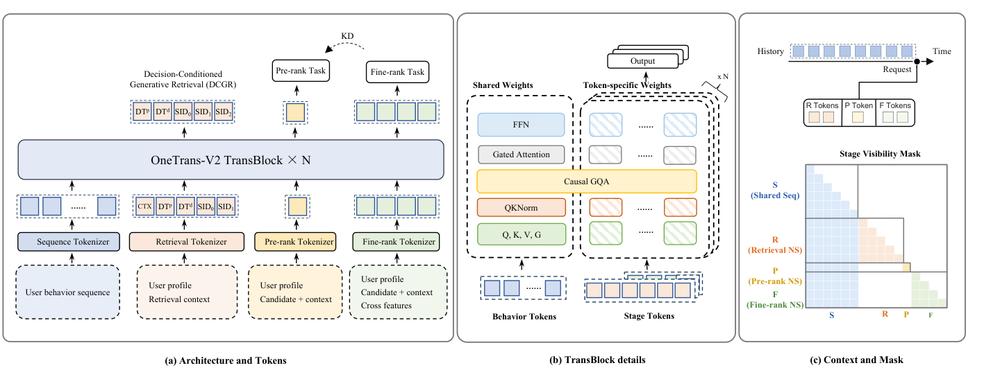
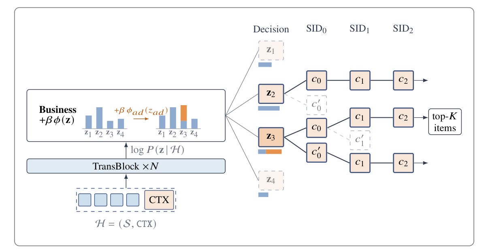
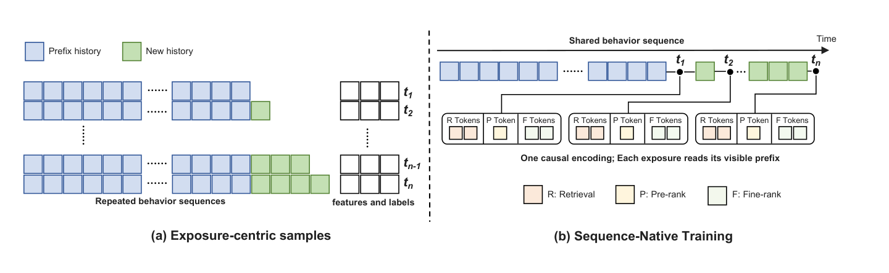
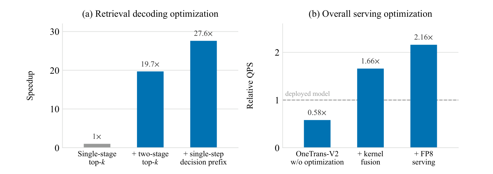

# OneTrans-V2 详细解读：共享用户上下文、决策条件召回与序列原生训练

论文：*OneTrans-V2: Unifying Retrieval, Pre-rank, and Fine-rank with One Transformer in Industrial Recommender*。署名为字节跳动全球电商推荐基础模型团队。本文依据用户提供的 2609.28589v1 本地 PDF，正文页码均指该版本；完整中文译稿另见 [论文译文](../translation/paper.zh-CN.md)。

## 1. 论文试图统一哪些东西

工业推荐的三个阶段承担不同规模的筛选任务：

```text
十亿级商品库
    ↓ 召回：产生数千候选
    ↓ 粗排：低成本筛到数百候选
    ↓ 精排：使用完整候选特征形成最终顺序
最终推荐列表
```

这套逐级缩减机制仍然保留。OneTrans-V2 改变的是模型组织方式：三个阶段由同一个联合训练的 Transformer 承担，读取同一份用户历史上下文，但分别使用自己的候选特征、token 数量和预测方式。[E01–E03]

三个阶段都需要理解“这个用户过去做了什么”。传统系统往往分别训练用户行为编码器，线上也分别编码历史。一个新历史特征或更长序列，可能需要在三套模型里各改一次。召回内部又因点击、发现、广告等目标分为多个模型，进一步增加重复。

OneTrans-V2 将共享边界放在**与候选无关的用户历史**与**阶段专属的候选建模**之间。核心结构可概括为：

$$
\text{统一模型}=\text{共享用户历史编码}+\text{隔离的阶段专属 token}+\text{联合训练目标}.
$$

它同时处理三类碎片化：

| 层面 | 原来的分裂 | 论文的处理 |
| --- | --- | --- |
| 跨阶段 | 召回、粗排、精排各自建模用户 | 共享用户上下文，三个任务共同训练 |
| 召回内部 | 不同目标使用不同通道模型 | DCGR 用结构化决策前缀表达目标 |
| 训练数据 | 每次曝光都携带一份长历史 | SNT 按用户窗口复用一次因果编码 |

MoE、稳定扩展与服务算子优化，用于让这个统一模型能够在生产预算内训练和部署。

### 与 OneTrans、OneRec 的关系

按本文对既有工作的描述，可以这样区分：[E01–E02]

| 体系 | 主要统一对象 | 本文讨论的线上形式 |
| --- | --- | --- |
| OneTrans | 单个排序模型中的历史建模与异构特征交互 | 仍是级联中的一个阶段 |
| OneRec 路线 | 用生成过程吸收传统级联功能，排序模型可提供奖励 | 生成式端到端推荐 |
| OneTrans-V2 | 同一用户上下文上的召回、粗排、精排三个任务 | 保留级联与阶段特征 |

从 OneTrans 到 V2，变化发生在统一范围：由单个排序模型内部，扩展到整个级联。对 OneRec、Sona 等方法的上述定位是这篇论文自己的相关工作叙述，并非本文另行复现的横向评测。

## 2. 一个 Transformer 如何同时服务三个阶段

### 2.1 行为 token 与阶段 token 使用不同参数组织

沿用 OneTrans，模型有两类输入：[E02]

- **行为 token：** 每个用户行为事件一个 token。事件形式同质，因此共享 Q/K/V 和 FFN 参数。
- **阶段专属 token：** 表达用户画像、请求上下文、候选及交叉特征。不同 token 表达异构内容，使用 token 专属 Q/K/V 和 FFN 参数。

因此，“一个模型”中仍有专用参数。它保留了各阶段的特征差异，没有要求广告供给类型、候选交叉特征和历史事件都经过完全相同的映射。

架构图将三条任务路径、参数组织以及掩码放在一起。



*来源：论文图 2，第 6 页。左侧为三个阶段的任务路径，中间为共享/专属参数，右侧为注意力可见性。*

图中行为序列在底部提供公共信息，召回路径产生决策和 SID，粗排与精排分别打分。右侧 R、P、F 各自读取 S，但彼此没有可见的交叉区域；粗排只用一个候选 token，精排用多个。

### 2.2 掩码如何保证用户上下文只算一次

将输入概念上记为：

$$
[S,R,P,F].
$$

允许的注意力关系如下，行是 query，列是 key：

| Query / Key | S：历史 | R：召回 | P：粗排 | F：精排 |
| --- | --- | --- | --- | --- |
| S | 历史内因果可见 | 不可见 | 不可见 | 不可见 |
| R | 仅请求时可见前缀 | 同阶段同曝光内因果可见 | 不可见 | 不可见 |
| P | 仅请求时可见前缀 | 不可见 | 同阶段同曝光内因果可见 | 不可见 |
| F | 仅请求时可见前缀 | 不可见 | 不可见 | 同阶段同曝光内因果可见 |

这里还有一条同样重要的规则：**不同曝光的阶段 token 相互不可见**，即使它们属于同一阶段、同一用户。[E02]

这带来两个性质：

1. 用户历史的计算不依赖后面的候选与任务，因此用户上下文可以提前计算并复用。
2. 一个阶段的前向结果不依赖另一个阶段的中间 token，因此各阶段可独立安排候选数、特征和 token 预算。

三个阶段在前向传播中隔离，在训练中又通过共享用户上下文互相影响。召回的下一 token 预测损失、粗排与精排的判别损失都可以更新公共用户表示。这是联合学习的通道。

特别要区分：**业务流水线有先后，不代表 token 表示互相读取。** 粗排会接收召回产生的候选，但其 query 不会直接读取召回生成轨迹；精排也不会读取粗排 token。这与论文所述 UniR2 由排序 query 关注生成轨迹的设计不同。[E01–E02]

### 2.3 三个阶段为什么不统一成同一种任务

| 阶段 | 输出形式 | 候选侧信息与预算 |
| --- | --- | --- |
| 召回 | 决策前缀与三级 SID 的生成概率 | 用户画像、召回上下文；通过生成产生候选 |
| 粗排 | CTR、CVR 概率 | 精简特征集，压缩成一个候选 token |
| 精排 | 包括 CTR、CVR 的多个目标 | 完整非序列特征和交叉特征，多个 token |

粗排要给数千候选打分，逐候选成本最紧；精排只处理数百候选，可以花更多计算保留特征异质性。召回负责产生候选，本身就不同于给定候选上的判别任务。[E03]

在线执行仍按三个阶段分别进行：

```text
用户行为序列 → 一次共享编码 → 用户上下文缓存 C_u
                                 ├→ DCGR：生成候选
                                 ├→ 粗排：对召回候选评分
                                 └→ 精排：对粗排幸存候选评分
```

这里的分支表示共享缓存的读者；实际粗排、精排仍等待上一阶段缩减候选。

## 3. DCGR：把召回目标写成可预测、可引导的决策

### 3.1 为什么排序的多头方案不能直接解决召回多目标

候选已经给定时，一个模型可以同时预测点击、转化、价值，再融合分数。召回面对的是“接下来生成哪些候选”，目标直接影响候选身份。只给生成器增加多个评分头，尚不能指定它应该生成哪类候选。[E04]

DCGR 将生成拆成：

$$
P(\mathbf z,Item\mid H)
=P(\mathbf z\mid H)P(Item\mid H,\mathbf z).
$$

\(H\) 是用户历史与召回上下文，\(\mathbf z\) 是结构化决策。先预测交互形态，再在该形态下生成物品。

### 3.2 四个决策维度具体表示什么

| 变量 | 决策含义 | 标签来源 |
| --- | --- | --- |
| \(z_{oc}\) | 购买档位：无购买、一次购买、多次购买 | 交互订单记录 |
| \(z_{disc}\) | 发现档位：类目相对用户近期行为有多新 | 用户近期行为与候选类目关系 |
| \(z_{ad}\) | 供给类型：自然或广告 | 物品供给属性 |
| \(z_{aov}\) | 消费档位：每笔订单的价值区间 | 订单价值 |

这些决策是**日志交互结果标签**。模型在推荐前预测它们，用户无须显式选择。[E04]

以论文中的例子理解，某请求可能得到“会购买、中档消费、高发现、自然供给”的前缀，于是模型生成符合这种交互形态的物品。同样用户上下文，如果前缀换成“无购买、低发现”，生成分布也会改变。

购买数量与单笔价值被拆开，是为了区分“多笔便宜订单”和“一笔昂贵订单”。用一个 GMV 档位会混合这两种情况。论文报告，将这两维换成单个 GMV token，交易价值加权 HR@1 降低 9%。[E17]

### 3.3 四个维度只占两个 token 位置

DCGR 的生成顺序为：

$$
CTX\rightarrow DT_p\rightarrow DT_d\rightarrow SID_0\rightarrow SID_1\rightarrow SID_2.
$$

三个并行头从 CTX 隐状态预测 \(z_{oc},z_{disc},z_{ad}\)，将对应 embedding 相加：

$$
DT_p=E_{oc}(z_{oc})+E_{disc}(z_{disc})+E_{ad}(z_{ad}).
$$

消费档位则在看到 \(DT_p\) 后预测，形成 \(DT_d\)。这一位置安排表达了“先知道购买档位，再判断单笔消费档位”的依赖。[E04]

其概率分解是：

$$
P(\mathbf z\mid H)
=P(z_{oc}\mid H)P(z_{disc}\mid H)P(z_{ad}\mid H)
P(z_{aov}\mid H,z_{oc},z_{disc},z_{ad}).
$$

并行结构还避免了人为排列无依赖维度的解码顺序。论文在早期三个二元决策实验中发现，订单维度放在第一位时，订单 HR@128 为 0.4590；放第三位则为 0.4520，整体交易价值加权命中也下降。[E17]

### 3.4 物品如何变成可以生成的 SID

对每个物品的多模态 embedding 做 RQ-KMeans，生成三级从粗到细的编码。每层码本大小为 8192。模型顺序生成：

$$
P(Item\mid H,\mathbf z)
=\prod_{\ell=0}^{2}P(SID_\ell\mid H,\mathbf z,SID_{<\ell}).
$$

训练时使用真实决策和前置 SID，即 teacher forcing；各位置用交叉熵监督。服务时沿 SID 编码树做束搜索。一个 SID 可以映射多个商品，论文会返回该 SID 对应的全部商品。[E04、E09]

因此，SID 路径、最终商品和 beam 不是同一概念。后文离线 HR@M 按 SID 命中定义。

### 3.5 业务目标如何改变召回结果

DCGR 不要求先硬指定“这次只推荐高消费物品”。它先给所有合法决策前缀打分，再加业务偏置，然后联合搜索前缀与 SID：[E05]

$$
score(\mathbf z,SID)=
\log P(\mathbf z\mid H)+\beta\phi(\mathbf z)
+\sum_{\ell=0}^{2}\log P(SID_\ell\mid H,\mathbf z,SID_{<\ell}).
$$

\(\phi(\mathbf z)=\sum_j\phi_j(z_j)\) 表示各目标偏好，例如提高高消费档位或广告供给的偏置；\(\beta\) 控制偏好强度。

- \(\beta=0\)：使用模型原本学到的联合排序。
- 增大 \(\beta\)：更倾向业务指定的决策区域。
- 偏置只加在决策分数上，给定决策后的 SID 条件模型不变。

图 3 展示了广告决策前缀在偏置后如何获得更高搜索优先级。



*来源：论文图 3，第 8 页。橙色前缀携带广告取值，增加偏置后更可能在 beam 中保留。*

图中每个前缀都携带自己的分数进入物品编码树。一个决策即使自身分数高，如果后续没有高概率物品，也可能被另一条完整路径超过。因此，解码并非先选定一个决策后再忽略其他决策。

偏置等价于对决策分布做指数倾斜：

$$
q(\mathbf z)\propto P(\mathbf z\mid H)e^{\beta\phi(\mathbf z)}.
$$

对于 \(\beta>0\)，它对应在提高业务偏好期望与偏离原分布之间折中的 KL 正则目标：

$$
\max_q\mathbb E_q[\phi(\mathbf z)]-\frac1\beta KL(q\Vert P).
$$

已有维度能表达的目标，可通过线上参数调整。新增维度则需要对应的决策标签和头部扩展；独立维度可以并入 \(DT_p\)，不额外增加串行 token 位置。

### 3.6 软引导与硬强制的实验差别

论文的召回阶段 A/B 对同一个训练模型改变解码方式，结果如下。这里统计的是归因给 DCGR 的曝光，参照是使用预测前缀解码：[E16]

| 解码干预 | CTR | 订单 | AOV | GMV |
| --- | --- | --- | --- | --- |
| 强制无购买档位 \(z_{oc}=0\) | +8.2% | −10.4% | +5.8% | −5.1% |
| 强制最高消费档位 | −8.1% | −33.5% | +38.9% | −7.7% |
| 弱业务偏置 | +2.2% | +4.9% | +2.5% | +7.5% |
| 中业务偏置 | −0.9% | −3.0% | +13.9% | +10.4% |
| 强业务偏置 | −5.4% | −1.2% | +28.3% | +26.7% |

最高消费硬条件提高客单价，但订单损失更大，GMV 反而下降。软偏置允许模型在原本用户适配分布上逐渐偏移。

另一个按**用户全部曝光**统计的实验里，购买档位与消费档位联合强引导使人均 GMV +3.0%。它与表中 +26.7% 的分母和对照不同，不能互换。[E16]

### 3.7 哪些证据说明前缀被模型使用

论文提供两类不同实验：[E15]

1. **给真实决策：** 在 SID-only 召回上增加一个维度，并使用真实标签 teacher forcing，测其携带的物品信息。广告维度在各已测切片带来 9.6%–20.5% 的 HR@1 提升；购买档位影响均不超过 1%。这是给定正确结果的条件实验，不是线上决策预测准确率。
2. **改变预测决策：** 在正常自由运行中强制一个维度。强制广告时，广告 HR@1 +31.5%、点击 HR@1 −19.6%；强制多订单时，GMV HR@1 +12.8%、点击 HR@1 −17.6%。说明生成分布会响应前缀。

论文还提出 CFG 扩展：用有、无决策前缀的两次 SID 分数差放大条件效应，并以参数 w 控制遵从强度。该扩展尚未部署，也未给出结果，不能计入已验证收益。[E05]

## 4. 粗精排如何共同学习，又保持不同预算

### 4.1 判别目标与总损失

粗排和精排分别以 CTR、CVR 等标签做二元交叉熵。精排真实目标更多，论文主要报告 CTR、CVR。总体损失为：[E06]

$$
\mathcal L=0.1\mathcal L_r+\mathcal L_p+\mathcal L_f+\mathcal L_{kd}.
$$

召回负责预测决策及 SID，排序负责预测给定候选上的行为概率，四项共同训练共享模型。

### 4.2 为什么还需要蒸馏

共享用户表示后，粗排只看到轻量候选特征，精排看到完整特征，两者仍可能排序不同。若粗排提前过滤掉精排偏好的候选，精排无法再补救。论文以精排为教师、粗排为学生，让粗排向更丰富特征下的打分靠近。[E06]

对每个目标，把教师、学生 logit 分别减去自己的均值，再除以同一个温度：

$$
p_T=\sigma\left(\frac{o_T-\mu_T}{\tau}\right),\qquad
p_S=\sigma\left(\frac{o_S-\mu_S}{\tau}\right),\quad \tau=0.5.
$$

蒸馏损失是 \(BCE(p_T,p_S)\)，教师输出停止梯度。均值来自动量 0.9999 的跨 batch EMA，**不是在每个请求内部对候选做 listwise softmax**。这种处理用于减弱两套 logit 均值差异，让学生跟随教师软目标。

同模型设计使教师与学生在同一步更新，不需要另外训练、部署和周期更新一个离线教师。

### 4.3 联合训练收益与蒸馏收益要分开看

论文对联合训练做了架构、参数预算、数据、目标匹配的对比，独立粗排基线同样获得独立精排的蒸馏。[E12]

| 联合方式 | 相对独立训练的变化 |
| --- | --- |
| 仅粗精排联合 | 粗排 CTR UAUC +0.17%，精排 +0.21% |
| 三阶段联合，但召回不回传用户骨干 | 召回 HR@1 +7.63%，粗排 CTR UAUC +0.19%，精排 +0.21% |
| 三阶段联合，召回梯度进入用户骨干 | 召回 HR@1 +15.44%，粗排 CTR UAUC +0.28%，精排 +0.31% |

三个任务都受益，召回的生成监督还能改善排序表示。阻断召回到用户骨干的梯度时，embedding 表仍共享，所以该设置并非召回对排序完全没有训练影响。

另一组消融保持联合模型不变，只去掉蒸馏，粗排 CTR AUC −0.55%、CTR UAUC −0.97%，精排分别 −0.03%、−0.04%。它回答的是蒸馏增量，不能与上表联合训练增量直接相加。[E13]

线上一致性分析报告：逆序率下降 6.7%，top-10 与 top-50 覆盖率分别提高 31.4%、13.5%，均为相对变化。指标是在粗排已经转交精排的候选集合上计算。[E13]

## 5. SNT：一份用户历史服务多个请求、多个阶段

### 5.1 训练样本的重复发生在哪里

普通曝光样本类似：

```text
样本 e1 = 用户历史副本 + 请求/候选特征1 + 标签1
样本 e2 = 用户历史副本 + 请求/候选特征2 + 标签2
样本 e3 = 用户历史副本 + 请求/候选特征3 + 标签3
```

同一请求不同候选之间会重复；不同请求之间也会重复；三个阶段之间还会重复。共享用户骨干后，长历史编码成本更突出。

SNT 按用户窗口组织：

```text
用户窗口 = 一份行为序列 S
         + 若干曝光的 {请求时间, 可见锚点, 阶段, 专属特征, 标签}
```

历史因果编码一次，每次曝光只带自己的 query、特征与锚点。[E08]

图 4 展示了曝光中心样本与序列原生组织的差别。



*来源：论文图 4，第 13 页。左侧反复复制历史，右侧一份因果编码为多个请求提供各自可见前缀。*

右图中不同请求连接到不同历史位置，表示请求仍保留自己的时间视图。多个阶段在同一请求处读取相同锚点，历史编码本身不读取这些阶段 token。

### 5.2 为什么完整序列可以提供早期前缀

因果注意力下，位置 i 的状态只依赖其可见前缀。后面追加事件不会改变旧位置已经定义的计算依赖，因此一次完整因果编码包含了各个早期前缀的状态。[E08]

例如，同一用户当天有两次请求：

```text
09:00 请求 A：只能看见 a、b
10:00 新行为 c 到达
11:00 请求 B：能看见 a、b、c
```

训练可将历史组织为 `[a,b,c]`，但 A 的阶段 query 被锚定在 b，不能读取 c；B 锚定在 c。上例仅为掩码机制的教学示意，不是论文额外实验。

需要同时满足两条因果约束：

- 历史自身不能通过双向注意力把 c 泄漏回 a、b。
- 早期曝光的 query 不能越过请求锚点读取 c。

### 5.3 缓存复用后，如何知道一个行为距离请求有多久

同一历史行为对于不同请求的“年龄”不同，不能把所有请求都相对化后的年龄直接写死进一份共享历史表示。

SNT 在阶段 query 与历史 key 的时间通道上使用时间戳旋转：[E08]

$$
\big(R(t_e)q_e\big)^\top\big(R(t_i)k_i\big)
=q_e^\top R(t_i-t_e)k_i.
$$

历史 key 只按行为自身时间 \(t_i\) 旋转，计算一次即可复用；每个请求的 query 按其时间 \(t_e\) 旋转。两者点积自然包含时间差。模型用多个固定时间周期捕捉长短期动态，历史自注意力保持原设计。

### 5.4 SNT 报告了什么收益

论文按用户**日窗口**训练：不跨日评估边界，以保持每日 next-batch 指标与基线可比。[E21]

- 相同硬件预算下，训练加速 4.4×。
- 序列特征存储减少 95%。
- 用户曝光相邻存储，使非序列特征压缩后的存储约减半。

跨周、跨月窗口被列为未来方向，没有给出实测加速。

## 6. 统一后的容量与训练稳定性

### 6.1 MoE 扩容量，GQA 压缓存

统一骨干汇集了原来分散的模型容量。直接增加稠密宽度，会增加每个 token 的计算；论文因此使用稀疏 MoE：[E07]

- 一个始终激活的共享专家。
- 多个细粒度 SwiGLU 路由专家。
- 每 token 只激活固定数量的路由专家。
- sigmoid 计算相关性，选中后再归一化并乘路由缩放系数。

sigmoid 与 softmax 的区别在于，前者先独立评估每个专家，后者使所有专家的分数直接竞争。共享专家则提供每个 token 都能使用的公共计算路径。

GQA 让多个 query head 共享更少的 KV head。共享历史缓存会被三个阶段和多个 beam 反复读取，减少 KV 容量也减少后续内存流量。历史与阶段 token 的 KV head 数和 head 维度要兼容，query head 数可以不同。

### 6.2 QKNorm 与门控注意力处理不同问题

- **QKNorm：** 约束 query/key 尺度，防止注意力 logit 过大而使 softmax 过度集中。
- **门控注意力：** 在 attention 输出后、输出投影前乘输入相关 sigmoid 门，控制每个头向残差流写入多少内容，抑制无用头、attention sink 与巨幅激活。

门控不直接修改注意力概率；它调制的是加权 value 输出。[E07]

单组件消融中，门控注意力对精排 CTR UAUC 贡献 +0.15%，MoE 相对计算匹配稠密 FFN 为 +0.30%，sigmoid router 相对 softmax 为 +0.20%。这些来自不同独立对照，不能相加当作总收益。[E18]

### 6.3 为什么加宽、加深需要改变学习率规则

论文用 μP 稳定宽度扩展，用 Depth-μP 稳定深度扩展。相对基础宽度、深度，令 \(m_d=d/d_0\)、\(m_N=N/N_0\)，隐藏权重学习率采用：[E07]

$$
\eta=\frac{\eta_0}{m_d\sqrt{m_N}},\qquad
\gamma=\frac1{\sqrt{2N}}.
$$

初始化、残差缩放、学习率必须联合设置，避免加宽后单步更新随宽度增长，或加深后多个相关残差更新累加失控。这里列的是论文给出的**隐藏层规则**，不是所有参数类型无差别使用一个学习率。

优化器也有值得保留的细节：稠密 AdamW 的 β₁=0，不使用一阶动量；β₂=0.99999，ε=10⁻⁵，权重衰减 0.01。作者把 RMSProp 换成同参数、无动量的 Adam，主要新增二阶矩 bias correction，CTR UAUC 跨三次运行的标准差由 0.105% 降到 0.012%；再加权重衰减，提高模型加宽收益。[E09、E19]

### 6.4 多模态输入方式会随容量变化

论文对比两种输入：[E20]

1. **SimTier：** 先算候选与历史物品的多模态相似度，再汇成直方图特征。
2. **直接 embedding：** 将多模态向量作为历史物品和候选的辅助信息，由模型学习交互。

小模型 V2XS 上，SimTier 的精排 CTR UAUC +0.10%，直接 embedding −0.10%；大模型 V2L 上分别为 +0.14%、+0.33%。作者解释为，大模型具备学习多模态空间与自身物品表示空间映射的容量，小模型更需要预计算相似度的归纳偏置。

## 7. 实验结果应该怎样读

### 7.1 主表：S 版本低于原算术预算，L 版本扩大预算

原级联每请求计算量是：

$$
202+4+69=275\ \text{GFLOPs}.
$$

以下是论文表 2 的部分指标；粗排与精排均使用各自对应的生产模型作基线。[E10]

| 指标 | 原阶段模型 | V2S | V2L |
| --- | --- | --- | --- |
| 全级联 GFLOPs/request | 275 | 239 | 662 |
| 召回 HR@1 | 0.0545 | 0.0660 | 0.0923 |
| 召回 HR@10 | 0.3112 | 0.3441 | 0.4053 |
| 粗排 CTR UAUC | 0.7080 | 0.7372 | 0.7409 |
| 粗排 CVR UAUC | 0.7365 | 0.7534 | 0.7596 |
| 精排 CTR UAUC | 0.7393 | 0.7532 | 0.7564 |
| 精排 CVR UAUC | 0.7428 | 0.7589 | 0.7682 |

V2S 以原计算量约 86.9% 服务三阶段，并改善指标；V2L 使用约 2.41 倍原计算量，获得更大收益。V2L 的线上结果不能视作等计算预算下纯模型统一的结果。

例如，召回 HR@1 从 0.0545 到 0.0923：

$$
\frac{0.0923-0.0545}{0.0545}\approx69.36\%.
$$

这是相对提升 69.36%；换成百分比读数，是 5.45% 到 9.23%，增加 3.78 个百分点。

此外，HR@M 定义为日志真实物品的 SID 是否进入 top-M SID。它衡量日志物品身份的复现，不直接等于最终物品级 recall、GMV 或候选多样性。[E09]

### 7.2 整系统 A/B 与通道覆盖实验的分母不同

整系统 A/B 使用用户级哈希随机分流，各占 50%：[E11]

- 对照：三个独立生产模型。
- 实验：V2L 替代全部三个阶段，配合优化服务栈。
- 人均 GMV +9.74%。
- 用户活跃天数 +0.25%。
- 相同硬件预算下，全链路 QPS 3.2×。

另一组召回通道实验中，DCGR 接管主通道、发现通道和广告通道，报告主通道 GMV 约 1.5×、发现新类目数 2.2×、广告 GPM 2.1×。DCGR 现在承担原来多个通道的曝光，和单个旧通道比较时分工已改变。[E14]

主通道明细说明了这一点：DCGR 曝光 +69.3%，GPM −13.0%，两者乘积约为总 GMV +48.0%。这体现扩大归因曝光后的目标覆盖，不能写成系统 GMV 又增加 48%。

### 7.3 FLOPs 更多，为何 QPS 仍更高

论文同时优化模型执行与数据复用。图 13 分别展示召回解码和精排服务吞吐。



*来源：论文图 13，第 25 页。左图相对自有单阶段 top-k 实现，右图相对已部署精排；均在相同延迟预算下比较吞吐。*

左图显示两阶段 top-k 后吞吐 19.7×，再单步枚举决策前缀后累计 27.6×。右图显示统一精排未优化时只有原精排 0.58× 的吞吐，kernel 融合后 1.66×，FP8 后 2.16×。这些数字的对照不同。

**第一，缩小全局 top-k 的候选池。** 设束宽 k、每层词表 V=8192。直接做法在 kV 个 beam—token 扩展中选全局 k 个。两阶段做法先为每个 beam 选自己的前 k 个，再从最多 k² 个结果中选全局 k 个，结果保持一致。[E21]

它为何精确？如果某扩展在同一个 beam 内已经排在 k 名之后，该 beam 内就至少有 k 个不差于它的扩展，它不可能是全局 top-k 必须保留的结果；分数并列需使用一致的 tie-breaking。

该优化前 top-k 占召回推理时间的 94%。两阶段 top-k 的**单请求延迟**改善为 2.3×；19.7× 是延迟约束下可采用更大 batch 后的吞吐改善，且参照是作者自有未优化实现。

**第二，枚举决策组合，消除前缀串行步骤。** 决策取值有限，所有合法组合可作为已知前缀一起并行评分，用一个前向调用替代逐位置调用。每条路径内部仍使用正确因果依赖。它不是取消消费档位对购买档位的依赖，而是并行计算所有组合的分数。[E21]

**第三，提高每次前向的硬件利用率。** QKVG 融合 GEMM、避免 Q/K 切片复制、SwiGLU 投影融合、带掩码的 FlashAttention 风格 kernel、推理专用融合和 FP8 等，提高 MFU、减少内存往返。浮点输入特征默认保持 FP16，FP8 主要用于更耐受低精度的 SwiGLU GEMM，并非全模型和所有原始特征统一量化。[E21]

**第四，跨阶段只编码一次用户历史。** 在各阶段优化之上，共享用户上下文使整个级联额外获得 1.53× 吞吐。论文最终报告全链路 3.2×，这来自模型结构与服务栈协同，不能只归因于参数共享。[E11、E21]

## 8. 工程判断与证据边界

以下是基于论文的分析与建议，与前面的论文事实和作者解释分开。

### 8.1 最有迁移价值的是共享边界的选择

从工程上看，候选无关历史是复用价值很高的边界：长、重复出现、所有阶段都需要。与此同时，阶段候选数和特征差别大，继续保留异构候选建模有实际意义。

“共享全部参数”未必是必要目标。OneTrans-V2 已经保留大量 token 特定参数，其有效性来自把重复部分集中处理，而不是把每条计算路径都强行变成同一种任务。

还要正确理解缓存：它不是一个经过池化的单用户向量。各层历史键值/状态仍要让阶段 query 读取。若按标准 KV 缓存作估算，其主要容量约为：

$$
2N L h_{kv}d_h b,
$$

其中 N 为层数、L 为历史长度、h_kv 为 KV 头数、d_h 为头维度、b 为每元素字节数；这是用于理解的工程估算，不是论文公开配置。候选 query 对长历史的注意力成本仍存在，GQA 和 kernel 优化因此重要。

### 8.2 “教师不回传”不能理解为完全不受学生影响

教师 logit stop-gradient，阻止的是蒸馏损失沿教师输出这条路径回传。学生仍使用共享用户骨干，蒸馏可能通过学生路径更新公共参数，从而间接改变后续教师输出。

论文观察到精排在去蒸馏时变化很小，支持其配置中影响较小；从计算图上不能概括成教师参数与学生彻底隔离。

### 8.3 DCGR 的可控性与因果收益是两回事

DCGR 是有监督的结果条件生成，加上解码阶段的分布倾斜。它没有在本文部署方案里训练自然语言思维链，也没有因为写出 KL 正则式就自动变成强化学习训练算法。

它的日志条件分布是：

$$
P(Item\mid H,\text{交互结果为高消费}).
$$

业务真正关心的是“向这个用户展示某物品，能否提高未来成交价值”。两者之间可能存在用户群体、价格、供给、历史策略选择等混杂因素。强制最高消费反而降低 GMV 的结果，已经说明高消费条件不保证整体最优。

业务偏置保留了模型原分布的约束，是有用的工程机制；当 β 很大、目标组合超出日志支持域时，仍要监控曝光量、点击、订单、用户长期价值及商家覆盖。四维并行/依赖结构是建模选择，也不证明三项并行标签在真实数据中严格条件独立。

此外，模型搜索联合路径，和先把决策边缘化后按物品总概率排序不必相同：

$$
P(Item\mid H)=\sum_{\mathbf z}P(\mathbf z\mid H)P(Item\mid H,\mathbf z).
$$

同一商品可能从多个决策或 SID 路径出现，论文没有交代完整去重与跨路径分数聚合规则。复现时必须明确采用最大路径分、边缘概率近似，还是其他聚合，不能自行假定论文用了其中一种。

### 8.4 SNT 的复用前提比 mask 更广

因果掩码是必要条件，还需要数据与特征满足稳定前缀假设：

1. **按当时实际到达情况确定锚点。** 迟到事件不能因事件时间较早而事后插入过去请求的可见前缀。
2. **历史 token 的输入可复用。** 如果历史商品价格、类目、用户画像等在构建训练集时被回填成最新值，未来信息仍可能经输入泄漏。
3. **请求相关信息放在可变 query 侧。** 请求相对年龄、候选相关历史检索等，若提前写入共享历史表示，会破坏直接复用。
4. **模型与缓存版本一致。** 本文承诺的是同一请求跨阶段复用；不能自动扩展成参数更新后还可永久复用旧缓存。
5. **用户窗口的训练与评估协议可审计。** 按窗口组织 batch 后，要检查标签成熟时间、时间顺序、用户活跃度权重，以及 next-batch 的具体实施。

论文按日窗口提供了实测结果，但没有公开足以照搬完整数据流水线的所有细节。

### 8.5 实验证据支持到什么程度

**较有说服力的部分：**

- V2S 在更低服务算术成本下改善三个阶段指标，说明收益并非必须靠 662 GFLOPs 大模型才能出现。
- 联合训练消融匹配架构与容量，并使独立粗排也获得蒸馏，比仅比较三个小模型和一个大模型更能隔离共享监督的价值。
- 决策干预改变生成切片，说明前缀确实被使用；强制条件与软偏置的对比展示了真实业务权衡。
- 系统优化清楚报告多个参照，甚至给出未优化统一精排仅 0.58× 吞吐，说明硬件收益需要实现配合。

**仍需补充的部分：**

- 全系统线上没有给出实验周期、绝对量、置信区间或 p 值，也未给出 GMV +9.74% 的逐组件线上拆解。这个数字应归属于整个部署方案。
- 完整层数、宽度、参数量、专家总数与激活数、序列实际长度、线上束宽、候选量、GPU 型号、绝对延迟等未充分披露，不能按论文精确复刻吞吐。
- 训练稳定性仅有三次重复，标准差小不等于所有组件差异都有充分显著性证据。
- 粗精排一致性仅在已送精排候选上计算。它支持幸存集合内排序更一致，尚不能单独证明被粗排丢弃集合中漏掉的精排最优项减少了多少。更直接验证需要更大候选集上的 teacher shadow scoring。
- 召回日志正样本构造、决策档位阈值、无购买时消费档位的合法处理、SID 冲突与过滤等信息不足。
- 论文用“终身序列”描述组织方式，但未给出本次部署实际历史长度，不能据此认定完整无截断终身历史已全部进入模型。

### 8.6 建议的落地与验证顺序

如果已有成熟级联，渐进实施比一次切换全部模块更有利于定位收益：

| 步骤 | 先验证什么 | 建议保留的对照 |
| --- | --- | --- |
| 1. 划分共享用户历史与候选侧特征 | 用户表示能否候选无关、请求无关地复用 | 原独立模型与相同参数预算模型 |
| 2. 粗排精排共享用户骨干 | 联合训练与负迁移 | 有/无共享，有/无蒸馏的交叉消融 |
| 3. 接入召回生成梯度 | 生成监督是否改善共享表示 | 阻断/开放召回梯度，控制容量 |
| 4. 添加少量可靠决策标签 | 可预测性与条件生成是否成立 | SID-only、真实前缀、预测前缀分别测 |
| 5. 在线调业务偏置 | GMV 与订单、点击、供给的权衡 | 统一用人均全系统口径，并另报渠道归因 |
| 6. 引入用户窗口 SNT | 因果等价、标签与样本权重 | 小数据确定性逐样本与窗口编码对照 |
| 7. 扩展 MoE 与服务栈 | 质量、训练成本、P99、MFU、QPS | 同计算量稠密模型及逐项 kernel 对照 |

对内容推荐业务，电商订单数量与 AOV 不能直接照搬。可以考虑能从日志稳定构造、上线时可预测、又能影响候选集合的结果维度，但应先验证条件信息与可预测性，再评估在线收益。增加一个维度通常仍需要训练适配；只有已有维度覆盖的偏好调整，才属于无需重新训练的线上 steering。

这篇论文提供的总体方向是：**将用户建模作为跨阶段共享资产，以阶段特定 token 保留候选差异，再把训练数据与服务执行一起围绕这种复用重组。** DCGR 扩展了统一模型对业务目标的表达能力；SNT 与系统优化则决定这种统一能否承受生产成本。

---

## 审核用证据定位

正文 E01–E21 对应 [阅读记录](../reading-record.md) 的证据索引，均指本地原始 PDF。原始论文、完整译稿、资产与自动质检报告保存在同一目录。本文为待人工审核解读，未发布。
