# OneTrans-V2：在工业推荐系统中以一个 Transformer 统一召回、粗排与精排

**署名：** ByteDance Global E-Commerce Recommendation Foundation Team（字节跳动全球电商推荐基础模型团队）。完整作者名单见附录 A。

**日期：** 2026 年 9 月 25 日。

> 译注：本译稿依据用户提供的本地 PDF，保留章节、公式、图表和引用编号。Retrieval、Pre-rank、Fine-rank 分别译为召回、粗排、精排；decision 统一译为“决策”，指模型预测的交互结果。参考文献保留原始书目信息以便检索。文中结果均为论文报告，未做独立复现。

## 摘要

工业推荐系统通常采用召回、粗排和精排组成的级联架构，但这些阶段往往作为独立模型训练和服务，导致用户序列被重复编码、优化相互隔离，以及工程工作重复。在 OneTrans 模型级统一的基础上，我们提出 OneTrans-V2：用一个 Transformer 统一整个级联。它将用户行为序列编码一次，作为共享上下文，同时保留各阶段特有的候选特征与计算。联合训练使三个阶段相互促进，并支持从精排到粗排的模型内知识蒸馏。

我们使用稀疏混合专家（mixture-of-experts，MoE）扩展共享骨干，在限制激活计算量的同时增加模型容量，并采用 μP 风格的参数化稳定扩展。为整合面向不同目标的召回通道，我们引入决策条件生成召回（Decision-Conditioned Generative Retrieval，DCGR）。DCGR 预测描述即将发生的交互的决策前缀，再以此为条件生成物品，使业务目标能够引导同一个生成过程。最后，序列原生训练（Sequence-Native Training，SNT）围绕每位用户的终身行为序列组织训练，将序列编码成本分摊到各次曝光。

OneTrans-V2 已部署于一个大规模工业推荐系统的全部三个阶段，使商品交易总额（gross merchandise value，GMV）提高 9.74%；配合协同设计的服务栈，在相同硬件预算下实现被替代级联 3.2 倍的吞吐量。

## 1 引言

现代工业推荐系统采用级联架构，以满足严格的延迟约束。召回从十亿级商品库中选择数千个候选；粗排通过低成本逐候选打分，将其缩减至数百个；精排使用更丰富的候选特征，包括用户—物品交叉特征，生成最终排序。通过这种逐步缩减，系统可以在几百毫秒内完成十亿规模的推荐。

然而，传统级联中的召回、粗排和精排独立设计、训练与服务，召回还可能针对不同业务目标维护多个模型。这种碎片化带来四方面成本。1）各阶段重复投入工程工作。新的用户特征、更长的行为序列或模型扩展改进，都必须在每个阶段分别实现、调优、验证与部署。2）每个阶段重复编码相同的用户行为序列，浪费大量计算。3）独立优化的阶段不能直接共享学到的表示或监督，可能使级联内部不一致。4）模型容量分散在专用模型中，限制了整个级联的整体扩展。

单个排序模型过去也存在类似的碎片化问题：特征交互和行为建模通常由专用模块承担。我们先前的 OneTrans [53] 证明，可以在一个因果 Transformer 中统一这些组件。但这种模型级统一仍局限于单个排序阶段，召回、粗排和精排仍是独立模型。另一条路径以 OneRec [23] 为代表，用端到端生成模型消除传统级联（图 1(a)）。这种做法提供了直接的架构统一路径，但工业排序阶段高度依赖丰富的候选特征，移除这些特征可能显著降低推荐质量 [13]。因此，我们采用保留级联的路线（图 1(b)）：保留各阶段原生的候选建模方式，同时统一各阶段共享、与候选无关的用户上下文。

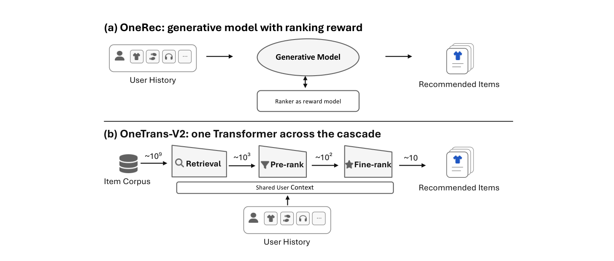

*图 1：统一工业推荐级联的两条路径。(a) 以 OneRec 为例的端到端生成推荐，以一个生成模型替代级联，并将排序模型作为奖励模型。(b) OneTrans-V2 保留召回、粗排、精排级联及候选集缩减，但将三个阶段作为一个 Transformer 上的任务，使用共享且缓存的用户上下文。原文第 2 页。*

在 OneTrans 基础上，我们提出 OneTrans-V2。它将基于 Transformer 的统一，从一个排序模型扩展到整个推荐级联，将召回、粗排和精排表示为同一个因果 Transformer 的三个任务。具体而言，OneTrans-V2 将与候选无关的用户行为序列编码为共享用户上下文，其状态在各阶段复用。每个阶段在此上下文后追加自己的 token，并通过 OneTrans 的混合参数化，使用 token 专属参数建模异构特征。因此，行为序列在每个请求中只编码一次，而非每个阶段编码一次。三个阶段也被联合训练，共同改善共享用户上下文，而非各自孤立优化。阶段可见性掩码（§4.1）控制阶段专属 token 对共享用户上下文的访问。每个阶段都能读取共享上下文，但其 token 与其他阶段的 token 隔离，也不能修改共享上下文。这种隔离使各阶段能依据延迟和特征要求独立选择 token 预算。粗排对小规模特征集使用单个 token，保持轻量；精排则使用多个 token 建模更丰富的候选特征。

除计算复用外，统一还将此前分散在专用模型中的容量汇集到一个可整体扩展的骨干中。但稠密扩展会同时增加模型容量、计算和内存流量 [4, 28]。因此，我们使用稀疏 MoE [9, 35] 扩展汇集后的骨干，将总容量与激活计算量及逐 token 内存流量解耦。随着骨干增大，我们进一步采用 μP 风格参数化，使不同规模下的优化保持稳定。

统一也简化了跨阶段知识蒸馏。粗排和精排通常是独立优化的模型，可能产生不一致的候选排序 [46, 54]。已有蒸馏方法 [17, 29, 42] 能缓解这种不一致，但要求分别训练、打分和更新独立的精排教师。在 OneTrans-V2 中，两个排序阶段是同一 Transformer 的任务，因而共享用户上下文，并在同一训练步更新。精排可以在模型内部直接监督粗排，改善两个阶段的一致性。

然而，召回给统一带来了独特挑战。在我们的生产系统中，不同业务目标需要不同候选集。主通道面向点击和订单，专用通道则促进发现或广告。因此，召回演化出了多个目标专属通道，各有自己的模型与解码过程。难点在于，这些通道的差别不仅是预测什么，还包括召回什么。对于粗排和精排，候选已经给定，多个目标可以通过不同预测头共享一次前向传播。但在召回中，目标决定了首先生成哪些候选。如果仍为每个目标保留独立解码过程，就会保留我们希望消除的碎片化。因此，统一召回器必须在同一个生成过程中表达多个业务目标。

我们通过 DCGR 解决这一问题。DCGR 不直接从用户上下文生成物品，而是在生成物品前增加中间决策步骤。模型首先预测一个决策前缀，表示给定用户条件下即将发生的交互分布。决策维度刻画与目标相关的结果，例如用户是否转化、转化价值多少，以及该类目对用户有多新。随后，模型基于此前缀生成物品的语义标识符（semantic identifier，SID）。这种决策条件生成方式提供了一种紧凑的、非语言形式的思维链推理类比：模型以决策 token 而非自然语言表示中间决策，用它们指导后续物品生成。

这个决策空间也为业务目标提供共同接口。我们不再为每个目标分配独立召回通道，而是施加业务偏置，将预测的决策分布引向期望目标。偏置改变决策前缀的优先级，而不同目标共享物品生成模型。偏置强度作为线上参数暴露。因此，同一模型可以在不同业务目标间权衡，而无须重新训练或新增召回通道。

当三个阶段共享一个骨干后，长用户行为序列的编码成为主要训练成本。因此，我们提出 SNT。SNT 围绕每位用户的终身行为序列组织曝光，将序列编码分摊到该用户的多次曝光。每次曝光保留自身对共享序列的因果视图，同时复用相同的用户侧计算。这带来了 4.4 倍训练加速。

我们已在一个大规模工业推荐系统的召回、粗排和精排中部署 OneTrans-V2。它使 GMV 提升 9.74%；结合协同设计的服务栈，在相同硬件预算下，实现原级联 3.2 倍的每秒查询数（queries per second，QPS）。

我们的贡献如下：

- **级联级 One Transformer。** 将召回、粗排和精排定义为一个联合训练 Transformer 的三个任务，在各阶段复用与候选无关的用户上下文，同时保留各阶段原生候选特征、异构目标与服务预算。这种统一在单一骨干内支持计算复用、跨阶段知识迁移和整个级联的容量扩展。实验表明，联合训练使三个阶段都优于单独训练版本；模型内蒸馏进一步改善粗排和精排的一致性。
- **召回目标整合。** 生产系统中的召回依旧分裂为目标专属通道，因为召回生成候选而非给候选打分。DCGR 从行为序列预测用户条件决策分布，并以得到的决策前缀为条件生成标识符。业务目标通过业务偏置引导该分布，使单个生成模型无需外部路由规则即可覆盖多个目标。
- **面向生产的高效训练、扩展与验证。** 使用稀疏 MoE 在限制激活计算量的同时扩展容量，以 μP 风格参数化稳定不同规模的优化，并通过 SNT 将统一骨干控制在生产训练预算内。在大规模工业系统中，OneTrans-V2 使 GMV 提升 9.74%；结合协同设计的服务栈，实现原级联 3.2 倍的端到端 QPS。

## 2 相关工作

### 2.1 排序中的模型级统一

工业排序模型传统上结合特征交互和用户行为建模的专用组件，包括 DeepFM [12]、DCN V2 [45] 等特征交互架构，以及 DIN [55]、SIM [27] 等行为编码器。近期研究日益转向统一的 token 化架构或共享骨干架构。RankMixer [57] 通过 token 混合强调硬件高效的特征交互；MTGR [13] 将丰富候选特征融入可扩展序列建模。TokenFormer [56] 和 OneTrans [53] 更明确地在单个排序模型中统一异构特征交互与用户行为建模。这些工作共同说明，减少单个排序阶段内部的架构碎片化具有价值。OneTrans-V2 将这一方向从阶段内部的模型级统一，扩展到召回、粗排和精排之间的级联级统一。

### 2.2 从跨阶段协作到级联级统一

跨阶段方法逐步从独立优化模型之间的信息传递，发展到阶段之间直接共享表示和计算。早期方法如 RankFlow [29]、CoRR [17]，通过监督传播、自适应采样与蒸馏改善跨阶段一致性，但大体仍保留独立参数、用户侧计算和服务路径。

OneRec [23] 展示了统一级联的一条路径：围绕生成式召回重新表述推荐，排序通过面向排序的监督或策略信号吸收进生成过程，不再作为独立线上阶段。同期工作 Sona [37] 进一步朝这一方向发展，在统一编码器—解码器架构中处理召回、粗排和精排。与此同时，MTGR [13] 等特征丰富的工业排序模型仍依赖阶段专属候选特征，促使研究者在共享可复用计算的同时保留这些异构特征。

第二条路径保留级联，同时更紧密地耦合召回与排序。UniPinRec [20] 从表示、训练和服务层面联合设计召回与轻量排序；OneRanker [39] 与 UniSGR [40] 通过共享表示和排序导向监督，将生成式召回与下游排序连接。UniR2 [50] 进一步将用户上下文、SID 生成轨迹和排序侧物品特征 token 放入同一异构 decoder-only 序列。其排序查询直接关注生成轨迹，以此作为召回到排序的表示桥梁。共享的基础注意力参数、排序专用 FFN 和低秩适配（LoRA），用于平衡表示共享、任务适配和优化隔离。

OneTrans-V2 采用第二条路径，但通过共享用户上下文，以及两个排序阶段之间的蒸馏损失来耦合各阶段。不同于排序查询会关注生成轨迹的 UniR2，OneTrans-V2 各阶段专属 token 在前向传播中相互隔离，不消费其他阶段生成的中间表示。

### 2.3 决策条件生成召回

生成式召回用语义标识符表示物品，并以用户上下文为条件自回归生成候选，代表方法包括 TIGER [31] 和 OneRec [23]。近期工作进一步将目标相关信号融入生成。PinRec [2] 基于期望结果表示进行条件召回；UniSGR [40] 在序列前添加针对点击、加购和购买的可学习任务感知 token。

OneTrans-V2 的区别在于，DCGR 不把目标当成输入 token，而是从用户上下文预测决策维度，再用推断出的决策前缀指导后续 SID 生成。通过这种方式，DCGR 联合学习决策推断与决策条件召回，使一个生成模型服务多个业务目标。

控制生成模型推荐什么，存在两类方法。一类为模型生成结果赋予奖励，再使用强化学习优化；OneRec [23] 就将排序器作为奖励模型。另一类把结果写入序列本身，通过普通下一 token 预测训练。Decision Transformer [3] 及其后续结果条件方法 [10, 33] 采用后者：把一串动作的结果放在这些动作之前，推理时写入期望结果，后续动作便以此为条件生成。

DCGR 是这一思想的单步情况。决策描述当前一次交互，而非一长串动作的累计奖励，因此标签直接来自日志，无须估计。这也去除了第一类方法的两项成本：无须让奖励模型对生成结果打分，也无须因为日志样本由旧模型而非当前训练模型产生而重新加权。单步设定还回应了结果条件方法的一个已知局限：如果给定的动作序列分别都较差，它无法像多步规划方法那样，将其中较好的部分拼出更优序列。DCGR 先预测一次决策，再生成物品，没有需要拼接的动作序列，因此不存在该局限。

推理阶段最接近的已有方法是 Multi-Game Decision Transformer [19]：它同样不要求外部提供期望结果，而是预测结果分布，将分布移向更好的结果，再生成动作。§4.2.1 的业务偏置就是这种平移，但作用对象是结构化决策，而非单一数值。该模型从平移后的分布抽取一个结果，并以此为条件；DCGR 则为每个决策前缀打分。每个前缀携带调整后的分数，进入覆盖决策与 SID 编码的同一次束搜索。因此，一个本身分数较好、却无法产生好物品的前缀，会被其他前缀超越，而非直接选中。

### 2.4 以序列为中心的训练与计算复用

近期研究越来越多地围绕共享序列或请求上下文，重新组织推荐训练和推理，以减少用户行为序列的重复编码。HSTU [51] 将推荐表述为序列转导，其 M-FALCON 推理算法在候选微批次和请求之间复用缓存的历史状态。请求级批处理（request-level batching，RLB）[11]、SORT [44] 和 MTGR [13] 将同一请求或用户的候选组织在同一共享上下文下，分摊用户侧计算。

SNT 将这一复用原则应用于统一级联。在每个用户窗口内，来自不同请求和不同级联阶段的曝光共享一次用户行为序列编码（§4.4）。

## 3 背景

OneTrans [53] 是基于 Transformer 的排序模型，联合建模顺序用户行为和异构非序列特征。它把每个行为事件投影成一个序列 token，形成行为序列 \(S\)，并通过专用 tokenizer 将非序列特征转换为 token 集合 \(NS\)。

OneTrans 的关键设计是混合参数化。序列 token 的表示是同质的，因此共享注意力 \(Q/K/V\) 和前馈网络（FFN）参数；异构非序列 token 则使用不共享的、token 专属 \(Q/K/V\) 与 FFN 参数。因果注意力掩码将非序列 token 放在行为序列之后，使它们在不违反因果性的情况下关注整个前置行为序列。得到的非序列 token 状态再送入任务头，输出排序预测。

这种分解把与候选无关的行为序列建模，与异构非序列特征交互分离开来，为 OneTrans-V2 提供架构基础：前者可以跨级联阶段共享，后者仍保持阶段专属。

## 4 OneTrans-V2

传统级联沿阶段边界划分，每个阶段各自拥有模型，并重新编码共同的用户行为序列。OneTrans-V2（图 2）则沿“重复部分”和“阶段专属部分”的边界划分：将行为序列编码一次，得到单一用户上下文，再让每个阶段在其后追加自己的 token，从而保留各阶段原生的候选侧建模。因此，OneTrans-V2 保留了级联及阶段专属建模，但只需要一个联合训练的因果 Transformer；传统设计则每个阶段都需要独立模型，且召回内部每个业务目标还需要独立模型。

### 4.1 跨级联的一个 Transformer

OneTrans-V2 的输入分为两部分。与候选无关的用户行为序列 \(S\) 在整个级联共享；非序列特征集合 \(NS_r,NS_p,NS_f\) 分别专属于召回、粗排和精排，仅由各自阶段转换为跟随共享用户上下文的 token。沿用 OneTrans（§3），OneTrans-V2 在每个 Transformer 块（TransBlock）内部对两类 token 采用混合参数化。\(S\) 中的行为 token 共享一套注意力 \(Q/K/V\) 和 FFN 参数，而各阶段非序列 token——下称阶段专属 token——使用自己不共享的 token 专属 \(Q/K/V\) 和 FFN 参数。这使三个阶段可以在一个 Transformer 内运行，同时保留各自异构特征表示；块的内部设计见 §4.3。

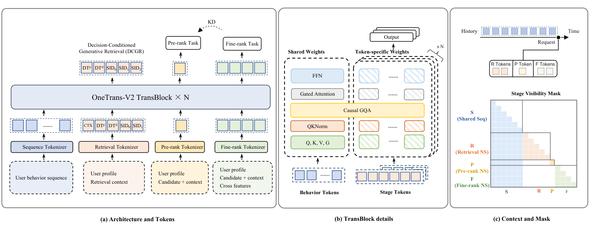

*图 2：包含 \(N\) 个 Transformer 块的 OneTrans-V2。(a) 独立 tokenizer 生成共享用户行为 token 与阶段专属非序列（NS）token，由统一骨干处理。DCGR 使用召回上下文 token CTX、并行和依赖决策 token \(DT_p,DT_d\)，以及三个 SID 编码 SID₀–SID₂ 生成物品。粗排和精排头为候选打分；虚线 KD 表示精排教师向粗排学生蒸馏。(b) 行为 token 共享参数，阶段专属 token 使用各 token 特有参数。Q、K、V 表示查询、键、值投影，G 表示门控注意力的门。(c) S 为共享行为序列，R、P、F 分别为召回、粗排、精排 token。请求时间戳将阶段 token 锚定到可见行为前缀。掩码行是查询、列是键；有色单元允许注意力，白色单元屏蔽。行为 token 在 S 内因果关注；阶段 token 关注可见行为前缀、自身，以及同一阶段同一次曝光中位于其前面的 token。来自其他阶段或曝光的 token 被屏蔽。原文第 6 页。*

**共享因果用户上下文。** 用户 \(u\) 的行为序列 \(S=(s_1,\ldots,s_L)\)，也记作 \(S_u\)，按行为到达顺序排列；每个新事件都追加到序列末尾。为防止未来信息泄漏，我们沿用 OneTrans [53]，通过因果注意力块建模 \(S\)，使每个位置的隐藏状态仅汇总该位置之前的行为。

**阶段可见性掩码。** 一次请求是用户发起的一次推荐调用，依次由全部三个阶段服务。某次曝光的阶段专属 token 属于某个时间戳发起的请求。我们将其锚定在该时间戳之前最后到达的行为位置，使阶段 token 只能关注截至锚点的行为前缀，不能看到之后到达的行为。在同一曝光、同一阶段内部，阶段专属 token 进一步按预定义顺序遵循因果注意力。不同阶段或不同曝光的 token 相互屏蔽，行为 token 从不关注阶段 token，因此用户上下文可以只编码一次，供每个阶段读取。虽然阶段 token 相互隔离，三个任务仍共同优化共享用户上下文，使召回、粗排和精排共享用户建模而不混合非序列特征。不同请求的曝光如何在此掩码下共享一次序列编码，见 §4.4。

### 4.2 任务定义与联合优化

基于上述共享用户上下文和阶段专属 token，OneTrans-V2 联合优化三种异构任务：召回的自回归生成，以及粗排和精排的判别式预测。

#### 4.2.1 决策条件生成召回

在生成式召回中，模型不对给定候选打分，而是以用户上下文为条件自回归生成物品标识符。要将 §1 中的目标专属通道合并到这样一个模型，需要两点：第一，物品需要可生成的结构化标识符；第二，模型需要在内部表示每个通道所隐含的决策，让业务目标能够引导生成。语义标识符解决第一点，DCGR 解决第二点。

**语义标识符。** 沿用已有生成召回工作 [23, 31]，我们对物品多模态 embedding 应用残差量化 k-means（RQ-KMeans）[22]，得到三级 SID \((SID_0,SID_1,SID_2)\)。这三个编码形成由粗到细的层次，模型按此顺序自回归生成。召回是在该编码树上进行宽度为 \(k\) 的束搜索，而非对固定候选集打分。由于多个物品可能共享相同编码，每个召回 SID 所映射的全部物品都会返回。

**决策条件生成召回。** 普通生成召回从用户上下文直接走向 SID 编码，中间没有可观察步骤。DCGR 插入一个中间步骤：在生成 SID 前，模型首先预测即将发生的交互的几项决策，即购买档位、消费档位、发现档位和供给类型，分别描述是否购买、购买价值、类目对用户有多新、以及是否为广告物品。这些预测组成决策前缀，即位于 SID 编码前的少量决策 token。思维链提示 [47] 展示了中间步骤对语言模型的帮助；DCGR 将类似步骤加入召回，但以日志监督，而非自由生成。这里的决策是模型预测的结果，不是用户显式做出的选择。四个维度构成一个决策空间，每个业务目标对应其一个区域，而非一个独立召回通道。

考虑一次请求。用户到达后，模型在生成任何物品之前，先预测交互类型。例如，它可能预测中档消费水平的购买、高发现档位及自然供给，然后基于该预测解码 SID，返回符合这种交互形态的物品。如果预测的是低发现档位且不购买，同样的用户上下文就会产生不同物品。这解释了为何一个模型能服务多个目标：目标不是模型之外的路由决策，而是模型自身预测前缀中的一个区域，业务偏置把预测移向该区域。

决策有两类。并行决策仅依赖用户上下文，在同一位置预测。依赖决策还依赖先前决策，因此处于后续的链式位置。召回专属特征 \(NS_r\) 汇总为跟在共享行为序列 \(S\) 之后的上下文 token CTX。在 \(H=(S,CTX)\) 条件下，模型从 CTX 位置开始逐位置生成：

$$
[\underbrace{DT_p}_{\text{并行决策}},\underbrace{DT_d}_{\text{依赖决策}},\underbrace{SID_0,SID_1,SID_2}_{\text{物品}}]. \tag{1}
$$

四个决策维度的标签直接来自行为日志。

**并行决策。** 三个维度可以仅依据用户上下文预测。购买档位 \(z_{oc}\)（order count）表示一次交互最终无购买、一次购买还是多次购买。由于 \(z_{oc}=0\) 已标记未转化交互，不需要独立购买指示变量。发现档位 \(z_{disc}\)（discovery）表示相对于用户近期行为，候选类目有多新。供给类型 \(z_{ad}\)（advertising）表示自然物品还是广告物品。每个维度都由独立轻量决策头从 CTX 位置的隐藏状态预测。三个维度的决策 embedding 相加，构成下一个位置的单个并行决策 token \(DT_p\)。相加而非串联有两个原因：串联会迫使我们为没有依赖顺序的维度选择解码顺序，而先解码的维度会得到更好服务（§7.5），这种选择并非中性；相加还能缩短前缀。

**依赖决策。** 本文唯一的依赖决策是消费档位 \(z_{aov}\)（average order value），表示每笔订单的价值区间。我们有意不用单个 GMV 标签建模交易价值，因为它无法区分多笔低价订单和一笔高价购买。将交易价值拆为购买档位和消费档位后，消费档位只有在购买档位已知时才有意义，因此在 \(DT_p\) 之后预测，并用依赖决策 token \(DT_d\) 表示。然后，以用户上下文和预测决策为条件，逐个生成 SID 编码。

**DCGR 目标。** DCGR 对决策与物品的联合分布建模：

$$
P(\mathbf z,Item\mid H)=\underbrace{P(\mathbf z\mid H)}_{\text{决策建模}}\cdot\underbrace{P(Item\mid H,\mathbf z)}_{\text{决策条件召回}}.\tag{2}
$$

其中 \(\mathbf z_p=(z_{oc},z_{disc},z_{ad})\) 是并行决策，\(\mathbf z=(\mathbf z_p,z_{aov})\) 是完整决策前缀。根据上述组织形式：

$$
\begin{aligned}
P(\mathbf z\mid H)&=\prod_{j\in\{oc,disc,ad\}}P(z_j\mid H)\cdot P(z_{aov}\mid H,\mathbf z_p),\\
P(Item\mid H,\mathbf z)&=\prod_{\ell=0}^{2}P(SID_\ell\mid H,\mathbf z,SID_{<\ell}).
\end{aligned}\tag{3}
$$

第一行由用户上下文预测决策，第二行在决策条件下生成物品。所有决策和 SID 预测均按式（1）的自回归顺序使用交叉熵训练，在对应位置提供真实决策，即教师强制（teacher forcing）。由此得到召回损失 \(\mathcal L_r\)。

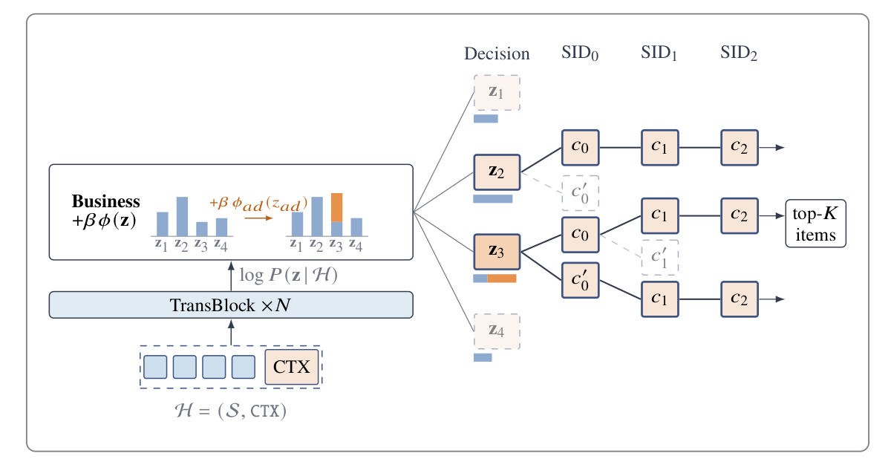

*图 3：DCGR 的推理。模型在缓存上下文 H（行为序列 S 后接 CTX）上，对决策维度的每种组合 z 打分。业务偏置 βφ(z) 仅加到决策前缀分数。图中 βφ_ad(z_ad) 加给带广告取值的前缀 z₃（橙色），提高其分数及被束搜索保留的机会；β=0 则保留模型原始排序。每个前缀带着其分数进入 SID 束搜索，最终将 top-K 物品送往粗排。c_ℓ 是第 ℓ 层编码，撇号表示竞争编码，虚线节点被剪枝。线上调整 β 即可改变模型采取哪些决策，而无须新增召回通道。原文第 8 页。*

**业务引导。** 解码是在决策前缀与 SID 编码上的束搜索，因此返回哪些物品取决于决策前缀的相对得分。业务目标通过在解码阶段改变该排序进入模型。解码分三步。首先，在缓存用户上下文上为每个合法决策组合 \(\mathbf z\) 打分，得到每个前缀的 \(\log P(\mathbf z\mid H)\)（图 3）。其次，对每个分数增加业务偏置 \(\beta\phi(\mathbf z)\)。最后，束搜索将前缀延伸到 SID 编码，按下式联合排序前缀与编码：

$$
\underbrace{\log P(\mathbf z\mid H)+\beta\phi(\mathbf z)}_{\text{引导后的决策前缀}}+\sum_{\ell=0}^{2}\log P(SID_\ell\mid H,\mathbf z,SID_{<\ell}).\tag{4}
$$

这里 \(\phi_j\) 为维度 \(j\) 的每个取值分配一个偏置。例如，为最高消费档位增加正偏置，会将召回引向更高价值订单。\(\phi(\mathbf z)\) 汇总前缀各维度的偏置；单个标量 \(\beta\) 决定整体偏置强度。

偏置是软偏好，而非硬规则。式（4）的第一项对应分布 \(q(\mathbf z)\propto P(\mathbf z\mid H)e^{\beta\phi(\mathbf z)}\)，它是以下优化问题的解：

$$
\max_q\ \mathbb E_q[\phi(\mathbf z)]-\frac1\beta KL\big(q\Vert P(\cdot\mid H)\big).
$$

这正是离线强化学习 [26] 中使用的 KL 正则化改进步骤。也就是说，偏置提高决策的期望业务价值，KL 惩罚使其保持接近日志中学到的分布，\(\beta\) 决定可以移动多远。Multi-Game Decision Transformer [19] 将同样的思想用于单一结果分数。由于 \(\phi\) 按维度相加，指数项可分解为 \(e^{\beta\phi(\mathbf z)}=\prod_j e^{\beta\phi_j(z_j)}\)，每个目标一个因子。因此，各业务目标在自己的维度上获得各自偏置，而非只有一个全局权重。

由此有三点结论。第一，偏置只作用于式（4）的决策部分，改变哪些决策胜出，而不改变式（2）中的物品项 \(P(Item\mid H,\mathbf z)\)，因此给定决策时，模型仍返回它认为最可能的物品。第二，\(\beta=0\) 对应原始排序，更大的 \(\beta\) 使排序偏离更多，因此偏置调整而非覆盖原始排序。第三，\(\beta\) 在线设置。对于已有维度能表达的目标，无需重新训练即可引导。新目标会成为新的决策维度，只需在相同模型上增加一个轻量决策头，而非增加有独立模型的新通道。如果新维度没有条件依赖，就将其加到 \(DT_p\)，决策前缀不变长。

**物品侧引导。** 业务偏置决定哪个决策胜出；同样的设计还允许第二种控制，用来决定生成物品在多大程度上遵从该决策。无分类器引导（classifier-free guidance，CFG）[16] 最早用于扩散模型，后用于语言模型 [32]，可以提供这种控制。其思想是，用同一模型分别在有、无决策前缀时对每个 SID 编码打分，把两者分数之差看作决策的影响。

为支持第二种分数，在一小部分训练样本中，用特殊空 token \(\varnothing\) 替换决策前缀，使模型也能在未知决策时预测 SID。解码时，每个编码可以按下式评分：

$$
\log P(SID_\ell\mid H,\varnothing,SID_{<\ell})+
 w\Big[\log P(SID_\ell\mid H,\mathbf z,SID_{<\ell})-\log P(SID_\ell\mid H,\varnothing,SID_{<\ell})\Big].\tag{5}
$$

括号部分衡量知道决策 \(\mathbf z\) 对编码分数的影响，权重 \(w\) 缩放该变化。\(w=1\) 时等于式（4）的普通物品项；\(w>1\) 放大决策影响，使物品更遵从决策；\(w<1\) 减弱影响；\(w=0\) 忽略决策。因为两种分数来自同一模型，其差值基本不受单个分数校准好坏的影响。计算第二种分数需要第二次解码器前向，但两次都读取同一缓存用户上下文，仅在前缀与 SID 位置不同，额外工作局限于束搜索。这样就有两个线上引导参数：\(\beta\) 决定采取哪个决策，\(w\) 决定物品遵从决策的程度。§7.4 的干预表明，解码器对前缀响应足够强，\(w\) 应能产生作用。**该扩展尚未部署，评估留待未来。**

#### 4.2.2 判别式排序任务

**粗排。** 粗排对召回返回的每个候选打分，因此逐候选预算在级联中最严格，既无法读取完整非序列特征集，也无法为每个候选使用许多 token。我们将其限制为轻量特征子集 \(NS_p\subset NS_f\)，由 tokenizer 将整个子集压缩成单个候选 token。该 token 在阶段可见性掩码下关注共享用户上下文。粗排预测头读取其状态，预测粗排目标集 \(T_p\)，包含 CTR 与 CVR，均通过二元交叉熵损失优化：

$$
\mathcal L_p=-\sum_{t\in T_p}\left[y_p^t\log\hat y_p^t+(1-y_p^t)\log(1-\hat y_p^t)\right].\tag{6}
$$

其中 \(y_p^t\in\{0,1\}\) 与 \(\hat y_p^t\) 分别是目标 \(t\) 的标签与预测概率。

**精排。** 精排仅对通过粗排的候选打分，并决定最终顺序，因此主要约束从逐候选吞吐转向排序精度。如果把丰富候选特征汇聚为一个 token，会抹去精度所依赖的特征异质性。沿用 OneTrans [53]，我们让精排消费完整的非序列集合 \(NS_f\)，并保持为多个 token，而非粗排所用的单个 token。这些 token 在同一阶段可见性掩码下关注共享上下文，所得状态由精排头读取，预测精排目标。精排预测的目标远多于粗排；本文关注核心 CTR、CVR，记作 \(T_f\)，同样使用二元交叉熵损失：

$$
\mathcal L_f=-\sum_{t\in T_f}\left[y_f^t\log\hat y_f^t+(1-y_f^t)\log(1-\hat y_f^t)\right].\tag{7}
$$

其中 \(y_f^t\) 和 \(\hat y_f^t\) 的含义与式（6）相同。

**知识蒸馏。** 共享用户上下文为粗排和精排提供共同表示，但两阶段仍学习各自打分函数，对相同候选可能排序不同。这是个问题：被粗排丢弃的候选永远无法被精排找回，两阶段的分歧会永久移除精排可能置于顶部的物品。为此，我们在两个排序任务间采用知识蒸馏 [15]，以精排为教师、粗排为学生，让拥有更丰富候选特征的阶段监督低成本阶段的排序。我们沿用 logit 标准化 [41] 中的均值中心化步骤，但将标准差替换为固定温度 \(\tau\)。对每个粗排目标 \(t\in T_p\)，教师 logit \(o_T^t\) 与学生 logit \(o_S^t\) 分别减去自己的均值 \(\mu_T^t,\mu_S^t\)，所得学生概率对齐教师概率，按目标求和的二元交叉熵为：

$$
\begin{aligned}
p_T^t&=\sigma\left(\frac{o_T^t-\mu_T^t}{\tau}\right),\quad
p_S^t=\sigma\left(\frac{o_S^t-\mu_S^t}{\tau}\right),\\
\mathcal L_{kd}&=-\sum_{t\in T_p}\left[p_T^t\log p_S^t+(1-p_T^t)\log(1-p_S^t)\right].
\end{aligned}\tag{8}
$$

\(\sigma\) 为 sigmoid。为避免蒸馏损失影响教师，我们对教师 logit 停止梯度，使其只由精排目标塑造，而对齐仅推动学生。由于 OneTrans-V2 采用单模型设计，这种蒸馏既不需要单独训练的教师，也不需要离线蒸馏阶段。\(\mathcal L_{kd}\) 与任务损失在同一次反向传播中优化，因此学生可随着教师增强而持续改善。

#### 4.2.3 总体目标

OneTrans-V2 的损失是三个任务目标与蒸馏损失的加权和：

$$
\mathcal L=\lambda_r\mathcal L_r+\lambda_p\mathcal L_p+\lambda_f\mathcal L_f+\lambda_{kd}\mathcal L_{kd}.\tag{9}
$$

\(\lambda_r,\lambda_p,\lambda_f,\lambda_{kd}\) 控制四个目标的相对贡献。

### 4.3 扩展与稳定化

扩展 OneTrans-V2，需要在限制激活计算量的同时增加容量，并保持注意力有效、优化稳定。为此，我们结合参数高效扩展、稳定化与优化技术，并重新考察哪些输入设计在大规模下仍有益。

**TransBlock 设计。** 图 2(b) 展开了 TransBlock 内部结构。每个块采用 pre-norm 布局：注意力和 FFN 子层前使用 RMSNorm [52]，其后接残差连接。对 \(N\) 个块，分支输出乘以残差系数 \(\gamma=1/\sqrt{2N}\)，使残差流随深度增加仍保持有界。注意力子层按头对查询和键执行 RMS 归一化（QKNorm [14]），门控注意力 [30] 在输出投影前调制注意力输出。FFN 子层采用稀疏 MoE，将每个 token 路由到少量专家，在保持逐 token 激活计算大致不变的同时增加参数。算法 1 概括块的前向传播，后文分别说明各组件。

**算法 1：TransBlock 前向传播**

输入：隐藏状态 \(X\)、阶段可见性掩码 \(M\)、残差系数 \(\gamma=1/\sqrt{2N}\)。

```text
1. X̃ ← RMSNorm(X)                         # pre-norm
2. Q, K, V, G ← split(X̃ W_QKVG)           # 一次融合投影
3. Q̄, K̄ ← RMSNorm_head(Q), RMSNorm_head(K) # QKNorm
4. A ← Attn(Q̄, K̄, V; M)
5. X ← X + γ (A ⊙ σ(G)) W_O               # 门控注意力
6. X̃ ← RMSNorm(X)                         # pre-norm
7. X ← X + γ MoE(X̃)                       # 稀疏 MoE
8. 返回 X
```

**分组查询注意力。** 注意力采用分组查询注意力（grouped-query attention，GQA）[1]。查询头被分成若干组，每组共享一个键/值头，因此每层的键/值头数远少于查询头数。这种节省很重要：共享行为序列的键/值缓存只计算一次，随后由三个任务的阶段 token 读取；召回时还会广播给解码器的多个 beam。因此，其大小决定每次交叉注意力的内存占用和内存流量。GQA 按分组大小的比例缩减缓存，且不损失质量（§7.6）。阶段 token 与共享行为序列只需键/值头数和 head 维度一致，因此两者可在相同缓存键值上使用不同数量的查询头。

**稀疏 MoE。** 沿用 DeepSeekMoE [5]，OneTrans-V2 的 FFN 是由细粒度专家构成的稀疏 MoE；每个专家是中间层较窄的 SwiGLU 网络 [34]。一个共享专家始终激活，其余为路由专家。轻量路由器为每个输入产生各路由专家的分数，选取固定数量的最高分专家。选中分数重新归一化到和为 1，再乘固定的路由专家缩放系数。子层输出是共享专家输出，加上所选路由专家输出的加权和。

受 DeepSeek-V3 [7] 启发，我们使用 sigmoid 路由器，而非 softmax。softmax 会耦合专家：提高一个分数必然降低其他分数，容易推动 winner-take-all 路由，并使各分数尺度依赖专家总数。sigmoid 则在固定尺度上独立评估每个专家与输入的相关性，使多个专家可同时被判为相关；增加专家时分数仍具有可比性，有利于更大专家数量下的训练。

**门控注意力。** 我们采用门控注意力 [30]，对注意力输出施加按头、随输入变化的 sigmoid 门。门的 logit 来自归一化注意力输入，经融合 QKVG 投影的额外切片产生。每个注意力头 softmax 加权后的值，在输出投影前，与门 logit 的 sigmoid 逐元素相乘。因此，门控制各头写回残差流的内容，不直接控制注意力分布。它位于值投影和输出投影之间，引入非线性，避免两者退化为一个线性映射。它还产生输入相关稀疏性：对当前 token 无用的头可以关闭，而非将注意力质量分配给注意力汇聚位置（sink）。这抑制了注意力汇聚与巨幅激活，改善训练稳定性。

**稳定化技术。** 随宽度与深度增加，激活、梯度和逐步权重更新的尺度会随模型大小漂移，使一个规模上稳定的配置在下个规模发散。每次扩展都可能需要重新搜索超参数，而大规模试验成本高。因此，我们参照用于宽度的最大更新参数化（maximal update parameterization，μP）[48]，以及用于深度的 Depth-μP [49]，使骨干在扩展时保持训练动力学不变。两者共同原则是：扩展会改变每层求和的项数，因此必须共同选择初始化、乘数和学习率，使每个隐藏激活及其逐步变化都保持在既不增大也不消失的尺度，记作 \(\Theta(1)\)。

对于宽度，考虑隐藏层 \(W\mathbf x\)，其中 \(\mathbf x\in\mathbb R^d\)，\(d\) 为宽度。fan-in 初始化使 \(W\) 元素方差为 \(1/d\)，初始化时各项不相关，因此 \(W\mathbf x\) 已保持 \(\Theta(1)\)。但学习率为 \(\eta\) 的一次 Adam 更新，使 \(W\) 每个元素大致变化 \(\eta\)。由此产生的 \(\Delta W\mathbf x\) 汇总了与 \(\mathbf x\) 相关的 \(d\) 项，增长为 \(\Theta(\eta d)\)。μP 将每个隐藏权重的 Adam 学习率缩放为 \(1/d\)，抵消增长。

对于深度，设块数为 \(N\)，每块向残差流加入注意力分支和 FFN 分支。残差流汇总 \(2N\) 个初始化时近似不相关的分支输出，因此残差乘数 \(1/\sqrt{2N}\) 使前向信号保持 \(\Theta(1)\)。但不同分支的更新因共享损失而相关，彼此叠加而非抵消，总更新随 \(N\) 增长。残差乘数已抵消一个 \(\sqrt N\) 因子，Adam 学习率还需缩放 \(1/\sqrt N\) 抵消另一个。表 1 给出相对于宽度 \(d_0\)、深度 \(N_0\) 基础模型的隐藏层规则，其中 \(m_d=d/d_0\)，\(m_N=N/N_0\)。

**表 1：骨干隐藏权重的 μP 与 Depth-μP 规则（原文第 12 页）。** 两类规则相乘组合，例如隐藏层学习率为 \(\eta_0/(m_d\sqrt{m_N})\)。

| 隐藏层量 | 基础模型 | 宽度规则（μP） | 深度规则（Depth-μP） |
| --- | --- | --- | --- |
| W 的初始化方差 | \(1/d_0\) | × \(1/m_d\)，即 \(1/d\) | 不变 |
| 残差乘数 γ | \(1/\sqrt{2N_0}\) | 不变 | × \(1/\sqrt{m_N}\)，即 \(1/\sqrt{2N}\) |
| Adam 学习率 | \(\eta_0\) | × \(1/m_d\) | × \(1/\sqrt{m_N}\) |

另有两个量是在训练过程中漂移，而非随模型规模漂移。注意力 logit 随查询和键投影的范数增大，因此使用 QKNorm [14]，将 logit 限制在固定范围，避免 softmax 塌缩到单个位置。权重范数在 Adam 下也会增长，有效学习率随之缩小，因此使用 AdamW 优化稠密参数，其解耦权重衰减 [21] 使范数维持稳定。

**多模态 embedding。** 容量也改变了多模态 embedding 应如何进入模型。已有实践 SimTier [36] 不直接输入多模态 embedding，而是对每条行为序列，计算候选与每个历史物品的余弦相似度，将分数汇总为直方图，作为稠密特征输入。OneTrans-V2 则直接将多模态 embedding 作为每个历史物品和候选的辅助信息。这种选择只有在容量足够时才有益，见 §7.8。

### 4.4 序列原生训练

更大的骨干使每次训练更新更昂贵，其中最大成本是编码长行为序列。传统推荐训练多次支付这一成本，因为各阶段各自构建逐曝光或逐请求样本，每个样本都携带一份序列副本。一位有一百次曝光的用户，其序列最多会被复制和编码一百次。RLB [11]、MTGR [13] 等方法通过将曝光组织在共享用户上下文下减少冗余。SNT 将这种复用扩展到整个级联：序列仅编码一次，每次曝光从中读取，无论来自哪个请求、哪个阶段。

两个性质使其成为可能。第一，行为序列仅追加，并用因果注意力编码 [53]。每个位置的隐藏状态只汇总截至该位置的行为，因此完整序列编码中包含每个更早前缀的编码，且它们不变。第二，每次曝光保留请求身份、时间戳、任务身份、阶段专属特征和标签，但不再携带序列副本。在模型中，曝光表示为在阶段可见性掩码下附着于共享编码的阶段 token，只读取截至请求时间的前缀。为实际实现这种共享，SNT 也改变样本分组：按用户分组，将时间窗口内同一用户的曝光（用户窗口）与一份行为序列一起存储、读取。窗口长度可配置（§7.9）。

**每次曝光看到什么。** 形式上，曝光 \(e\) 锚定于 \(S_u\) 中在其请求时间前最后到达的行为位置 \(a_e\)（§4.1）。阶段可见性掩码只允许其关注截至 \(a_e\) 的前缀。同一请求的曝光共享锚点。因此，即使序列只为所有曝光编码一次，每次曝光看到的仍恰好是该次线上请求可见的内容。我们称之为曝光的因果视图；图 4 对这种组织方式进行了说明。

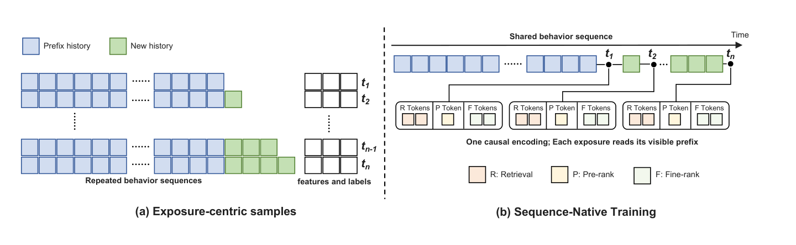

*图 4：SNT 的样本组织。(a) 以曝光为中心的样本在各级联阶段逐曝光独立存储，每次都携带行为序列副本。(b) SNT 在每个用户窗口内仅存储并因果编码一次序列。每次曝光保留阶段特征与标签，只读取请求时间可用的前缀。原文第 13 页。*

这些视图随着序列增长仍然有效，因为序列只追加。令 \(S_u^{(n)}\) 表示第 \(n\) 次请求看到的序列，则下一请求看到：

$$
S_u^{(n+1)}=S_u^{(n)}\Vert\Delta S_u^{(n+1)},\tag{10}
$$

其中 \(\Vert\) 为拼接，\(\Delta S_u^{(n+1)}\) 为两请求之间到达的行为。新行为被追加，而不会插入更早前缀，因此在 \(S_u^{(n)}\) 上定义的因果状态和锚点，在 \(S_u^{(n+1)}\) 中仍有效。

**请求相对时间编码。** 锚点决定曝光能看到哪些行为，却没有说明行为有多旧。昨天的行为对于今天的请求和一个月后的请求意义不同，但两个请求读取相同序列编码。因此，我们使阶段 token 与行为序列之间的注意力依赖请求与行为的时间差。采用基于时间戳的旋转位置编码变体 [24, 38]：请求时间为 \(t_e\) 的曝光查询按 \(t_e\) 旋转，事件时间为 \(t_i\) 的行为键按 \(t_i\) 旋转。时间通道的注意力项满足：

$$
\big(R(t_e)q_e^{time}\big)^\top\big(R(t_i)k_i^{time}\big)
=(q_e^{time})^\top R(t_i-t_e)k_i^{time}.\tag{11}
$$

\(R(t)\) 是时间戳 \(t\) 的旋转变换。该项只依赖 \(t_i-t_e\)，而非行为在序列中的位置。同一曝光的 token 共享一个请求时间，因此相对旋转抵消。行为自注意力保持不变。我们使用多个固定时间周期捕获长短期动态。键的旋转只取决于行为自身的时间戳，旋转后的键可计算一次后供每个请求和阶段复用，每次曝光只需自己的查询和锚点。相较以曝光为中心的样本，SNT 在相同硬件预算下实现 4.4 倍训练加速（§7.9）。

## 5 服务与系统优化

### 5.1 服务流水线

尽管 OneTrans-V2 作为一个 Transformer 联合训练，线上仍按原有“召回 → 粗排 → 精排”级联服务，每个阶段仅执行自身候选侧计算。

**共享用户上下文。** 对用户 \(u\) 的线上请求，首先使用共享因果 Transformer 处理 \(S_u\)，产生可复用用户上下文缓存 \(C_u\)。召回、粗排、精排消费同一个 \(C_u\)，因此长行为序列按请求编码一次，而非按阶段编码。召回结合 \(C_u\) 与召回特征 \(NS_r\) 执行 DCGR 解码，将 §4.2.1 的业务偏置施加到前缀分数，再对 SID 层次进行束搜索。粗排和精排是在同一 \(C_u\) 上进行的非自回归候选打分。粗排使用轻量 \(NS_p\) 为召回候选评分；精排只为存活候选使用更丰富的 \(NS_f\)。尽管用户上下文共享，候选集合仍沿级联逐步缩减。

### 5.2 解码与算子优化

**召回解码优化。** 召回先生成决策前缀，再通过束搜索解码 SID。两者都逐步解码，延迟取决于串行步骤数及每步工作量。我们针对前缀减少步骤，针对 SID 减少单步工作。每个决策维度的词表很小：\(z_{oc}\) 三个值，\(z_{ad}\) 两个值，\(z_{disc}\) 和 \(z_{aov}\) 各少量值。其组合数足够小，可在一次前向传播中全部评分。因此，我们枚举式（3）中所有合法 \(\mathbf z\) 组合，在缓存用户上下文上一次前向打分，而非按并行、依赖位置依次解码。这将前缀从多个串行步骤压缩为一个评分步骤，业务偏置就在此施加。

对 SID 解码，\(k\) 为束宽，\(K\) 为最终返回粗排的物品数。我们将所有 beam—token 对上的全局 top-k 替换为两阶段 top-k：先保留每个 beam 的 k 个最佳扩展，再从这些候选中选择全局 k 个。得到的 top-k 集合完全相同。中间候选池从“束宽 × 词表大小”缩减为每个 beam 仅 k 个，相应降低后续每步工作量。

**算子融合。** 除上述解码改进外，一系列 kernel 优化提高了训练和服务每次前向传播的模型 FLOPs 利用率（MFU）。现代 GPU 的利用率受 GEMM 大小、数量及其间逐元素操作的内存流量影响，因此我们让 GEMM 更大、更少，并融合其间操作。阶段 token 与共享行为序列间的注意力采用 FlashAttention 风格算子 [6]，其内置阶段可见性掩码可在一次调用内覆盖用户全部候选，无需 padding 或显式构造注意力矩阵。

在 TransBlock 内，查询、键、值与门投影合为一次无偏置通用矩阵乘（GEMM），输出原地使用。QKNorm 由 RMSNorm kernel 通过偏移访问查询、键切片，避免复制。SwiGLU 的 gate 与 up 投影也合为一次 GEMM。每个融合 kernel 都利用现代 GPU 的高效指令。例如 RMSNorm kernel 保证每个 token 隐藏向量起始地址 16 字节对齐，使编译器产生 128 位向量化载入指令，每次读取八个 16 位数值。

**低精度服务。** 与 LLM 不同，推荐模型消费大量需要保留数值范围和精度的浮点特征，因此服务默认使用 FP16。Transformer 骨干则更耐受低精度，因为每个子层前、查询和键上的 RMSNorm 将激活限制在有界尺度。我们进一步将约占 TransBlock 三分之二 FLOPs 的 SwiGLU GEMM 降为 FP8。服务还允许一种训练中无法采用的融合：没有反向传播需要保留中间激活时，可将合并的 gate/up GEMM、down GEMM 及带缩放的残差更新放在同一个 kernel 中。

## 6 实验结果

### 6.1 实验设置

**数据集。** 我们在大规模工业推荐系统生产日志上离线评估 OneTrans-V2。日志使用与 OneTrans [53] 相同的日志、特征快照和标签流水线，但时间窗口不同，因此绝对数值不可与旧论文直接比较。生产日志按时间顺序组织，所有特征在曝光时记录，避免时间泄漏，并使离线评估与线上服务一致。点击、订单等标签在生产所用固定窗口内累计。日志采集遵循严格隐私政策，个人身份信息均匿名化并哈希处理。

**任务与指标。** 评估覆盖三个阶段。生成式召回通过束搜索解码 SID，不对固定候选集打分。沿用 UniSGR [40]，采用 HitRate@M（HR@M），即真实物品的 SID 出现在束搜索返回 top-M SID 中的请求比例，报告 M=1、10。粗排和精排对给定候选集打分，针对 CTR、CVR 分别报告 AUC 和 UAUC，即按曝光数加权的用户级 AUC。两阶段及其基线使用相同曝光和标签训练评估，不加入未曝光候选或采样负例。

沿用 OneTrans [53] 的 next-batch 协议，按时间流式处理数据，每个 mini-batch 在用于模型更新之前先被评分，因此预测不会发生在模型已经训练过的数据上。指标按天计算，再在评估期内宏平均。

我们还报告服务 GFLOPs：在部署配置下，模型为一次请求实际执行的浮点计算成本，对其服务的阶段求和。¹ 该成本是在 OneTrans 所述优化后真正执行的成本。例如，同阶段同请求候选共享一次行为序列编码，因此编码仅计一次，而非逐候选累计。

**实现。** 我们评估两种规模。默认 OneTrans-V2L（large）堆叠 §4.3 的 TransBlock，每请求成本为 662 GFLOPs；OneTrans-V2S（small）为相同设计的轻量版本，239 GFLOPs，约为 L 的 36%。召回将每个物品量化为三个 SID 编码，每层码本 8192 个条目。四个决策维度 \((z_{oc},z_{disc},z_{ad},z_{aov})\) 放在两个 token 位置。

训练采用双优化器：稀疏 embedding 用 AdaGrad [8]，学习率 0.1，初始累加器 1.0；稠密参数用 AdamW [21]²，\(\beta_1=0,\beta_2=0.99999,\epsilon=10^{-5}\)，权重衰减 0.01。由于 \(\beta_1=0\)，它不带动量，相当于带二阶矩偏差校正和解耦权重衰减的 RMSProp；我们按实现继续称其为 AdamW。除 §4.3 的稳定化外，稠密和稀疏层均使用全局梯度范数裁剪 [25]。训练使用 BF16、16 张 GPU、每 GPU batch size 2048。式（9）的权重为 \(\lambda_r=0.1,\lambda_p=1,\lambda_f=1,\lambda_{kd}=1\)，蒸馏温度 \(\tau=0.5\)。式（8）的中心化均值通过训练 batch 的指数滑动平均维护，动量 0.9999。

**基线。** 以下所有基线使用相同特征：

- **OneTrans-GR：** 已部署的独立生成式召回模型，仅生成 SID、不含决策前缀；物品用三级 SID 表示（§4.2.1），由 Transformer 解码器自回归解码。它是在 OneTrans [53] 之后开发、规模更大的系统内最新 GR 模型，属于强基线，而非简单调优的参考模型。
- **OneTrans-Lite：** 已部署粗排模型，是满足粗排更严格计算预算的紧凑 OneTrans 变体。
- **OneTrans [53]：** 已部署精排模型，在单个 Transformer 中联合建模行为序列和非序列特征（§3）。
- **UniSGR [40]、UniPinRec [20]：** 近期将生成召回与下游排序组件统一的框架。复现时，将 UniPinRec 轻量排序映射为粗排、UniSGR 多目标排序映射为精排，并按 UniSGR 原实现解码召回，其任务 token 由外部指定，而非由行为序列预测。每种方法仅耦合两个阶段，因此仅比较映射覆盖的阶段。UniPinRec 召回是例外：它不是生成式，而是对物品 embedding 做近邻搜索，因此不与本文基于 SID 的生成召回比较。

¹ OneTrans [53] 报告的是训练 FLOPs；本文报告服务 FLOPs，因为部署级联的 QPS 与延迟由每请求服务成本约束。

² 权重衰减沿用现代 LLM 训练约定：\(W\leftarrow W-\eta\omega W\)，衰减系数 \(\omega\) 受学习率 \(\eta\) 缩放；不是 TensorFlow 旧版 AdamW 所用、与学习率无关的 \(W\leftarrow W-\omega W\)。

### 6.2 离线效果

表 2 汇总三个阶段的效果。现有级联由召回 OneTrans-GR、粗排 OneTrans-Lite、精排 OneTrans 构成，每请求总计 275 GFLOPs，以下比较以此为参照。

**表 2：三个阶段的效果（原文第 16 页）。** (a) 为线上各阶段专用基线；(b) 为统一多个阶段的模型。N.A. 表示未覆盖或不比较的阶段。GFLOPs 是每个模型独立服务一次请求、覆盖该阶段全部候选的实际算术成本，包括粗排数千、精排数百候选，已计入用户序列只编码一次等优化；它不是吞吐量代理，因为吞吐还依赖 MFU。各质量指标最佳值均来自 V2L。

| 类型 | 模型 | 召回 HR@1 | HR@10 | 粗排 CTR AUC | CTR UAUC | CVR AUC | CVR UAUC | 精排 CTR AUC | CTR UAUC | CVR AUC | CVR UAUC | GFLOPs |
| --- | --- | --- | --- | --- | --- | --- | --- | --- | --- | --- | --- | --- |
| (a) 单模型 | OneTrans-GR | 0.0545 | 0.3112 | N.A. | N.A. | N.A. | N.A. | N.A. | N.A. | N.A. | N.A. | 202 |
| (a) 单模型 | OneTrans-Lite | N.A. | N.A. | 0.7965 | 0.7080 | 0.9102 | 0.7365 | N.A. | N.A. | N.A. | N.A. | 4 |
| (a) 单模型 | OneTrans | N.A. | N.A. | N.A. | N.A. | N.A. | N.A. | 0.8084 | 0.7393 | 0.9139 | 0.7428 | 69 |
| (b) 统一模型 | UniPinRec | N.A. | N.A. | 0.8046 | 0.7212 | 0.9113 | 0.7506 | N.A. | N.A. | N.A. | N.A. | 325 |
| (b) 统一模型 | UniSGR | 0.0483 | 0.2964 | N.A. | N.A. | N.A. | N.A. | 0.7976 | 0.7209 | 0.9130 | 0.7328 | 117 |
| (b) 统一模型 | OneTrans-V2S | 0.0660 | 0.3441 | 0.8053 | 0.7372 | 0.9128 | 0.7534 | 0.8171 | 0.7532 | 0.9163 | 0.7589 | 239 |
| (b) 统一模型 | OneTrans-V2L | 0.0923 | 0.4053 | 0.8089 | 0.7409 | 0.9145 | 0.7596 | 0.8182 | 0.7564 | 0.9184 | 0.7682 | 662 |

OneTrans-V2S 以略低于参照的 239 GFLOPs 服务全部阶段，却在对应阶段分别超过三个基线，例如召回 HR@1 +21.10%、精排 CVR UAUC +2.17%。OneTrans-V2L 使用原级联 2.4 倍计算量，在全部十个质量指标上获得更大收益：相对 OneTrans-GR，召回 HR@1 +69.36%；相对 OneTrans-Lite，粗排 CTR UAUC +4.65%、CVR UAUC +3.14%；相对 OneTrans，精排 CTR UAUC +2.31%、CVR UAUC +3.42%。两种版本也在 UniPinRec、UniSGR 覆盖的全部阶段超过它们。在相同架构与参数预算下，联合训练自身的收益在 §7.1 单独考察。

### 6.3 线上 A/B 效果

我们在大规模工业推荐系统通过线上 A/B 测试评估业务影响。对照组由原有 OneTrans-GR、OneTrans-Lite、OneTrans 级联服务；实验组用单个 OneTrans-V2L 配合 §5.2 服务栈替代三个模型。用户级哈希随机分流，各组 50% 流量。

相对对照组，OneTrans-V2 的人均 GMV 提升 9.74%，用户活跃天数提升 0.25%，说明其推荐更能使用户回访。这些收益来自与三个独立训练、独立服务模型构成的强级联的比较，展示了级联级统一的潜力。

OneTrans-V2 的服务也更高效。QPS 定义为每秒完成全部三个阶段的请求数。相同硬件预算下，实验组 QPS 为对照组的 3.2 倍，尽管每请求 FLOPs 更多。更高 QPS 来自服务栈，以及行为序列每请求只编码一次而非每阶段一次；§7.9 对两者进行量化。

## 7 分析

本节分析各组件的贡献。除非另行说明，排序结果报告 CTR，所有提升均为相对参照配置的相对变化，而非 AUC 或 UAUC 的绝对差值。

### 7.1 联合训练的效果

我们分析三个任务联合训练是否优于分别训练。本小节中，联合模型与独立训练版本使用相同架构、参数预算、数据和训练目标，保持 §6.1 损失权重不变，也包括 §4.2.2 的蒸馏损失：独立粗排由独立精排蒸馏。因此收益反映联合训练本身，而非新增容量或蒸馏。先分析粗排与精排合并，再分析三个阶段合并。

**合并粗排与精排。** 两个排序任务的 token 读取共享用户上下文，并共同优化。表 3 显示，两任务都优于分别训练的版本：粗排 CTR AUC +0.09%、CTR UAUC +0.17%；精排分别 +0.12%、+0.21%。两个任务相互促进，而非竞争。

**表 3：粗排与精排联合训练相对分别训练的提升（原文第 17 页）。**

| 任务 | CTR AUC | CTR UAUC |
| --- | --- | --- |
| 粗排 | +0.09% | +0.17% |
| 精排 | +0.12% | +0.21% |

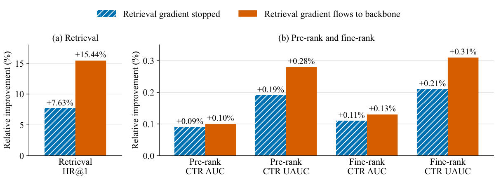

*图 5：三个任务联合训练的效果，比较召回梯度停止或流入共享用户上下文两种情况。(a) 相对相同架构、参数预算的独立召回模型的 HR@1 提升。(b) 相对独立粗排、精排的 CTR AUC/UAUC 提升。原文第 17 页。*

**合并全部三个阶段。** 加入召回并共同训练后，图 5 将每个任务与其独立训练版本比较。当阻断召回进入共享用户上下文的梯度时，召回任务³ 复用已由排序任务塑造的用户上下文，HR@1 提升 7.63%；粗排和精排 CTR UAUC 提升 0.19%、0.21%。⁴ 进一步允许召回梯度流入共享上下文，让下一 token 预测目标也塑造排序任务读取的用户上下文后，召回收益大致翻倍至 HR@1 +15.44%，粗排和精排 CTR UAUC 升至 +0.28%、+0.31%。因此，统一三任务使每个任务均优于独立训练，召回目标进一步增强了排序所用共享用户上下文。

³ 本实验中，联合模型的召回任务及其独立版本，采用与 OneTrans-GR 相同的骨干和计算预算，以隔离联合训练与容量因素。

⁴ 与表 3 略有不同，因为 embedding 表仍共享，即使阻断召回进入共享用户上下文的梯度，召回任务仍会小幅影响粗排与精排。

### 7.2 两个排序阶段的蒸馏与一致性

**知识蒸馏。** 上节表明联合训练帮助了全部任务。对于排序任务，OneTrans-V2 还通过 §4.2.2 的 \(\mathcal L_{kd}\) 让精排 logit 监督粗排。图 6(a) 展示其贡献。这与联合训练对比正交：联合训练对比的两种设置都保留蒸馏，此处则从联合模型去掉蒸馏。保持架构、数据及其他超参数不变，去掉 \(\mathcal L_{kd}\) 使粗排 CTR AUC 降低 0.55%、CTR UAUC 降低 0.97%，体现蒸馏缩小粗精排差距的作用。精排变化最多 0.04%，符合教师 logit 停梯度的设计，学生收益不以教师退化为代价。

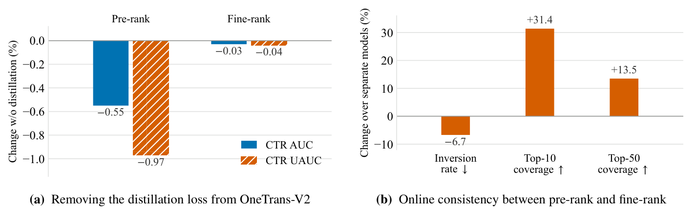

*图 6：两个排序任务的蒸馏与一致性。(a) 其他条件不变时去掉蒸馏的相对变化：粗排 CTR AUC −0.55%、UAUC −0.97%；精排分别 −0.03%、−0.04%。(b) 相对 §7.1 独立粗排与精排，一致性指标的相对变化；标签箭头表示改善方向。原文第 18 页。*

**跨阶段一致性。** 我们进一步分析线上粗排和精排对相同候选的排序一致程度。共享用户上下文和蒸馏损失都会拉近两阶段；图 6(b) 用逆序率及 top-10、top-50 覆盖率衡量两者联合效果。逆序率是两任务排序不同的物品对比例；top-10 覆盖率是粗排 top-10 中也出现在精排 top-10 的比例，top-50 同理。这些指标均在粗排送给精排的候选上计算。相对 §7.1 的独立训练粗排与精排，OneTrans-V2 使逆序率相对降低 6.7%，top-10、top-50 覆盖率相对提高 31.4%、13.5%。因此，两阶段分歧更少。作者进一步指出，粗排能向精排送出更多精排偏好的头部候选，减少它们在到达精排前被丢弃的情况。

### 7.3 DCGR 的目标覆盖

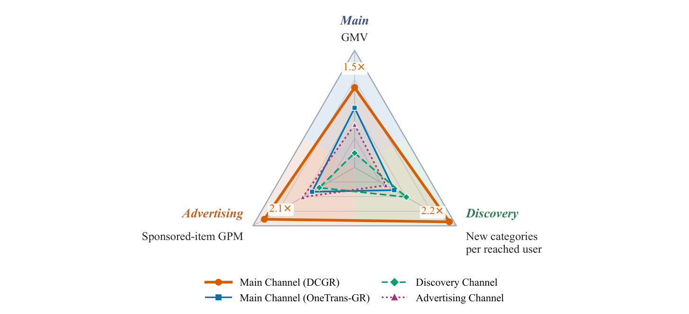

*图 7：三个召回目标的覆盖。在等流量召回阶段 A/B 测试中，实验组以 OneTrans-V2 召回任务 DCGR 合并三个通道，对照组保留三个通道。四个通道在三项对应目标上比较，每轴一个目标；DCGR 超过各目标专属通道的倍数标于顶点。每次曝光根据服务日志的召回来源字段仅归因于一个通道，半径采用幂次刻度。原文第 18 页。*

如 §1 所述，我们生产召回按业务目标拆为专用通道：OneTrans-GR 主通道面向点击与订单，发现通道促进用户未接触类目，广告通道召回广告物品。DCGR 通过决策维度在一个模型内表示这些目标：购买档位 \(z_{oc}\) 表示主通道点击—订单目标；发现档位 \(z_{disc}\) 表示发现目标；供给类型 \(z_{ad}\) 区分自然与广告物品。三个目标由独立通道迁入共享决策空间。下面考察单个 DCGR 是否仍能覆盖各专用通道的作用。

我们进行召回阶段线上 A/B 测试，按用户等流量分组。实验组以 DCGR 替代主通道 OneTrans-GR，并关闭发现和广告通道，由单模型统一三者。对照组保持原有三个通道。因为各通道目的不同，按各自原生指标评估：主目标用 GMV，发现用每位触达用户的新类目数，广告用广告物品每千次曝光 GMV（GPM）。

图 7 显示，DCGR 在一个模型内覆盖三个目标：GMV 为对照主通道的 1.5 倍，每位触达用户的新类目数为发现通道的 2.2 倍，广告物品 GPM 为广告通道的 2.1 倍。因此，在各自原生指标上，单个 DCGR 匹配或超过专用通道。

**主通道分析。** 主目标 1.5 倍 GMV 主要来自更广曝光，而非更高单曝光价值。表 4(a) 中，相对对照主通道，DCGR 曝光增加 69.3%、点击增加 74.6%。部分增加量来自对照组由发现和广告通道承担、现由 DCGR 承担的曝光。其单曝光转化更低：每千曝光订单降低 34.0%，GPM 降低 13.0%。更大的曝光量抵消这些下降，使总订单增加 11.4%、总 GMV 增加 48.0%。单曝光 CTR 也提高 3.2%。曝光物品平均价格下降 4.4%，说明新增曝光更集中于低价物品。

**表 4：图 7 召回阶段 A/B 测试明细（原文第 19 页）。** (a) 是实验 DCGR 相对对照主通道的相对变化，其中 GMV 对应图 7 主轴；(b)(c) 是相对发现、广告通道的比值，分别首行和第二行对应图 7 相应轴。(b) 成对百分比先为 DCGR 对发现通道的覆盖，再为反向覆盖。

| (a) 主通道指标 | 变化 |
| --- | --- |
| 曝光 | +69.3% |
| 点击 | +74.6% |
| 订单 | +11.4% |
| GMV | +48.0% |
| 单曝光点击率 | +3.2% |
| 每千曝光订单 | −34.0% |
| 每千曝光 GMV | −13.0% |
| 曝光物品平均价格 | −4.4% |

| (b) 相对发现通道 | 比值或覆盖率 |
| --- | --- |
| 每位触达用户的新类目数 | 2.2× |
| 覆盖对方发现物品的比例 | 76.0% / 14.0% |
| 覆盖对方用户—类目对的比例 | 11.7% / 1.2% |
| 每天形成用户—类目对 | 9.4× |
| 各通道独占触达用户的转化对比 | 2.8× |

| (c) 相对广告通道，仅广告物品 | 比值 |
| --- | --- |
| 曝光 | 1.8× |
| 每千曝光 GMV | 2.1× |
| 单曝光订单 | 1.7× |
| 转化率 | 2.6× |
| 平均订单价值 | 1.2× |

这些度量比较的是通道，而非系统。DCGR 在实验组承担了对照组三个通道的曝光，因此它相对主通道的领先，不等于系统新增价值。图 7 衡量的是 DCGR 覆盖哪些目标，而非增量多少。§6.3 的全流量 A/B 测试衡量后者。

**发现与广告分析。** 表 4(b)(c) 进一步拆解与专用通道的对比。

对于发现，DCGR 每位触达用户达到 4.81 个新类目，专用发现通道为 2.15，形成图 7 的 2.2 倍收益。更重要的是，差异主要在于哪些用户收到这些类目，而非召回了哪些物品。DCGR 覆盖发现通道 76.0% 的物品，却仅覆盖其 11.7% 的用户—类目对；反向覆盖分别为 14.0%、1.2%。DCGR 每天形成的用户—类目对是 9.4 倍，DCGR 独占触达用户的转化效率是发现通道独占用户的 2.8 倍。因此，两召回器的物品有较大重叠，却将其曝光给非常不同的用户。

对于广告，DCGR 在广告物品召回中也承担更大角色。广告物品占其曝光的 33.7%，对照主通道仅 4.7%。相对专用广告通道，DCGR 广告曝光 1.8 倍、GPM 2.1 倍。收益来自更强的下游转化与价值，而非点击：尽管点击率约低三分之一，其单曝光订单为 1.7 倍、转化率 2.6 倍、平均订单价值 1.2 倍。即，DCGR 召回的广告物品点击更少，但购买更多且价值更高。

这些结果共同表明，单个 DCGR 能覆盖 \(z_{oc},z_{disc},z_{ad}\) 表示的目标，并在原生指标上匹配或超过专用通道，展示了单模型整合这些召回目标的潜力。

### 7.4 DCGR 决策维度分析

上节表明单个 DCGR 能覆盖多个专用目标。下面考察决策前缀本身是否携带有用召回信号，以及是否控制物品生成。

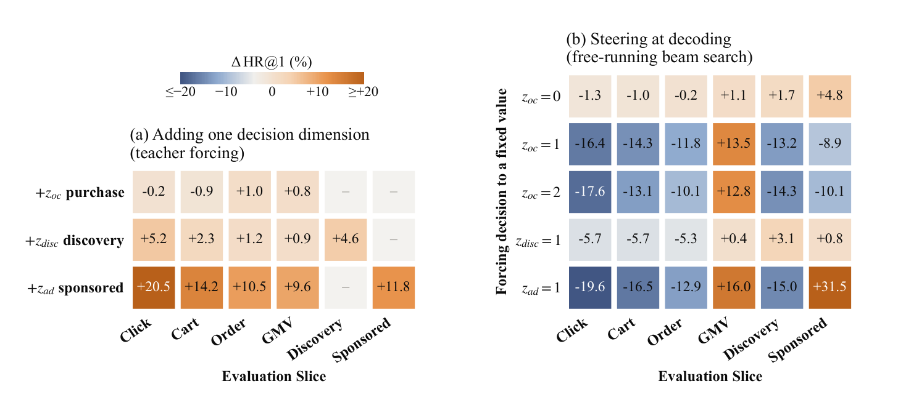

*图 8：决策维度消融，数值为 HR@1 相对变化百分比。(a) 向 SID-only 生成召回逐次增加单个决策维度，在列名对应切片上用真实决策 teacher forcing 评估；横线表示未测。(b) 解码时将一个维度强制到固定值，其余前缀自回归解码，相对完整前缀自回归解码的变化。单元格给出精确值，颜色范围截断在 ±20。原文第 20 页。*

为保留图中全部数值，其读数如下：

| (a) 添加决策维度，teacher forcing | Click | Cart | Order | GMV | Discovery | Sponsored |
| --- | --- | --- | --- | --- | --- | --- |
| + z_oc 购买 | −0.2 | −0.9 | +1.0 | +0.8 | — | — |
| + z_disc 发现 | +5.2 | +2.3 | +1.2 | +0.9 | +4.6 | — |
| + z_ad 广告 | +20.5 | +14.2 | +10.5 | +9.6 | — | +11.8 |

| (b) 强制维度值，自由运行束搜索 | Click | Cart | Order | GMV | Discovery | Sponsored |
| --- | --- | --- | --- | --- | --- | --- |
| z_oc=0 | −1.3 | −1.0 | −0.2 | +1.1 | +1.7 | +4.8 |
| z_oc=1 | −16.4 | −14.3 | −11.8 | +13.5 | −13.2 | −8.9 |
| z_oc=2 | −17.6 | −13.1 | −10.1 | +12.8 | −14.3 | −10.1 |
| z_disc=1 | −5.7 | −5.7 | −5.3 | +0.4 | +3.1 | +0.8 |
| z_ad=1 | −19.6 | −16.5 | −12.9 | +16.0 | −15.0 | +31.5 |

**决策维度携带召回信号。** 图 8(a) 在 SID-only 模型上逐次增加一个维度，并通过 teacher forcing 提供真实值，测量点击、加购、订单、GMV、发现和广告物品切片上的 HR@1 变化。因为提供的决策描述正在预测的那次交互，该实验度量的是正确决策能提供多少信息，而非可部署的端到端召回精度。

不同维度携带的物品信息量不同。购买档位 \(z_{oc}\) 对任一切片的影响不超过 1%；\(z_{disc}\) 改善全部已测切片；\(z_{ad}\) 带来最大收益，范围为 9.6%–20.5%。这反映了决策对物品身份约束强弱的差别。例如，\(z_{ad}\) 将广告交互限制到只占交互 28% 的广告子集，而 \(z_{oc}\) 对具体选中哪个物品提供的信息相对少。收益也不限于对应目标：\(z_{ad}\) 除广告召回外，也改善点击、加购、订单、GMV 召回。已测切片没有任何一个下降超过 1%。

**决策维度控制生成。** teacher forcing 表明正确决策有信息，但服务依赖模型预测。因此，我们在自由运行束搜索中干预一个预测维度。如果 SID 解码器忽略前缀，强制决策应影响很小；图 8(b) 显示相反结果。强制 \(z_{ad}\) 为广告，使广告 HR@1 +31.5%、GMV HR@1 +16.0%，同时点击 HR@1 −19.6%。强制 \(z_{oc}\) 为多订单，使 GMV HR@1 +12.8%、点击 HR@1 −17.6%。强制 \(z_{disc}\) 朝发现方向，其自身切片 +3.1%。因此，改变决策会按预期改变召回物品。

干预大小也取决于被强制值原本有多常见。广告占交互 28%，而用户新类目交互原本已约占四分之三，留给发现强制改变的请求更少。发现离线变化小，也不与 §7.3 较大线上收益矛盾；\(z_{oc}=0\) 时点击 HR@1 略降，同样不与表 5 线上 CTR 提升矛盾。离线 HR@1 奖励复现日志中的物品，而线上指标奖励用户会点击的曝光、或能触达有价值新类目的曝光，即使召回物品与日志不同。

### 7.5 DCGR 决策引导与前缀设计

下面考察决策维度在实践中应如何引导、如何组织。

**预测决策与外部指定决策。** 预测前缀的自然替代方案，是像目标条件方法 [40] 那样直接指定期望决策。表 5 在召回阶段线上 A/B 中比较这种硬条件与业务偏置：强制 \(z_{oc}=0\) 偏向点击，强制 \(z_{aov}\) 为最高值，或使用逐渐增强的偏置。硬强制近似目标引导的极端情形，偏置则逐渐倾斜预测分布。

**表 5：同一训练模型在解码时的线上引导（原文第 21 页）。** 相对正常预测前缀解码，统计按 §7.3 归因给 OneTrans-V2 召回任务的曝光。Orders 为主订单，每次结账计一次，无论拆成多少子订单；AOV 为每主订单 GMV。曝光数只在最高 z_aov 强制组记录，该组归因曝光减少 19.4%，故本表无曝光列。

| 对 z 的干预 | CTR | Orders | AOV | GMV |
| --- | --- | --- | --- | --- |
| 无，预测前缀 | — | — | — | — |
| 强制 z_oc=0（点击） | +8.2% | −10.4% | +5.8% | −5.1% |
| 强制 z_aov 最高值 | −8.1% | −33.5% | +38.9% | −7.7% |
| 业务偏置，弱 β | +2.2% | +4.9% | +2.5% | +7.5% |
| 业务偏置，中 β | −0.9% | −3.0% | +13.9% | +10.4% |
| 业务偏置，强 β | −5.4% | −1.2% | +28.3% | +26.7% |

硬强制表现类似目标专属通道。强制 \(z_{oc}=0\) 使 CTR +8.2%，但 GMV −5.1%；强制最高 \(z_{aov}\) 使 AOV +38.9%，却使订单 −33.5%、GMV −7.7%。业务偏置则提供渐进权衡：强度由弱到强时，GMV 从 +7.5% 变到 +26.7%，CTR 从 +2.2% 变到 −5.4%。因此，偏置无需用固定值替代预测决策，就能将模型引向业务目标。

表 6 的第二个召回阶段 A/B 在系统层面确认相同权衡。与表 5 不同，它统计用户全部曝光，而非仅 DCGR 归因曝光。仅引导 \(z_{oc}\) 使订单 +2.4%，GMV −0.6%。增加 \(z_{aov}\) 后，以部分订单换取更高 AOV，使 GMV 转正，强设置下达 +3.0%。两个维度控制业务价值的互补方面。

**表 6：第二个业务偏置召回阶段 A/B 测试（原文第 22 页）。** 所有值是相对对照组的人均变化，覆盖用户全部曝光；后两行保持购买档位偏置不变，增加消费档位偏置。

| 偏置设置 | Clicks | Orders | AOV | GMV |
| --- | --- | --- | --- | --- |
| 仅购买档位 z_oc | +8.8% | +2.4% | −2.9% | −0.6% |
| + 消费档位 z_aov，弱 | +11.4% | −5.2% | +5.9% | +0.4% |
| + 消费档位 z_aov，强 | +5.1% | −9.4% | +13.7% | +3.0% |

**组织决策前缀。** \(z_{oc}\)、\(z_{aov}\) 的互补性支持分别建模购买数量与价值。用单个 GMV token 替代两者，使交易价值加权 HR@1 降低 9%。独立购买指示变量也冗余，因为 \(z_{oc}=0\) 已表示未转化，添加后 HR@1 不变。

独立决策维度不应任意串联，因为串联必须选择解码顺序。表 7 在更早配置中，用订单、冷启动、发现三个二元维度测试此效应。订单目标最先解码时最好，订单在先的配置也取得最高加权 HR@128，说明顺序会偏向某个目标。DCGR 将独立维度合到并行 token \(DT_p\)，仅对真正依赖的决策串联：\(z_{aov}\) 在 \(DT_d\) 中跟随 \(z_{oc}\)。它也缩短了前缀，但主要优势是消除排序偏置，因为求和的维度共享同一位置，没有解码先后。

**表 7：链式决策 token 解码顺序影响（原文第 22 页）。** 早期配置 a=订单、c=冷启动、d=发现。前缀自回归解码的 HR@128；每行平均该订单位置的两种排列；加权列按交易价值加权命中。

| 订单维度位置 | 加权 HR@128 | 订单 | 冷启动 | 发现 |
| --- | --- | --- | --- | --- |
| 第一（acd, adc） | 0.3287 | 0.4590 | 0.0352 | 0.1437 |
| 第二（cad, dac） | 0.3267 | 0.4548 | 0.0348 | 0.1437 |
| 第三（cda, dca） | 0.3252 | 0.4520 | 0.0371 | 0.1446 |

### 7.6 架构分析

我们分析 §4.3 的 GQA、门控注意力与 MoE。图 9 报告门控注意力、MoE 对 OneTrans-V2L 精排的贡献，再分析 MoE 内部设计。

用 GQA 替换完整多头注意力后，精排质量基本不变，因此缩小键值缓存没有准确率代价。图 9(a) 中，相对传统注意力，门控注意力贡献 CTR AUC +0.08%、CTR UAUC +0.15%。

MoE 比门控注意力贡献更大：相对计算量匹配的稠密 FFN，CTR AUC +0.13%、CTR UAUC +0.30%。图 9(b) 分析 MoE 内部：相对相同总参数但更少、更宽的专家，细粒度专家贡献 +0.01%、+0.04%；相对没有共享专家的同种 MoE，共享专家贡献 +0.02%、+0.07%；sigmoid 路由器相对 softmax 的贡献更大，为 +0.10%、+0.20%。⁵

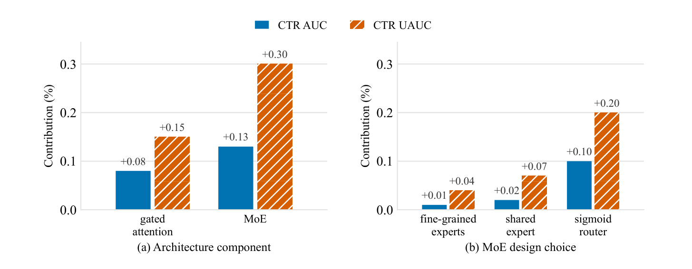

*图 9：每个架构组件和 MoE 设计选择在精排任务的贡献。每根柱为保持 OneTrans-V2L 其他条件不变，单组件相对传统替代的 CTR AUC/UAUC 相对提升。各柱是独立单组件消融，不是 MoE 总收益的分解。(a) 架构组件；(b) MoE 内部选择。原文第 23 页。*

⁵ 同配置重复运行的 CTR AUC、CTR UAUC 差异约为 0.006%、0.012%（§7.7）；作者认为超过这一差异的结果具有意义。

### 7.7 稳定化分析

我们分析 §4.3 稳定化方法。下面每个实验从 OneTrans-V2 去除一种技术，比较相同加宽在有、无该技术时的收益，分别相对于相应构建方式的窄模型。由于参照不同，各段的加宽收益也不同，因此可在同一图内比较，不能跨图比较。完整配置的加宽收益是图 10 的 AdamW 结果。

**AdamW 与权重衰减。** RMSProp [43] 常用于工业推荐，本文 RMSProp 基线使用线上模型调优过的学习率、ε 与衰减系数。图 10 显示其重复运行方差大，加宽没有收益。

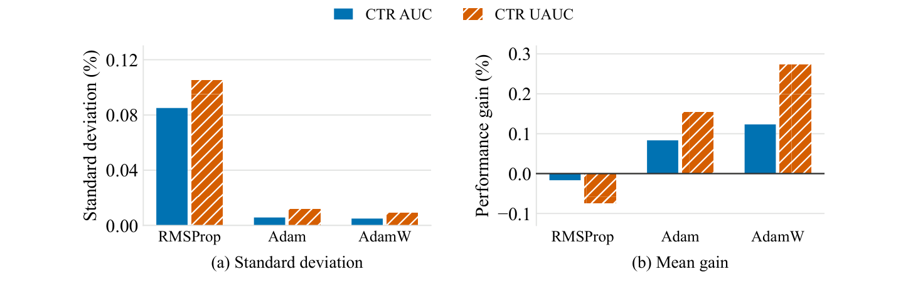

*图 10：加宽 OneTrans-V2 的效果，三次运行。(a) 跨运行标准差；(b) 平均收益。原文第 23 页。*

然后，我们用相同学习率与 ε 的 Adam [18] 替换，将 β₂ 设为 RMSProp 衰减系数，β₁=0（§6.1），不引入动量。两者唯一差别是二阶矩估计的偏差校正。这防止了早期更新的有效学习率被放大。根据同样三次运行估计，CTR AUC 标准差从 0.085% 降到 0.006%，CTR UAUC 从 0.105% 降到 0.012%。此时加宽有效，CTR UAUC 从 RMSProp 的负收益转为 +0.15%。再加入解耦权重衰减，即 AdamW，收益进一步提高到接近 +0.3%，标准差保持相同低水平。

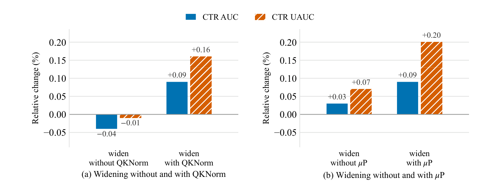

*图 11：在精排上，加宽时 QKNorm 与 μP 的效果。每面板两根柱均相对不含该技术的窄模型；对 μP，参照为采用自己初始化与学习率的标准参数化。柱可在面板内比较，不能跨面板或与图 10 比较。(a) 无/有 QKNorm；(b) 无/有 μP。原文第 24 页。*

**QKNorm。** 图 11(a) 中，不使用 QKNorm 时加宽低于预期，精排 CTR AUC −0.04%、CTR UAUC −0.01%；引入后同样加宽获得 +0.09%、+0.16%。

**μP。** 图 11(b) 中，不使用 μP，保留原宽度调优的超参数，加宽仅带来 +0.03% CTR AUC、+0.07% CTR UAUC。标准参数化下，原超参数在更宽时不再合适，每次加宽都需重新搜索。μP 则使最优超参数对宽度保持不变，即超参数迁移 [48]，无需重新调优，同样加宽得到 +0.09%、+0.20%。

**Depth-μP。** 上述实验加宽模型；加深由 Depth-μP 控制（§4.3），残差乘数与学习率都缩放 \(1/\sqrt{m_N}\)。表 8 中，单独增加块数仅获得 +0.04% CTR AUC、+0.05% CTR UAUC，同样加深配合 Depth-μP 后为 +0.08%、+0.11%，将额外深度转化为更大收益。

**表 8：Depth-μP 对加深 OneTrans-V2 精排的效果，相对基础深度（原文第 24 页）。**

| 设置 | CTR AUC | CTR UAUC |
| --- | --- | --- |
| 基础深度 | — | — |
| 加深，不使用 Depth-μP | +0.04% | +0.05% |
| 加深，使用 Depth-μP | +0.08% | +0.11% |

### 7.8 多模态 embedding 与模型容量

为验证 §4.3 的设计，我们在两种规模比较 SimTier 与直接多模态 embedding：默认 OneTrans-V2L，以及训练便宜约 46 倍的更小 OneTrans-V2XS（extra small）。

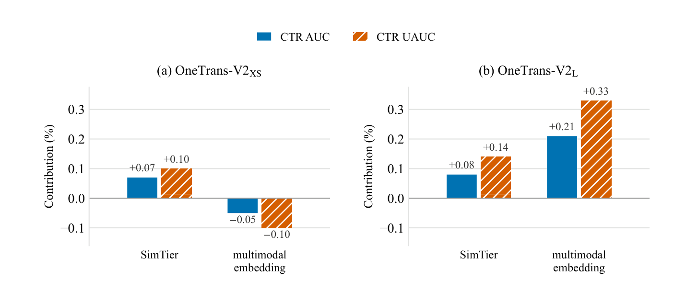

*图 12：两种多模态输入方式在两种规模的精排贡献。每根柱相对于不接收多模态 embedding 的模型，单独增加该输入的相对变化；面板内两根柱是独立实验，并非收益分解。(a) V2XS；(b) V2L。原文第 25 页。*

图 12 显示两种规模需要相反设计。小规模下仅 SimTier 有益，CTR AUC +0.07%、CTR UAUC +0.10%；直接多模态 embedding 则为 −0.05%、−0.10%，损害这一规模模型。大规模下两种方式都有益，直接 embedding 更有价值：CTR AUC +0.21% 对 +0.08%，CTR UAUC +0.33% 对 +0.14%，且无需预计算特征。

多模态 embedding 与模型自己学到的物品 embedding 位于不同空间，模型必须学习两者映射。我们假设小模型缺乏容量学习映射，因此必须为其预计算相似度；OneTrans-V2L 能自行学习，并从原始 embedding 获得比预计算摘要更多收益。因此，多模态 embedding 如何进入排序模型并不是固定选择，而取决于容量；一个规模上确立的实践未必在下个规模上最优。

### 7.9 训练与推理加速

先分析 SNT（§4.4）的训练加速，再分析 §5.2 的服务加速，先看召回专属解码优化，再看全模型优化。

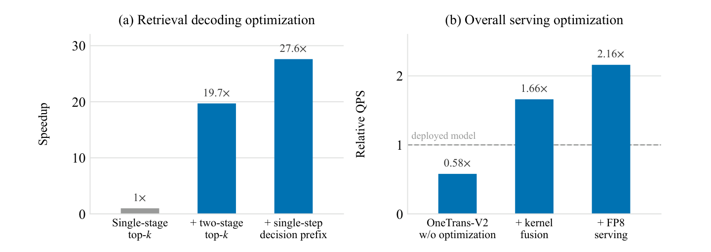

*图 13：服务端优化的加速。(a) OneTrans-V2 召回任务在相同延迟预算下的吞吐量，累计加入两项解码优化：单阶段 top-k 1×，两阶段 top-k 19.7×，再加单步决策前缀 27.6×。(b) 精排在相同延迟预算下相对已部署精排模型的吞吐：未优化 0.58×，加 kernel 融合 1.66×，再加 FP8 服务 2.16×。原文第 25 页。*

**序列原生训练。** 将 SNT 与图 4(a) 逐曝光样本对比，后者每次曝光单独编码一份序列。一个用户窗口内全部曝光共享一次编码，在相同硬件预算下实现 4.4 倍训练加速。本实验 mini-batch 按用户窗口组织，每窗口为用户某时间窗口的曝光。窗口按日边界切分，不跨评估日期，使 §6.1 的日指标与基线可比。按日切分限制了加速，因为只能在一天曝光之间共享；按周或月切分将进一步提高加速，留待未来研究。

SNT 还节省存储。行为序列按用户存一次而非逐曝光存，序列特征存储减少 95%。同用户曝光相邻存储，使非序列特征更好压缩，其存储减半。

**召回解码优化。** 图 13(a) 中，两阶段 top-k 在相同线上延迟预算下提高吞吐 19.7 倍，对照是我们自己的单阶段实现，而非线上召回基线。单请求束搜索延迟降低 2.3 倍。吞吐收益大于延迟收益，是因为吞吐是在满足延迟预算的最大 batch 下测量。将候选池从“束宽 × 词表大小”缩为每 beam k 个，使每 GPU 能在预算内处理更大 batch。这一步很重要，因为修改前，召回推理时间的 94% 花在 top-k 上。

单步决策前缀评分再去掉串行前缀步骤，使每个剩余步骤承载更大 batch，更好匹配 GPU。相对逐步解码前缀，实测延迟约降 30%，累计解码吞吐加速升至 27.6 倍。

**整体服务优化。** 上述解码优化针对召回，kernel 融合和 FP8 则作用于全模型。图 13(b) 在相同延迟预算下，以已部署精排为参照测量。未优化时，因每请求计算更多，统一模型吞吐仅为 0.58 倍；kernel 融合后升至 1.66 倍，FP8 后 2.16 倍。因此，尽管计算更大，统一模型精排比被替代专用模型快 2.16 倍。

跨三阶段共享用户上下文（§5.1），将行为编码从每阶段一次变为每请求一次，在所有逐阶段优化之上，又给整个级联增加 1.53 倍吞吐。两者共同形成 §6.3 的端到端 QPS 3.2 倍。

## 8 结论

我们提出 OneTrans-V2，以一个 Transformer 服务工业推荐级联的召回、粗排和精排。它建立在三个关键思想上：第一，通过跨阶段共享与候选无关的用户上下文，同时保留原生候选特征与计算，在一个 Transformer 内统一三个阶段。第二，DCGR 将业务目标表示为单一生成过程中的决策，从而整合目标专属召回模型。第三，SNT 围绕每位用户的终身行为序列组织训练，将编码分摊到多次曝光。

这些设计共同实现了跨阶段、跨召回目标的统一，并使共享骨干在生产规模训练中可行。统一支持计算复用、联合学习和模型内知识蒸馏，也将此前分散的容量汇集到共享骨干。我们通过稀疏 MoE 在限制激活计算的同时增大容量，用 μP 风格参数化稳定扩展。在大规模工业部署中，OneTrans-V2 使 GMV +9.74%，结合协同设计服务栈，在相同硬件预算下达到被替代级联 3.2 倍的 QPS。我们认为，OneTrans-V2 为推荐架构从“每阶段一个模型”转向“统一单模型”提供了生产规模基础。

## 参考文献

以下保留原始作者、英文标题、会议与标识符，便于按正文 [1]–[57] 检索；不将书目标题改写为新题名。

完整作者串、会议信息及页码另保存在 [原文参考文献全文](../source/references.txt)。下列逐条保留编号、年份与原题；长作者名单以首作者等简记。

[1] Joshua Ainslie 等，2023。GQA: Training generalized multi-query Transformer models from multi-head checkpoints。EMNLP。

[2] Edoardo Botta 等，2025。PinRec: Unified generative retrieval for Pinterest recommender systems。arXiv:2504.10507。

[3] Lili Chen 等，2021。Decision transformer: Reinforcement learning via sequence modeling。NeurIPS。

[4] Aidan Clark 等，2022。Unified scaling laws for routed language models。ICML。

[5] Damai Dai 等，2024。DeepSeekMoE: Towards ultimate expert specialization in mixture-of-experts language models。ACL。

[6] Tri Dao 等，2022。FlashAttention: Fast and memory-efficient exact attention with IO-awareness。NeurIPS。

[7] DeepSeek-AI，2024。DeepSeek-V3 technical report。arXiv:2412.19437。

[8] John Duchi, Elad Hazan, Yoram Singer，2011。Adaptive subgradient methods for online learning and stochastic optimization。Journal of Machine Learning Research, 12:2121–2159。

[9] William Fedus, Barret Zoph, Noam Shazeer，2022。Switch Transformers: Scaling to trillion parameter models with simple and efficient sparsity。Journal of Machine Learning Research, 23(120):1–39。

[10] Dibya Ghosh 等，2021。Learning to reach goals via iterated supervised learning。ICLR。

[11] Lin Guan 等，2026。Make it long, keep it fast: End-to-end 10k-sequence modeling at billion scale on Douyin。WWW。

[12] Huifeng Guo 等，2017。DeepFM: A factorization-machine based neural network for CTR prediction。IJCAI。

[13] Ruidong Han 等，2025。MTGR: Industrial-scale generative recommendation framework in Meituan。CIKM。

[14] Alex Henry 等，2020。Query-key normalization for Transformers。Findings of EMNLP。

[15] Geoffrey Hinton, Oriol Vinyals, Jeff Dean，2015。Distilling the knowledge in a neural network。NIPS Deep Learning and Representation Learning Workshop。

[16] Jonathan Ho, Tim Salimans，2021。Classifier-free diffusion guidance。NeurIPS Workshop on Deep Generative Models and Downstream Applications。

[17] Xu Huang 等，2023。Cooperative retriever and ranker in deep recommenders。WWW。

[18] Diederik P. Kingma, Jimmy Ba，2015。Adam: A method for stochastic optimization。ICLR。

[19] Kuang-Huei Lee 等，2022。Multi-game decision transformers。NeurIPS。

[20] Hanyu Li 等，2026。UniPinRec: Unifying generative retrieval and ranking at Pinterest scale。arXiv:2606.00422。

[21] Ilya Loshchilov, Frank Hutter，2019。Decoupled weight decay regularization。ICLR。

[22] Xinchen Luo 等，2024。QARM: Quantitative alignment multi-modal recommendation at Kuaishou。arXiv:2411.11739。

[23] OneRec Team，2025。OneRec technical report。arXiv:2506.13695。

[24] David Pardoe 等，2026。CADET: Context-conditioned ads CTR prediction with a decoder-only Transformer。arXiv:2602.11410。

[25] Razvan Pascanu, Tomas Mikolov, Yoshua Bengio，2013。On the difficulty of training recurrent neural networks。ICML。

[26] Xue Bin Peng 等，2019。Advantage-weighted regression: Simple and scalable off-policy reinforcement learning。arXiv:1910.00177。

[27] Qi Pi 等，2020。Search-based user interest modeling with lifelong sequential behavior data for click-through rate prediction。CIKM。

[28] Reiner Pope 等，2023。Efficiently scaling Transformer inference。MLSys。

[29] Jiarui Qin 等，2022。RankFlow: Joint optimization of multi-stage cascade ranking systems as flows。SIGIR。

[30] Zihan Qiu 等，2025。Gated attention for large language models: Non-linearity, sparsity, and attention-sink-free。NeurIPS。

[31] Shashank Rajput 等，2023。Recommender systems with generative retrieval。NeurIPS。

[32] Guillaume Sanchez 等，2024。Stay on topic with classifier-free guidance。ICML。

[33] Jürgen Schmidhuber，2019。Reinforcement learning upside down: Don’t predict rewards – just map them to actions。arXiv:1912.02875。

[34] Noam Shazeer，2020。GLU variants improve Transformer。arXiv:2002.05202。

[35] Noam Shazeer 等，2017。Outrageously large neural networks: The sparsely-gated mixture-of-experts layer。arXiv:1701.06538。

[36] Xiang-Rong Sheng 等，2024。Enhancing Taobao display advertising with multimodal representations: Challenges, approaches and insights。CIKM。

[37] Sona Team，2026。Sona technical report。arXiv:2608.11015。

[38] Jianlin Su 等，2024。RoFormer: Enhanced Transformer with rotary position embedding。Neurocomputing, 568:127063。

[39] Dekai Sun 等，2026。OneRanker: Unified generation and ranking with one model in industrial advertising recommendation。arXiv:2603.02999。

[40] Jiawei Sun 等，2026。UniSGR: Unified framework for semantic ID generation and ranking。arXiv:2607.04068。

[41] Shangquan Sun 等，2024。Logit standardization in knowledge distillation。CVPR。

[42] Jiaxi Tang, Ke Wang，2018。Ranking distillation: Learning compact ranking models with high performance for recommender systems。KDD。

[43] Tijmen Tieleman, Geoffrey Hinton，2012。Lecture 6.5-RMSProp: Divide the gradient by a running average of its recent magnitude。COURSERA: Neural Networks for Machine Learning。

[44] Chunqi Wang 等，2026。SORT: A systematically optimized ranking Transformer for industrial-scale recommenders。arXiv:2603.03988。

[45] Ruoxi Wang 等，2021。DCN V2: Improved deep & cross network and practical lessons for web-scale learning to rank systems。WWW。

[46] Zhe Wang 等，2020。COLD: Towards the next generation of pre-ranking system。arXiv:2007.16122。

[47] Jason Wei 等，2023。Chain-of-thought prompting elicits reasoning in large language models。arXiv:2201.11903。

[48] Greg Yang 等，2021。Tensor Programs V: Tuning large neural networks via zero-shot hyperparameter transfer。NeurIPS。

[49] Greg Yang 等，2024。Tensor Programs VI: Feature learning in infinite-depth neural networks。ICLR。

[50] Ruochen Yang 等，2026。UniR2: Unifying generative recall and multi-objective ranking in a single decoder-only sequence。arXiv:2607.24439。

[51] Jiaqi Zhai 等，2024。Actions speak louder than words: Trillion-parameter sequential transducers for generative recommendations。ICML。

[52] Biao Zhang, Rico Sennrich，2019。Root mean square layer normalization。NeurIPS。

[53] Zhaoqi Zhang 等，2026。OneTrans: Unified feature interaction and sequence modeling with One Transformer in industrial recommender。WWW。

[54] Zhishan Zhao 等，2023。COPR: Consistency-oriented pre-ranking for online advertising。CIKM。

[55] Guorui Zhou 等，2018。Deep interest network for click-through rate prediction。KDD。

[56] Yifeng Zhou 等，2026。TokenFormer: Unify the multi-field and sequential recommendation worlds。arXiv:2604.13737。

[57] Jie Zhu 等，2025。RankMixer: Scaling up ranking models in industrial recommenders。CIKM。

## 附录 A 完整作者名单

**基础模型团队（Foundation Team）：** Hannan Cao, Jun Guo, Haolei Pei, Zhaoqi Zhang, Tianyu Wang, Ziyang Wang, Youchen Sun, Yue Xue, Yucheng Mao, Lintao Yan, Yufei Feng, Shaowei Liu*。

**架构团队（Architecture Team）：** Rongkun Xing, Feiling Gong, Xinyu Chenli, Cong Xu, Mingge Zhang, Yunjia Zhu, Yajing Zhang, Pengfei Ren, Yue Lin。

**\* 通讯作者：** liushaowei.nphard@bytedance.com。
