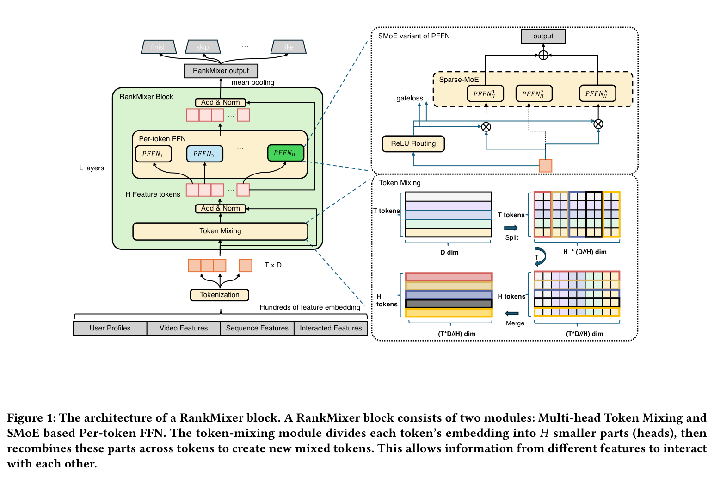
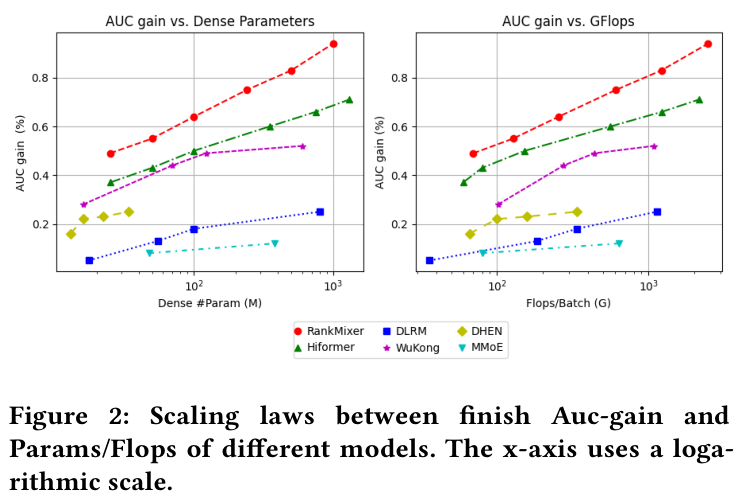
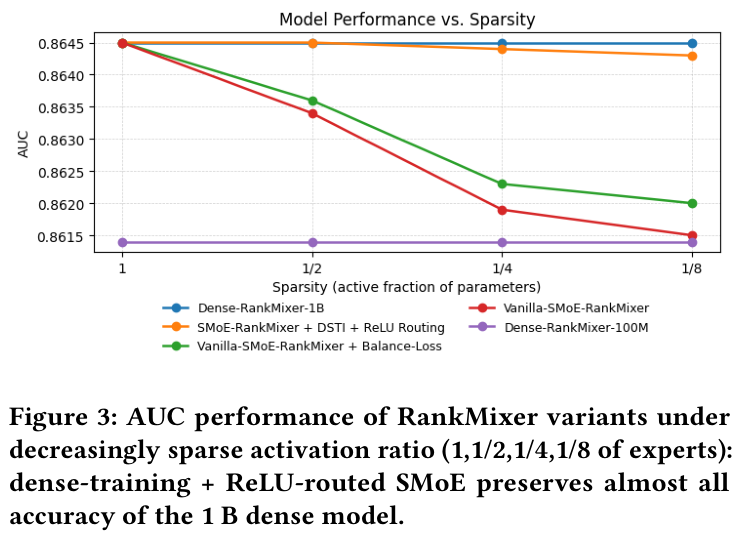
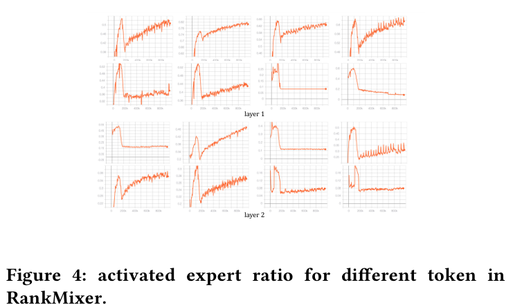

# RankMixer 详解：无参数特征混合、独立 FFN 与十亿参数排序模型的部署

论文：**RankMixer: Scaling Up Ranking Models in Industrial Recommenders**，字节跳动，arXiv:2507.15551v3。本文依据用户提供的 9 页 PDF；完整中文翻译见 [译稿](../translation/paper.zh-CN.md)。以下是详细解读，推导示例和伪代码均作了标注，不属于原文翻译。

RankMixer 研究的是工业推荐的**排序阶段稠密特征交互网络**。用户特征、候选视频特征、上游序列模块产出的兴趣表示，以及现有交叉特征先转成 token，再由统一网络输出完播、划走、点赞等任务的预测。

它没有把物品 ID 当词表做自回归生成，也没有用一个模型替代整个召回—排序链路。上游序列模块仍然存在。[E02,E03]

论文的关键设计可以概括为：**以少量较宽的特征 token 为输入，交替执行无参数的跨 token 重排与 token 专属 FFN，使特征交互网络更适合 GPU 并行，再用可选的稀疏 MoE 扩展容量。**

## 1. 为什么参数很少的推荐模型也可能很慢？

推荐模型中的参数要区分两类：

- **稀疏 embedding 参数**：例如用户 ID、视频 ID 的查表参数。
- **稠密网络参数**：embedding 之上的交互网络和相关全连接计算。

本文的 100M、1B 参数规模主要讨论第二类，**不包括大规模稀疏 embedding 表**。[E07]

论文指出，传统稠密交互网络常拼接 DCN、FM、Attention、MLP 等不同模块。算子形状零碎、内存访问多、并行拓扑复杂，会使 GPU 大量时间用于读写数据或等待算子，无法持续执行高吞吐矩阵乘。

因此，参数少、名义 FLOPs 少，都不必然意味着真实推理快。论文线上基线只有约 15.8M 稠密参数，MFU 为 4.47%；RankMixer-1B 则达到 44.57%。其架构目标是在效果之外，改善“每单位真实执行时间能完成多少有效模型计算”。[E01,E15]

## 2. 从输入到多任务预测：完整数据流

图 1 将主干、token 混合与可选 MoE 放在一起，展示这三个部分的连接关系。



*图 1：RankMixer 架构。来源：原文 Figure 1，第 3 页。*

左侧主干可以写成：

```text
用户 / 候选 / 序列输出 / 交叉特征
                ↓
          分组、切分、投影
                ↓
             [B,T,D]
                ↓
        无参数 Token Mixing
                ↓
          残差 + LayerNorm
                ↓
        每个位置独立的 FFN
                ↓
          残差 + LayerNorm
                ↓
         重复 L 个 block
                ↓
        对 token 维均值池化
                ↓
            多任务预测头
```

右下部分是 token 混合，它改变通道片段所属的 token。右上部分是 FFN 的稀疏 MoE 替代方案。**不使用 MoE，RankMixer 主干同样成立。**

一个 block 对应原文式（1）：

$$
S=\operatorname{LN}(\operatorname{Mix}(X)+X),
\qquad
X'=\operatorname{LN}(\operatorname{PFFN}(S)+S).
$$

这是子层之后归一化的结构；不能照常见 LLM 代码直接改写成 Pre-LN，并声称与原文完全一致。最后对 token 维取均值，输出每个样本一个向量，再进入各任务的预测头。[E02]

## 3. 特征 token 化：先控制粒度，再做交互

### 3.1 一字段一 token 有什么问题？

输入有 300 多个特征，不同字段的 embedding 维度和信息密度各不相同。

如果每个字段都生成一个 token，token 数可能达到数百。有限预算会被拆成大量小计算，每个 token 难以获得足够容量，GPU 上的矩阵形状也可能太小。

如果所有输入只拼成一个 token，则又退回一个大 MLP，不再显式区分不同特征子空间。[E03]

### 3.2 RankMixer 如何折中？

论文先利用领域知识，把特征按语义组织成若干簇，再顺序拼接，按固定长度切片，投影到统一维度：

$$
x_i=\operatorname{Proj}\big(e_{\mathrm{input}}[d(i-1):di]\big).
$$

注意这里有两个维度：

- $d$：原始拼接 embedding 每个切片的长度；
- $D$：投影后供 RankMixer 使用的统一宽度。

最终配置为：

| 配置 | token 数 T | 隐藏维度 D | block 数 L |
|---|---:|---:|---:|
| 100M 级 | 16 | 768 | 2 |
| 1B 级 | 32 | 1536 | 2 |

数百字段最终被组织成十几个或几十个宽 token。论文同时使用“语义分组”和“固定长度切分”的描述，并未给出字段到 token 的完整映射，不能简单理解成一个语义组严格对应一个 token。[E03,E11]

## 4. 无参数 Token Mixing：究竟混合了什么？

### 4.1 拆头、交换维度、重新拼接

给定 $T$ 个 token，每个宽度为 $D$。先把每个 token 均分成 $H$ 个片段：

$$
x_t=[x_t^{(1)};x_t^{(2)};\ldots;x_t^{(H)}].
$$

然后从**所有输入 token**中取第 $h$ 个片段，组成新的第 $h$ 个 token：

$$
s_h=[x_1^{(h)};x_2^{(h)};\ldots;x_T^{(h)}].
$$

于是形状变化为：

$$
[T,D]\rightarrow[T,H,D/H]\rightarrow[H,T,D/H]\rightarrow[H,TD/H].
$$

论文取 $H=T$，最终仍是 $[T,D]$，可以与原输入相加。还需要 $D$ 能被 $H$ 整除。[E04]

### 4.2 用一个具体例子理解

**以下为教学示例。** 取 $T=H=4,D=8$，每个 token 分成四段，每段两维：

```text
x1 = [a1 | a2 | a3 | a4]
x2 = [b1 | b2 | b3 | b4]
x3 = [c1 | c2 | c3 | c4]
x4 = [d1 | d2 | d3 | d4]
```

混合后：

```text
s1 = [a1 | b1 | c1 | d1]
s2 = [a2 | b2 | c2 | d2]
s3 = [a3 | b3 | c3 | d3]
s4 = [a4 | b4 | c4 | d4]
```

每个新 token 都含有全部四个原始 token 的一部分信息。总元素数没有增加，也没有计算任何两两注意力权重。

对应的**解释性伪代码**如下，不是作者发布的实现：

```python
# x: [B, T, D]，H = T 且 D % T == 0
mixed = (
    x.reshape(B, T, T, D // T)
     .permute(0, 2, 1, 3)
     .reshape(B, T, D)
)
s = layer_norm(x + mixed)
```

该操作没有可学习矩阵。其作用是为后续网络重新布线；真正可学习的跨来源特征函数在后续 FFN 中形成。

### 4.3 它与 Attention 的区别

| 维度 | 自注意力 | RankMixer Token Mixing |
|---|---|---|
| 跨 token 路径 | 由输入相关权重决定 | 固定的通道片段路由 |
| 是否计算 token 两两相似度 | 是 | 否 |
| 混合本身是否有参数 | 常有 Q/K/V 等投影 | 无 |
| 跨 token 权重矩阵 | 通常有 T×T 结构 | 无需该矩阵 |
| 后续非线性建模 | FFN 等模块 | token 专属 FFN |

作者认为，推荐字段来自异构语义空间，直接学习两两相似度不如固定混合有效；表 3 的对照结果为：Attention 替代方案 AUC 下降 0.03%，参数增加 16%，FLOPs 增加 71.8%。[E10]

这里的“多头”只是先拆成多个通道片段，与 Attention 的 Q/K/V 多头机制不同。

## 5. Per-token FFN：同样计算量如何容纳更多参数？

### 5.1 从共享权重变成每个位置独立权重

标准共享 FFN 对所有 token 使用同一组参数：

$$
v_t=\phi(s_tW_1+b_1)W_2+b_2.
$$

RankMixer 则使用：

$$
v_t=\operatorname{GELU}(s_tW_{t,1}+b_{t,1})W_{t,2}+b_{t,2},
$$

其中 $W_{t,1}\in\mathbb{R}^{D\times kD}$、$W_{t,2}\in\mathbb{R}^{kD\times D}$。不同 token 位置的 $W_{t,1},W_{t,2}$ 不共享。[E05]

### 5.2 参数与 FLOPs 的推导

**以下根据原文结构推导，忽略偏置和归一化。**

单个两层 FFN 参数约为：

$$
D\cdot kD+kD\cdot D=2kD^2.
$$

共享 FFN 虽只有一套参数，也要对全部 $T$ 个 token 分别计算。若乘加计为两次浮点运算：

| 一个 block 的 FFN | 参数量 | 单样本前向 FLOPs |
|---|---:|---:|
| 共享 FFN | $2kD^2$ | $4kTD^2$ |
| 逐 token FFN | $2kTD^2$ | $4kTD^2$ |

所以在**固定 T、D、k**时，逐 token FFN 参数约增加到 $T$ 倍，算术运算量近似不变。原先同一组权重被用于多个位置，现在让不同位置使用各自的权重。

这解释了论文“参数增长与计算增长解耦”的一个具体来源。但对已经采用独立 FFN 的 RankMixer，继续增加宽度、层数或 token 数，仍有：

$$
P\approx2kLTD^2,\qquad F\approx4kLTD^2.
$$

即参数和前向 FLOPs 同阶增长。不能把“替换共享机制时的容量优势”理解成任意扩模都不增加计算。[E05,E16]

### 5.3 独立建模的对象是什么？

作者希望参数隔离减少高频字段压制低频或长尾信号。不过，经过 Token Mixing 后，一个位置已经接收所有原始 token 的片段。

因此，这些 FFN 建模的是**混合后位置所对应的组合子空间**，不能一直把 FFN₁叫作“纯用户专家”、FFN₂叫作“纯视频专家”。

与 MMoE 的区别也很明确：MMoE 的多个专家常接收同一份输入；这里每个位置的 FFN 接收不同输入，且具有不同参数。[E04,E05]

## 6. 为什么只用两层，也能做到 1B？

参数主项 $2kLTD^2$ 对宽度 $D$ 是平方关系。1B 级配置相比 100M 级，$T$ 从 16 增至 32，$D$ 从 768 增至 1536，$L$ 保持 2；若其余条件相同，FFN 主项约增长：

$$
\frac{32}{16}\left(\frac{1536}{768}\right)^2=8.
$$

这是主项的结构比例，不能拿来精确复原表中的 107M 与 1.1B：论文未给出足够完整的 FFN 扩展比及全部参数构成。

作者报告，相同参数预算下，增加深度、宽度、token 数的效果接近；从 GPU 效率出发，增宽能形成更大的矩阵乘，因此最终选择较浅、较宽的配置。[E11,E16]

图 2 展示不同结构在参数预算和计算预算变化时的效果趋势。



*图 2：Finish AUC 增益随参数量与 FLOPs 的变化。来源：原文 Figure 2，第 5 页。*

左图中 RankMixer 随参数增大持续提升；右图换成 FLOPs 横轴后，其优势仍保留。Wukong 在参数扩展上获得收益，但计算消耗增长较快。图中纵轴为 AUC 增益，不能当作原始绝对 AUC。[E11]

## 7. Sparse MoE：进一步增加容量，减少推理激活

### 7.1 固定 Top-k 的局限

把每个 token 的独立 FFN 替换为多专家后，会同时增加两个维度上的专属参数：token 位置与专家。

作者指出两个问题：

- 所有 token 都固定选 k 个专家，无法灵活分配计算预算。
- 专家总数大，稀疏训练可能让部分专家长期拿不到足够更新。[E06]

### 7.2 ReLU 路由

对 token $i$ 的专家 $j$，使用非负门控：

$$
G_{i,j}=\max(0,h(s_i)_j),\qquad
v_i=\sum_jG_{i,j}e_{i,j}(s_i).
$$

门控值大于零的专家才被激活，不再要求每个 token 恰好选择 k 个专家。损失增加稀疏项：

$$
\mathcal L=\mathcal L_{\mathrm{task}}+
\lambda\sum_{i,j}G_{i,j}.
$$

它惩罚门控值总量，通过训练推动稀疏化；该项本身不是“激活专家个数”的直接计数。[E06]

### 7.3 Dense Training / Sparse Inference

DTSI 使用训练路由器 $h_{\mathrm{train}}$ 与推理路由器 $h_{\mathrm{infer}}$。训练时两者都更新，稀疏正则只施加于推理路由器，推理时仅使用后者。

作者的目标是让专家在训练中得到更充分的学习，同时在服务时只激活一部分。它将训练充分性和推理稀疏性拆开处理。[E06]

图 3 对照不同激活比例下的准确率变化。



*图 3：模型 AUC 与参数激活比例。来源：原文 Figure 3，第 6 页。*

蓝线为 1B 稠密模型，橙线为 DTSI+ReLU。激活比例降至 1/8 时，橙线仍接近蓝线；普通稀疏 MoE 的红线下降明显，负载均衡版本的绿线有所改善，但仍有差距。紫线是 100M 稠密参考线。

横轴写作 Sparsity，但括号说明是“active fraction of parameters”，因此从 1 到 1/8 是**激活比例减少、稀疏程度增加**。论文还报告吞吐量提高约 50%。1/8 激活并不代表 8 倍吞吐或显存减至 1/8。[E12]

图 4 展示不同 token 的激活比例轨迹，用于观察动态路由差异。



*图 4：不同 token 的专家激活比例。来源：原文 Figure 4，第 6 页。*

各 token 的轨迹和最终激活水平不同，说明路由没有为所有位置强制同一激活预算。作者将其解释为适应 token 信息量差异，并通过稠密训练缓解专家饥饿。[E13]

## 8. 离线结果：容量、交互方式与计算效率

### 8.1 数据与指标

实验使用抖音两周的私有训练数据，含 300 多个特征。作者称日志每天覆盖万亿条记录，涉及数十亿用户 ID、数亿视频 ID。稀疏参数异步更新，稠密参数同步更新；稠密部分用学习率 0.01 的 RMSProp，稀疏部分用 Adagrad。[E07]

主要任务是 Finish 与 Skip，指标为 AUC 和 UAUC。**Skip AUC 提升表示更准确识别划走行为，并非划走率增加。**

表 1 的核心对比如下，效果列保留论文的增益百分数口径：

| 模型 | 参数 | FLOPs/Batch | Finish AUC 增益 | Finish UAUC 增益 | Skip AUC 增益 | Skip UAUC 增益 |
|---|---:|---:|---:|---:|---:|---:|
| DLRM-MLP 基线 | 8.7M | 52G | 绝对值0.8554 | 绝对值0.8270 | 绝对值0.8124 | 绝对值0.7294 |
| DLRM-MLP-100M | 95M | 185G | +0.15% | — | +0.15% | — |
| DHEN | 22M | 158G | +0.18% | +0.26% | +0.36% | +0.52% |
| HiFormer | 116M | 326G | +0.48% | — | — | — |
| Wukong | 122M | 442G | +0.29% | +0.29% | +0.49% | +0.65% |
| RankMixer-100M | 107M | 233G | +0.64% | +0.72% | +0.86% | +1.33% |
| RankMixer-1B | 1.1B | 2.1T | +0.95% | +1.22% | +1.25% | +1.82% |

来源：原文 Table 1，第 5 页；完整基线见译稿。[E08]

单纯扩宽 MLP 的收益较小；相近参数级别下，RankMixer 相比 HiFormer、Wukong 同时取得更高增益和较低 FLOPs。1B 版本在四项指标上进一步提升。

### 8.2 哪些组件影响效果？

| 改动 | ΔAUC |
|---|---:|
| 去除多头 Token Mixing | −0.50% |
| 独立 FFN 改为共享 FFN | −0.31% |
| 去除残差连接 | −0.07% |
| 去除 LayerNorm | −0.05% |

来源：原文 Table 2，第 6 页。[E09]

在这些消融中，混合模块的下降最大。独立 FFN 也提供明显收益，残差和归一化则支持稳定训练。

进一步对比混合方式，All-Concat-MLP 下降 0.18%，All-Share 下降 0.25%；表 3 记载这两种设置的参数和 FLOPs 变化均为 0。Attention 方案的计算成本增加更大，效果略降。作者据此选择固定多头混合。[E10]

## 9. 1B 模型为何能维持约 14ms 时延？

线上对照与离线表 1 的 8.7M 基线不同：这里是此前全量部署的 DLRM+DCN、约 15.8M 参数模型。[E15]

| 指标 | 线上基线 | RankMixer-1B |
|---|---:|---:|
| 稠密参数量 | 15.8M | 1.1B |
| FLOPs | 107G | 2106G |
| FLOPs/Param（G/M） | 6.8 | 1.9 |
| MFU | 4.47% | 44.57% |
| 推理精度 | fp32 | fp16 |
| 时延 | 14.5ms | 14.3ms |

来源：原文 Table 6，第 7 页。参数约增至 70 倍；FLOPs 按列值复算约增至 19.68 倍，原表写 20.7 倍，存在算术差异。[E15]

论文用下式解释服务成本：

$$
\mathrm{Latency}\approx
\frac{\#\mathrm{Param}\times\mathrm{FLOPs/Param}}
{\mathrm{MFU}\times\mathrm{Hardware\ Peak\ FLOP/s}}.
$$

三项措施共同抵消扩模成本：

1. **每参数对应运算减少约 3.6 倍。** 参数规模增长快于 FLOPs。
2. **MFU 提升约 10 倍。** 使用较大的 GEMM 形状，将并行逐 token FFN 融合为 kernel，减少零碎调用和内存开销。
3. **由 fp32 改为 fp16。** 在论文采用的硬件计算口径下，峰值算力约翻倍。

按作者的近似分解，$70/(3.6\times10\times2)\approx0.97$，与时延大致持平的方向一致。这个比例是机制解释，不是可替代实测的精确时延预测。[E15]

**摘要明确写最终全流量上线的是 1B Dense-Parameters RankMixer。** 因此解释 14.3ms 时不能直接用“只激活 1/8 专家”代替表 6 的硬件与架构优化；MoE 结果属于另一组扩展实验。[E12,E15]

## 10. 线上收益：推荐与广告

作者报告 Feed 场景有 8 个月的长期观察；表 4 使用长期反向 A/B 结果，并注明截至 2025 年 7 月 24 日收益尚未饱和。[E14]

| 应用 / 人群 | 活跃天数 | 总时长 | 点赞 | 完播 | 评论 |
|---|---:|---:|---:|---:|---:|
| 抖音总体 | +0.2908% | +1.0836% | +2.3852% | +1.9874% | +0.7886% |
| 抖音低活跃 | +1.7412% | +3.6434% | +8.1641% | +4.5393% | +2.9368% |
| 抖音极速版总体 | +0.1968% | +0.9869% | +1.1318% | +2.0744% | +1.1338% |

来源：原文 Table 4，第 7 页，其他分人群数字见译稿。[E14]

低活跃组在抖音活跃天数与时长上的相对收益较高。Active Days 是实验期间平均活跃天数，不能直接改写为 DAU 提高相同百分数。

广告场景报告 **AUC +0.73%、ADVV +3.90%**。ADVV 指广告主价值，不能未经定义直接写成平台广告收入提升 3.90%。作者称线上收益具有统计显著性。[E14]

## 11. 工程判断与证据边界

以下为基于原文的分析与建议，与作者报告结果区分。

### 11.1 这篇论文最有价值的设计组合

RankMixer 把问题拆成三个层面：

- **特征组织：** 避免一字段一 token 导致过度碎片化。
- **交互表达：** 固定重排提供跨来源连接，专属 FFN 提供可学习容量。
- **执行效率：** 统一形状、增宽矩阵、融合并行算子，提高实际 GPU 利用率。

这个组合对“线上已有复杂稠密交互模块、MFU 很低、希望扩大容量”的系统尤其有参考价值。收益来自结构与执行共同设计，不能只抽出一个 reshape 操作就期待相同结果。[I01,I03]

### 11.2 对 Attention 的论证应限制在当前实验条件

Attention 对照显示，在作者的输入组织、预算和配置下，固定混合更划算。但它不足以证明所有推荐模型都应去掉 Attention。

特别是，带 Q/K 投影的注意力并非只能直接对未对齐的原始 embedding 求内积；异构空间可以经过学习映射。原文“异构特征导致注意力困难”是作者的解释，实验没有隔离并验证其全部因果机制。

同时，论文的 token mixing 替换的是稠密特征交互层的注意力候选方案。上游用户序列模块仍可保留注意力机制。不能推导成“用户序列建模也不需要注意力”。[E03,E10]

### 11.3 Per-token FFN 的收益归因还不完全

把独立 FFN 换成共享 FFN，除了改变参数隔离，也会大幅减少参数量。表 2 的 −0.31% 同时包含容量和结构变化的影响。

要证明“防止高频字段主导”是独立来源，还需要：

- 等参数预算的共享 FFN 对照；
- 高频 / 低频字段的梯度或贡献分析；
- 长尾样本、低频 ID、冷启动人群的专门评估。

现有数据支持独立 FFN 版本更好，但没有把上述机制完全拆开。[E05,E09]

### 11.4 Scaling law 的证据是有限区间的经验趋势

图 2 展示了参数增大时效果持续改善，也给了 FLOPs 视角，这是有用的扩模证据。

不过，论文没有报告幂律拟合指数、置信区间、数据量缩放对照、训练到同等收敛程度的成本，以及最优数据/参数配比。因此，“在当前私有数据和测试范围内扩模有效”比“建立了通用推荐扩展定律”更符合证据范围。

同样，按不同方向扩展时效果接近，是作者的观测，原文没有充分展开对应的逐配置结果。[E11]

### 11.5 MoE 曲线不能回答的几个问题

图 3 支持 DTSI+ReLU 的组合比普通稀疏训练更稳，但未单独提供 DTSI-only 与 ReLU-only 的完整消融，无法精确分离两者贡献。

图 4 展示 token 级激活比例，未展示专家级训练样本数、梯度分布和死亡专家占比。token 激活多，也不能自动等同于它的“信息量更高”；原文没有独立信息量指标来验证这种解释。

此外：

- 稀疏推理仍可能需要在显存中保留全部专家权重。
- ReLU 门控的动态专家数会增加调度难度，平均激活比例低不保证尾延迟低。
- 路由、索引、散列聚合、跨卡通信都有额外成本。
- 稠密训练意味着训练成本未必随推理稀疏度同比降低。
- 原文没有完整给出双路由器任务损失如何组合、正则系数如何自适应、零专家激活如何回退等实现细节。

因此可以把 MoE 看成后续扩容路线，暂不把 1/8 激活直接换算成 8 倍真实服务效率。[E06,E12,E13]

### 11.6 线上证据较强，但不能独立复原所有结论

跨推荐和广告的实际部署、长期观察、多业务指标正向，是论文最有工程分量的部分。但以下信息没有充分披露：

- A/B 分流比例、精确实验样本量、p 值和置信区间；
- 低中高活跃用户的划分阈值；
- 固定硬件、batch、QPS、P95/P99 时延与完整服务链路边界；
- 模型基础损失、任务权重、训练步数、数据时序划分；
- 1B 权重、优化器状态、checkpoint 与训练资源成本。

原文的“服务成本不增加”应首先理解为作者报告的生产部署结论，不宜推广成任何系统中训练成本、显存占用、尾延迟和总体 TCO 都不变。[E07,E14,E15,I04]

### 11.7 阅读时需要保留的数字口径

1. **70 倍与 100 倍。** 引言写“超过 100 倍”，具体线上表是 15.8M→1.1B，约 70 倍。谈该部署时使用后者。
2. **FLOPs 倍数。** 表 6 写 20.7 倍，但 2106/107≈19.68；两者都应注明，不据此给出过度精确结论。
3. **AUC 增益。** 表 1 使用 +0.64% 等形式，没有清楚给出相对增益与百分点的计算公式。不要擅自把 0.8554 改算成某个精确新 AUC。图 3 是另一组直接绘制绝对 AUC 的结果，也不应强行与表 1 一一对齐。
4. **FLOPs 范围。** 式（12）为单样本前向近似，表 1 定义为 512 batch 的训练 FLOPs，表 6 未清楚标注计量边界，不能直接互代。
5. **两个基线。** 离线表 1 是 8.7M MLP，线上表 6 是 15.8M DLRM+DCN。两种收益不共用同一基线。[E07,E08,E15,E16]

### 11.8 建议的落地顺序

**第一步：先测当前系统。** 分开分析 embedding 读写、序列模块、交互网络、多任务头的耗时。检查 GEMM 形状、kernel 数、MFU，以及 P95/P99，而不只看平均时延。

**第二步：从 dense 小规模版本开始。** 保留同一份输入和上游序列模块，尝试语义组织、固定 token 混合、独立 FFN、残差与 LayerNorm。论文的 $T=16,D=768,L=2$ 可以作为结构参考，但未披露的超参数需要自行搜索。

**第三步：补齐公平对照。** 至少比较原有交互网络、共享 FFN、独立 FFN、无混合、固定混合、Attention，并分别做等参数、等 FLOPs、等真实时延预算对照。

**第四步：优先探索增宽。** 对固定 batch 的 GPU 实测宽度、token 数和层数的效果—时延曲线；不要只依据参数量判断成本，也不要默认 Python 循环执行各 token FFN 能达到原文 MFU。可评估 batched/grouped GEMM 与算子融合。

**第五步：最后再做 MoE。** 当 dense 路线已确认有效、容量继续增长确有收益时，再研究 DTSI+ReLU。除了 AUC，要观测每 token 激活数、每专家样本量、训练梯度、显存与尾延迟。

这条顺序先验证结构是否适合自身数据，再引入稀疏执行的系统复杂度。RankMixer 最值得借鉴的是**把推荐特征交互的表达能力与硬件执行形态放在同一个优化问题中**。[I01–I05]

---

## 审核用证据定位

证据 ID 对应 [阅读记录](../reading-record.md) 的索引：E01–E16 为原文事实或作者主张，I01–I05 为工程推断。关键位置：方法第 2–4 页；离线表 1 / 图 2 第 5 页；消融与 MoE 图第 6 页；线上表 4–6 第 7 页；长期观察说明第 8 页。

论文规范链接：<https://arxiv.org/abs/2507.15551v3>。本地原文为翻译与解读依据；未在线核查更新版本或补充代码。当前为内部阅读解读稿，未获人工发布批准；公开复用图片前需确认许可。
