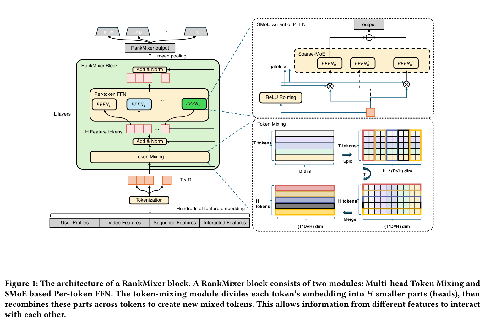
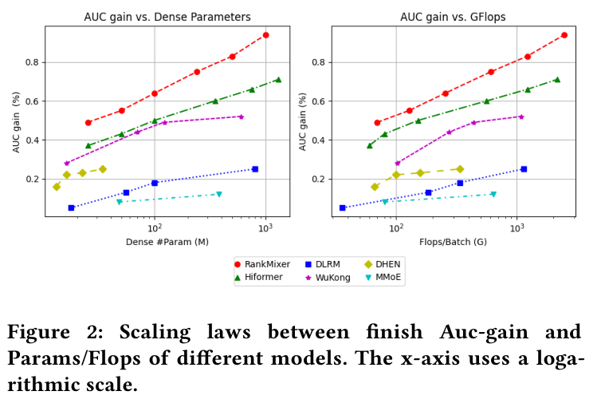
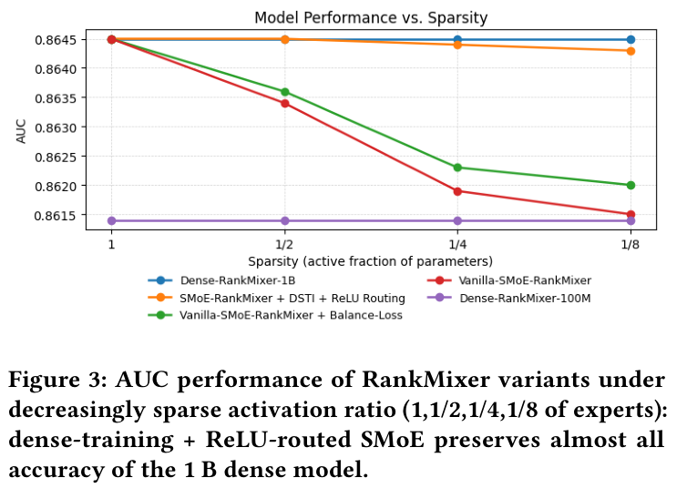
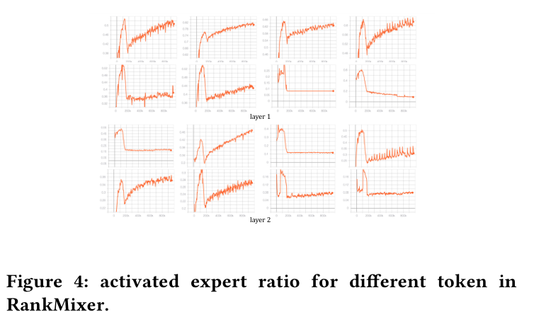

# RankMixer：扩展工业推荐系统中的排序模型

作者：Jie Zhu*、Zhifang Fan*、Xiaoxie Zhu*、Yuchen Jiang*、Hangyu Wang、Xintian Han、Haoran Ding、Xinmin Wang、Wenlin Zhao、Zhen Gong、Huizhi Yang、Zheng Chai、Zhe Chen、Yuchao Zheng、Qiwei Chen†、Feng Zhang、Xun Zhou、Peng Xu、Xiao Yang、Di Wu、Zuotao Liu。

机构：ByteDance（字节跳动）。* 同等贡献；† 通讯作者。

邮箱（原文）：{zhujie.zj, zhuxiaoxie.777, jiangyuchen.jyc, wanghangyu.123, hanxintian, dinghaoran, xinmin.wang, zhaowenlin, gongzhen.666, yanghuizhi, chaizheng.cz, chenzhe.john, zhengyuchao.yc, feng.zhang, zhouxun, xupeng, wuqi.shaw, di.wu, michael.liu}@bytedance.com；{fanzhifangfzf, chenqiwei05}@gmail.com。

> 译注：以用户提供的 v3 PDF 为唯一翻译底本，页边标注日期为 2025 年 7 月 26 日。保留原文的数字、公式编号与引用编号；个别原文排版或口径疑点用“译注”标明。图片内英文保留，图注译为中文。作者邮箱及参考文献书目信息中的作者名、刊会名保留原文；完整联系信息见原文第 1 页。

## 摘要

大语言模型（LLM）的近期进展激发了人们扩展推荐系统规模的兴趣，但仍存在两个实际障碍。首先，工业推荐系统的训练和服务成本必须满足严格的时延约束与高 QPS 要求。其次，排序模型中大多数人工设计的特征交叉模块沿袭自 CPU 时代，无法利用现代 GPU，导致模型浮点运算利用率（Model FLOPs Utilization，MFU）低下、扩展性差。

我们提出 RankMixer：一种面向统一、可扩展特征交互架构的硬件感知模型设计。RankMixer 保留 Transformer 的高度并行性，同时使用多头 token 混合模块替代具有二次复杂度的自注意力，以提高效率。此外，RankMixer 通过逐 token 前馈网络（Per-token FFN）同时维持对不同特征子空间的建模，以及跨特征空间的交互。我们进一步以稀疏混合专家（Sparse-MoE）变体将其扩展至十亿参数，以提高投入产出比（ROI）。采用动态路由策略解决专家训练不足和不均衡问题。

实验展示了 RankMixer 在万亿级生产数据集上的优越扩展能力。通过用 RankMixer 替换此前多种人工设计、低 MFU 的模块，我们将模型 MFU 从 4.5% 提升至 45%，在推理时延大致不变的情况下，将线上排序模型参数规模扩大了两个数量级。我们在两个核心应用场景——推荐与广告——开展线上 A/B 测试，验证 RankMixer 的通用性。最后，我们在服务成本不增加的情况下，将拥有 1B 稠密部分参数的 RankMixer 上线用于全流量服务，使用户活跃天数提升 0.3%，应用内总使用时长提升 1.08%。

**CCS 概念**：信息系统 → 推荐系统。

**关键词**：扩展定律；排序模型；推荐系统。

## 1 引言

推荐系统（RS）在信息分发过程中至关重要。作为一个重要的机器学习场景，推荐系统基于大量多字段特征数据，预测用户对物品的行为。这些数据包括各类统计量等数值特征、用户与物品 ID 等类别特征、用户行为特征和内容特征 [19,41]。当前先进的推荐方法基于深度学习推荐模型（DLRM）：在输入特征 embedding 之上，将神经网络作为稠密交互层，灵活捕获特征交互。DLRM 中的稠密交互层对推荐性能至关重要，研究者为此提出了多种结构 [7,11,33,38,42]。

受益于参数规模增长的大语言模型 [1,14,16] 的发展推动，扩大 DLRM 以充分利用数据量已成为迫切需求。此前围绕 DLRM 扩展的研究产生了大量成果：早期工作 [2,6,40] 仅增加特征交互层的宽度或层数，不修改其结构。这种方式取得的收益较小，有时甚至为负 [18,32]。随后，DHEN [39]、Wukong [38] 等工作转而设计新的 DNN 结构，以改善扩展性能。

然而，利用模型规模改善推荐效果面临独特的实际挑战。与 NLP 或视觉任务不同，工业级推荐系统必须严格满足紧张的时延约束，支持极高的每秒查询量（QPS）。因此，核心挑战是在模型效果与计算效率之间找到合适的平衡点。

从历史上看，推荐排序模型的架构受 CPU 时代设计原则影响。这些模型通常组合异构、多样、人工设计的交叉特征模块来提取特征交互，但其中许多核心算子在现代 GPU 上受内存带宽而非算力限制，导致 GPU 并行性差，MFU 极低，常常只有个位数百分比。此外，CPU 时代模型的计算成本近似正比于参数数量，因此扩展定律所暗示的积极扩模的潜在 ROI 很难在实践中兑现。

总之，DLRM 扩展定律的研究必须克服以下问题：

- 架构应与硬件适配，最大化现代 GPU 上的 MFU 与计算吞吐量。
- 模型设计必须利用推荐数据的特点，例如异构特征空间，以及数百个字段之间的个性化交叉特征交互。

为此，我们提出硬件感知的模型设计方法 RankMixer。其核心设计建立在两个可扩展组件之上：

1. 多头 token 混合仅通过无参数算子实现跨 token 特征交互。这一策略在效果和计算效率上优于自注意力机制。
2. 逐 token 前馈网络（FFN）显著扩展模型容量，为不同特征子空间的建模分配独立参数，以应对特征空间之间的主导问题。这些 FFN 也与推荐数据模式相适配，带来更好的扩展表现。

为进一步提高大模型 ROI，我们把逐 token FFN 扩展为稀疏混合专家（MoE）结构。对于不同数据，每个 token 动态激活部分专家，从而在计算成本仅小幅增加的情况下显著扩大模型容量。

RankMixer 采用与 Transformer 类似的高度并行架构，同时克服基于自注意力的特征交互的若干关键局限：训练效率低、建模跨空间 ID 相似性时的组合爆炸，以及注意力权重矩阵造成的严重内存瓶颈。同时，在相同 FLOPs 下，RankMixer 比原始 Transformer 提供更大的模型容量和学习能力。

在抖音推荐系统的生产部署中，我们证明，相比此前基线，可以在推理时延更短的情况下将模型参数扩大超过 100 倍。这得益于 RankMixer 通过架构将参数增长与 FLOPs 增长解耦，并通过高 MFU 与工程优化将 FLOPs 增长与实际成本解耦。

> 译注：上段保留原文“超过 100 倍”的表述；第 4.6 节和表 6 的具体线上对照为 15.8M→1.1B，约 70 倍，不能将两种表述视为完全相同的实验口径。

主要贡献如下：

- 提出遵循硬件感知模型设计理念的新架构 RankMixer。设计多头 token 混合、逐 token FFN 策略，以高效捕获异构特征交互，并利用动态路由策略改善 RankMixer 中 SparseMoE 的可扩展性。
- 利用高 MFU 与性能优化，包括 MFU 改善和量化，在推理成本不增加的情况下将模型参数扩大 70 倍。
- 在万亿级工业推荐数据集上进行了广泛的离线与在线实验，并研究模型扩展定律。RankMixer 已在抖音 Feed 推荐排序中全流量部署，活跃天数和应用使用时长分别提升 0.3% 与 1.08%。

## 2 相关工作

现代推荐系统建立在 DLRM 之上，如何有效建模特征交互是关键因素 [5,11,15,22,31,33,39]。Wide&Deep [5] 是较早的探索之一：结合逻辑回归的 wide 部分和 DNN 的 deep 部分，分别捕获低阶和高阶特征交互。DeepFM [11] 是另一项成果，将因子分解机（FM）与 DNN 集成。DeepCross [26] 是残差网络 [13] 的扩展，旨在隐式学习自动特征交互。研究表明，仅依赖 DNN 学习高阶交互相当困难 [22,25]。

显式交叉方法设计不同算子来明确捕获高阶交互，例如 PNN [22]、DCN [32] 及其后续 DCNv2 [33]、xDeepFM [18]、FGCNN [20] 和 FiGNN [17]。AutoInt [28] 和 Hiformer [10] 使用带残差连接的注意力机制学习复杂交互。DHEN [39] 提议组合多种交互算子。虽然这些新架构提高了准确率，但也增加了模型时延和内存消耗，模型规模依然相对较小。

扩展定律已成为深度学习的基础主题，并推动了过去十年的许多突破，尤其是在自然语言处理 [14,16]、计算机视觉 [8,37] 与多模态建模 [23,24] 中。它描述模型性能与模型规模、数据量、计算能力等扩展因素之间的幂律关系 [1,16,29,30]。

近期，推荐系统中的扩展定律受到广泛关注 [12]。已有研究探索了用户活动序列预训练 [6]、通用用户表示 [27,40] 和在线召回 [9,34] 的扩展策略。Wukong [38] 堆叠 FM 和 LCB 来学习特征交互。与此方向正交，Zhang 等 [40] 将序列推荐模型扩展到 0.8B 参数。HSTU [36] 改善了生成式推荐模型（GR）的扩展效果，后者更关注序列部分。

## 3 方法

### 3.1 总体架构

RankMixer 由 $T$ 个输入 token、连续的 $L$ 个 RankMixer block，以及一个输出池化算子组成。每个 block 包含两个主要组件：（1）多头 token 混合层；（2）逐 token 前馈网络（PFFN）层，如图 1 所示。首先将输入向量 $e_{\mathrm{input}}$ token 化为 $T$ 个特征 token $\mathbf{x}_1,\mathbf{x}_2,\ldots,\mathbf{x}_T$，每个 token 表示一组内在关联的特征向量。RankMixer block 通过 $L$ 层迭代细化 token 表示：

$$
\begin{aligned}
\mathbf{S}_{n-1}&=\operatorname{LN}\!\left(\operatorname{TokenMixing}(\mathbf{X}_{n-1})+\mathbf{X}_{n-1}\right),\\
\mathbf{X}_{n}&=\operatorname{LN}\!\left(\operatorname{PFFN}(\mathbf{S}_{n-1})+\mathbf{S}_{n-1}\right).
\end{aligned}\tag{1}
$$

其中 $\operatorname{LN}(\cdot)$ 是层归一化函数，$\operatorname{TokenMixing}(\cdot)$ 和 $\operatorname{PFFN}(\cdot)$ 分别表示多头 token 混合模块和逐 token FFN 模块。$\mathbf{X}_n\in\mathbb{R}^{T\times D}$ 为第 $n$ 个 block 的输出，$\mathbf{X}_0\in\mathbb{R}^{T\times D}$ 由 $\mathbf{x}_1,\ldots,\mathbf{x}_T$ 堆叠而成，$D$ 是模型隐藏维度。对最后一层表示 $\mathbf{X}_L$ 做均值池化得到输出表示 $\mathbf{o}_{\mathrm{output}}$，用于计算不同任务的预测。

### 3.2 输入层与特征 token 化

构建大规模推荐模型的第一步，是准备信息丰富的输入：**用户特征**包括用户 ID 和其他用户信息；**候选特征**包括视频 ID、作者 ID 等；**序列特征**经序列模块 [4,42] 处理，以捕获时间兴趣，得到 $\mathbf{e}_s$；**交叉特征**是用户与候选之间的交叉特征。所有特征均转换为不同维度的 embedding。

*图 1：RankMixer block 架构。一个 block 包含多头 token 混合与基于 SMoE 的逐 token FFN 两个模块。token 混合模块将每个 token 的 embedding 分为 $H$ 个较小部分（头），再跨 token 重组这些部分，生成新的混合 token，使不同特征的信息得以交互。原文第 3 页。*

为支持后续高效并行计算，必须将不同维度的 embedding 转换为维度对齐的向量，称为特征 token。我们将这一 embedding 对齐过程称为 token 化。最简单的策略是每个特征的 embedding 对应一个 token，但面对通常数百个特征时，这会带来若干挑战。数百个 token 必然将每个 token 可分配的参数和计算切分得很碎，造成重要特征建模不足，GPU 核心利用率低。相反，token 过少，例如只有一个，会使模型退化为简单 DNN，无法明确表示不同特征空间，并可能使主导特征压制其他特征。

为此，我们基于领域知识提出语义 token 化，将特征划分为若干语义一致的簇。这些分组特征依次拼接为一个 embedding 向量 $e_{\mathrm{input}}=[e_1;e_2;\ldots;e_N]$，再按固定维度大小切分为数量适当的 token。每个特征 token $\mathbf{x}_i\in\mathbb{R}^D$ 捕获一组代表相似语义方面的特征 embedding。

$$
\mathbf{x}_i=\operatorname{Proj}\left(e_{\mathrm{input}}[d\cdot(i-1):d\cdot i]\right),\quad i=1,\ldots,T.\tag{2}
$$

其中 $e_{\mathrm{input}}$ 为拼接的 embedding 向量，$d$ 为每个 token 在切分时的固定维度，$N$ 为特征组数量，$T$ 为得到的 token 数。$\operatorname{Proj}$ 将切分后的 embedding 映射到 $D$ 维。

### 3.3 RankMixer block

#### 3.3.1 多头 token 混合

为促进 token 之间有效的信息交换——这对特征交叉和全局信息建模十分重要——我们引入多头 token 混合模块。将每个 token 均匀拆为 $H$ 个头，第 $t$ 个 token $\mathbf{x}_t$ 的第 $h$ 个头记为 $\mathbf{x}^{(h)}_t$：

$$
[\mathbf{x}^{(1)}_t\Vert\mathbf{x}^{(2)}_t\Vert\cdots\Vert\mathbf{x}^{(H)}_t]=\operatorname{SplitHead}(\mathbf{x}_t).\tag{3}
$$

这些头可以视为 token $\mathbf{x}_t$ 在低维特征子空间中的投影，因为推荐任务需要考虑不同视角。token 混合用于融合这些子空间向量，以实现全局特征交互。形式上，多头混合后的第 $h$ 个 token $\mathbf{s}^h$ 构造为：

$$
\mathbf{s}^{h}=\operatorname{Concat}(\mathbf{x}_1^{h},\mathbf{x}_2^{h},\ldots,\mathbf{x}_T^{h}).\tag{4}
$$

输出 $\mathbf{S}\in\mathbb{R}^{H\times\frac{TD}{H}}$ 由重排后的 token $\mathbf{s}_1,\ldots,\mathbf{s}_H$ 堆叠而成。本文设定 $H=T$，保持混合前后 token 数一致，以支持残差连接。

经过残差连接与归一化，可得：

$$
\mathbf{s}_1,\ldots,\mathbf{s}_T=
\operatorname{LN}\left(\operatorname{TokenMixing}(\mathbf{x}_1,\ldots,\mathbf{x}_T)+(\mathbf{x}_1,\ldots,\mathbf{x}_T)\right).\tag{5}
$$

自注意力虽然在大语言模型中非常有效，但我们发现它对推荐系统并非最优。自注意力通过 token 内积计算注意力权重。该方法在 NLP 中效果良好，因为所有 token 共享统一的 embedding 空间。但推荐任务的特征空间天然异构。计算两个异构语义空间之间的内积相似性非常困难，尤其是用户侧和物品侧的特征 ID 空间可能包含数亿个元素。因此，对如此多样的输入使用自注意力，效果不及无参数多头 token 混合，同时消耗更多计算、内存 I/O 与 GPU 显存。

#### 3.3.2 逐 token FFN

此前 DLRM 和 DHEN 往往在单一交互模块中混合来自不同语义空间的特征。这可能使高频字段占据主导，淹没低频或长尾信号，最终损害推荐质量。我们引入参数隔离的前馈网络架构，称为逐 token FFN。传统设计中所有 token 共享 FFN 参数；我们则对每个 token 使用专属变换，为每个 token 隔离参数。对第 $t$ 个 token $\mathbf{s}_t$：

$$
\mathbf{v}_t=f^{t,2}_{\mathrm{pffn}}\!\left(\operatorname{Gelu}\!\left(f^{t,1}_{\mathrm{pffn}}(\mathbf{s}_t)\right)\right),\tag{6}
$$

其中

$$
f^{t,i}_{\mathrm{pffn}}(\mathbf{x})=\mathbf{x}\mathbf{W}^{t,i}_{\mathrm{pffn}}+\mathbf{b}^{t,i}_{\mathrm{pffn}}\tag{7}
$$

是逐 token FFN 的第 $i$ 层 MLP。参数维度为 $\mathbf{W}^{t,1}_{\mathrm{pffn}}\in\mathbb{R}^{D\times kD}$、$\mathbf{b}^{t,1}_{\mathrm{pffn}}\in\mathbb{R}^{kD}$、$\mathbf{W}^{t,2}_{\mathrm{pffn}}\in\mathbb{R}^{kD\times D}$、$\mathbf{b}^{t,2}_{\mathrm{pffn}}\in\mathbb{R}^{D}$。$k$ 是调节 FFN 隐藏维度的超参数，$\operatorname{Gelu}(\cdot)$ 是 GELU 激活函数，$\mathbf{s}_t\in\mathbb{R}^D$ 是第 $t$ 个 token。

逐 token FFN 模块概括为：

$$
\mathbf{v}_1,\ldots,\mathbf{v}_T=\operatorname{PFFN}(\mathbf{s}_1,\ldots,\mathbf{s}_T),\tag{8}
$$

其中

$$
\operatorname{PFFN}(\mathbf{s}_1,\ldots,\mathbf{s}_T)
=f^{t,2}_{\mathrm{pffn}}\!\left(\operatorname{Gelu}\!\left(f^{t,1}_{\mathrm{pffn}}(\mathbf{s}_1,\ldots,\mathbf{s}_T)\right)\right).\tag{9}
$$

> 译注：式（9）沿用原文的紧凑记法，含义是对各 token 分别应用其对应的 $f^{t,1}$、$f^{t,2}$，并非把整个序列送入一个共享 FFN。

与完全共享参数的 FFN 相比，逐 token FFN 在保持计算复杂度不变的同时，引入更多参数，增强建模能力。

值得强调的是，逐 token FFN 与 MMoE 专家的区别在于：每个逐 token FFN 接收不同的 token 输入，而 MMoE 中所有专家共享相同输入。MMoE 中许多专家处理同一输入；Transformer 中不同输入共享一个 FFN；RankMixer 则同时划分输入和参数，有利于学习不同特征子空间中的多样性。

### 3.4 RankMixer 中的稀疏 MoE

为进一步提高扩模 ROI，可以将每个 token 的稠密 FFN 替换为稀疏 MoE block，在计算成本大致不变的情况下增加容量。然而，普通 Sparse-MoE 在 RankMixer 中会退化，原因如下：

1. **统一的 $k$ 专家路由。** Top-$k$ 选择对所有特征 token 一视同仁，在信息少的 token 上浪费预算，令信息多的 token 得不到足够预算，妨碍模型捕获 token 差异。
2. **专家训练不足。** 逐 token FFN 已将参数数量乘以 token 数；再增加不共享专家，会进一步扩大专家数量，导致路由高度不均衡、部分专家训练不充分。

我们结合两种互补的训练策略解决上述问题。

**ReLU 路由。** 为让 token 可使用灵活的专家数量，并保持可微性，我们用 ReLU 门控与自适应 $\ell_1$ 惩罚 [35] 替换常见的 Top-$k$ + softmax。给定 token $\mathbf{s}_i\in\mathbb{R}^{d_h}$ 的第 $j$ 个专家 $e_{i,j}(\cdot)$，以及路由器 $h(\cdot)$：

$$
G_{i,j}=\operatorname{ReLU}(h(\mathbf{s}_i)),\qquad
\mathbf{v}_i=\sum_{j=1}^{N_e}G_{i,j}e_{i,j}(\mathbf{s}_i).\tag{10}
$$

> 译注：原文第一式未显式写路由器输出的第 $j$ 个分量；按上下文，$G_{i,j}$ 对应 token $i$ 到专家 $j$ 的门控值。

其中 $N_e$ 是每个 token 的专家数量，$N_t$ 是 token 数。ReLU 路由将为高信息量 token 激活更多专家，提高参数效率。稀疏性由 $\mathcal{L}_{\mathrm{reg}}$ 和系数 $\lambda$ 控制，使平均激活专家比例接近预算：

$$
\mathcal{L}=\mathcal{L}_{\mathrm{task}}+\lambda\mathcal{L}_{\mathrm{reg}},\qquad
\mathcal{L}_{\mathrm{reg}}=\sum_{i=1}^{N_t}\sum_{j=1}^{N_e}G_{i,j}.\tag{11}
$$

**稠密训练 / 稀疏推理（DTSI-MoE）。** 受 [21] 启发，采用两个路由器 $h_{\mathrm{train}}$ 与 $h_{\mathrm{infer}}$，仅对 $h_{\mathrm{infer}}$ 施加 $\mathcal{L}_{\mathrm{reg}}$。训练时两者都更新，推理时只使用 $h_{\mathrm{infer}}$。结果表明，DS-MoE 能避免专家训练不足，同时降低推理成本。

> 译注：原文此处使用“DS-MoE”，小节名及后文使用“DTSI-MoE”；此处保留这一名称差异。

### 3.5 扩展方向

RankMixer 天然具有高度并行和可扩展的架构。其参数量与计算成本可沿四个正交轴扩展：token 数 $T$、模型宽度 $D$、层数 $L$、专家数 $E$。对全稠密激活版本，参数量与单样本前向 FLOPs 可近似计算为：

$$
\#\mathrm{Param}\approx2kLTD^2,\qquad
\mathrm{FLOPs}\approx4kLTD^2.\tag{12}
$$

其中 $k$ 为 FFN 隐藏维度的扩展比例。稀疏 MoE 版本中，每个 token 的有效参数与计算还受稀疏比例 $s=\#\mathrm{Activated\_Param}/\#\mathrm{Total\_Param}$ 缩放。

## 4 实验

### 4.1 实验设置

#### 4.1.1 数据集与环境

离线实验使用抖音推荐系统训练数据，来自抖音线上日志与用户反馈标签。训练集包含 300 多个特征，如数值特征、ID 特征、交叉特征、序列特征，涉及数十亿用户 ID 和数亿视频 ID，均转换为 embedding。数据每天覆盖万亿条记录，实验使用两周内收集的数据。

#### 4.1.2 评估指标

模型效果主要采用 AUC（曲线下面积）与 UAUC（用户级 AUC）评估；效率采用参数量、FLOPs 和 MFU：

- **Finish/Skip AUC/UAUC：** finish=1/0、skip=1/0 分别表示用户是否完整观看视频，或是否在短时间内划至下一个视频。我们对完播标签评估 AUC 和 UAUC。AUC 增加 0.0001 可被视为有把握的显著改善。
- **Dense-Param：** 稠密部分参数量，不包括稀疏 embedding 参数。
- **Training FLOPs/Batch：** 单个 512 样本 batch 通过模型所需的浮点运算数，表示训练计算成本。
- **MFU：** 模型实际消耗的 FLOPs 与硬件理论 FLOPs 容量的比值，衡量模型对硬件浮点运算能力的有效利用程度。

> 译注：本节将 FLOPs/Batch 称为训练成本；式（12）则明确定义单样本前向 FLOPs。二者需分别理解，原文未进一步统一前向、反向与在线表格的计量口径。“AUC 增加 0.0001 显著”是作者的陈述，原文没有给出此阈值对应的统计检验细节。

#### 4.1.3 基线

与以下广泛认可的先进方法比较：

- **DLRM-MLP：** 用于特征交叉的原始 MLP，作为实验基线。
- **DCNv2 [33]、RDCN [3]：** 先进的特征交叉模型。
- **MoE：** 通过多个并行专家扩模。
- **AutoInt [28]、Hiformer [10]：** 原文在此处列出这两个模型，并介绍异构自注意力层和低秩近似矩阵计算。
- **DHEN [39]：** 组合不同特征交叉 block，堆叠 DCN、自注意力、FM、LR 等多层模块。
- **Wukong [38]：** 沿 DHEN 的架构，使用因子分解机块（FMB）与线性压缩块（LCB）研究特征交互的扩展定律。

所有实验在数百张 GPU 上进行，采用混合分布式训练框架：稀疏部分异步更新，稠密部分同步更新。不同模型的优化器超参数保持一致。稠密部分使用 RMSProp，学习率为 0.01；稀疏部分使用 Adagrad。

### 4.2 与先进方法比较

为研究如何扩模，我们比较参数规模在一亿左右的模型，以确定相同计算成本下表现最好的结构。

**表 1：约 100M 参数推荐模型的效果与效率比较。** 原文以粗体标出最优值。首行为绝对 AUC，其余效果列保留原文的增益百分数表示；参数量不包括稀疏 embedding。

| 模型 | Finish AUC↑ | Finish UAUC↑ | Skip AUC↑ | Skip UAUC↑ | 参数量 | FLOPs/Batch |
|---|---:|---:|---:|---:|---:|---:|
| DLRM-MLP（基线） | 0.8554 | 0.8270 | 0.8124 | 0.7294 | 8.7M | 52G |
| DLRM-MLP-100M | +0.15% | — | +0.15% | — | 95M | 185G |
| DCNv2 | +0.13% | +0.13% | +0.15% | +0.26% | 22M | 170G |
| RDCN | +0.09% | +0.12% | +0.10% | +0.22% | 22.6M | 172G |
| MoE | +0.09% | +0.12% | +0.08% | +0.21% | 47.6M | 158G |
| AutoInt | +0.10% | +0.14% | +0.12% | +0.23% | 19.2M | 307G |
| DHEN | +0.18% | +0.26% | +0.36% | +0.52% | 22M | 158G |
| HiFormer | +0.48% | — | — | — | 116M | 326G |
| Wukong | +0.29% | +0.29% | +0.49% | +0.65% | 122M | 442G |
| **RankMixer-100M** | **+0.64%** | **+0.72%** | **+0.86%** | **+1.33%** | **107M** | **233G** |
| **RankMixer-1B** | **+0.95%** | **+1.22%** | **+1.25%** | **+1.82%** | **1.1B** | **2.1T** |

主要结果见表 1。RankMixer 在多个目标和指标上显著优于其他先进模型。

进一步看各模型：首先，单纯把 DLRM 扩到一亿参数只带来有限收益，说明必须针对推荐数据特点设计模型，才能获得更好的扩展性能。与 DCN、RDCN、AutoInt、DHEN 等经典交叉结构相比，这些模型的参数量与计算成本不均衡，即使参数较少，FLOPs 已经很大，体现出限制其表中效果的设计不足。RankMixer 在一亿参数级别实现最好效果，其 FLOPs 在各模型中仍相对适中，平衡了容量与计算负载。

与 Hiformer、Wukong 等常用扩模方法相比，在相近参数设置下，RankMixer 不仅效果更好，所需计算也更少。

### 4.3 不同模型的扩展定律

*图 2：不同模型的完播 AUC 增益与参数量 / FLOPs 之间的扩展曲线。横轴采用对数刻度。原文第 5 页。*

图 2 从参数规模与 FLOPs 两个角度展示观测到的扩展曲线。RankMixer 在两者上都呈现最陡的扩展趋势，始终优于其他模型。

Wukong 的参数曲线虽然较陡，但计算成本增长更快；因此在 AUC 对 FLOPs 的曲线上，它与 RankMixer、Hiformer 的差距进一步扩大。Hiformer 略逊于 RankMixer，反映其按特征级别切 token 并依赖注意力影响了效率。DHEN 的扩展不理想，说明其交叉结构扩展能力有限。MoE 通过增加专家扩模，则面临专家均衡问题，扩展表现不佳。

具体而言，我们可以通过增加宽度 $D$、特征 token 数 $T$、层数 $L$ 扩展 RankMixer。实验观察到与 LLM 扩展定律类似的结论：模型质量主要与总参数量相关，不同扩展方向——深度、宽度、token 数——得到几乎相同的效果。

从计算效率看，相比堆叠更多层，更大的隐藏维度能形成更大的矩阵乘形状，获得更高 MFU。因此，100M 和 1B 的最终配置分别为 $(D=768,T=16,L=2)$ 和 $(D=1536,T=32,L=2)$。

### 4.4 消融研究

**表 2：RankMixer-100M 组件消融。**

| 设置 | ΔAUC |
|---|---:|
| 去除跳跃连接 | −0.07% |
| 去除多头 token 混合 | −0.50% |
| 去除层归一化 | −0.05% |
| 逐 token FFN → 共享 FFN | −0.31% |

在 RankMixer-100M 中，对残差连接和多头 token 混合等组件进行消融。表 2 显示，移除这些组件会显著降低效果。去除多头 token 混合使模型失去全局信息，因为各 FFN 只建模部分特征，彼此没有交互。去除残差连接和 LayerNorm 同样会损害效果，降低训练稳定性，并增加梯度爆炸或消失的可能性。

**表 3：Token→FFN 路由策略比较。**

| 路由策略 | ΔAUC | ΔParams | ΔFLOPs |
|---|---:|---:|---:|
| All-Concat-MLP | −0.18% | 0.0% | 0.0% |
| All-Share | −0.25% | 0.0% | 0.0% |
| Self-Attention | −0.03% | +16% | +71.8% |

进一步分析表 3 中的 token 混合策略，即从特征 token 到 FFN 的路由策略。相对多头 token 混合，比较：

- **All-Concat-MLP：** 拼接所有 token，经过大 MLP，再切回相同数量的 token。性能下降说明大矩阵学习存在挑战，且局部信息学习被削弱。
- **All-Share：** 不切分，将整个输入向量共享并送入每个逐 token FFN，类似 MoE。性能显著下降，说明与全共享输入相比，特征子空间划分和独立建模十分重要。
- **Self-Attention：** 使用 token 间自注意力路由。效果略逊于多头 token 混合，且计算成本高，说明在数百个不同特征子空间之间学习相似性较困难。

### 4.5 稀疏 MoE 的扩展性与专家均衡

*图 3：RankMixer 变体在专家激活比例降低至 1、1/2、1/4、1/8 时的 AUC。稠密训练结合 ReLU 路由的 SMoE 几乎保留了 1B 稠密模型的全部准确率。原文第 6 页。*

**扩展性。** 图 3 展示离线 AUC 与 SMoE 稀疏程度的关系。稠密训练 / 稀疏推理结合 ReLU 路由，对高稀疏度下保持准确率至关重要，使 RankMixer 可在 AUC 几乎不损失的情况下将参数容量（以及内存占用）扩展超过 8 倍，并显著节省推理成本，吞吐量提升 50%。

普通 SMoE 在激活专家减少时效果单调下降，反映前述专家不均衡与训练不足问题。增加负载均衡损失可缓解相对普通 SMoE 的退化，但仍不及 DTSI+ReLU，因为问题主要在专家训练，而非路由器本身。这验证了稀疏 MoE 是 RankMixer 从当前 1B 扩展至未来 10B 部署、同时不突破成本预算的一条路径。

*图 4：RankMixer 中不同 token 的专家激活比例，分别展示第 1 层与第 2 层。原文第 6 页。*

**专家均衡与多样性。** 普通稀疏 MoE 常有专家不均衡问题，使一些专家训练不足，最终形成几乎从不激活的“死亡专家”，而少数固定专家持续被激活。图 4 显示，DTSI 结合 ReLU 路由能有效解决该问题：稠密训练保证大多数专家获得足够梯度更新，避免专家饥饿；ReLU 路由使激活比例随 token 动态变化。图中的激活比例根据其信息内容自适应变化，与推荐数据多样、高动态的分布相适应。

### 4.6 线上服务成本

当参数增加两个数量级时，如何避免推理时延激增？实际系统中，时延与吞吐量成反比，并与服务机器资源成本直接相关。此前全量部署的模型约有 16M 参数，结构融合 DLRM 与 DCN；RankMixer 扩展至 1B，参数约增至 70 倍。尽管参数显著增长，由于硬件适配的模型设计和优化，最终推理时延保持稳定。

模型参数大幅增加时，时延可分解为：

$$
\mathrm{Latency}=\frac{\#\mathrm{Param}\times(\mathrm{FLOPs/Param\ ratio})}{\mathrm{MFU}\times(\mathrm{Theoretical\ Hardware\ FLOPs})}.
$$

**表 6：线上模型部署与成本指标。**

| 指标 | OnlineBase-16M | RankMixer-1B | 变化 |
|---|---:|---:|---:|
| 参数量 | 15.8M | 1.1B | ↑70× |
| FLOPs | 107G | 2106G | ↑20.7× |
| FLOPs/Param（G/M） | 6.8 | 1.9 | ↓3.6× |
| MFU | 4.47% | 44.57% | ↑10× |
| 硬件 FLOPs 对应精度 | fp32 | fp16 | ↑2× |
| 时延 | 14.5ms | 14.3ms | — |

> 译注：表中数值均按原文保留。2106/107≈19.68，与表内“20.7×”不完全一致；原文亦未在本表标明 FLOPs 的 batch 口径。这里不静默修正。

如表 6 所示，两个数量级的参数增长被 FLOPs/Param 比值下降 3.6 倍、MFU 提升 10 倍，以及量化使硬件 FLOPs 提升 2 倍逐步抵消。

1. **FLOPs/Param 比值。** 表 6 第三行表示每个参数所需的浮点运算数。由于模型设计，RankMixer 参数增加 70 倍，FLOPs 只增加约 20 倍，FLOPs/Param 降至基线约三分之一，即效率提升 3.6 倍。换言之，在相同 FLOPs 预算下可容纳约三倍参数。
2. **MFU。** 采用大 GEMM 形状、良好的并行拓扑——将并行逐 token FFN 融合到一个 kernel——降低内存带宽成本与开销，使 MFU 提升近 10 倍，将模型从内存瓶颈区间转到计算瓶颈区间。
3. **量化。** 半精度 fp16 推理使 GPU 理论峰值 FLOPs 提升 2 倍。RankMixer 的主要计算是若干大矩阵乘，非常适合半精度推理。

### 4.7 线上效果

为验证 RankMixer 作为推荐扩模框架的通用性，我们在个性化排序的两个核心场景——Feed 推荐与广告——进行线上实验，覆盖主要使用场景。关注的指标如下：

- **Feed 推荐：** Active Days 为实验期间每用户平均活跃天数，用作 DAU 增长的替代指标；Duration 为在应用内累计停留时长；Finish/Like/Comment 为完整播放、点赞和评论的总次数。
- **广告：** 模型质量指标 ΔAUC，以及收益指标 ADVV（Advertiser Value，广告主价值）。

这些场景此前的基线是结合 DLRM 与 DCN 的 16M 参数模型。将稠密部分替换为 RankMixer-1B 后，AUC 提升 0.7%。我们在 Feed 推荐与广告中开展线上 A/B 实验。Feed 推荐长达 8 个月的观察结果见表 4，广告结果见表 5。

**表 4：抖音与抖音极速版 Feed 推荐线上 A/B 结果。** 原文称所有改善均具有统计显著性。长期反向 A/B 测试与持续观察显示，RankMixer-1B 的收益尚未收敛，表中结果仍在改善。

| 应用 / 人群 | 活跃天数↑ | 时长↑ | 点赞↑ | 完播↑ | 评论↑ |
|---|---:|---:|---:|---:|---:|
| 抖音 / 总体 | +0.2908% | +1.0836% | +2.3852% | +1.9874% | +0.7886% |
| 抖音 / 低活跃 | +1.7412% | +3.6434% | +8.1641% | +4.5393% | +2.9368% |
| 抖音 / 中活跃 | +0.7081% | +1.5269% | +2.5823% | +2.5062% | +1.2266% |
| 抖音 / 高活跃 | +0.1445% | +0.6259% | +1.828% | +1.4939% | +0.4151% |
| 抖音极速版 / 总体 | +0.1968% | +0.9869% | +1.1318% | +2.0744% | +1.1338% |
| 抖音极速版 / 低活跃 | +0.5389% | +2.1831% | +4.4486% | +3.3958% | +0.9595% |
| 抖音极速版 / 中活跃 | +0.4235% | +1.9011% | +1.7491% | +2.6568% | +0.6782% |
| 抖音极速版 / 高活跃 | +0.0929% | +1.1356% | +1.8212% | +1.7683% | +2.3683% |

*脚注 1：结果于 2025 年 7 月 24 日更新，因为长期实验显示收益尚未饱和。*

**表 5：RankMixer 的广告线上收益。**

| 广告指标 | ΔAUC↑ | ADVV↑ |
|---|---:|---:|
| 提升 | +0.73% | +3.90% |

RankMixer 在三个个性化排序应用中部署并评估，包括 Feed 推荐（RankMixer-1B）和广告（RankMixer-1B）。所有业务关键指标均有统计显著提升。与其他活跃程度人群相比，低活跃用户收益最大，活跃天数提升达到 1.7412% 以上，说明模型有较强泛化能力。这些结果表明，作为统一骨干网络，RankMixer 能可靠泛化到不同应用场景。

> 译注：原文此处称“三个应用”，按结果表对应抖音 Feed、抖音极速版 Feed、广告；场景类别仍为推荐与广告两类。“低活跃用户收益最大”保留作者概括，但不代表表 4 中每一个细分指标都由低活跃组取得最大增益。

## 5 结论

本文介绍了最新的 RankMixer 模型，已在抖音 Feed 排序中全量部署。它结合面向异构特征交互的模型设计与适合服务效率的高度并行架构。实验展示了其更好的效果与较陡的扩展曲线。全量部署后，抖音应用的活跃天数与应用使用时长分别提高 0.3% 和 1%。

## 参考文献

> 保留原文编号与书目身份，以下将论文题名译为中文；原始英文书目另存于 `../source/references.extracted.txt`，供检索与核对。

[1] Josh Achiam 等，2023。《GPT-4 技术报告》。arXiv:2303.08774。

[2] Newsha Ardalani, Carole-Jean Wu, Zeliang Chen, Bhargav Bhushanam, Adnan Aziz，2022。《理解推荐模型的扩展定律》。arXiv:2208.08489。

[3] Fedor Borisyuk 等，2024。《LiRank：LinkedIn 的工业级大规模排序模型》。KDD 2024，4804–4815。

[4] Zheng Chai 等，2025。《LONGER：扩展工业推荐系统中的长序列建模》。arXiv:2505.04421。

[5] Heng-Tze Cheng 等，2016。《推荐系统中的 Wide & Deep 学习》。第 1 届深度学习推荐系统研讨会，7–10。

[6] Sharad Chitlangia, Krishna Reddy Kesari, Rajat Agarwal，2023。《扩展用户广告活动序列的生成式预训练》。

[7] Paul Covington, Jay Adams, Emre Sargin，2016。《用于 YouTube 推荐的深度神经网络》。第 10 届 ACM 推荐系统会议，191–198。

[8] Alexey Dosovitskiy，2020。《一张图像值 16×16 个词：用于大规模图像识别的 Transformer》。arXiv:2010.11929。

[9] Yan Fang 等，2024。《稠密检索的扩展定律》。第 47 届 ACM SIGIR，1339–1349。

[10] Huan Gui, Ruoxi Wang, Ke Yin, Long Jin, Maciej Kula, Taibai Xu, Lichan Hong, Ed H. Chi，2023。《Hiformer：利用 Transformer 学习推荐系统的异构特征交互》。arXiv:2311.05884。

[11] Huifeng Guo, Ruiming Tang, Yunming Ye, Zhenguo Li, Xiuqiang He，2017。《DeepFM：用于 CTR 预测、基于因子分解机的神经网络》。arXiv:1703.04247。

[12] Wei Guo 等，2024。《拓展新边界：大规模推荐模型的洞见》。arXiv:2412.00714。

[13] Kaiming He, Xiangyu Zhang, Shaoqing Ren, Jian Sun，2016。《用于图像识别的深度残差学习》。CVPR，770–778。

[14] Jordan Hoffmann 等，2022。《训练计算最优的大语言模型》。arXiv:2203.15556。

[15] Yanhua Huang, Hangyu Wang, Yiyun Miao, Ruiwen Xu, Lei Zhang, Weinan Zhang，2022。《用于点击率预测的神经统计量》。第 45 届 ACM SIGIR，1849–1853。

[16] Jared Kaplan 等，2020。《神经语言模型的扩展定律》。arXiv:2001.08361。

[17] Zekun Li, Zeyu Cui, Shu Wu, Xiaoyu Zhang, Liang Wang，2019。《Fi-GNN：利用图神经网络建模 CTR 预测的特征交互》。第 28 届 ACM CIKM，539–548。

[18] Jianxun Lian, Xiaohuan Zhou, Fuzheng Zhang, Zhongxia Chen, Xing Xie, Guangzhong Sun，2018。《xDeepFM：结合显式与隐式特征交互的推荐系统》。第 24 届 ACM SIGKDD，1754–1763。

[19] Jianghao Lin 等，2023。《推荐系统如何受益于大语言模型：综述》。ACM Transactions on Information Systems。

[20] Bin Liu, Ruiming Tang, Yingzhi Chen, Jinkai Yu, Huifeng Guo, Yuzhou Zhang，2019。《利用卷积神经网络生成特征进行点击率预测》。The World Wide Web Conference，1119–1129。

[21] Junwei Pan 等，2024。《坍缩与纠缠世界中的广告推荐》。第 30 届 ACM SIGKDD，5566–5577。

[22] Yanru Qu 等，2018。《基于乘积的神经网络：基于多字段类别数据预测用户响应》。ACM TOIS 37(1)，1–35。

[23] Alec Radford 等，2021。《从自然语言监督中学习可迁移的视觉模型》。ICML，PMLR，8748–8763。

[24] Aditya Ramesh 等，2021。《零样本文本到图像生成》。ICML，PMLR，8821–8831。

[25] Steffen Rendle, Walid Krichene, Li Zhang, John Anderson，2020。《重新审视神经协同过滤与矩阵分解》。第 14 届 ACM RecSys，240–248。

[26] Ying Shan, T. Ryan Hoens, Jian Jiao, Haijing Wang, Dong Yu, J. C. Mao，2016。《Deep Crossing：无需人工构造组合特征的网络级建模》。第 22 届 ACM SIGKDD，255–262。

[27] Kyuyong Shin 等，2023。《推荐模型的扩展定律：迈向通用用户表示》。AAAI 37，4596–4604。

[28] Weiping Song, Chence Shi, Zhiping Xiao, Zhijian Duan, Yewen Xu, Ming Zhang, Jian Tang，2019。《AutoInt：通过自注意力神经网络实现自动特征交互学习》。第 28 届 ACM CIKM，1161–1170。

[29] Gemma Team 等，2024。《Gemma：基于 Gemini 研究与技术的开放模型》。arXiv:2403.08295。

[30] Hugo Touvron 等，2023。《Llama 2：开放基础模型与微调聊天模型》。arXiv:2307.09288。

[31] Hangyu Wang 等，2024。《FLIP：用于 CTR 预测的 ID 模型与预训练语言模型的细粒度对齐》。第 18 届 ACM RecSys，94–104。

[32] Ruoxi Wang, Bin Fu, Gang Fu, Mingliang Wang，2017。《用于广告点击预测的 Deep & Cross Network》。ADKDD'17，1–7。

[33] Ruoxi Wang 等，2021。《DCN V2：改进的 Deep & Cross Network 与网络级排序学习实践经验》。The Web Conference 2021，1785–1797。

[34] Yunli Wang 等，2024。《在线广告召回的扩展定律》。arXiv:2411.13322。

[35] Ziteng Wang, Jianfei Chen, Jun Zhu，2024。《ReMoE：使用 ReLU 路由的完全可微混合专家》。CoRR abs/2412.14711，doi:10.48550/ARXIV.2412.14711。

[36] Jiaqi Zhai 等，原文无日期。《行动胜于语言：用于生成式推荐的万亿参数序列转导器》。第 41 届 ICML。

[37] Xiaohua Zhai, Alexander Kolesnikov, Neil Houlsby, Lucas Beyer，2022。《扩展视觉 Transformer》。CVPR，12104–12113。

[38] Buyun Zhang 等，原文无日期。《Wukong：迈向大规模推荐的扩展定律》。第 41 届 ICML。

[39] Buyun Zhang 等，2022。《DHEN：用于大规模点击率预测的深度层次集成网络》。arXiv:2203.11014。

[40] Gaowei Zhang 等，2024。《大型序列推荐模型的扩展定律》。第 18 届 ACM RecSys，444–453。

[41] Weinan Zhang, Jiarui Qin, Wei Guo, Ruiming Tang, Xiuqiang He，2021。《用于点击率估计的深度学习》。arXiv:2104.10584。

[42] Guorui Zhou 等，2018。《用于点击率预测的深度兴趣网络》。第 24 届 ACM SIGKDD，1059–1068，doi:10.1145/3219819.3219823。
