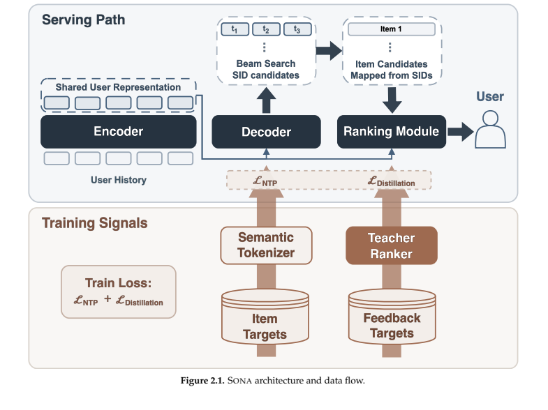
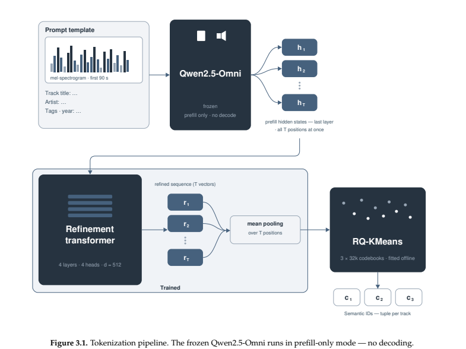
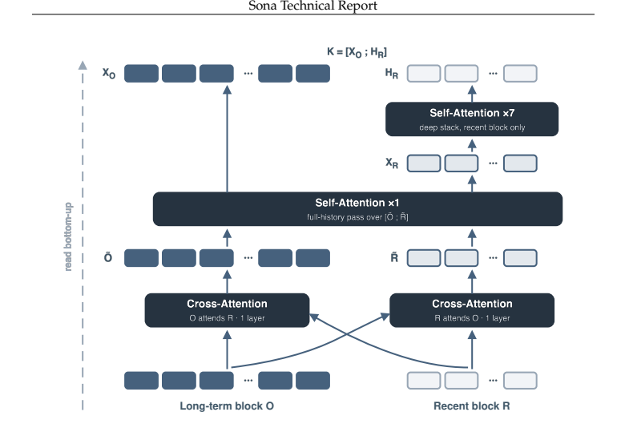
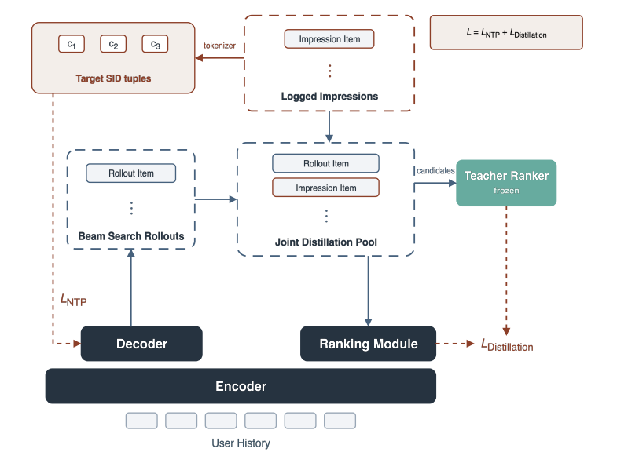
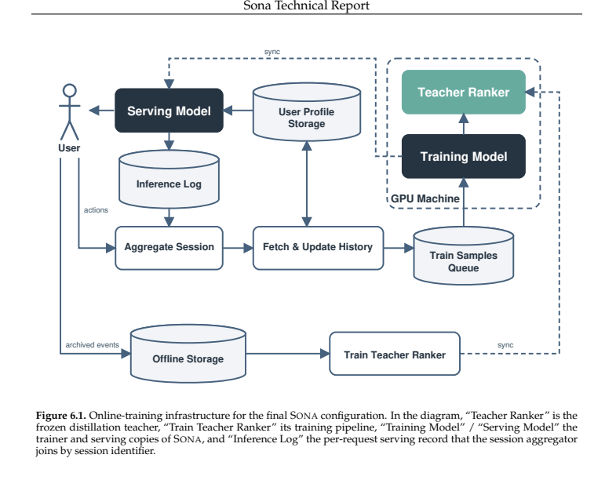

# SONA 详解：语义编码、生成与排序联合训练，以及音乐推荐的线上验证

SONA 研究的问题是：音乐推荐中，一个基于用户原始事件序列的线上模型，能否同时承担候选生成与排序，替代已有的多阶段推荐链路？作者在智能音箱 My Vibe 场景给出的最终 A/B 结果是：活跃用户数 +4.53%、总收听时长 +6.30%、点赞数 +11.42%。该实验持续 7 天，实验组和对照组各为随机选取的 15% 用户。〔E01、E15；第 1、23 页〕

SONA 将多个环节接在一起：内容与协同信息构建 Semantic ID；解码器生成候选；强教师提供排序监督；学生排序模块和解码器共享用户编码；长历史通过分层计算控制成本；在线训练持续吸收新行为。以下先按论文说明完整机制和证据，最后集中讨论工程判断与局限。

阅读路线：第 1—2 节建立整体结构；第 3—7 节解释方法和训练；第 8—9 节解释实验与工程；第 10 节集中分析证据边界。完整逐节译文见 [全文中文译稿](../translation/paper.zh-CN.md)，原始图表定位见 [资产索引](../source/assets/index.md)。

## 1. 任务背景：为何音乐推荐需要生成和排序两种能力

My Vibe 的智能音箱用户通常直接开始播放，没有提供歌手、风格、心情等显式查询。模型需要从行为推断当前需求。用户听歌时还可能做其他事情，行为表现为连续播放、跳过和偶尔点赞；播放既可能表示喜欢，也可能只是没有主动干预。音乐还具有强重复消费属性：再次听熟悉的歌曲经常有价值。论文据此强调，系统需要同时维持收听时长和发现新偏好。〔E01；§1，第 3 页〕

原系统包含超过 15 个候选生成器，以及使用数百个特征的预排序、排序模型。SONA 的最终线上路径用共享编码器、SID 解码器、确定性目录映射和排序模块承担这些功能。硬业务规则仍保留。〔E01、E02、E15〕

生成负责从大目录中提出候选，排序负责基于多个反馈目标挑选和安排这些候选。两者在同一个模型中使用同一份用户状态，但仍有各自的输出结构和监督目标。

## 2. 一次请求如何完成推荐

图 2.1 把训练和线上路径放在一起，适合先建立整体认识。



*来源：原文图 2.1，第 5 页。*

上半部分是最终线上路径：历史编码一次，解码器产生 SID，目录索引解析歌曲，排序模块读取同一编码结果打分。下半部分是训练监督：分词器给出生成目标，冻结教师给出排序目标。〔E02〕

一条请求可分为六步：

1. 读取用户最近最多 8192 个事件，构造歌曲、场景、反馈嵌入。
2. 共享编码器产生可供下游交叉注意力读取的记忆 K。
3. 两层解码器从 BOS 开始生成三个 SID，线上使用宽度 1024 的受约束束搜索。
4. 目录索引把完整 SID 元组展开成歌曲；一个元组可能对应多首。
5. 四层排序模块使用候选特征读取 K，输出教师对应的两个分数头。
6. 固定加权组合器合成标量分数，排序后输出，并保留业务约束。〔E02、E04、E05；表 B.3—B.5〕

“一个模型”指最终服务的统一网络。完整训练系统还包括单独构建的分词器和教师。最终线上不运行多模态基础模型或教师；SID 到歌曲的索引需要在线可用。

## 3. Semantic ID：如何把音乐目录变成可生成的词表

### 3.1 从歌曲身份变成三级编码

每首歌表示为三个离散编码，各级有 32,000 个取值。解码器进行三步分类，而非每一步直接对完整歌曲库分类。三级编码构成从粗到细的路径。

下面是为解释而构造的示意：

```text
歌曲 A → [125, 803, 41]
歌曲 B → [125, 803, 92]
歌曲 C → [967, 212, 18]
```

A 与 B 共享前缀，因此预测它们时，前两步使用相同 token 目标。模型可以在这些共享决策上积累学习信号。前缀来自数据驱动聚类，不对应论文预先指定的“流派—艺人—歌曲”标签。〔E03；§3.1〕

### 3.2 内容特征如何获得

冻结 Qwen2.5-Omni 读取歌曲前 90 秒音频的梅尔频谱，以及歌曲名、艺人、标签等元数据；只执行 prefill，取最后一层各位置的隐藏状态。它不需要生成自然语言描述。

四层细化 Transformer 接收这些状态，经池化得到 256 维物品向量。附录列出最多 640 个 Qwen 隐藏向量、细化模型维度 512，以及累计播放 500 次的嵌入刷新阈值。量化只使用细化后的向量。〔E03；表 B.1〕

图 3.1 展示这个过程。



*来源：原文图 3.1，第 7 页。*

可训练的是中间的细化 Transformer；内容基础模型冻结。细化模型训练后也冻结，再拟合残差 K-means。随后学生的生成训练使用固定 SID 作为标签。

### 3.3 协同细化如何调整向量

原始音频与文本信息描述歌曲内容，协同歌曲对补充用户或推荐场景中的关联。两类对分别为：

| 来源 | 构造 | 数据量与窗口 |
| --- | --- | --- |
| Target-wise | 同一生产推荐响应共同曝光，系统规则保证跨艺人 | 3 周，2.2 亿—2.4 亿对 |
| NPMI | 三个月内共同收听关联强，且属于同一艺人 | 2000 万对 |

对比损失让配对歌曲相对于批内其他歌曲更接近；每对的两个方向都参与。对齐损失把细化向量约束在原始内容均值附近：

```math
\mathcal L_{\mathrm{refine}}
=\mathcal L_{\mathrm{InfoNCE}}+0.1\mathcal L_{\mathrm{align}}.
```

直观上，前者引入协同关系，后者保留内容锚点。该流程希望让“在推荐中相关”的歌曲在量化前具有更接近的几何位置。〔E03〕

### 3.4 NPMI 为什么比共听次数更有信息

NPMI 比较实际共同出现概率与独立情况下的概率：

```math
\operatorname{NPMI}(i,j)
=\frac{\log[p(i,j)/(p(i)p(j))]}{-\log p(i,j)}.
```

若两首歌都很热门，共同被听到的次数自然可能很高；分母中的边缘概率乘积提供了这个基准。实际共现明显超过基准，才说明存在超出各自热门度的正关联。论文只保留同艺人高 NPMI 对，与跨艺人的 Target-wise 来源互补。

### 3.5 残差量化为何形成前缀

以下是残差 K-means 的等价教学写法：

```math
r_0=z,\quad
c_\ell=\arg\min_j\|r_{\ell-1}-\mu_j^{(\ell)}\|_2^2,\quad
r_\ell=r_{\ell-1}-\mu_{c_\ell}^{(\ell)},\quad \ell=1,2,3.
```

第一级编码较粗的结构，后两级编码未被解释的残差。细化后靠近的向量更有机会共享前级中心，形成共同 SID 前缀。原文采用离线残差 K-means，没有给出联合训练的 RQ-VAE 编码器—解码器损失。相同完整元组的歌曲会发生碰撞，线上先展开碰撞类，再做物品级排序。〔E03；§3.4〕

## 4. 用户表示与历史压缩：保留 8k 历史如何控制成本

### 4.1 一个事件包含什么

表 3.3 的事件输入有三组：

| 组 | 原始信号 | 编码方式 |
| --- | --- | --- |
| 物品 | 歌曲 ID、艺人 ID、时长 | ID 多次哈希，时长分桶 |
| 场景 | 智能音箱、自然信息流标志 | 离散嵌入 |
| 反馈 | 点赞、播放时长 | 点赞嵌入；播放完成率分桶 |

物品相关嵌入拼接投影，上下文和反馈嵌入各自求和，再将三组相加构成事件 token。前面加 CLS。音乐的重复收听保留为事件序列的一部分。〔E04；§3.2，第 8 页〕

### 4.2 历史压缩分配的是计算深度

8192 个事件分为长期 6144 个和近期 2048 个。图 3.2 的路径从下往上读：



*来源：原文图 3.2，第 9 页。*

先让长期与近期通过两个方向的交叉注意力互相读取，再运行一层全历史自注意力；随后仅对近期块运行七层深层自注意力。最终把长期浅层表示与近期深层表示拼在一起：

```math
K=[X_O;H_R].
```

解码器与排序器仍能访问全部历史位置，只是旧事件的直接编码深度较少。旧历史还可通过底部桥接和全历史层影响近期深层表示。论文报告该方案大致保留相同长度完整 Transformer 的主要效果，推理成本约一半。〔E04〕

注意力复杂度从完整深层处理的：

```math
\Theta(LN^2d)
```

变为：

```math
\Theta\big((Ln_r^2+N^2+2n_on_r)d\big).
```

深层近期注意力的单层平方项约为全历史的 1/16，但模型还支付全历史浅层、桥接、前馈和下游计算，所以这个 1/16 不能当成整模型的加速比。

## 5. 教师：用高密度时间线训练学习排序知识

### 5.1 教师为何要单独训练

学生的排序反馈来自冻结教师。教师不受最终线上预算约束，使用 10 层因果编码器、6 层候选打分器、1024 隐藏维度，总参数约 0.6B，大部分在嵌入表。它不使用历史压缩。〔E06；表 B.2〕

### 5.2 从请求级重复前缀到时间线级打包

学生每个请求样本携带此前历史，相邻请求会包含大量重叠前缀。教学示例：

```text
请求 1：历史 [A,B,C]       → 本次正样本与曝光
请求 2：历史 [A,B,C,D]     → 本次正样本与曝光
请求 3：历史 [A,B,C,D,E]   → 本次正样本与曝光
```

教师改用用户时间线。因果编码器一次产生各位置的状态，通过掩码让时间线上各目标读取自身发生前的历史。这样能够在一次编码内监督许多位置，减少相邻请求历史的重复处理。论文因此能将教师目标日志扩展至一年，学生联合训练仍采用数周数据。〔E05、E06〕

### 5.3 先学习行为，再学习排序

教师初始训练分为两阶段：

| 阶段 | 输入和目标 | 参数变化 |
| --- | --- | --- |
| NIP 预训练 | 2k 行为历史预测下一物品；InfoNCE，批内负样本加均匀尾部负样本，并用 LogQ 校正 | 学习编码器和预测头 |
| 排序微调 | 8k 历史，真实曝光上的 pairwise 与辅助二分类目标 | 保留编码器，丢弃预训练头，接入随机打分器 |

NIP 预训练的批内负样本数量为 8192。微调把反馈分为“点赞 > 播放 > 跳过 > 点踩”，配对时间相邻且等级不同的曝光。同一请求内与相邻请求间都可配对，但仅推荐请求的实际曝光可用。主头优化：

```math
\mathcal L_{\mathrm{pair}}
=-\frac{1}{|\mathcal P|}\sum_{(i,j)\in\mathcal P}
\log\sigma(s_i-s_j).
```

辅助头分别拟合反馈 BCE。总目标是 pairwise 与各辅助损失之和。之后教师沿时间更新到当前，并每天刷新。〔E06〕

### 5.4 何谓把一年历史压缩进权重

这一表述指教师从覆盖一年的目标数据学习总体规律，再通过分数向学生传递知识。模型输入仍有长度上限；教师预训练为 2k，微调为 8k。学习到的参数也不能用于完整还原原始日志。学生训练窗口短，也仍可读取窗口之前的用户历史。需要区分的是：训练目标日期跨度、每样本输入历史和模型权重中的统计知识。〔E05、E06；I02〕

## 6. 学生联合训练：生成目标与排序目标如何配合

### 6.1 NTP：学习产生正反馈歌曲的编码

一条请求可能有多个正反馈物品，它们共享一次历史编码，分别以 teacher forcing 解码完整 SID。下式为帮助理解的 NTP 展开式，原文第 4.2 节没有单独列出归一化形式：

```math
\mathcal L_{\mathrm{NTP}}
\propto-\sum_{v\in\mathcal C^+(u)}\sum_{\ell=1}^{3}
\log p_\theta(s_\ell(v)\mid s_{<\ell}(v),K(u)).
```

SID 是歌曲内部的三级编码，因此三步生成一个候选编码；这里并非三步连续预测三首未来歌曲。歌曲播放序列发生在编码器历史侧。

### 6.2 蒸馏：对候选逐头学习教师分数

排序模块输入每首候选的歌曲 ID、各级 SID、SID 前缀 n-gram，经哈希嵌入和投影后，交叉注意力读取 K。它输出与教师对应的头；最终模型有两个头。

两类候选分别计算逐头平均绝对误差：

```math
\mathcal L_{\mathrm{rollout}}
=\sum_{h=1}^n\frac{1}{|\mathcal B|}\sum_{c\in\mathcal B}|\hat r_c^h-r_c^h|,
\qquad
\mathcal L_{\mathrm{impression}}
=\sum_{h=1}^n\frac{1}{|\mathcal I|}\sum_{c\in\mathcal I}|\hat r_c^h-r_c^h|.
```

总目标为：

```math
\mathcal L=\mathcal L_{\mathrm{NTP}}+\mathcal L_{\mathrm{rollout}}+\mathcal L_{\mathrm{impression}}.
```

三个损失的权重是 1:1:1，各候选来源内部按数量平均。增加 rollout 候选数不会直接将该项权重按候选数量同比扩大。〔E05；表 B.3〕

图 4.1 展示两类候选如何进入教师监督。



*来源：原文图 4.1，第 12 页。*

生成的候选即使没有真实曝光反馈，也能得到教师多头分数；曝光候选则补充生产行为分布。冻结教师仅提供目标，不在学生训练步骤中被更新。

### 6.3 损失分别更新哪些参数

| 训练信号 | 共享编码器 | 生成解码器专有参数 | 排序模块专有参数 | 冻结教师 |
| --- | --- | --- | --- | --- |
| NTP | 更新 | 更新 | 无直接梯度 | 不更新 |
| 两项蒸馏 | 更新 | 论文未给出经离散生成的直接梯度路径 | 更新 | 不更新 |

表中按专有参数区分；共享嵌入等参数按实际共享关系接收梯度。第 4.2 节明确两类目标都更新共享编码器，因此排序监督会改变生成依赖的用户表示。论文没有把 beam search 定义为可微步骤，也没有给出根据教师奖励优化生成概率的策略梯度目标。〔E05；I03〕

### 6.4 最终排序分数与训练损失的关系

线上把多个头按固定权重合成一个标量。原文明确这一合成分数不进入训练损失。学生训练的是各头对教师的拟合，线上组合器决定如何权衡这些头。实验 1 表明增加点赞分能够改变点赞与其他参与指标的表现。〔E05、E13〕

## 7. Rollout Distillation：生成与排序如何对齐

### 7.1 候选分布决定排序模块练习什么

线上排序模块面对的是解码器产生的候选。若训练只使用旧系统曝光的歌曲，训练物品分布就可能偏离当前生成器的输出。当前解码器进行束搜索，教师评价这批候选，学生就在自己实际会产生的候选上学习排序。

例如，旧系统曝光 A、B、C，当前生成器提出 D、E、F。只学 A、B、C 的教师分数，不能保证学生准确区分 D、E、F。Rollout 为后者补充教师目标。随着生成器更新，候选也变化，因此排序监督能够持续跟随当前候选分布。〔E05；第 4 页设计理念〕

### 7.2 共享编码器形成表示层面的耦合

只有分布适配，主要使排序跟上生成。共享编码器再建立一条从排序监督到生成条件的路径：

```text
教师评分 → 排序蒸馏损失 → 共享编码器参数更新
                                  ↓
                         生成使用新的用户表示
```

生成目标要求用户表示支持预测正反馈歌曲；排序目标要求它支持评价候选的反馈质量。联合优化让两个任务共同塑造输入表示。

### 7.3 一个完整示例

以下所有歌曲与分数均为教学示意。

1. 用户近期多次播放安静钢琴曲，也有较早的爵士收听。
2. 编码器处理这段历史，产生记忆 K。
3. 当前解码器生成候选 D、E、F。
4. 教师根据同一用户对应的历史对三首歌输出分数，例如 0.8、0.3、0.6。
5. 学生当前预测 0.5、0.7、0.4，MAE 促使 D、F 分数上升、E 下降。
6. 此时解码器还在真实正反馈歌曲的 SID 上执行 NTP，两个目标都更新用户编码器。
7. 下次训练使用更新后的生成器产生候选，再重复监督。

若生成器对 E 的似然最高，排序仍可以把教师更偏好的 D 放在前面。这是生成概率与最终排序分数各自承担的职责。

### 7.4 “稠密”的含义与两类来源的互补

显式点赞事件有限，教师却可对大量用户—候选组合产生目标，尤其包括尚未曝光的生成候选，因此监督密度高。教师分数是模型预测，监督质量取决于教师。

表 7.6 给出直接证据：

| 候选来源 | 目标 Recall@1000 | Teacher Recall@10 | WPA |
| --- | ---: | ---: | ---: |
| 仅曝光 | 0.8663 | 0.2983 | 0.5872 |
| 仅 rollout | 0.8610 | 0.5618 | 0.5730 |
| Rollout + 曝光 | 0.8615 | 0.5654 | 0.5892 |

仅曝光的目标召回点估计最高，但在生成候选上拟合教师明显较差。仅 rollout 的教师一致性好，真实反馈对上的 WPA 却更低。两种来源结合得到更均衡的结果。〔E10〕

训练 beam 为 32，上线和离线评估 beam 为 1024；训练候选更少。增至 128 时 Teacher Recall@10 从 0.5654 增至 0.5762，但候选打分数增加四倍。作者因此保留 32。该对齐面向实际生成的高概率候选子集，不覆盖生成分布中的全部物品。

## 8. 实验证据：每组实验回答什么

### 8.1 三项离线指标不可混用

| 指标 | 对照目标 | 所回答的问题 |
| --- | --- | --- |
| Target-track Recall@k | 留出请求的真实目标歌曲 | 候选中能否找回用户目标 |
| Teacher Recall@k | 同一候选池中教师的 Top-k | 学生前排是否保留教师选择 |
| WPA | 反馈等级不同的时间相邻曝光对 | 分数是否把反馈更好的物品排前 |

Teacher Recall 高表明教师迁移较好；它仍是条件于候选池的指标，未召回的好物品不在这项评价中。WPA 以等级权重差加权；文中没有披露等级对应的全部数值。目标歌曲召回使用请求宏平均，具体分母为 min(目标数,k)。〔§7.1，第 17—18 页〕

### 8.2 分词器：内容基础和协同修正有用

表 7.2 的结果为：

| 配置 | Recall@10 | Recall@100 | Recall@1000 |
| --- | ---: | ---: | ---: |
| CLMR | 0.1848 | 0.4712 | 0.8111 |
| CLMR + 协同投影 | 0.2005 | 0.4873 | 0.8139 |
| Qwen + 协同细化 | 0.2171 | 0.5362 | 0.8524 |

固定 CLMR 时，码本从 8192 增至 32,000，Recall@1000 从 0.8036 增至 0.8111。最终选择三个 32k 码本和细化 Qwen 表示。〔E09〕

### 8.3 容量与数据：测试范围内尚未饱和

三个 Transformer 核心规模分别为 20M、130M、260M，包含嵌入和输出头后的总参数为 264M、485M、659M。相同累计目标曝光量下，容量越大，训练 NTP 损失越低。

固定 Medium 主干和 2k 历史，单遍数据窗口从 1 周扩展到 8 周，Recall@1000 从 0.8333 增至 0.8947，Recall@10 从 0.1798 增至 0.2519。作者在已测试范围内未观察到平台期。〔E09〕

### 8.4 教师：预训练、长历史、打分器深度

固定 8k 历史和六层候选打分器，有无 NIP 预训练的 WPA 为 0.6215、0.6153，差 0.0062，即 0.62 个百分点。

固定六层打分器，历史由 2k 变为 8k，WPA 从 0.6134 到 0.6215。固定 8k 时，打分器从一层增至六层，WPA 从 0.6159 到 0.6215；八层为 0.6219。论文选六层，后两层带来的点估计增量已较小。〔E11〕

### 8.5 学生：显式排序模块及长历史的作用

| 配置 | 目标 Recall@1000 | Teacher Recall@10 | WPA |
| --- | ---: | ---: | ---: |
| 2k，仅解码似然排序 | 0.8656 | 0.0381 | 0.5478 |
| 2k，一层排序模块 | 0.8615 | 0.5654 | 0.5892 |
| 2k，四层排序模块 | 0.8656 | 0.6005 | 0.5937 |
| 8k，四层，全注意力 | 0.8722 | 0.6586 | 0.6029 |
| 8k，四层，历史压缩 | 0.8709 | 0.6474 | 0.6033 |

目标召回在第一和第三行相同，而教师一致性和 WPA 明显不同，说明找回目标和排好候选是不同能力。完整长历史的召回与教师一致性点估计最高；历史压缩接近它，且成本更低，因而被选为最终方案。〔E12〕

### 8.6 损失函数并无统一赢家

MAE、MSE、Huber、KL 的指标各有取舍。MSE 的 Teacher Recall@10 和 WPA 高于 MAE，Huber 的目标召回更高，MAE 的 Teacher Recall@100 最高。作者保留 MAE 为参考配置，而未声称 MAE 全面最优。完整数字见译稿表 7.6。〔E10〕

### 8.7 五组线上实验构成的验证路径

| 实验 | 主要变量 | 关键结果与含义 |
| --- | --- | --- |
| 1 | 教师排序的点赞分权重 | 非零点赞权重改善点赞；最高权重的点赞收益最高，但活跃用户并非最高 |
| 2 | 教师候选中是否加入 SID | 同生成器下，有 SID 组的五项对照组相对点估计均更高 |
| 3 | 仅教师替换排序器，或生成器与教师共同替换完整链路 | 活跃 +1.22% 与 +2.72%，支持逐步替换 |
| 4 | 2k 学生排序与 8k 教师重排 | 蒸馏学生无需线上教师也有正收益，但教师重排的活跃、时长仍更高 |
| 5 | 完整 8k 历史压缩 SONA 替换全链路 | 五项指标均显著正向，主要指标活跃 +4.53% |

所有百分比都是相对同次实验生产对照组，不能横向直接当成组间相对收益。实验 3 中点赞与重播的若干数字带 †，没有达到论文采用的 p<0.01 显著阈值。〔E13—E15〕

最终实验五项结果：

| 指标 | 相对变化 |
| --- | ---: |
| 活跃用户数，主要指标 | +4.53% |
| 总收听时长 | +6.30% |
| 点赞 | +11.42% |
| 重播指令 | +17.99% |
| 深度参与用户数 | +7.37% |

作者说明这些是保留此前部署收益之后的新增量。SONA 的活跃增量 4.53/1.93≈2.35 倍，是相对过去 Argus 部署增量的比较。〔E15〕

## 9. 工程闭环：如何让模型持续更新并可在线服务

### 9.1 时间对齐是训练正确性的条件

一首歌播放后，反馈可能晚于请求产生。若训练时拿到的历史已经包含该歌曲或后续行为，就可能产生与推理不一致的状态。SONA 在推理日志中记录历史截止时间，聚合反馈后连接这条记录，再交回推理服务按相同逻辑构建样本。〔E07〕

图 6.1 展示整条更新闭环。



*来源：原文图 6.1，第 16 页。*

用户事件进入会话聚合，关联推理记录后回读历史，经样本队列训练；新模型同步线上。教师有独立训练路径，仅定期把快照更新进学生训练器。

### 9.2 两种画像存储兼顾长历史与时效

| 存储 | 内容 | 作用 |
| --- | --- | --- |
| 批式长历史 KV | 按批重建的长期历史 | 避免实时频繁写完整长序列 |
| 实时画像 | 最近 72 小时、最多 1000 事件 | 补齐批存储落后的尾部 |

读取时按时间合并去重，冲突优先批侧。每用户实时状态有界，减少流处理器状态体积和写负载。历史不嵌入每条事件传输，而按样本输出频率回建，降低流式带宽。〔E07〕

### 9.3 更新时延的各个数字不能混淆

| 项目 | 配置／测量 |
| --- | --- |
| 会话归因窗口 | 至少 15 分钟 |
| 学生权重同步 | 每 10 分钟 |
| 教师快照刷新 | 每 24 小时 |
| 事件到线上权重生效 | 中位 45 分钟、P99 60 分钟 |

因此“每 10 分钟同步”不能解释为“用户行为 10 分钟内一定影响模型”。事件处理、归因、队列、训练、上传还占据时间。在线训练以固定 7×10⁻⁵ 学习率持续消费事件顺序请求流，教师与学生更新节奏不同。〔E07；表 B.7〕

### 9.4 GPU 优化围绕真实形状进行

训练侧包括异步输入、哈希预计算与 GPU 重叠、bfloat16、FSDP、FlashAttention、torch.compile、QK normalization 和梯度裁剪。推理侧采用：

- CPU 侧组批、截断和填充固定形状，便于捕获完整 CUDA Graph。
- 同一 GPU 执行生成与排序，中间候选不回 CPU，用户编码只算一次。
- 每父 beam 内进行高效 radix top-k，再合并全局候选。
- 为 KV 长度至多 3、query 极短且 beam 很大的解码器自注意力调优 tile。

论文报告推理 MFU 为 41%。它描述算力利用情况，业务端到端延迟还取决于组批、队列和 CPU 服务。〔E08〕

## 10. 工程判断与证据边界

本节是基于论文材料的分析；与前述作者报告的机制、数值区分。

### 10.1 可迁移的经验及其条件

**第一，生成和排序可以共享昂贵的历史编码。** 若两任务都依赖相同的用户事件，这能避免重复编码，也建立联合优化的接口。收益需与共享导致的目标干扰一起验证；本文没有系统报告两个任务梯度冲突。

**第二，教师解决的不只是容量压缩。** 时间线打包使一年日志训练可承受，而学生的请求级联合训练使用数周数据。知识跨训练格式、数据窗口和网络结构迁移，是这套系统的重要价值。教师质量仍决定可传递信号的上限。

**第三，应在实际待排序候选上训练排序器。** 表 7.6 是最直接的证据：仅曝光具有接近的目标召回，却明显损失生成候选上的教师一致性。对其他生成式召回系统，当前生成候选加真实曝光也是值得做受控比较的组合。

**第四，长历史计算可按时间分配深度。** 旧行为保留位置，近期行为获得更多层，可能适合需要长期偏好又强调短期意图的任务。它能否迁移到强时序突变、购买周期长或内容生命周期极短的场景，需要单独验证。

**第五，日志一致性决定在线学习是否可信。** 模型再复杂，若训练重建了推理未见的历史，损失优化的对象也会偏离真实决策。记录截止时间、统一特征构造和控制反馈流，比单纯提高更新频率更基础。

### 10.2 “无人工特征”的范围

论文没有额外依赖大批人工聚合的用户—物品统计，但仍有人工决定的输入字段、哈希次数、时长与完成率分桶、反馈等级、前缀 n-gram、协同对挖掘规则和业务规则。架构也编码了时间与近期优先等偏置。

因此可以把该主张理解为“减少独立手工统计特征和特征生产链路”。将其扩展为完全没有特征工程、人工先验或规则，会超出论文证据。〔I01〕

### 10.3 Rollout 对齐可以支持多强的结论

分布适配和共享表示两条机制都有明确结构依据，表 7.6 也支持候选来源的重要性。但 MAE 对齐的是教师头分数，未强制解码概率单调对应教师奖励。共享编码器只提供影响路径，不保证所有生成更新都朝教师偏好改善。

冻结教师也可能保留旧系统偏差，当前 rollout 主要覆盖高概率区域。若生成器根本没有提出某些优质歌曲，蒸馏不会凭空让它们成为候选。曝光来源扩大支持集，但仍来自生产策略。

### 10.4 协同细化、内容理解与新物品泛化

共曝光说明旧推荐器认为歌曲适合一起展示，共听说明用户集合有关联。它们均可能混入热门度、既有策略和互补消费，不能视作严格替代性的直接标签。批内其他歌曲作为负样本，也可能包含未标注的真实相关歌曲。

量化前向量接近不保证共享前缀，聚类边界仍可能分开相近样本。NCE 使用余弦相似度、量化使用欧氏距离，向量范数处理会影响两者关系。正文还没有明确交代原始内容均值与最终 256 维向量的维度匹配方式，复现时需要补充实现细节。

表 7.2 中 CLMR 与 Qwen + 细化的差异同时涉及基础模型、元数据和细化结构，不能把 0.8111 → 0.8524 的全部增量归于协同细化。对新物品的泛化在设计上有动机，但报告缺少按物品年龄、交互量分层的冷启动实验；附录 500 次播放刷新阈值的确切运行语义也没有完整说明。

### 10.5 实验能证明与不能证明的内容

| 材料 | 可以支持 | 仍需额外证据 |
| --- | --- | --- |
| 表 7.4 教师预训练消融 | 当前训练方案下加预训练提高 WPA | 相同总算力下仍优于其他训练分配 |
| 表 7.6 候选来源消融 | Rollout 对教师迁移重要，曝光补充有益 | 对长期用户价值和冷门内容的单独作用 |
| 表 7.7 历史压缩 | 指标接近全 8k，计算方案有效 | 小幅 WPA 差异是否统计显著 |
| 实验 4 教师与学生 | 小历史学生有收益，教师重排仍有空间 | 纯粹由蒸馏压缩造成的损失，因为教师和学生历史长度不同 |
| 实验 5 最终 A/B | 该场景七天实验内相对控制显著获益 | 跨数月稳定性、其他端和场景的外推 |
| 图 7.1 容量曲线 | 测试范围内大模型训练损失更低 | 线上业务 scaling law、最终饱和点 |

论文没有披露线下多随机种子的方差、置信区间，以及所有业务指标的精确定义。15% 用户是分流比例，不能替代原始样本量。点赞 +11.42% 是相对增幅，不是点赞率增加 11.42 个百分点。

### 10.6 最终收益的归因限制

实验 4 学生的活跃收益 +1.41%，实验 5 完整 SONA 为 +4.53%，两者相减 3.12 个百分点，只是两个相对增幅数值的差。由于实验分开进行，不能把它解释为“历史从 2k 扩到 8k 的单独因果收益”。原文已明确指出这个限制。

同样，4.53/1.93≈2.35 表达相对过去 Argus 部署的增量比例；它没有证明 SONA 在同一时间、相同人群的直接 A/B 中，以该比例优于一个单独 Argus 模型。

### 10.7 成本与部署仍有哪些信息缺口

教师约 0.6B 参数、学生各模块形状、beam 和优化设置已给出，复现实验轮廓相对清楚。仍缺绝对 QPS、GPU 数量和型号、端到端推理延迟、完整训练算力与经济成本，难以据此估算另一业务直接替换链路的投入。

队列为至少一次投递，论文没有详述重复样本如何处理；SID 刷新后的索引与模型兼容、完整碰撞分布、长尾码本利用率也未充分披露。它们都是线上实现需要明确的细节，不能从概念图自动补齐。

### 10.8 覆盖、探索与长期价值

作者明确说明尚未全量上线，目录覆盖低于旧系统，计划做跨数月实验。另一方面，“未观察到内容探索下降”没有配套详细探索指标。这两个陈述并不必然矛盾：覆盖衡量触及多少目录，探索可能衡量用户接触或喜欢新内容的行为；本文未提供足够定义来量化二者关系。

更长周期内，熟悉歌曲可能改善短期时长，也可能影响发现和疲劳。若要复用该方法，应同时观测物品覆盖、流行度分布、重复率、首次收听、首次点赞、用户长期留存及分人群变化。这里是后续验证建议，不是本文已经完成的实验。

### 10.9 一个可执行的复现验证顺序

1. **固定离线数据协议。** 明确时间切分、请求发生前历史、曝光与反馈归因，先避免泄漏。
2. **单独验证分词器。** 比较内容、协同修正、码本大小；同时统计碰撞、码本利用、年龄与热门度分层召回。
3. **单独验证教师。** 做有无 NIP、历史长度、打分器深度消融，记录总训练算力和标签排序指标。
4. **接入显式排序模块。** 先固定候选池比较似然排序与教师蒸馏，区分召回变化和排序变化。
5. **比较候选来源。** 曝光、rollout、两者结合使用同一评估 beam；确认训练候选支持集与线上接近。
6. **检验共享与历史压缩。** 在固定预算和其他条件下评估多任务相互影响，再比较 2k、完整 8k、压缩 8k。
7. **验证在线正确性和服务成本。** 追踪单事件到权重生效时延、历史截止一致性、绝对延迟与吞吐。
8. **受控线上验证。** 同期对照、报告置信区间，逐步覆盖场景，并把目录覆盖与长期价值作为守护指标。

这条顺序旨在让每个模块的贡献可以被识别。论文已经给出有价值的工业可行性证据，跨场景复用时仍需要补齐上述数据、成本和长期行为验证。

## 原文定位

- 总体动机与设计：§1—2，第 3—5 页。
- 分词器和用户编码：§3，第 6—11 页。
- 学生训练：§4，第 11—12 页。
- 教师：§5，第 13—14 页。
- 基础设施：§6，第 14—17 页。
- 离线实验：§7.1—7.4，第 17—21 页。
- 线上实验：§7.5，第 22—23 页。
- 局限和未来工作：§8，第 24 页。
- 模型超参数：附录 B，第 27—29 页。

文中 E、I 编号对应 [阅读记录中的证据索引](../reading-record.md)。原文为 [本地 PDF](../source/paper.pdf)。
