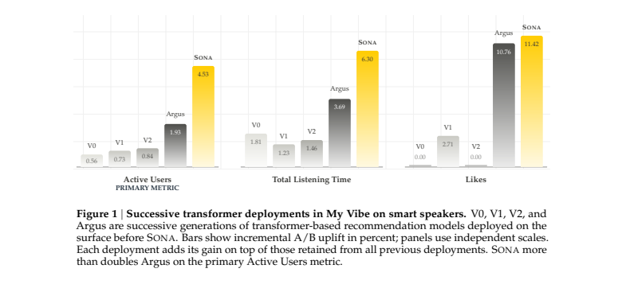
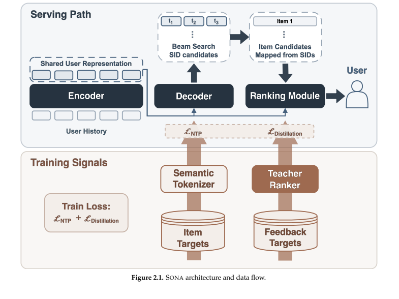
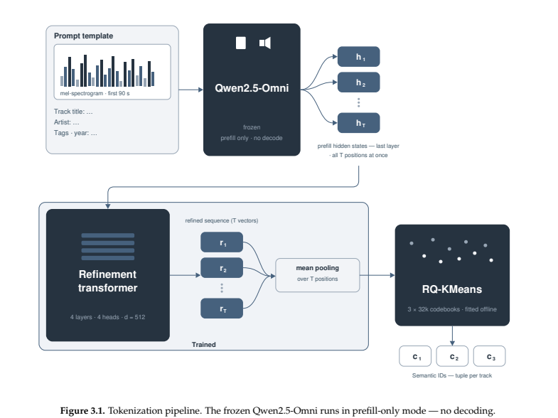
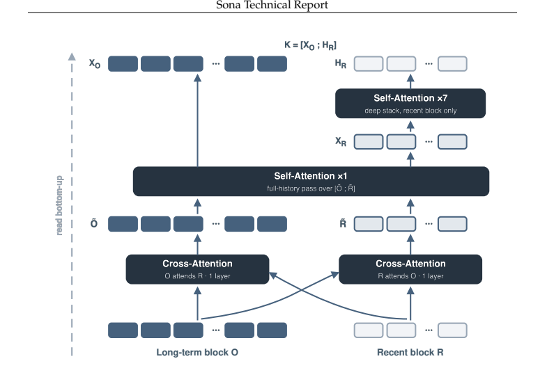
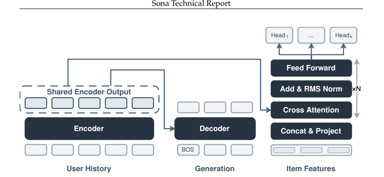
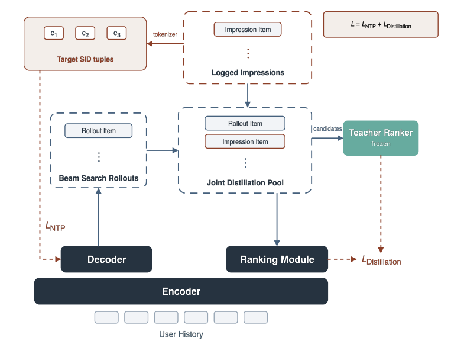
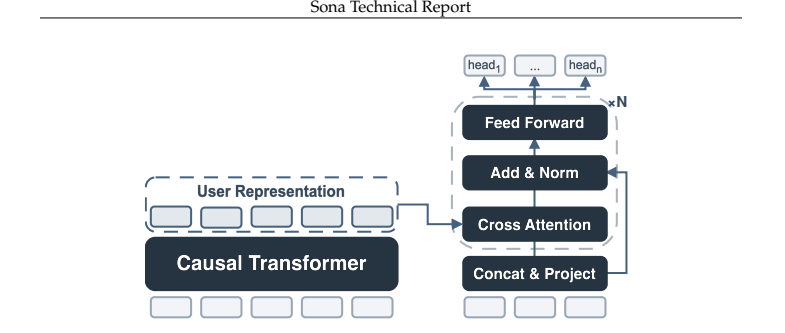
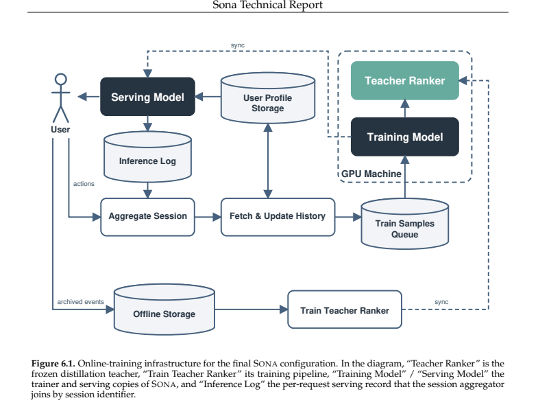
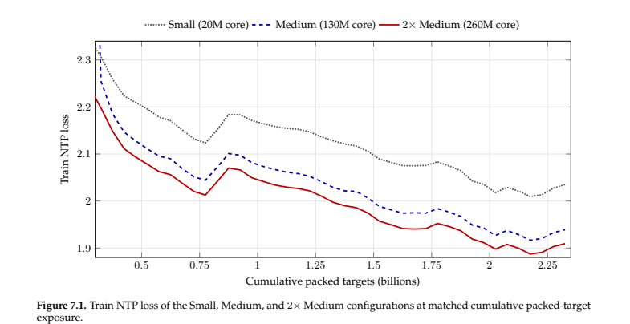

# SONA 技术报告：用于 Yandex Music 的单模型生成式推荐系统

作者：Sona Team。原文版本：2608.11015v2，2026 年 8 月 12 日。

译者说明：按原文章节与段落顺序翻译正文、附录、图表和公式；参考文献保留可检索的原始著录，并补充中文题名。原文图中的英文标注保留，中文图注及相关说明置于正文。页面号均为原 PDF 页码。解读与证据评价单独保存，不混入译文。

## 摘要〔第 1 页〕

我们介绍 SONA，这是用于 Yandex Music 的单模型生成式推荐系统。在一项线上 A/B 测试中，SONA 替换了完整的生产级级联系统——其中包括超过 15 个候选生成器，以及使用数百个特征的预排序和排序模型，这些特征还包含 Argus [12] 等大型 Transformer 模型和目标注意力打分器提供的信号——同时显著改善了关键用户参与度指标。

SONA 的架构围绕共享的用户表示，统一候选生成与排序。编码器将按时间排列的用户交互日志转换为隐藏状态，供自回归解码器和排序模块共同使用。下一 token 预测与蒸馏目标联合更新编码器，通过同一用户状态将生成与排序关联起来。SONA 及其教师排序模型都不使用人工设计特征，而是使用日志事件字段和学习得到的物品表示。在最终配置中，更大的教师只在训练时提供排序目标，线上仅保留编码器、解码器和排序模块，作为一个整体模型部署。

我们在智能音箱端 My Vibe 的真实流量上进行线上 A/B 实验。该场景是 Yandex Music 最大的推荐场景之一，用户无需指定艺人、流派、情绪或其他偏好即可开始播放。相对生产对照组，SONA 在主要指标活跃用户数上获得具有统计显著性的 +4.53% 提升，总收听时长提升 +6.30%，点赞数提升 +11.42%。这些收益是在此前部署所保留收益之上的额外增量。活跃用户数的提升幅度是此前该场景最强模型 Argus 所带来增量的 2.35 倍。结果表明，一个联合训练的模型能够替代成熟的多阶段推荐级联系统，同时提升真实流量中的推荐质量。



*图 1：智能音箱端 My Vibe 中连续部署的 Transformer 模型。V0、V1、V2、Argus 是 SONA 之前的连续代际。柱形表示各自 A/B 测试的增量百分比收益，各面板独立缩放。每次部署的收益都叠加在此前已保留的收益上。SONA 在主要指标活跃用户数上的增量超过 Argus 的两倍。来源：第 1 页。*

图中数值如下，均为增量百分比：

| 模型 | 活跃用户数 | 总收听时长 | 点赞数 |
| --- | ---: | ---: | ---: |
| V0 | 0.56 | 1.81 | 0.00 |
| V1 | 0.73 | 1.23 | 2.71 |
| V2 | 0.84 | 1.46 | 0.00 |
| Argus | 1.93 | 3.69 | 10.76 |
| SONA | 4.53 | 6.30 | 11.42 |

## 目录〔第 2 页〕

1. 引言
2. SONA 概览：2.1 设计理念；2.2 整体框架
3. SONA 架构：3.1 语义分词器；3.2 用户历史表示；3.3 编码器；3.4 解码器；3.5 排序模块
4. SONA 训练：4.1 数据集设计；4.2 训练框架
5. 教师排序模型：5.1 架构；5.2 数据集设计；5.3 训练框架
6. 训练与推理基础设施：6.1 训练优化；6.2 在线训练基础设施；6.3 推理优化
7. 评估：7.1 评估协议与指标；7.2 候选生成；7.3 教师排序模型设计消融；7.4 统一生成与排序；7.5 线上 A/B 测试
8. 结论、局限与未来工作

参考文献；附录 A 贡献与致谢；附录 B 超参数与模型卡；附录 C 符号。

## 1 引言〔第 3 页〕

我们提出 SONA：一个将候选生成与排序结合在单个模型中的 Yandex Music 生成式推荐系统，并通过真实流量的线上 A/B 实验进行评估。线上架构是处理用户按时间排列的事件历史的 Transformer，具有解码器和排序模块两个输出模块。在最终实验中，这个单模型替代了成熟推荐级联系统中由多个独立训练模型承担的候选生成、预排序和排序阶段。本报告介绍使其能够在真实流量上超越级联系统的架构、训练方案和基础设施。

Yandex Music 是围绕个性化收听构建的订阅音乐流媒体服务。除搜索、精选歌单和编辑内容外，首页信息流、广播式电台和个人 My Vibe 音乐流都由推荐驱动，推荐播放占总收听时长的很大比例。服务覆盖移动和桌面应用、网页播放器、电视及搭载语音助手的智能音箱。智能音箱端 My Vibe 是 SONA 的实验平台：用户无需指定艺人、流派、情绪或其他偏好即可开始播放，构成一个用于衡量推荐质量的纯推荐场景；它也是收听时长最大的场景之一。

音乐领域的若干特性使其区别于短视频和电商推荐，并影响 SONA 的设计。消费大多是被动的：用户做其他事情时，音乐流持续播放，因此反馈主要表现为播放、跳过和偶尔点赞，而非主动选择。重复收听十分常见；重新听一首熟悉的歌通常正是用户想要的，因此应把重复当作需要建模的信号，而非应过滤的冗余。这两个特性形成领域的核心张力：熟悉的歌曲能够稳定维持收听时长，而发现新喜爱的歌曲会在更长时间尺度上带来收益，因此推荐系统必须持续平衡收听时长与新颖性。

SONA 将下一首歌曲推荐表述为条件序列生成。编码器接收带类型的交互事件，包括播放、跳过、点赞和点踩，以及歌曲身份和请求上下文。沿用 Rajput 等人的 Semantic ID 形式 [22] 及其生产级后续工作 [8,18,39,41]，解码器用一个简短的离散 Semantic ID 元组表示每次推荐（第 3.1 节）。每个元组被展开为共享该元组的歌曲，再由排序模块排序（第 3.4 节）。两个模块共享每次请求只计算一次的用户编码器，从而在一个线上模型中运行。训练与线上输入均由日志事件字段及学习得到的 Semantic ID 构成，没有组件使用手工设计特征。

排序模块的训练监督来自教师排序模型（第 5.1 节）：它使用与编码器相同的事件词汇表，是带交叉注意力候选打分器的序列 Transformer。初始训练分两阶段：下一物品预测预训练学习序列表示，多头排序微调适配参与度目标，训练好的模型作为蒸馏教师。描述此类预训练的生产报告并不多，Argus [12] 与 GPSD [30] 是其中的例子。我们的消融实验表明，这个阶段是关键支撑：它使不使用人工特征的单个 Transformer 教师能够替代依赖数百个特征的排序模型，其中还包括 Argus 等大型 Transformer 和目标注意力打分器的信号（第 7.5 节）。

线上模型接入持续在线训练闭环：产生的收听事件在 15 分钟窗口内聚合到所属会话，经实时处理进入训练进程消费的队列；新权重每 10 分钟发布到生产环境。从事件发出到更新后的生产模型生效，端到端延迟中位数为 45 分钟，第 99 百分位为 60 分钟（第 6.2 节）。

我们进行离线和线上验证。离线通过 Teacher Recall@k 衡量排序模块在相同生成候选上保留教师排序的程度（第 7.1、7.4 节）。随后按概念顺序介绍五项线上实验，评估中间配置和最终配置。最终实验中，活跃用户数提升 +4.53%，总收听时长提升 +6.30%，点赞数提升 +11.42%（第 7.5 节）。主要指标活跃用户数的收益，是此前该场景最强模型 Argus [12] 增量收益的 2.35 倍。

## 2 SONA 概览

### 2.1 设计理念〔第 4 页〕

少量核心思想始终指导我们构建 SONA，包括选择问题形式、权衡方案和决定部署内容。下面介绍这些思想及其依据；报告其余部分说明由此形成的架构、训练方法和基础设施。

**一个模型完成生成与排序。** 大语言模型表明，在大规模语料上端到端训练的单个模型能够吸收原先分散在专用组件中的功能；单模型生成式推荐也已将此方法用于生产推荐 [8,18,41]。受这些结果启发，我们探索音乐领域单模型推荐的潜力。

**一个用户表示，跨任务共享。** 我们认为一个用户表示应服务于建立在其上的每项推荐任务：每次请求只支付一次编码器计算成本，所得表示同时用于生成和排序。近期工业部署表明，候选生成与物品级排序可在生产规模共享主干 [13,14]。因此，我们选择统一生成与排序的 Gryphon [28] 作为 SONA 的架构（第 3.5 节）。

**不使用人工设计特征。** 在多个机器学习领域，足够规模和数据的模型已经达到人工编码领域结构的流水线的效果：当预训练数据充分时，视觉 Transformer 能达到围绕卷积归纳偏置构建的架构的精度 [5]；语言模型质量随参数量与数据量呈平滑的缩放曲线 [11]。推荐领域也出现相同模式：原始交互事件上的序列模型具有类似的扩展规律 [12]，基于这些序列的 Transformer 排序器能够达到使用丰富特征的生产排序器的质量 [2,39]。因此，SONA 及其教师仅使用日志事件字段和学习到的 Semantic ID，探索这一方案在音乐推荐中能走多远。

**为不依赖人工特征的排序提供稠密监督。** 下一 token 预测与行为预测的监督密度差别很大：前者在每条序列的每个位置都有训练目标，而显式反馈事件稀疏。强大的无人工特征排序模型必须从数据中恢复原本由这些特征编码的结构；缺少预置归纳偏置，需要大规模数据训练。在交互序列上自回归训练是利用此类规模数据的常见方法 [7,39]。我们沿用该方法，首先通过下一物品预测预训练、再进行多头排序微调两阶段训练教师 [12]；消融发现预训练对教师质量至关重要（表 7.4）。

**将一年历史压缩进教师，再稠密蒸馏到学生。** 对于在时间顺序数据上进行下一 token 预测训练的编码器—解码器，每个样本都携带用户完整交互历史。因此磁盘数据规模与历史编码计算量的增长远快于样本数：每个样本从头编码历史，却只监督少量新增目标。这使覆盖数月的数据集成本过高。因此我们在覆盖一年交互日志的数据上自回归训练大型排序器，把历史知识压缩进权重，再稠密蒸馏到排序模块；后者在日期范围短得多的数据上与下一 token 预测任务联合训练（第 4.2、5.1 节）。

**通过 Rollout Distillation 对齐生成与排序。** 我们将当前解码器束搜索产生的候选作为 Rollout Distillation 的候选来源（第 4.2 节）。冻结教师对生成候选打分，排序模块学习复现这些分数。由于候选来自当前解码器分布，蒸馏信号随该训练阶段模型的候选分布而变化。解码器和排序模块还共享用户编码器，因此该信号会塑造两个任务共同依赖的表示。由此，Rollout Distillation 在联合训练目标内实现生成与排序对齐。

### 2.2 整体框架〔第 5 页〕

图 2.1 汇总线上路径与训练信号。线上时，编码器一次处理用户时间序列历史，产生解码器和排序模块共享的表示。遵循生成式推荐范式，解码器自回归生成一组简短的 SID 元组 [8,18,22,39,41]。目录索引把各元组映射到一首或多首歌曲，排序模块利用共享编码器状态对候选打分排序。

训练时，语义分词器将目标物品转成 SID 序列，为解码器提供下一 token 预测目标。冻结教师对解码器生成的候选打分，为排序模块提供蒸馏目标。两个损失均反向传播到共享编码器，让用户表示同时从生成和排序中学习。最终配置中分词器和教师仅用于训练；线上由编码器、解码器、确定性的 SID 到物品映射和排序模块构成。线上实验 1—4 曾将教师临时用于限流实验组（第 7.5 节）。表 2.1 总结各组件角色和生命周期。



*图 2.1：SONA 架构与数据流。上半部为线上路径，下半部为训练监督来源。来源：第 5 页。*

**表 2.1：SONA 最终线上组件与仅训练使用的监督组件。〔第 6 页〕**

| 组件 | 输入 | 输出／作用 | 优化与生命周期 |
| --- | --- | --- | --- |
| 语义分词器 | 稠密物品表示 | 每个物品固定 SID 元组，定义解码目标和 SID 到物品索引 | 离线构建；训练和线上期间固定 |
| 共享用户编码器 | 按时间排列的用户事件 | 生成与排序共享的隐藏状态 | 训练及线上；同时接收下一 token 和蒸馏目标梯度 |
| SID 解码器 | 编码器状态与此前 SID token | 候选 SID 元组的 beam | 下一 token 训练；线上使用 |
| SID 到物品映射器 | 生成 SID 与目录索引 | 目录候选歌曲 | 确定性映射，无可学习参数 |
| 排序模块 | 编码器状态、候选物品／SID 特征 | 多反馈分数与最终排序 | 教师蒸馏；线上使用 |
| 教师排序模型 | 历史事件与候选物品 | 物品级蒸馏目标 | 单独训练后冻结 |

## 3 SONA 架构〔第 5 页起〕

本节介绍语义分词器、用户事件表示、带历史压缩的共享编码器、自回归解码器及排序模块。

### 3.1 语义分词器〔第 6—8 页〕

生成式推荐面对庞大且持续增长的物品空间，直接生成原子物品标识符在计算和架构上不可行。因此，物品被编码成由小型固定词表中的离散编码组成、从粗到细的短序列，即 Semantic ID [22]。这使目录增长时输出空间仍紧凑稳定；内容或行为模式相似的歌曲共享前缀，从而在相关歌曲之间迁移知识，改善新增物品泛化 [18]。

分词器为每首歌分配固定的三个 SID，来自三个各含 32,000 条目的码本。它们构成解码器输出词表并定义线上 SID 到物品索引。离线流程包含三个阶段（图 3.1）：从冻结多模态 LLM 隐藏状态获取内容特征，以协同歌曲对训练细化 Transformer，再进行残差量化。

对于符合条件的歌曲，冻结 Qwen2.5-Omni [21] 编码前 90 秒音频梅尔频谱，以及包含标题、艺人、标签和额外元数据的提示。其末层隐藏状态即内容特征。参考 QARM 类流程 [15]，内容特征经过四层、四注意力头、模型维度 512 的 Transformer，再均值池化为单个 256 维歌曲向量 z。细化 Transformer 训练并冻结后，量化器仅接收 z。

**协同细化。** 仅内容特征无法显式表达可替代性：听众认为可互换的歌曲在内容向量空间未必相邻 [9,32]。因此，细化 Transformer 使用协同关联歌曲对训练，使收听模式相似的歌曲获得相近向量，并在量化后共享前缀。损失包括：

```math
\mathcal{L}=\mathcal{L}_{\mathrm{InfoNCE}}+\lambda_{\mathrm{align}}\mathcal{L}_{\mathrm{align}}.
```

一批 m 个歌曲对产生 2m 个细化向量，批中歌曲 a 的表示为 zₐ。每个向量都作为一次锚点，其配对歌曲为正样本，其他 2m−2 个向量为负样本：

```math
\mathcal{L}_{\mathrm{InfoNCE}}=-\frac{1}{2m}\sum_{a=1}^{2m}\log\frac{\exp(\operatorname{sim}(z_a,z_{a^+})/\tau)}{\sum_{b\ne a}\exp(\operatorname{sim}(z_a,z_b)/\tau)}.
```

sim 为余弦相似度，τ 为温度。对齐项使向量接近该歌曲内容特征的均值：

```math
\mathcal{L}_{\mathrm{align}}=\frac{1}{2m}\sum_{a=1}^{2m}\|z_a-\bar h_a\|^2,\qquad\lambda_{\mathrm{align}}=0.1.
```



*图 3.1：分词流程。冻结的 Qwen2.5-Omni 仅执行 prefill，不进行解码。音频和元数据先转成隐藏状态，再由细化 Transformer 和均值池化产生歌曲表示，最后使用 RQ-KMeans 生成三个 SID。来源：第 7 页。*

**协同歌曲对。** 两个来源挖掘歌曲对。Target-wise 数据流收集生产推荐器同一次响应中共同展示的物品集合。生产系统不会在一次响应中放入同一艺人的歌曲，因此这些共现天然跨艺人。NPMI 数据流使用归一化点互信息衡量歌曲 i、j 的共同收听：

```math
\operatorname{NPMI}(i,j)=\frac{1}{-\log p(i,j)}\log\frac{p(i,j)}{p(i)p(j)}.
```

p(i,j) 为三个月窗口内两首歌共同出现在用户收听日志中的概率，p(i)、p(j) 为边缘概率。只保留同一艺人的高 NPMI 对，因此两种数据流不重叠。两者在训练前拼接并打乱。

**表 3.2：分词器 InfoNCE 目标的协同歌曲对来源。**

| 来源 | 挖掘窗口 | 歌曲对数 |
| --- | --- | ---: |
| Target-wise：共同曝光、跨艺人 | 3 周 | 2.2 亿—2.4 亿 |
| NPMI：共同收听、同一艺人 | 3 个月 | 2000 万 |

**残差量化。** 细化向量 z 通过残差 K-means 映射为 SID 元组：三级各 32,000 个聚类中心，以 k-means++ 初始化并按欧氏距离分配。每一级量化上一级的残差，因此元组是码本中一条由粗到细的路径。码本大小与量化器输入表示的选择实验见第 7.2 节。

### 3.2 用户历史表示〔第 8 页〕

编码器输入来自日志交互历史。某次请求的历史为：

```math
u=(e_1,\ldots,e_T),\qquad T\le T_{\max}.
```

每个事件是一次过去交互。训练与线上采用相同选择规则；不足最大长度的历史用同一个可学习向量填充所有缺失位置。

**事件嵌入器。** 每个事件由三个嵌入器编码：歌曲身份的物品嵌入器、请求场景的上下文嵌入器、已观测反馈的反馈嵌入器。表 3.3 列出来源及变换。所有输入都是日志属性，无人工设计特征。

**表 3.3：历史事件特征与三个嵌入器前的输入变换。**

| 嵌入器 | 来源信号 | 构造 |
| --- | --- | --- |
| 物品 | 歌曲 ID、艺人 ID、歌曲时长 | 歌曲 ID 三次哈希、艺人 ID 两次哈希，映射到同一嵌入表；时长分桶后嵌入 |
| 上下文 | 智能音箱标志、自然信息流标志 | 对两个请求场景标志分别嵌入 |
| 反馈 | 点赞标志、播放时长 | 嵌入点赞标志；播放时长除以歌曲时长得到完成率，再分桶嵌入 |

**连续特征。** 歌曲时长与播放完成率均分桶后嵌入，不直接使用原始标量：

```math
\rho_t=\frac{p_t}{\max(d_t,\epsilon)},
```

其中 pₜ 为播放时长，dₜ 为歌曲时长。

**事件 token。** 物品嵌入器拼接五个哈希身份特征与时长嵌入，再投影到 d 维；上下文及反馈嵌入器把各属性直接嵌入到 d 维后求和。事件 token 是三者之和：

```math
x_t=\operatorname{ItemEmb}(e_t)+\operatorname{ContextEmb}(e_t)+\operatorname{FeedbackEmb}(e_t).
```

**编码器输入。** 在序列开头加入可学习 CLS token 作为全局汇总位置：

```math
X=[x_{\mathrm{CLS}},x_1,\ldots,x_T].
```

### 3.3 编码器〔第 9—10 页〕

完整编码器的隐藏状态矩阵为：

```math
H=\operatorname{Enc}_{\theta}(X),\qquad H\in\mathbb R^{(T+1)\times d}.
```

解码器与排序模块使用每次请求只计算一次的共享编码器记忆 K。H 表示编码器直接输出，K 表示提供给下游的接口。完整编码器下 K=H；历史压缩不构造所有位置的全深度 H，而使用长期浅层表示与近期深层表示拼接的 K。

**历史压缩。** 注意力成本随历史长度平方增长，在工业系统中保留长历史同时满足时延约束是反复出现的难题 [34,43]。SONA 因此对不同历史分配不同深度。将最多 N 个事件分为最近 nᵣ 个事件的近期块 R，以及此前 nₒ=N−nᵣ 个事件的长期块 O，执行四步（图 3.2）。历史压缩仅用于 SONA；教师完整编码历史。

1. **交叉注意力。** 两个单层交叉注意力块让 O 读取 R、R 读取 O，得到增强后的两个块。
2. **全历史处理。** 在拼接的增强块上运行一层自注意力，得到 Xₒ、Xᵣ。这是唯一在整个历史上进行混合的自注意力阶段。
3. **仅近期块的深层网络。** 七层自注意力承载大部分编码器容量，仅细化 Xᵣ，得到 Hᵣ。
4. **拼接输出。** 下游交叉注意力读取：

```math
K=[X_O;H_R].
```

所有 N 个位置对下游可见，仅最近 nᵣ 个具有深层编码。



*图 3.2：历史压缩，自下而上阅读。深色为长期块 O，浅色为近期块 R；底部双向交叉注意力，中间全历史浅层注意力，顶部仅近期深层注意力，最后拼接。来源：第 9 页。*

**成本。** 完整 L 层编码器的注意力成本为：

```math
\Theta(LN^2d).
```

本方法仅在近期块支付深层成本，总注意力成本降为：

```math
\Theta\big((Ln_r^2+N^2+2n_on_r)d\big).
```

节省来自容量分配方式，而非丢弃历史。采用 N=8192、nᵣ=2048，能保留同长度完整 Transformer 的大部分下游性能，推理成本约为其一半（第 7.4 节）。

**模块设计。** 所有 Transformer 块使用 pre-norm 布局的 RMSNorm [40,35]、SwiGLU 前馈网络 [23] 与 RoPE [26]；完整模型卡见表 B.4、B.5。

### 3.4 解码器〔第 10 页〕

分词器把目录歌曲 v 映射为 L 级 SID：

```math
s(v)=(s_1(v),\ldots,s_L(v)),\qquad L=3.
```

解码器是在码本词表上运行的浅层自回归 Transformer（表 B.5）。从 BOS 开始，在编码历史条件下逐级生成：

```math
p_\theta(s_1,\ldots,s_L\mid u)=\prod_{\ell=1}^{L}p_\theta(s_\ell\mid s_{<\ell},K).
```

**从元组到歌曲。** 线上受约束束搜索利用分词器 trie 屏蔽无效前缀，确保完成的元组至少映射到一首歌曲。码本并非无碰撞：通常少量歌曲共享一个 SID 元组，这是 Rajput 等人形式 [22] 的固有属性。每个元组展开为量化到它的所有歌曲，再交由排序模块排序。

### 3.5 排序模块〔第 10—11 页〕

排序模块使用解码器读取的相同记忆 K，对束搜索候选打分，遵循 Gryphon [28] 的统一生成与排序设计：SID 生成提供高召回候选，排序模块对其排序（图 3.3）。历史只编码一次，打分不增加第二次编码。

**候选表示。** 每个候选包含歌曲 ID、各级 SID 编码和前缀 n-gram 特征 [45]。沿用统一嵌入方案 [3]，每个特征通过多个独立哈希函数映射到与编码器共享的嵌入表；查表向量拼接后投影为单个稠密向量 eᵢ。

**打分。** 模块大体沿用解码器架构，以候选嵌入为输入，通过 pre-norm 交叉注意力块读取历史 [36]：

```math
\tilde e_i=\operatorname{CrossAttnBlocks}(e_i,K),\qquad s_i=\operatorname{Head}(\tilde e_i)\in\mathbb R^n.
```

前馈打分层输出 n 个分数，与教师各头对应，通过蒸馏和解码器下一 token 目标联合训练。

**组合分数。** 固定加权组合器将 n 个头合为一个标量，按此对展开候选排序，产生最终推荐列表。



*图 3.3：统一生成与排序架构，解码器和排序模块通过交叉注意力读取同一编码历史。来源：第 11 页。*

## 4 SONA 训练

### 4.1 数据集设计〔第 11 页〕

数据集以请求为单位：每个样本对应一次已经服务的推荐请求，携带请求发生前的时间顺序历史，以及此次响应曝光的物品、请求时间戳和之后获得的反馈。历史事件仅包含表 3.3 中的日志属性。空历史样本被丢弃，样本流继承在线闭环的流量过滤条件（第 6.2 节）。

**监督。** 同一请求中的所有正样本共享历史进行监督：分词器把每个曝光物品映射成 SID，正样本构成下一 token 目标的打包集合 C⁺(u)，一次编码监督每请求的多个目标（第 4.2 节）。完整曝光列表是蒸馏的一类候选，束搜索 rollout 是另一类。分词器目录快照中不存在的曝光物品从损失中屏蔽。

**时间顺序。** 初始训练的目标请求划分为日级表，训练器从旧到新消费。在线训练直接按事件顺序消费请求流，不再切成时间戳块。两个阶段都沿时间向前，每个样本仅以请求之前的事件为条件。

### 4.2 训练框架〔第 11—12 页〕

SONA 通过生成与排序联合目标训练（图 4.1）。解码器仅使用请求中的正反馈曝光，即用户实际交互的物品，经 SID 映射后进行下一 token 预测。每请求编码器运行一次，每个正样本都作为独立的 teacher-forcing 序列解码，并交叉注意共享表示。排序模块接受冻结教师的蒸馏：教师对每个候选输出 n 个参与度分数，学生相应头用逐元素平均绝对误差拟合。两个目标都回传到共享编码器。

**蒸馏来源。** 蒸馏的用户—候选对来自当前解码器 rollout 和日志曝光。对每个用户历史，束搜索生成 B 个 SID 元组；解析成功的目录物品构成 rollout 候选集，未解析项不参加排序模块打分与损失。该集合再补充请求的日志曝光，使教师监督覆盖生产流量中实际曝光的物品。记教师和排序模块对候选 c 的第 h 头分数分别为 r 和带帽 r，各来源贡献逐头 MAE：

```math
\mathcal L_{\mathrm{rollout}}
=\sum_{h=1}^{n}\frac{1}{|\mathcal B|}\sum_{c\in\mathcal B}|\hat r_c^h-r_c^h|,
\qquad
\mathcal L_{\mathrm{impression}}
=\sum_{h=1}^{n}\frac{1}{|\mathcal I|}\sum_{c\in\mathcal I}|\hat r_c^h-r_c^h|.
```

联合目标为：

```math
\mathcal L=\mathcal L_{\mathrm{NTP}}+\mathcal L_{\mathrm{rollout}}+\mathcal L_{\mathrm{impression}}.
```



*图 4.1：共享编码器上的解码器与排序模块联合训练。解码器由下一 token 损失监督；排序模块拟合冻结教师的分数。蒸馏池包含当前束搜索候选及日志曝光。来源：第 12 页。*

**组合排序分数。** 线上使用第 3.5 节固定加权组合器将 n 个头折叠成标量，重排 beam 候选；此组合分数不进入任何训练损失。

**训练阶段。** 初始训练从随机初始化开始，按日块时间顺序消费数据；天之间有序，天内请求打乱，学习率采用线性预热与衰减。随后在线训练按到达顺序消费请求（第 6.2 节），学习率固定为衰减终点。

**优化。** 使用 AdamW、权重衰减和梯度裁剪，超参数与调度见附录 B。FSDP 对可训练参数分片；冻结教师以 bfloat16 在各 rank 复制，不增加 all-gather 成本。

## 5 教师排序模型

### 5.1 架构〔第 13 页〕

教师是不使用人工特征的大型排序器，作为排序模块的蒸馏教师（第 4.2 节）。由于不受最终模型的时延和吞吐约束，教师更大，并读取完整用户历史。它在线上实验中超过生产排序器（第 7.5 节）。图 5.1 展示架构。

教师结合带类型事件序列上的深层用户编码器与候选打分器。打分器和 SONA 排序模块相似：接收候选嵌入，通过多层交叉注意力读取编码器隐藏状态 [27,39]。与线上模型有两点区别：第一，教师编码器是因果的，每个位置承载该时间点用户状态，支持自回归训练与时间线打包监督（第 5.3 节）；第二，教师不使用历史压缩，每层深层网络都读取完整历史。

**输出头。** 多个参与度头读取打分器输出，每个都是收窄到一个标量的 MLP。一个头根据分级参与度目标学习排序，提供主要排序信号；其余辅助反馈头通过可学习的逐头缩放和偏置恢复为校准后的 logit（第 5.3 节）。完整模型卡见表 B.2。



*图 5.1：教师排序模型架构。左侧编码带类型历史序列，右侧候选打分器通过交叉注意力读取隐藏状态。来源：第 13 页。*

### 5.2 数据集设计〔第 13—14 页〕

教师初始训练采用 NIP 预训练、多头排序微调两个阶段，随后持续更新（第 5.3 节）。初始两个阶段和更新均使用相同数据形状：样本是某个用户一段按时间排列的事件时间线，属性与表 3.3 一致。预训练样本仅含时间线，每个事件都是下一物品目标。微调还携带时间线上实际曝光和分级反馈。更新使用微调格式，从新日志会话持续构建，并限定于模型服务的推荐场景。

**自回归消费。** 每个样本的所有目标同时使用。因果编码器在每个位置给出该时刻用户状态；候选打分器通过自定义交叉注意力掩码，把每个目标可读的历史限制在其锚点之前（第 5.3 节）。因此一次编码监督时间线中所有目标，而第 4.1 节请求级数据每个请求都重新运行编码器。

**数据跨度。** 一次编码打包整段时间线的目标，使一年数据窗口变得可承受；第 4.1 节的联合训练只使用数周数据。把一年知识压缩进教师权重，再稠密蒸馏到排序模块，是第 2.1 节的设计思想。

### 5.3 训练框架〔第 14 页〕

教师在按时间排列的交互序列上自回归训练：NIP 预训练学习用户编码器，多头排序微调适配排序模块所需信号，持续刷新保持时效。预训练贡献见表 7.4。

**预训练。** 历史编码器遵循 Argus [12] 自回归方案，每个位置从因果用户状态预测下一交互。目标是 InfoNCE，对比负样本混合批内负样本与均匀采样的尾部负样本池；使用 LogQ 校正 [38] 修正批内采样的热门度偏差。该阶段仅保留编码器参数，预测头丢弃。

**微调。** 使用预训练编码器初始化，接入随机初始化的候选打分器，训练多目标排序器。主要目标是成对排序。每次曝光被映射到分级反馈：点赞 > 播放 > 跳过 > 点踩。成对头通过分数差的 logistic 损失，对时间相邻、等级不同的曝光排序。设有序相邻对集合中 i 的等级高于 j：

```math
\mathcal L_{\mathrm{pair}}=-\frac{1}{|\mathcal P|}\sum_{(i,j)\in\mathcal P}\log\sigma\big(\operatorname{score}_{\mathrm{pair}}(i)-\operatorname{score}_{\mathrm{pair}}(j)\big).\tag{5.1}
```

配对既可发生在同一推荐请求内，也可跨越相邻请求边界；只使用推荐请求实际服务的曝光，使微调保持在排序器的使用分布。辅助目标为逐点二分类，各头在校准 logit 上拟合二元反馈，使用 BCE。所有头联合优化：

```math
\mathcal L_{\mathrm{teacher}}=\mathcal L_{\mathrm{pair}}+\sum_k\mathcal L_{\mathrm{BCE}}^k.
```

每个曝光组通过第 5.2 节的自定义掩码读取锚点前历史，由专用 Triton kernel [29] 实现。微调读取的历史显著长于预训练，使打分器看到评分时可用的长程上下文。

**持续刷新。** 微调后教师沿时间向前训练至当前，再每天用新会话刷新。续训将目标对限定在教师监督的生成模型所属场景，使信号针对该场景专门化。

**优化。** 所有阶段采用 Adam，将编码器与输出头分为两组；在 bfloat16 autocast 下使用线性预热方案，沿用 Khrylchenko 等人 [12]。序列长度、负样本数、学习率见表 B.2。

## 6 训练与推理基础设施

### 6.1 训练优化〔第 14—15 页〕

SONA 联合训练生成与排序，同一步还需要冻结教师评价生成候选。三种计算共同放在同一组 GPU worker 上。

**让数据路径离开关键路径。** 网络获取和 CPU 预处理后，输入流水线缓冲准备好的批次供 GPU 消费。目录歌曲哈希在训练执行期间由异步输入流水线计算。数据准备、哈希计算、传输因此能与 GPU 模型执行重叠。

**优化 GPU 执行。** bfloat16 混合精度缩短每批处理时间；FSDP [44] 对可训练模型状态分片；FlashAttention [4] 提供高效注意力 kernel；torch.compile 优化稠密计算图。

**保持数值稳定。** QK normalization [10] 约束注意力 logit，梯度裁剪限制异常更新；同时仔细调整学习率，包括峰值前预热与训练中衰减。混合精度、长历史、生成排序联合目标结合时，这些控制很重要。

### 6.2 在线训练基础设施〔第 15—16 页〕

图 6.1 展示在线训练数据路径。持续闭环把用户行为送到实时事件处理系统，按用户聚合会话，与推理时上下文连接后生成样本。GPU 训练器从消息队列读取样本，按第 4.2 节的下一 token 与排序蒸馏联合目标更新；每 10 分钟保存检查点并同步线上。教师拥有独立训练流水线（第 5.3 节），每 24 小时刷新到学生训练器。从事件产生到基于该事件训练的模型在线生效，延迟中位数 45 分钟、P99 为 60 分钟。15 分钟会话归因窗口与 10 分钟部署节奏占中位延迟预算的大部分，其余为处理、排队、训练和上传。

**会话聚合。** 按用户分区的流由处理器消费，每用户状态存于分片分布式 KV 存储。连续事件按几分钟空闲间隔和至少 15 分钟归因窗口聚成会话。归因窗口还是正确性缓冲，让推理日志追上触发它的事件。由于仅有新消息才唤醒 worker，超时由 worker 自行入队的内部定时消息驱动。

**流量过滤。** 会话经过反作弊与机器人过滤；历史长度过滤防止极短历史支配梯度；模型黑名单过滤探测或评估模型服务的流量，避免其与训练数据形成反馈闭环。

**并行样本流。** 会话聚合按模型配置。多个模型可同时注册，各自拥有会话定义、过滤规则与样本格式，输出各自流。一次用户事件处理可以并行支持多个在线更新，一个服务部署模型，其余服务待评估变体。

**用户画像存储。** 线上与样本构建读取同一逻辑画像，底层是两个存储。KV 保存长历史，按批更新，尾部落后实时流量；事件流直接写入的实时画像保存最近 72 小时，最多每用户 1000 个事件。读取时按时间合并去重，冲突优先批侧。实时窗口使处理器只维护有界尾部，无需持续更新完整 8192 事件历史，从而控制请求规模下的状态与写入成本。

**通过推理服务连接历史。** 训练历史必须与候选生成时推理看到的历史匹配，否则梯度基于模型从未见过的状态。为此，第一，推理服务在服务时向复制 KV 写入按请求标识键控的日志，携带当时的历史截断时间戳；会话聚合器按会话标识连接该记录，把截断点写入样本。第二，用户历史不随事件流传输；聚合会话回送推理服务，后者重新读两个画像存储，使用与线上相同的计算重建样本（第 6.3 节）。若每事件内联历史，流带宽会比训练样本速率对应的需求增加数个数量级，而从存储重建只需按输出样本频率进行。



*图 6.1：最终 SONA 配置的在线训练基础设施。Teacher Ranker 是冻结蒸馏教师，Train Teacher Ranker 是其独立训练流水线，Training Model／Serving Model 是 SONA 的训练及服务副本，Inference Log 是按会话标识连接的每请求线上记录。来源：第 16 页。*

**更新闭环。** 样本进入至少一次投递、个位数秒读取延迟的消息队列。GPU 训练器消费样本，使用当前模型产生蒸馏 rollout，优化联合损失。更新模型每 10 分钟上传模型制品存储，服务集群以同样节奏拉取。

### 6.3 推理优化〔第 16—17 页〕

线上模型包含共享编码器、自回归解码器和排序模块。最终配置的冻结教师只在训练器中计算；教师重排 A/B 组使用单独实验路径（第 7.5 节）。同一 GPU worker 执行生成与物品级排序，共享用户状态。以下优化使推理模型 FLOPs 利用率（MFU）达到 41%。

**样本构建。** 独立 CPU 推理服务读取用户画像，通过特征存储计算表 3.3 的事件属性，将准备好的样本发送 GPU 集群。初始训练、在线训练、推理都使用同一特征存储处理，确保属性计算一致。

**NVIDIA Triton Inference Server。** 将请求准备与模型执行分离。异步 CPU batcher 聚合变长历史，截断、填充到固定输入形状，再派发 GPU worker。固定形状允许初始化时将完整模型路径捕获为 CUDA Graph。稳定推理阶段只需拷贝新输入并回放图，减少整个请求的框架与 kernel 启动开销。

**模型执行。** 历史编码器每个打包批次运行一次，状态用于所有 SID 解码步骤并由排序模块复用。中间候选始终留在 GPU。子图使用 torch.compile，主计算为 bfloat16。

**束搜索选择。** beam 宽度 1024、每级 32,000 个 logit，使 top-k 成为显著成本。每条父 beam 内使用 Ye 等人 [37] 基于 radix 的选择器，再合并为下一全局 beam。目录前缀约束去掉无效扩展，KV cache 随选中的父假设重排。

**解码器注意力。** 大 beam 解码形成大量独立单 token query，自注意力 KV 长度至多 3，与默认 FlashAttention tile 大小 [4] 不匹配。为此，使用针对该形状调优的解码器自注意力 kernel，明显降低计算开销；生成步骤间维护 KV cache。

## 7 评估

我们考察四个问题：分词器、容量和数据量如何影响候选生成；预训练、历史长度、打分器深度如何影响教师；哪些训练与架构设置能让统一模型同时保留目标歌曲检索和教师排序；最终单模型能否改善线上参与度。表 7.1 对应模型与证据。

**表 7.1：评估范围。〔第 17 页〕**

| 问题 | 被评估模型 | 证据 |
| --- | --- | --- |
| 候选生成 | 仅 NTP 编码器—解码器 | Target-track Recall@k；容量实验在相同目标曝光量下比较训练 NTP 损失 |
| 教师设计 | 相同离线协议下的教师变体 | 预训练、历史长度、候选打分器深度消融的 WPA |
| 统一模型迁移 | NTP 与蒸馏联合训练的编码器、解码器、排序模块；教师仅提供目标与参考分数 | Target-track Recall@k、Teacher Recall@k、WPA |
| 线上性能 | 中间组及完整 SONA | 相对同次实验对照组的参与度变化 |

### 7.1 评估协议与指标〔第 17—18 页〕

**目标歌曲召回率。** 请求 i 有 nᵢ 首目标歌曲，前 k 个解析出的预测歌曲中命中 mᵢ(k) 首。Target-track Recall@k 是在至少有一个目标的留出请求上，对以下比值宏平均：

```math
\frac{\min\{m_i(k),k\}}{\min\{n_i,k\}}.
```

容量实验改为在相同累计目标曝光量下比较训练 NTP 损失，越低越好。

**教师召回率。** Teacher Recall@k 衡量给定候选生成条件下的排序保真度。对留出请求 r，解码器产生候选池 Cᵣ，教师和排序模块对同一池排序。设请求集为 R，两者标量评分分别为 s：

```math
\operatorname{TeacherRecall}@k=\frac{1}{|\mathcal R|}\sum_{r\in\mathcal R}\frac{1}{k}\left|\operatorname{Top}_k(s_{\mathrm{RM}}^{(r)};C_r)\cap\operatorname{Top}_k(s_{\mathrm{teacher}}^{(r)};C_r)\right|.
```

交集仅在共同候选池内计算。无排序模块时用解码似然排序。

**加权配对准确率。** WPA 在留出的时间相邻、目标权重不同的曝光对上衡量反馈排序。tᵢ 为预定义反馈目标权重，集合 P 中 tᵢ>tⱼ：

```math
\operatorname{WPA}=\frac{\sum_{(i,j)\in\mathcal P}(t_i-t_j)\mathbf1\{\operatorname{score}_{\mathrm{pair}}(i)>\operatorname{score}_{\mathrm{pair}}(j)\}}{\sum_{(i,j)\in\mathcal P}(t_i-t_j)}.\tag{7.1}
```

反馈权重差越大的配对贡献越大。三项离线指标均越高越好。

### 7.2 候选生成〔第 18—19 页〕

这些实验只评估 NTP 编码器—解码器，无排序模块或教师。分词器、数据量实验使用留出请求召回率，容量实验比较相同目标曝光量的训练损失。分别改变分词器、模型规模和训练数据量。

**语义分词器。** 各方案均以残差 K-means 将稠密歌曲向量映射为三个 SID。分别改变码本规模和物品表示，每种配置重建 ID、重训检索模型。对比训练的音乐音频编码器 CLMR [24] 为纯音频基线。固定 CLMR 向量比较每级 8192 与 32,000 条目的三级量化器。固定三个 32,000 码本，比较原始 CLMR、以协同歌曲对进行 InfoNCE 残差投影的 CLMR，以及第 3.1 节音频与元数据的 Qwen2.5-Omni 加协同细化。

**表 7.2：语义分词器消融。每个子表只改变一个部分，全部使用同一留出集。**

| 码本规模 | Recall@1000 |
| --- | ---: |
| 3 × 8192 | 0.8036 |
| 3 × 32,000 | 0.8111 |

| 物品表示 | Recall@10 | Recall@100 | Recall@1000 |
| --- | ---: | ---: | ---: |
| CLMR 音频向量 | 0.1848 | 0.4712 | 0.8111 |
| CLMR + 协同投影 | 0.2005 | 0.4873 | 0.8139 |
| Qwen2.5-Omni + 协同细化 | 0.2171 | 0.5362 | 0.8524 |

选择 3 × 32k 码本和细化 Qwen2.5-Omni 表示，其检索效果在此消融中最佳。

**模型规模。** 固定层分配、数据窗口、目标与 8192 事件历史，改变编码器—解码器容量。横轴为累计打包目标曝光量。Small、Medium、2×Medium 的 Transformer 核心参数量分别为 2000 万、1.3 亿、2.6 亿；含嵌入和输出头的总可学习参数分别为 2.64 亿、4.85 亿、6.59 亿。



*图 7.1：Small、Medium、2×Medium 的训练 NTP 损失随累计打包目标曝光量变化。来源：第 19 页。*

测量范围内，增大容量持续降低训练 NTP 损失。

**训练数据量。** 固定 Medium 主干、2k 历史、分词器、留出集和优化方案，每次运行按时间顺序仅遍历一次更长日志窗口。

**表 7.3：唯一训练数据时间窗口增长时的训练损失和召回率，每个窗口单遍训练。**

| 窗口 | 训练损失 | Recall@10 | Recall@100 | Recall@1000 |
| --- | ---: | ---: | ---: | ---: |
| 1 周 | 2.2735 | 0.1798 | 0.4979 | 0.8333 |
| 2 周 | 2.1061 | 0.2126 | 0.5576 | 0.8640 |
| 4 周 | 2.0800 | 0.2388 | 0.5993 | 0.8849 |
| 8 周 | 2.0427 | 0.2519 | 0.6178 | 0.8947 |

随着窗口增长，点估计单调改善，包括从 4 周到 8 周。结合容量曲线的分离，测量范围内未观察到平台期。

### 7.3 教师排序模型设计消融〔第 19—20 页〕

使用前述留出反馈对协议和 WPA，隔离初始预训练、可读取历史长度、候选打分器深度的影响。

**预训练。** 比较两阶段初始化与随机初始化直接微调。二者均用 8k 历史、六层打分器，唯一变化为排序微调前有无 NIP 预训练。

**表 7.4：固定 8k 历史、六层打分器的教师预训练消融。**

| 配置 | WPA |
| --- | ---: |
| 无预训练 | 0.6153 |
| 两阶段初始方案，选用 | 0.6215 |

收益使下一 token 预测预训练成为选用教师方案的一部分。

**历史长度与打分器深度。** 固定其他配置，变化两个维度。

**表 7.5：同一留出反馈集上的教师 WPA 点估计。**

| 历史 | 打分器层数 | WPA |
| --- | ---: | ---: |
| 2k | 1 | 0.6080 |
| 2k | 2 | 0.6105 |
| 2k | 4 | 0.6124 |
| 2k | 6 | 0.6134 |
| 2k | 8 | 0.6138 |
| 8k | 1 | 0.6159 |
| 8k | 2 | 0.6189 |
| 8k | 4 | 0.6207 |
| 8k | 6，选用 | 0.6215 |
| 8k | 8 | 0.6219 |

更长历史在各打分器深度下都带来收益。后续蒸馏和限流实验使用六层、8k 配置。

### 7.4 统一生成与排序〔第 20—21 页〕

固定教师后，评估 NTP 与蒸馏联合训练的编码器、解码器和排序模块。教师只提供目标和评价参考，不属于被评估模型。改变蒸馏损失、候选来源、训练 rollout beam、排序深度、历史编码，报告第 7.1 节指标。

**实验顺序。** 所有变体使用第 3 节组件和两周窗口。E、D、R 分别表示编码器、解码器、排序模块层数。R 为横杠表示无排序模块、按解码似然排序。表 7.6 围绕共享参考配置单因素变化：MAE、rollout 加日志曝光、训练 beam 32、2k 历史、E=7、D=2、R=1。各组 † 为同一个参考运行。评估 beam 固定 1024。随后将 R 增至 4，并用该架构进行历史实验。

**表 7.6：围绕共享参考配置的单因素消融。† 表示同一个参考运行。**

| 因素 | 配置 | 目标歌曲 Recall@1000 | Teacher Recall@10 | Teacher Recall@100 | WPA |
| --- | --- | ---: | ---: | ---: | ---: |
| 损失 | MAE† | 0.8615 | 0.5654 | 0.7344 | 0.5892 |
| 损失 | MSE | 0.8671 | 0.5748 | 0.7329 | 0.5915 |
| 损失 | Huber | 0.8679 | 0.5568 | 0.7220 | 0.5894 |
| 损失 | KL | 0.8662 | 0.5452 | 0.7151 | 0.5860 |
| 来源 | Rollout + 曝光† | 0.8615 | 0.5654 | 0.7344 | 0.5892 |
| 来源 | 仅 rollout | 0.8610 | 0.5618 | 0.7288 | 0.5730 |
| 来源 | 仅曝光 | 0.8663 | 0.2983 | 0.5281 | 0.5872 |
| 训练 beam | 32† | 0.8615 | 0.5654 | 0.7344 | 0.5892 |
| 训练 beam | 64 | 0.8565 | 0.5661 | 0.7359 | 0.5901 |
| 训练 beam | 128 | 0.8616 | 0.5762 | 0.7427 | 0.5905 |

**蒸馏损失。** 比较 MAE、MSE、Huber、pairwise KL。没有损失同时在检索、排序保真度、反馈排序上占优，因此保留 MAE 作为后续参考。

**蒸馏候选分布。** Rollout 来自当前解码器，曝光来自请求日志。仅曝光具有最高检索点估计，但 Teacher Recall 远低于含 rollout 的配置。两者结合，Teacher Recall 接近仅 rollout，同时 WPA 更高，因此同时使用。

**训练 rollout beam。** Btrain 决定每个训练提示的候选数量，与固定 Beval 不同。32 增至 128 获得最高 Teacher Recall 点估计，但需打分四倍候选。保留 32 作为低成本参考。

**表 7.7：排序模块深度、历史长度与历史编码消融。E、D、R 分别计层。**

| 历史编码 | 长度 | E | D | R | 目标歌曲 Recall@1000 | Teacher Recall@10 | Teacher Recall@100 | WPA |
| --- | --- | ---: | ---: | --- | ---: | ---: | ---: | ---: |
| 全注意力 | 2k | 7 | 2 | — | 0.8656 | 0.0381 | 0.1936 | 0.5478 |
| 全注意力 | 2k | 7 | 2 | 1 | 0.8615 | 0.5654 | 0.7344 | 0.5892 |
| 全注意力 | 2k | 7 | 2 | 4 | 0.8656 | 0.6005 | 0.7501 | 0.5937 |
| 全注意力 | 8k | 7 | 2 | 4 | 0.8722 | 0.6586 | 0.7997 | 0.6029 |
| 历史压缩 | 8k | 7 | 2 | 4 | 0.8709 | 0.6474 | 0.7893 | 0.6033 |

**排序模块深度与历史编码。** 先在 2k 历史上扩大排序模块。从解码似然排序改为一层打分器显著提升 Teacher Recall 与 WPA；四层进一步提升 Teacher Recall 点估计。固定四层后，完整 8k 注意力具有最高目标歌曲召回与 Teacher Recall。历史压缩接近这些数值，且 WPA 点估计最高，同时仅对近期历史深层编码，因此选为最终模型。

### 7.5 线上 A/B 测试〔第 22—23 页〕

除 † 标记外，实验组相对对照组变化均在 p<0.01 下显著。五项实验在智能音箱 My Vibe 流量上评估线上配置。实验 1—3 评估教师辅助配置，实验 4 评估蒸馏线上模型，实验 5 评估完整 SONA。

活跃用户数是主要指标；同时报告总收听时长、点赞、重播指令、深度参与用户数。每项均为相对同次实验生产对照组的百分比变化。

**实验 1：点赞分数。** NTP 编码器—解码器生成候选，教师按 pairwise 分数加加权点赞分排序。比较三组：仅 pairwise（权重 0）、点赞权重 α、点赞权重 2α。每组 5% 用户，教师 8k 历史、生成器 2k；教师线上成本限制流量和统计功效。

**表 7.8：教师点赞分权重的线上对比。**

| 指标 | 仅 pairwise | +α 点赞分 | +2α 点赞分 |
| --- | ---: | ---: | ---: |
| 总收听时长 | +2.05% | +2.45% | +2.28% |
| 点赞 | −1.03%† | +6.56% | +11.93% |
| 重播指令 | +7.43% | +12.89% | +12.57% |
| 活跃用户数 | +1.51% | +1.83% | +1.53% |
| 深度参与用户数 | +2.61% | +2.87% | +2.80% |

结果支持在教师中保留非零点赞分。

**实验 2：教师中的 SID 特征。** 两组使用相同 NTP 生成器和教师排序，唯一变化是教师候选特征是否包含 SID。对照组与两实验组各 4% 用户。

**表 7.9：仅教师 SID 候选特征不同的线上结果。**

| 指标 | 无 SID 教师 | 有 SID 教师 |
| --- | ---: | ---: |
| 总收听时长 | +2.60% | +3.18% |
| 点赞 | +11.13% | +19.86% |
| 重播指令 | +15.88% | +20.52% |
| 活跃用户数 | +1.98% | +2.23% |
| 深度参与用户数 | +2.95% | +3.80% |

因此保留教师的 SID 特征。

**实验 3：教师排序与候选生成。** 一组只替换生产排序器；另一组还用编码器—解码器替换生产候选生成。两组都仅用教师 pairwise 分数，使排序目标一致。成本限制每组 3% 用户。

**表 7.10：仅替换排序器与替换完整链路。**

| 指标 | 教师排序器 | 编码器—解码器 + 教师 |
| --- | ---: | ---: |
| 总收听时长 | +1.64% | +3.63% |
| 点赞 | +1.48%† | −0.54%† |
| 重播指令 | +4.68%† | +5.02%† |
| 活跃用户数 | +1.22% | +2.72% |
| 深度参与用户数 | +1.83% | +4.06% |

教师能够替代生产排序器，进一步用生成器替换生产候选生成，对替换完整链路表现出潜力。

**实验 4：蒸馏。** 比较蒸馏模型与同一生成器候选经教师重排。两组生成器均以第 4.2 节联合目标训练，使用 2k 历史。一组用学生排序模块，另一组用读取 8k 历史的教师；均含点赞分。对照组和两实验组各 8% 用户。

**表 7.11：蒸馏单模型及其经教师重排的结果，均替换完整链路。**

| 指标 | 蒸馏模型 | 蒸馏模型 + 教师 |
| --- | ---: | ---: |
| 总收听时长 | +1.62% | +4.32% |
| 点赞 | +7.12% | +11.81% |
| 重播指令 | +15.25% | +14.93% |
| 活跃用户数 | +1.41% | +2.81% |
| 深度参与用户数 | +2.78% | +5.11% |

蒸馏模型表明，无需线上教师即可替换生产级联系统。

**实验 5：SONA。** 通过历史压缩把用户历史延长到 8192 事件，进一步改进方案。仅两个组：生产对照组、完整 SONA。各随机选取 15% 用户，实验持续 7 天。限制生产输出的硬业务规则保留。

**表 7.12：单个 SONA 模型替换完整推荐链路。**

| 指标 | 相对对照组变化 |
| --- | ---: |
| 总收听时长 | +6.30% |
| 点赞 | +11.42% |
| 重播指令 | +17.99% |
| 活跃用户数 | +4.53% |
| 深度参与用户数 | +7.37% |

相对实验 4 的一个关键差异是用户上下文：实验 4 使用 2k，实验 5 通过历史压缩扩展到 8192。表 7.7 显示长上下文明显有益，因此该变化是完整配置的重要部分。由于两实验分别进行，其结果差异不能隔离历史长度的单独因果贡献。

在主要指标活跃用户数上，SONA 的 +4.53% 对照组相对提升，为此前该场景最强模型 Argus [12] 的 +1.93% 增量的 2.35 倍。

## 8 结论、局限与未来工作〔第 24 页〕

本报告证明，成熟工业推荐链路的候选生成、预排序、排序可以由一个端到端训练和服务的模型替换。SONA 在原始用户事件历史上，以一个 Transformer 生成候选并排序，监督来自下一 token 预测和无人工特征教师蒸馏。最终 A/B 中，五项参与度指标均优于生产对照组。下面介绍局限和后续方向。

**迈向全量部署。** 虽然核心指标大幅改善，SONA 尚未部署至全量。它对现有链路带来重大改变，需要跨数月的长期实验验证。我们也观察到目录覆盖低于生产系统，将继续调查。

**其他场景。** 本报告仅验证一个推荐场景。全量部署需要在其他场景验证，留待后续。

**模型扩展。** 已测容量和数据范围内，最大配置仍继续改善（第 7.2 节）。将继续增大容量，包括稀疏 MoE 主干、稀疏及线性注意力 [16]，以及跨请求持久化 KV cache。

**测试时扩展。** 潜力尚未充分探索。加宽 beam 能以更多推理计算换取候选质量，但如何恰当利用仍是开放问题。

**内容探索。** 未观察到内容探索下降，可能因为 SONA 基于生产日志训练。新内容行为需进一步研究。

**强化学习。** RL 后训练已对 LLM 有效 [1,6,17,19,25]，工业生成式推荐也逐渐通过 RL 对齐参与度和业务目标 [8,18,20,31,33,42,46]。推荐天然适合：用户日志提供可验证奖励，与业务目标紧密相关。我们只有在受控比较证实贡献后才引入训练阶段；目前尚无 RL 的此类证据，所以报告方案完全采用监督学习。长期奖励建模、用户反馈上的 RLVR 风格后训练是有前景的方向，受控评估留待未来。

## 参考文献〔第 24—27 页〕

译注：中文为题名译文；作者、英文题名、出版信息和链接保留原始著录，以便检索。本文仅翻译其著录，不表示已另行阅读或核验这些引用文献。

**[1] 使用人类反馈强化学习训练有帮助且无害的助手。**

Yuntao Bai, Andy Jones, Kamal Ndousse, Amanda Askell, Anna Chen, Nova DasSarma, Dawn Drain, Stanislav Fort, Deep Ganguli, Tom Henighan, et al. Training a helpful and harmless assistant with reinforcement learning from human feedback. arXiv preprint arXiv:2204.05862, 2022.

**[2] 从特征到 Transformer：重新定义可扩展排序。**

Fedor Borisyuk, Lars Hertel, Ganesh Parameswaran, Gaurav Srivastava, Sudarshan Srinivasa Ramanujam, Borja Ocejo, Peng Du, Andrei Akterskii, Neil Daftary, Shao Tang, Daqi Sun, Qiang Charles Xiao, Deepesh Nathani, Mohit Kothari, Yun Dai, Guoyao Li, and Aman Gupta. From features to transformers: Redefining ranking for scalable impact. arXiv preprint arXiv:2502.03417, 2025. URL https://arxiv.org/abs/2502.03417.

**[3] 统一嵌入：经过大规模系统验证的特征表示。**

Benjamin Coleman, Wang-Cheng Kang, Matthew Fahrbach, Ruoxi Wang, Lichan Hong, Ed H. Chi, and Derek Zhiyuan Cheng. Unified embedding: Battle-tested feature representations for web-scale ml systems. In Advances in Neural Information Processing Systems, 2023. URL https://arxiv.org/abs/2305.12102.

**[4] FlashAttention：具有 IO 感知的快速、内存高效精确注意力。**

Tri Dao, Daniel Y. Fu, Stefano Ermon, Atri Rudra, and Christopher Ré. Flashattention: Fast and memory-efficient exact attention with io-awareness. arXiv preprint arXiv:2205.14135, 2022. URL https://arxiv.org/abs/2205.14135.

**[5] 一幅图像相当于 16×16 个词：大规模图像识别 Transformer。**

Alexey Dosovitskiy, Lucas Beyer, Alexander Kolesnikov, Dirk Weissenborn, Xiaohua Zhai, Thomas Unterthiner, Mostafa Dehghani, Matthias Minderer, Georg Heigold, Sylvain Gelly, Jakob Uszkoreit, and Neil Houlsby. An image is worth 16x16 words: Transformers for image recognition at scale. In International Conference on Learning Representations (ICLR), 2021. URL https://arxiv.org/abs/2010.11929.

**[6] DeepSeek-R1：通过强化学习激发大模型推理能力。**

Daya Guo, Dejian Yang, Haowei Zhang, Junxiao Song, Ruoyu Zhang, Runxin Xu, Qihao Zhu, Shirong Ma, Peiyi Wang, Xiao Bi, et al. Deepseek-r1: Incentivizing reasoning capability in llms via reinforcement learning. arXiv preprint arXiv:2501.12948, 2025.

**[7] MTGR：美团工业级生成式推荐框架。**

Ruidong Han, Bin Yin, Shangyu Chen, He Jiang, Fei Jiang, Xiang Li, Chi Ma, Mincong Huang, Xiaoguang Li, Chunzhen Jing, Yueming Han, Menglei Zhou, Lei Yu, Chuan Liu, and Wei Lin. Mtgr: Industrial-scale generative recommendation framework in meituan. arXiv preprint arXiv:2505.18654, 2025. URL https://arxiv.org/abs/2505.18654.

**[8] OxygenRec：遵循指令的电商生成式推荐框架。**

Xuegang Hao, Ming Zhang, Alex Li, et al. Oxygenrec: An instruction-following generative framework for e-commerce recommendation. arXiv preprint arXiv:2512.22386, 2025. URL https://arxiv.org/abs/2512.22386.

**[9] PLUM：将预训练语言模型适配到工业级生成式推荐。**

Ruining He, Lukasz Heldt, Lichan Hong, Raghunandan Keshavan, Shifan Mao, Nikhil Mehta, Zhengyang Su, Alicia Tsai, Yueqi Wang, Shao-Chuan Wang, Xinyang Yi, Lexi Baugher, Baykal Cakici, Ed H. Chi, Cristos Goodrow, Ningren Han, He Ma, Romer Rosales, Abby Van Soest, Su-Lin Wu, Weilong Yang, and Yilin Zheng. Plum: Adapting pre-trained language models for industrial-scale generative recommendations. arXiv preprint arXiv:2510.07784, 2025. URL https://arxiv.org/abs/2510.07784.

**[10] Transformer 的 Query-Key 归一化。**

Alex Henry, Prudhvi Raj Dachapally, Shubham Pawar, and Yuxuan Chen. Query-key normalization for transformers. Findings of EMNLP, 2020. URL https://arxiv.org/abs/2010.04245.

**[11] 神经语言模型的缩放定律。**

Jared Kaplan, Sam McCandlish, Tom Henighan, Tom B. Brown, Benjamin Chess, Rewon Child, Scott Gray, Alec Radford, Jeffrey Wu, and Dario Amodei. Scaling laws for neural language models. arXiv preprint arXiv:2001.08361, 2020. URL https://arxiv.org/abs/2001.08361.

**[12] 将推荐 Transformer 扩展至十亿参数。**

Kirill Khrylchenko, Artem Matveev, Sergei Makeev, and Vladimir Baikalov. Scaling recommender transformers to one billion parameters. In Proceedings of the 32nd ACM SIGKDD Conference on Knowledge Discovery and Data Mining (KDD), 2026. URL https://arxiv.org/abs/2507.15994.

**[13] UniPinRec：Pinterest 规模下统一生成式检索与排序。**

Hanyu Li, Yi-Ping Hsu, Aditya Mantha, Prabhat Agarwal, Laksh Bhasin, Jialu Wang, Hongtao Lin, Bella Huang, Yaxin Li, Xinyi Li, et al. Unipinrec: Unifying generative retrieval and ranking at pinterest scale. arXiv preprint arXiv:2606.00422, 2026.

**[14] 在推荐链中协调生成式检索与排序。**

Yu Liu and Jiangxia Cao. Harmonizing generative retrieval and ranking in chain-of-recommendation. arXiv preprint arXiv:2604.25787, 2026. URL https://arxiv.org/abs/2604.25787.

**[15] QARM：快手多模态推荐的量化对齐。**

Xinchen Luo, Jiangxia Cao, et al. Qarm: Quantitative alignment multi-modal recommendation at kuaishou. arXiv preprint arXiv:2411.11739, 2024.

**[16] 生成式检索的门控双向线性注意力。**

Artem Matveev, Vladislav Tytskiy, Sergei Makeev, and Sergei Liamaev. Gated bidirectional linear attention for generative retrieval. arXiv preprint arXiv:2606.07317, 2026. URL https://arxiv.org/abs/2606.07317.

**[17] WebGPT：借助人类反馈的浏览器辅助问答。**

Reiichiro Nakano, Jacob Hilton, Suchir Balaji, Jeff Wu, Long Ouyang, Christina Kim, Christopher Hesse, Shantanu Jain, Vineet Kosaraju, William Saunders, et al. Webgpt: Browser-assisted question-answering with human feedback. arXiv preprint arXiv:2112.09332, 2021.

**[18] OneRec 技术报告。**

OneRec Team. Onerec technical report. arXiv preprint arXiv:2506.13695, 2025. URL https://arxiv.org/abs/2506.13695.

**[19] 使用人类反馈训练语言模型遵循指令。**

Long Ouyang, Jeffrey Wu, Xu Jiang, Diogo Almeida, Carroll Wainwright, Pamela Mishkin, Chong Zhang, Sandhini Agarwal, Katarina Slama, Alex Ray, et al. Training language models to follow instructions with human feedback. Advances in Neural Information Processing Systems, 2022. URL https://arxiv.org/abs/2203.02155.

**[20] EGA-v1：以端到端学习统一在线广告。**

Junyan Qiu et al. Ega-v1: Unifying online advertising with end-to-end learning. arXiv preprint arXiv:2505.19755, 2025.

**[21] Qwen2.5-Omni 技术报告。**

Qwen Team. Qwen2.5-omni technical report. arXiv preprint arXiv:2503.20215, 2025. URL https://arxiv.org/abs/2503.20215.

**[22] 使用生成式检索的推荐系统。**

Shashank Rajput, Nikhil Mehta, Anima Singh, Raghunandan Hulikal Keshavan, Trung Vu, Lukasz Heldt, Lichan Hong, Yi Tay, Vinh Tran, Jonah Samost, et al. Recommender systems with generative retrieval. Advances in Neural Information Processing Systems, 2023. URL https://arxiv.org/abs/2305.05065.

**[23] GLU 变体改进 Transformer。**

Noam Shazeer. Glu variants improve transformer. arXiv preprint arXiv:2002.05202, 2020.

**[24] 音乐表示的对比学习。**

Janne Spijkervet and John Ashley Burgoyne. Contrastive learning of musical representations. arXiv preprint arXiv:2103.09410, 2021. URL https://arxiv.org/abs/2103.09410.

**[25] 从人类反馈学习摘要。**

Nisan Stiennon, Long Ouyang, Jeffrey Wu, Daniel M. Ziegler, Ryan Lowe, Chelsea Voss, Alec Radford, Dario Amodei, and Paul Christiano. Learning to summarize from human feedback. Advances in Neural Information Processing Systems, 2020. URL https://arxiv.org/abs/2009.01325.

**[26] RoFormer：使用旋转位置嵌入增强 Transformer。**

Jianlin Su, Yu Lu, Shengfeng Pan, Ahmed Murtadha, Bo Wen, and Yunfeng Liu. Roformer: Enhanced transformer with rotary position embedding. arXiv preprint arXiv:2104.09864, 2021.

**[27] GRank：面向目标感知与精简工业检索的生成—排序框架。**

Yijia Sun, Shanshan Huang, Zhiyuan Guan, Qiang Luo, Ruiming Tang, Kun Gai, and Guorui Zhou. Grank: Towards target-aware and streamlined industrial retrieval with a generate-rank framework. In Proceedings of the ACM Web Conference 2026 (WWW ’26), 2026. URL https://arxiv.org/abs/2510. 15299.

**[28] Gryphon：工业推荐中统一 SID 生成与物品级打分。**

Daria Tikhonovich, Oleg Sorokin, Vladislav Dodonov, Mariia Ulianova, and Ilya Murzin. Gryphon: A unified architecture for semantic-id generation and item-level scoring in industrial recommendations. arXiv preprint arXiv:2606.08604, 2026.

**[29] Triton：分块神经网络计算的中间语言和编译器。**

Philippe Tillet, H. T. Kung, and David Cox. Triton: An intermediate language and compiler for tiled neural network computations. In Proceedings of the 3rd ACM SIGPLAN International Workshop on Machine Learning and Programming Languages (MAPL), 2019. URL https://doi.org/10.1145/3315508.3329973.

**[30] 通过生成式预训练扩展判别式推荐 Transformer。**

Chunqi Wang, Bingchao Wu, Zheng Chen, Lei Shen, Bing Wang, and Xiaoyi Zeng. Scaling transformers for discriminative recommendation via generative pretraining. arXiv preprint arXiv:2506.03699, 2025. URL https://arxiv.org/abs/2506.03699.

**[31] OneLive：直播推荐的动态统一生成框架。**

Shen Wang et al. Onelive: Dynamically unified generative framework for live-streaming recommendation. arXiv preprint arXiv:2602.08612, 2026.

**[32] 生成式推荐的可学习物品分词。**

Wenjie Wang, Honghui Bao, Xinyu Lin, Jizhi Zhang, Yongqi Li, Fuli Feng, See-Kiong Ng, and Tat-Seng Chua. Learnable item tokenization for generative recommendation. In Proceedings of the 33rd ACM International Conference on Information and Knowledge Management, 2024. URL https://arxiv.org/abs/2405.07314.

**[33] OneLoc：本地生活服务的地理感知生成式推荐。**

Zhipeng Wei et al. Oneloc: Geo-aware generative recommender systems for local life service. arXiv preprint arXiv:2508.14646, 2025.

**[34] LLATTE：大规模广告推荐多阶段序列建模的缩放定律。**

Lee Xiong, Zhirong Chen, Rahul Mayuranath, Shangran Qiu, Arda Ozdemir, et al. Llatte: Scaling laws for multi-stage sequence modeling in large-scale ads recommendation. arXiv preprint arXiv:2601.20083, 2026. URL https://arxiv.org/abs/2601.20083.

**[35] 论 Transformer 架构中的层归一化。**

Ruibin Xiong, Yunchang Yang, Di He, Kai Zheng, Shuxin Zheng, Chen Xing, Huishuai Zhang, Yanyan Lan, Liwei Wang, and Tie-Yan Liu. On layer normalization in the transformer architecture. In Proceedings of the 37th International Conference on Machine Learning, 2020. URL https://proceedings.mlr.press/v119/xiong20b.html.

**[36] 论 Transformer 架构中的层归一化。**

Ruibin Xiong, Yunchang Yang, Di He, Kai Zheng, Shuxin Zheng, Chen Xing, Huishuai Zhang, Yanyan Lan, Liwei Wang, and Tieyan Liu. On layer normalization in the transformer architecture. In International conference on machine learning, pages 10524–10533. PMLR, 2020.

**[37] FlashInfer：LLM 推理服务的高效可定制注意力引擎。**

Zihao Ye, Lequn Chen, Ruihang Lai, Wuwei Lin, Yineng Zhang, Stephanie Wang, Tianqi Chen, Baris Kasikci, Vinod Grover, Arvind Krishnamurthy, and Luis Ceze. Flashinfer: Efficient and customizable attention engine for LLM inference serving. In Proceedings of Machine Learning and Systems, 2025. URL https://proceedings.mlsys.org/paper_files/paper/2025/file/dbf02b21d77409a2db30e56866a8ab3a-Paper-Conference.pdf.

**[38] 大规模物品推荐中采样偏差校正的神经建模。**

Xinyang Yi, Ji Yang, Lichan Hong, Derek Zhiyuan Cheng, Lukasz Heldt, Aditee Kumthekar, Zhe Zhao, Li Wei, and Ed Chi. Sampling-bias-corrected neural modeling for large corpus item recommendations. In RecSys, 2019.

**[39] 行动胜于语言：万亿参数生成式推荐序列转导器。**

Jiaqi Zhai et al. Actions speak louder than words: Trillion-parameter sequential transducers for generative recommendations. arXiv preprint arXiv:2402.17152, 2024.

**[40] 均方根层归一化。**

Biao Zhang and Rico Sennrich. Root mean square layer normalization. In Advances in Neural Information Processing Systems, 2019. URL https://arxiv.org/abs/1910.07467.

**[41] GPR：面向大规模广告的生成式预训练单模型范式。**

Jun Zhang, Yi Li, Yue Liu, et al. Gpr: Towards a generative pre-trained one-model paradigm for large-scale advertising recommendation. arXiv preprint arXiv:2511.10138, 2025. URL https://arxiv.org/abs/2511.10138.

**[42] OneMall：快手电商多场景端到端生成式推荐家族。**

Kun Zhang et al. Onemall: One architecture, more scenarios — end-to-end generative recommender family at kuaishou e-commerce. arXiv preprint arXiv:2601.21770, 2026.

**[43] 扩展用户建模：Meta 广告个性化的大规模在线用户表示。**

Wei Zhang, Dai Li, Chen Liang, Fang Zhou, Zhongke Zhang, Xuewei Wang, Ru Li, Yi Zhou, Yaning Huang, Dong Liang, et al. Scaling user modeling: Large-scale online user representations for ads personalization in meta. InCompanion Proceedings of the ACM Web Conference (WWW ’24 Companion), 2024. URL https://arxiv.org/abs/2311.09544.

**[44] PyTorch FSDP：扩展全分片数据并行的经验。**

Yanli Zhao, Andrew Gu, Rohan Varma, Liang Luo, Chien-Chin Huang, Min Xu, Less Wright, Hamid Shojanazeri, Myle Ott, Sam Shleifer, et al. Pytorch fsdp: Experiences on scaling fully sharded data parallel. arXiv preprint arXiv:2304.11277, 2023.

**[45] 使用 Semantic ID 增强推荐嵌入表示稳定性。**

Carolina Zheng, Minhui Huang, Dmitrii Pedchenko, Kaushik Rangadurai, Siyu Wang, Fan Xia, Gaby Nahum, Jie Lei, Yang Yang, Tao Liu, et al. Enhancing embedding representation stability in recom- mendation systems with semantic id. In Proceedings of the Nineteenth ACM Conference on Recommender Systems, pages 954–957, 2025.

**[46] EGA-v2：工业广告的端到端生成式框架。**

Zuowu Zheng et al. Ega-v2: An end-to-end generative framework for industrial advertising. arXiv preprint arXiv:2505.17549, 2025.

## 附录 A 贡献与致谢〔第 27 页〕

贡献者按名字字母顺序排列，* 表示已离开团队的贡献者。

**贡献者：** Alexandr Udeneev、Aleksei Krasilnikov*、Alexey Nadtochiy、Andrey Semenov、Andrey Tsyrkunov、Anna Krivonos、Anna Lipkina、Artem Matveev*、Daniil Burlakov、Daniil Leshchev*、Daria Tikhonovich、Denis Burshtein、Ekaterina Dmitrieva、Eugene Krofto、Grigorii Khlystov*、Ilya Murzin、Kirill Golovko、Ksenia Sycheva、Leonid Dmitriev、Mariia Rozaeva、Mariia Ulianova、Mikhail Sandul、Nikolai Savushkin、Oleg Sorokin、Roman Odobesku、Semyon Panenko、Sergei Liamaev*、Sergei Makeev*、Vadim Shilov、Veronika Ivanova、Viktor Yanush、Vladimir Baikalov*、Vladislav Dodonov、Vladislav Tytskiy*。

**致谢：** 特别感谢 Alexander Ploshkin、Alexey Gusakov、Alexey Pismenny、Nikita Stepanov、Petr Ermakov、Petr Garmider、Sergey Kastryulin 在本工作中给予的大力支持。

## 附录 B 超参数与模型卡

### B.1 语义分词器〔第 27 页〕

**表 B.1：分词器模型卡。**

| 参数 | 值 |
| --- | --- |
| 音频基础模型 | Qwen2.5-Omni [21] |
| 音频输入长度 | 90 秒梅尔频谱 |
| 嵌入刷新阈值 | 累计播放 500 次 |
| Qwen 输出序列长度 | 最多 640 个隐藏向量 |
| 细化 Transformer | 4 层、4 头、模型维度 512 |
| 物品向量维度 | 256 |
| 对比温度 | 0.1 |
| 对齐损失权重 | 0.1 |
| SID 码本 | 3 级，每级 32,000 编码 |

### B.2 教师排序模型〔第 28 页〕

**表 B.2：教师模型卡。初始训练为第 5.3 节的两个阶段，阶段间只复用编码器，此后持续刷新。**

| 参数 | 值 |
| --- | --- |
| 编码器层数 | 10，因果 |
| 候选打分器层数 | 6 |
| 隐藏维度 | 1024 |
| 注意力头 | 16，头维度 64 |
| 哈希嵌入表 | 2¹⁹ × 256，歌曲／艺人；2¹⁹ × 512，语义前缀 |
| 每级 SID 嵌入 | 32001 × 128 |
| 最大位置数 | 8193 |
| Dropout | 编码器 0.1；打分器 0 |
| 总参数 | 0.6B，主要由嵌入表构成 |
| 预训练历史 | 2k 事件 |
| 微调历史 | 8k 事件 |
| NIP 批内负样本 | 2¹³ = 8192 |
| 学习率 | 两参数组均在 3000 步预热中从 10⁻⁵ 到 10⁻⁴，随后固定 |
| 梯度裁剪 | 1.0 |

### B.3 排序模块〔第 28 页〕

**表 B.3：排序模块模型卡。与编码器—解码器联合训练，从教师蒸馏。**

| 参数 | 值 |
| --- | --- |
| 模块 | 4 层交叉注意力 |
| 隐藏维度 | 1024 |
| 注意力头 | 4，头维度 256 |
| 前馈维度 | 4096 |
| 输出 | 两个教师头分数 |
| 每提示 rollout 数 | 32 |
| 损失权重 | NTP : rollout : impression = 1 : 1 : 1 |

### B.4 编码器—解码器主干〔第 28—29 页〕

**表 B.4：编码器模型卡。**

| 参数 | 值 |
| --- | --- |
| 层分配 | 7 层近期块；1 层全历史；每方向 1 层交叉桥接 |
| 隐藏维度 | 1024 |
| 注意力头 | 16，头维度 64 |
| 前馈维度 | 2816 |
| 历史长度 | 总计 8192 事件；近期 2048，另加 1 个 CLS |
| 共享哈希嵌入表 | 2¹⁹ × 256 |

**表 B.5：解码器模型卡。**

| 参数 | 值 |
| --- | --- |
| 层数 | 2，因果自注意力加对编码器状态的交叉注意力 |
| SID 词表 | 3 个 32,000 码本，另加 BOS 行 |
| 输出头 | 3 × Linear(1024 → 32000)，不绑定权重 |
| 线上解码 | 受约束束搜索，beam 1024 |

**表 B.6：编码器—解码器优化。**

| 参数 | 值 |
| --- | --- |
| 优化器 | fused AdamW，权重衰减 0.1，梯度裁剪 1.0 |
| 初始学习率调度 | 线性：10⁻⁵ → 3×10⁻⁴ → 7×10⁻⁵，预热 3000 步 |
| 有效 batch size | 16,384 样本 |

### B.5 在线训练与模型刷新〔第 29 页〕

**表 B.7：在线训练和模型刷新配置，见第 6.2 节。**

| 配置 | 值 |
| --- | --- |
| 在线更新 | 在按事件排序的请求流上连续优化 |
| 学习率 | 固定 7×10⁻⁵，为初始训练终点值 |
| 训练目标 | 下一 token 预测与排序模块蒸馏 |
| 会话归因窗口 | 15 分钟 |
| 线上权重同步 | 每 10 分钟 |
| 教师快照刷新 | 每 24 小时 |

## 附录 C 符号〔第 30 页〕

**表 C.1：全文使用的符号。**

| 类别 | 符号 | 定义 |
| --- | --- | --- |
| 用户历史与编码器 | u=(e₁,…,eₜ) | 按时间排列的交互历史，eₜ 是日志事件 |
| 同上 | T、Tmax | 历史长度及上限 |
| 同上 | X | 嵌入事件序列，编码器输入，见第 3.2 节 |
| 同上 | H=Encθ(X) | 完整编码器直接输出，形状 (T+1)×d |
| 同上 | d | 隐藏维度 |
| 同上 | θ | 可学习参数 |
| 语义分词器 | v | 目录歌曲 |
| 同上 | s(v)=(s₁,…,sL) | 歌曲 SID 元组；sℓ 是第 ℓ 级编码，L 为级数 |
| 同上 | zₐ、h̄ₐ | 歌曲向量与其内容特征均值 |
| 同上 | m | 每批协同歌曲对数量 |
| 同上 | sim、τ | 余弦相似度和 InfoNCE 温度 |
| 同上 | λalign | 对齐项权重 |
| 同上 | NPMI(i,j) | 歌曲共同收听归一化点互信息；p(i,j)、p(i) 分别为共现和边缘概率 |
| 历史压缩 | N | 最大可读取历史长度 |
| 同上 | O、R | 长期与近期块，分别有 nₒ=N−nᵣ 和 nᵣ 个事件 |
| 同上 | Õ、R̃ | 双向交叉注意力增强后的块 |
| 同上 | Xₒ、Xᵣ | 全历史处理后的块表示 |
| 同上 | Hᵣ | 近期 Xᵣ 的深层编码 |
| 同上 | K | 供生成和排序共享的记忆；完整编码时 K=H，历史压缩时 K=[Xₒ;Hᵣ] |
| 训练 | C⁺(u) | 下一 token 目标的打包正样本集合 |
| 同上 | B | rollout beam 大小 |
| 同上 | ℬ、ℐ | rollout 候选集、日志曝光集，两类蒸馏来源 |
| 同上 | r_c^h、r̂_c^h | 教师与排序模块对候选 c 的第 h 头分数，n 为蒸馏头数 |
| 同上 | LNTP、Lrollout、Limpression | 下一 token 损失与两项蒸馏损失，见第 4.2 节 |
| 教师 | P | 时间相邻、反馈等级不同的有序曝光对 |
| 同上 | scorepair(i) | 曝光 i 的 pairwise 头分数 |
| 同上 | Lpair、LᴋBCE、Lteacher | 成对损失、逐头二分类损失及其总和 |
| 评估 | k | 排序截断位置 |
| 同上 | Topₖ(·) | 某评分函数下的前 k 项集合 |
| 同上 | r、ℛ | 评估请求／历史及请求集合 |
| 同上 | Cᵣ | 请求 r 的解码候选池 |
| 同上 | sRM、steacher，带请求上标 r | 两模型在同一候选池上的分数 |
| 同上 | tᵢ | 曝光反馈标签的预定义目标权重 |

译注：附录符号中的上下标以正文 math 公式为准；纯文本表格使用便于阅读的近似写法。原始表 C.1 的精确排版保存在 source/assets/page-30.png。
