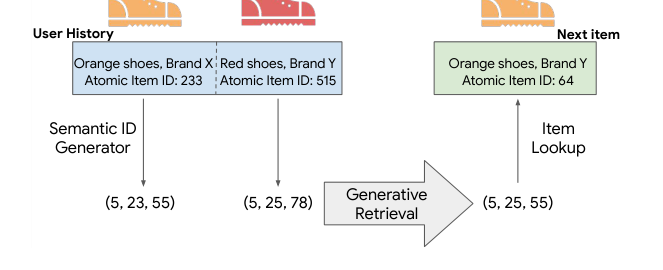
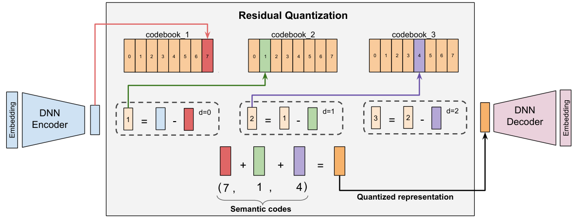
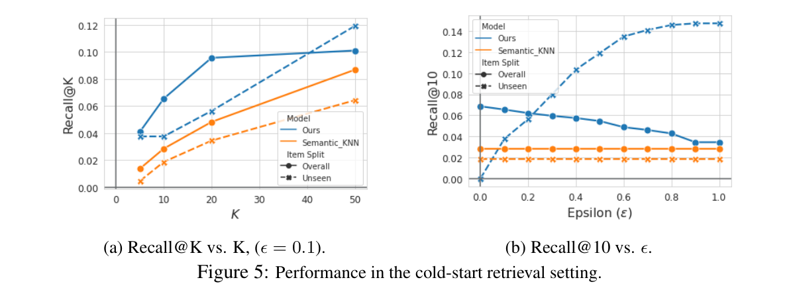

# TIGER 精读：用 Semantic ID 与生成式检索做序列推荐（NeurIPS 2023）

> 论文：Recommender Systems with Generative Retrieval（arXiv:2305.05065v3），Google 与 Google DeepMind，NeurIPS 2023。完整中文译稿见同目录 `../translation/paper.zh-CN.md`。

## 论文要解决的问题

现代推荐系统的检索阶段主流做法是双塔模型：用户历史和候选物品被编码进同一个向量空间，推理时拿用户向量去 ANN 索引里查最近邻。TIGER 的作者认为这条路有三个结构性问题：原子随机物品 ID 没有语义，相似物品之间无法共享知识；新物品没有 ID 嵌入，从上线到积累曝光之间检索不到（冷启动）；物品语料到十亿量级时，逐物品维护嵌入表的内存开销很大。

TIGER（Transformer Index for GEnerative Recommenders）给出的替代方案是：让检索模型自回归地"生成"下一物品的标识符，Transformer 的参数本身充当索引，不再单独构建 ANN 索引。整套方法分两个阶段：先用 RQ-VAE 把每个物品的内容嵌入量化成一串码字，作为物品的 Semantic ID；再在 Semantic ID 序列上训练一个 T5 式的 encoder-decoder 模型，任务是预测用户下一个交互物品的 Semantic ID。

图 1 是整个框架的示意：用户历史里的物品先经过 Semantic ID Generator 转成语义编码元组，模型据此生成下一物品的 Semantic ID，再通过 Item Lookup 映射回具体物品。

*图 1：TIGER 框架总览。来源：论文 Figure 1，第 1 页。*

## Semantic ID 怎么生成：RQ-VAE

Semantic ID 的要求是：内容相似的物品，编码应当有重叠，比如 (10, 21, 35) 应该更接近 (10, 21, 40) 而不是 (10, 23, 32)。论文用残差量化变分自编码器（RQ-VAE）实现这一点。

具体做法：把物品的标题、价格、品牌、类目拼成一句话，过预训练 Sentence-T5 得到 768 维语义嵌入；RQ-VAE 编码器把它压到 32 维潜在表示，然后做三级残差量化——第一级码本里找最近向量，用残差查第二级，再用残差查第三级，每级码本大小 256。三级编码再加上一个消除碰撞用的第 4 位码，每个物品最终得到长度 4 的唯一 Semantic ID。图 2 展示了这个逐级逼近的过程：编码器输出先被第一级码本粗略表示，每级的残差再交给下一级修正，三个索引拼起来就是语义编码。

*图 2：RQ-VAE 的残差量化过程，示例中三级索引得到编码 (7, 1, 4)。来源：论文 Figure 3，第 4 页。*

训练细节上值得注意的有两点：一是用 k-means 质心初始化码本，防止码本坍塌（大多数输入挤到少数几个码字上）；二是训练 20k 个 epoch，把码本使用率做到 80% 以上。模型本身很小，encoder-decoder 各 4 层、约 1300 万参数；输入序列是用户 ID token（2000 个，哈希映射）加上历史物品的 Semantic ID token（词表共 1024 个物品语义 token）。

## 实验结果

数据集是 Amazon Review 的三个经典基准：Beauty、Sports and Outdoors、Toys and Games（1.1 万到 1.8 万物品）。评估用留一法，指标为 Recall@K 和 NDCG@K。

主结果（论文 Table 1，第 7 页）：TIGER 在三个数据集、全部 12 个指标上超过 GRU4Rec、Caser、HGN、SASRec、BERT4Rec、FDSA、S3-Rec 和 P5 全部基线，相对各自最优基线的提升从 +0.15%（Beauty Recall@10）到 +29.04%（Beauty NDCG@5）。提升幅度最大的是 Beauty：Recall@5 为 0.0454，比 S3-Rec 的 0.0387 高 17.3%；NDCG@5 为 0.0321，比 SASRec 高 29%。论文附了 3 个随机种子的标准误（0.0004-0.0013，Table 9），主结果的差距大于噪声。

收益归因是这篇论文做得比较扎实的地方（Table 2，第 8 页）。保持序列到序列架构不变，只换物品表示：随机编码的 Random ID 在 Beauty 上 Recall@5 只有 0.0296；换成随机超平面哈希的 LSH Semantic ID 升到 0.0379；再用 RQ-VAE 学出的 Semantic ID 达到 0.0454。这个梯度说明主要收益确实来自"语义化的物品表示"，其中非线性学习相对随机投影贡献约两成，语义信息相对随机编码贡献约五成。

Semantic ID 还有一个性质在论文的定性分析中得到验证（Figure 4，第 6 页）：第一级码字对应粗粒度类目，第二级在此基础上细分。例如 Beauty 数据集上 c1=3 的物品集中在 Hair 类，c1=1 集中在面部 Makeup 和 Skin。这个层级结构是后面两个新能力的基础。

## 两个新能力：冷启动与多样性

**冷启动**。因为 Semantic ID 由内容特征决定，新物品没有交互数据也能拿到编码。实验设计是从训练集中移除 5% 的测试物品来模拟新物品，检索时用超参数 ε 控制候选中未见物品的最大占比。结果（Figure 5，第 8 页）显示 ε=0.1 时 TIGER 的 Recall 在所有 K 上都高于用语义嵌入做 kNN 的 Semantic_KNN 基线，ε≥0.1 的设置下也全部占优。

图 3 是冷启动实验的两张曲线，用来观察生成式检索在未见物品上的检索能力。左图中 ε=0.1 时 TIGER（Ours）在整体和未见物品两个口径的 Recall@K 都高于基线；右图显示 ε 从 0 增大到 0.6 左右时，TIGER 在未见物品上的 Recall@10 快速上升并远超基线，而基线是一条水平线。

*图 3：冷启动检索场景性能。(a) Recall@K 随 K 变化（ε=0.1）；(b) Recall@10 随 ε 变化。来源：论文 Figure 5，第 8 页。*

**多样性**。生成式解码可以在任意位置做温度采样，而且得益于 Semantic ID 的层级性，采样可以作用于不同粒度：采样第一级码字等于在粗类目层面探索，采样后两级是在类目内探索。解码温度从 1.0 升到 2.0，top-10 预测物品的真实类目熵从 0.76 升到 1.38（Table 3，第 9 页），定性例子（Table 4）中高温解码的 top-10 覆盖类目数明显增多。

## 无效 ID 与工程成本

自回归解码可能生成不指向任何物品的"无效 ID"。论文统计（§4.5，第 10 页；Figure 6，第 16 页）：ID 空间有 256⁴ 约 4 万亿个组合而物品只有 1-2 万，top-10 预测中无效比例仅 0.1%-1.6%（top-20 约 0.3%-6%），加大束搜索并过滤即可兜底。作者还提出用前缀匹配处理无效 token——由于层级性，前缀匹配相当于退化为"预测类目"，可能进一步提升指标，留作未来工作。

成本方面，论文在附录 E 里交代得比较坦率：推理时束搜索自回归解码比一次 ANN 点积查询更贵，本文没有优化推理效率；收益是嵌入表从 Nd（N 为物品数）缩小到 1024d（只存码字嵌入），两个 ID 映射查找表每张仅约 64N bit 且训练后冻结。消融还显示模型 3/4/5 层的指标差异很小（Table 5），加用户 ID 只带来约 1.8% 的 Recall@5 提升（Table 8）。

## 工程判断与证据边界

**证据的适用范围**。全部实验都在 Amazon 评论的三个小数据集上（1-2 万物品、用户历史截断到 20），没有线上 A/B 证据，也没有工业规模语料的结果。论文反复强调的"打破反馈循环、泛化到新物品"是合理的机制性主张，但支撑它的冷启动实验只在 Beauty 一个数据集上做过，基线只有 Semantic_KNN 一种，没有和"内容嵌入双塔零样本检索"这类更直接的对照比较。优势方向可信，幅度不宜直接外推。

**收益来源没有被完全隔离**。TIGER 的输入用了 Sentence-T5 内容嵌入，而所有序列推荐基线只用物品 ID。Table 2 的 Random ID 消融说明"同一架构下语义编码优于随机编码"，部分回应了这一疑问，但"内容特征本身带来多少收益、生成式范式额外带来多少"仍然是拆不开的。基线数字还取自 S3-Rec 论文公开的结果而非统一重跑，只有 P5 被作者重跑过——附录 D 值得一读：P5 原始预处理在数据切分前按出现顺序给物品编号，造成子词泄漏，修正后 P5 在 Beauty 上 Recall@5 从 0.0163 涨到 0.035。这个插曲说明这类基准上预处理细节的影响可以大到扭曲结论。

**落地前要回答的问题**。一是延迟：自回归解码的检索延迟预算能否接受，beam 宽度和解码深度的取舍需要压测；二是语义来源：没有内容特征或内容编码器的场景，需要先解决"拿什么生成 Semantic ID"的问题；三是规模：13M 参数模型加 20 个物品的历史长度，离真实检索场景的候选量和上下文长度都有距离，层级性在大语料下是否仍然成立，论文只给了一个三数据集合并后指标小幅下降的实验（Table 10）。

**值得借鉴的部分**。即便不整体迁移这套方案，RQ-VAE 生成层级化物品编码、用编码前缀做类目级探索、以及"检索索引变成模型参数"的思路，对排序特征、冷启动探索和向量检索索引设计都有直接参考价值。同期的 Singh 等人（arXiv:2306.08121）已经把 Semantic ID 用在 Google 的排序模型里替代物品 ID 并报告了泛化收益，可以对照阅读。
