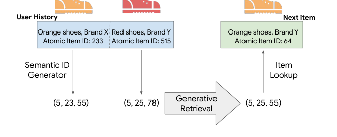
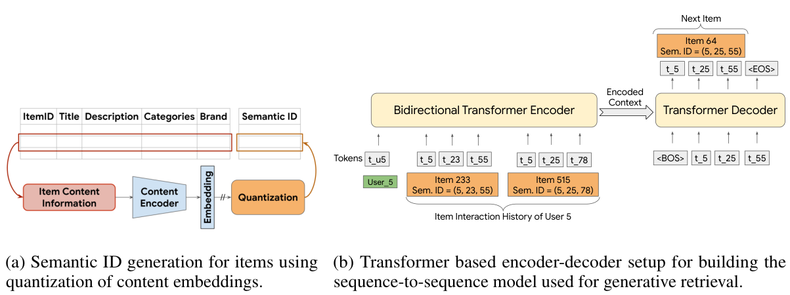
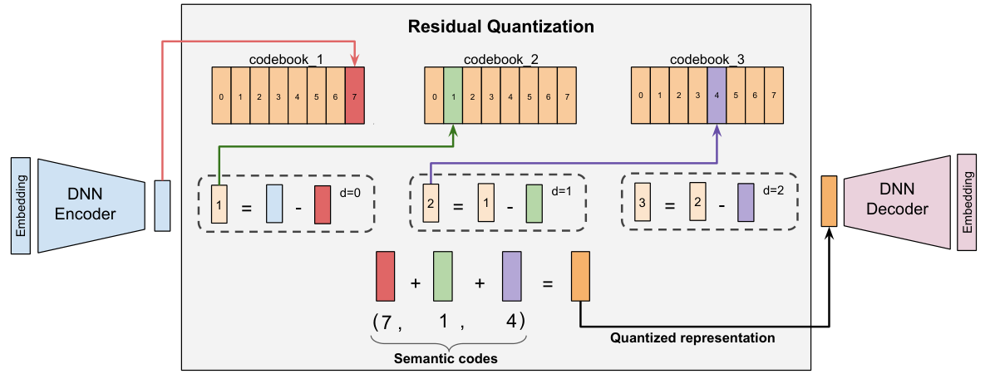
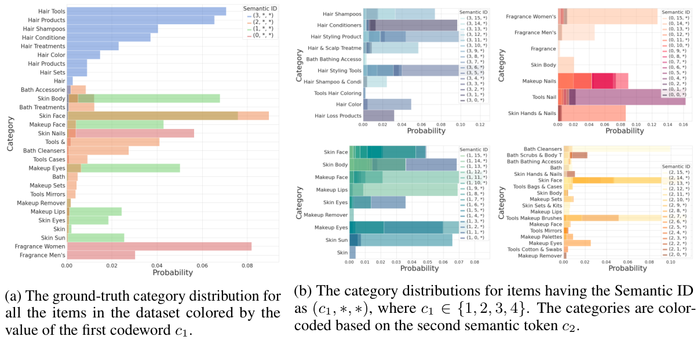
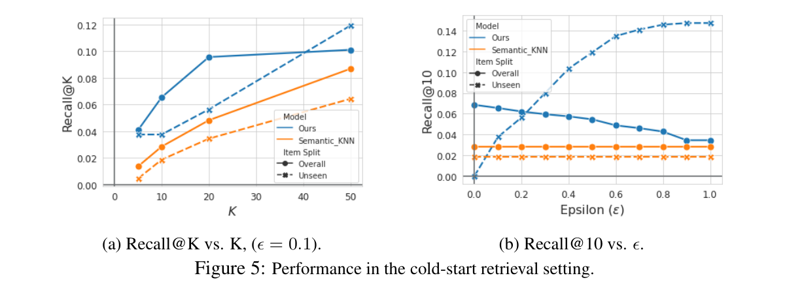
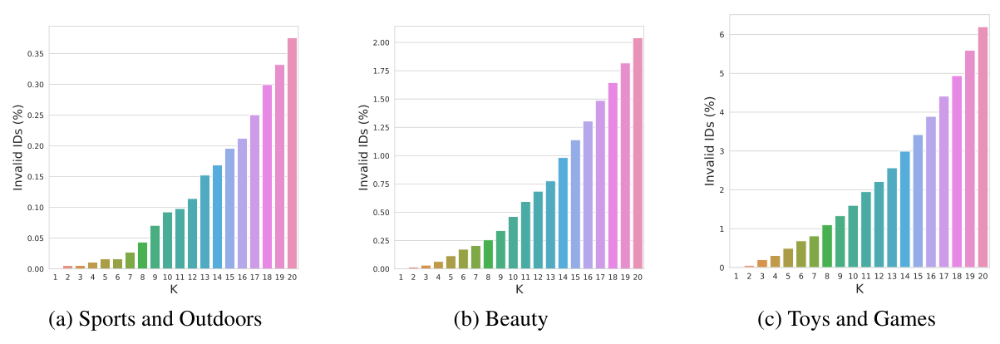

# 基于生成式检索的推荐系统

**作者**：Shashank Rajput⋆（University of Wisconsin-Madison）、Nikhil Mehta⋆（Google DeepMind）、Anima Singh（Google DeepMind）、Raghunandan Keshavan（Google）、Trung Vu（Google）、Lukasz Heldt（Google）、Lichan Hong（Google DeepMind）、Yi Tay（Google DeepMind）、Vinh Q. Tran（Google）、Jonah Samost（Google）、Maciej Kula（Google DeepMind）、Ed H. Chi（Google DeepMind）、Maheswaran Sathiamoorthy（Google DeepMind）

⋆共同一作。SR 的该项工作完成于其在 Google 任职期间。联系邮箱：rajput.shashank11@gmail.com, nikhilmehta@google.com, nlogn@google.com。

发表于：第 37 届神经信息处理系统大会（NeurIPS 2023）。arXiv:2305.05065v3 [cs.IR]，2023 年 11 月 3 日。

## 摘要

现代推荐系统通过将查询和候选物品嵌入到同一统一空间中来执行大规模检索，随后使用近似最近邻（ANN）搜索为给定查询嵌入选出头部候选。本文提出一种新颖的生成式检索方法：检索模型自回归地解码目标候选的标识符。为此，我们构建语义上有意义的码字元组，作为每个物品的 Semantic ID（语义 ID）。给定用户会话中各物品的 Semantic ID，训练一个基于 Transformer 的序列到序列模型来预测用户下一个将交互物品的 Semantic ID。我们证明，用该范式训练的推荐系统在多个数据集上显著优于当前 SOTA 模型。此外，我们证明将 Semantic ID 引入序列到序列模型能增强其泛化能力，这在无先验交互历史的物品上检索性能的提升中得到了印证。

## 1 引言

*图 1：Transformer Index for GEnerative Recommenders（TIGER）框架总览。在 TIGER 中，序列推荐被表述为生成式检索任务，每个物品表示为一组离散语义 token 组成的元组。原文 Figure 1，第 1 页。*

推荐系统帮助用户发现感兴趣的内容，广泛存在于视频 [4, 43, 9]、应用 [3]、商品 [6, 8] 和音乐 [18, 19] 等各类推荐场景。现代推荐系统采用"检索-排序"（retrieve-and-rank）策略：检索阶段选出一组可行候选，再由排序模型对候选排序。由于排序模型只作用于它接收到的候选，因此希望检索阶段输出高度相关的候选。

构建检索模型有标准且成熟的方法。矩阵分解 [19] 在同一空间中学习查询和候选嵌入。为更好地捕捉数据中的非线性，采用内积将查询与候选嵌入到同一空间的双塔（dual-encoder）架构 [39]（查询塔与候选塔各一）近年来颇为流行。推理时，先用候选塔为所有物品的嵌入建立索引；对给定查询，用查询塔得到其嵌入，再用近似最近邻（ANN）算法检索。近年来，双塔架构也被扩展到显式考虑用户-物品交互顺序的序列推荐 [11, 24, 41, 17, 32, 6, 44]。

我们为序列推荐提出一种新的生成式检索模型范式。不同于传统的查询-候选匹配方法，我们的方法使用端到端生成模型直接预测候选 ID。我们提出利用 Transformer [36] 的记忆（参数）作为推荐系统检索的端到端索引，这与 Tay 等人 [34] 使用 Transformer 记忆做文档检索的工作一脉相承。我们将该方法称为 Transformer Index for GEnerative Recommenders（TIGER）。TIGER 的概览见图 1。

TIGER 的独特之处在于一种新颖的物品语义表示，称为 "Semantic ID"——由每个物品的内容信息导出的 token 序列。具体而言，给定物品的文本特征，我们用预训练文本编码器（如 SentenceT5 [27]）生成稠密内容嵌入；再对物品嵌入施加量化方案，得到一组有序的 token/码字，即该物品的 Semantic ID。最终，用这些 Semantic ID 在序列推荐任务上训练 Transformer 模型。

将物品表示为语义 token 序列有诸多优势。在语义有意义的数据上训练 Transformer 记忆，可以让知识在相似物品间共享，从而摆脱以往推荐模型中作为物品特征使用的原子随机物品 ID [33, 42, 11, 8]。有了物品的语义 token 表示，模型更不容易受推荐系统固有的反馈循环 [1, 26, 39] 影响，能够泛化到新加入语料库的物品。此外，用 token 序列表示物品有助于缓解物品语料规模带来的挑战：token 序列可表示的物品数量是各位置 token 基数（cardinality）的乘积。物品语料规模可达数十亿量级，为每个物品学习唯一嵌入非常耗内存。虽然可以采用基于随机哈希的技术 [16] 缩减物品表示空间，但本工作表明，使用语义有意义的 token 表示物品是一种有吸引力的替代方案。本文主要贡献总结如下：

1. 我们提出 TIGER，一个新颖的基于生成式检索的推荐框架：为每个物品分配 Semantic ID，并训练检索模型预测给定用户可能交互物品的 Semantic ID。
2. 我们证明 TIGER 在多个数据集上按 Recall 和 NDCG 指标衡量优于现有 SOTA 推荐系统。
3. 我们发现这种生成式检索新范式为序列推荐系统带来两项额外能力：其一，能够推荐新物品和低频物品，从而改善冷启动推荐；其二，能够通过一个可调参数生成多样化的推荐。

**文章结构**。第 2 节简要综述推荐系统、生成式检索以及本文使用的 Semantic ID 生成技术。第 3 节解释我们提出的框架，并概述用于 Semantic ID 生成的多种技术。第 4 节给出实验结果，第 5 节总结全文。

## 2 相关工作

**序列推荐器**。在推荐系统中使用深度序列模型已形成丰富的文献。GRU4REC [11] 率先将基于 GRU 的 RNN 用于序列推荐。Li 等人 [24] 提出 Neural Attentive Session-based Recommendation（NARM），在 GRU 层之上用注意力机制跟踪用户长期意图。Zhang 等人提出的 AttRec [41] 用自注意力机制建模用户当前会话中的意图，并通过度量学习建模用户-物品亲和度来保证个性化。同期，Kang 等人提出 SASRec [17]，采用类似于 decoder-only Transformer 模型的自注意力。受语言任务中掩码语言建模成功的启发，BERT4Rec [32] 和 Transformers4Rec [6] 使用带掩码策略的 Transformer 模型完成序列推荐任务。S3-Rec [44] 在掩码之外进一步通过四个自监督任务的预训练来改进数据表示。上述模型都为每个物品学习一个高维嵌入，并在最大内积搜索（MIPS）空间中做 ANN 来预测下一物品。与之相对，我们提出的 TIGER 使用生成式检索直接预测下一物品的 Semantic ID。

P5 [8] 微调预训练大语言模型以统一多任务推荐。P5 依赖 LLM 分词器（SentencePiece 分词器 [29]）从随机分配的物品 ID 生成 token；而我们使用基于物品内容信息学到的 Semantic ID 表示。在实验（表 2）中，我们证明基于 Semantic ID 表示的推荐系统远好于使用随机编码的方案。

**Semantic ID**。Hou 等人提出 VQ-Rec [12]，用内容信息生成"编码"（ analogous to Semantic ID）。但他们的重点在构建可迁移的推荐系统，并未以生成方式使用这些编码做检索。虽然他们同样使用乘积量化（product quantization）[15] 生成编码，我们使用 RQ-VAE 生成 Semantic ID，从而得到物品的层级化表示（第 4.2 节）。与本文同期的工作中，Singh 等人 [31] 表明层级 Semantic ID 可以用来替代大规模推荐排序模型中的物品 ID，从而提升模型泛化。

**生成式检索**。学习式索引的技术早有提出 [20]，而生成式检索是文档检索领域近期发展出的方法，任务是从数据库中返回一组相关文档。代表性工作包括 GENRE [5]、DSI [34]、NCI [37] 和 CGR [22]。更详细的综述见附录 A。据我们所知，我们是首个在使用 Semantic ID 物品表示的推荐系统中提出生成式检索的工作。

## 3 提出的框架

我们的框架包含两个阶段：

1. **基于内容特征的 Semantic ID 生成**。将物品内容特征编码为嵌入向量，并将嵌入量化为语义码字元组。所得码字元组即物品的 Semantic ID。
2. **在 Semantic ID 上训练生成式推荐系统**。用 Semantic ID 序列在序列推荐任务上训练 Transformer 模型。

### 3.1 Semantic ID 生成

本节介绍推荐语料库中物品的 Semantic ID 生成过程。我们假设每个物品都有携带有效语义信息的内容特征（如标题、描述或图片），并且我们拥有一个预训练内容编码器，可以生成语义嵌入 $x \in \mathbb{R}^d$。例如，Sentence-T5 [27]、BERT [7] 等通用预训练文本编码器可以将物品的文本特征转换为语义嵌入。语义嵌入随后被量化以生成每个物品的 Semantic ID。图 2a 给出该过程的高层概览。

*图 2：TIGER 建模方法总览。(a) 通过内容嵌入量化生成物品 Semantic ID；(b) 用于构建生成式检索序列到序列模型的 Transformer 编码器-解码器。原文 Figure 2，第 3 页。*

我们将 Semantic ID 定义为长度为 $m$ 的码字元组。元组中的每个码字来自不同的码本。Semantic ID 能唯一表示的物品数量因此等于各码本大小的乘积。不同的 Semantic ID 生成技术会使 ID 具有不同的语义性质，但我们要求它们至少满足以下性质：**相似物品（内容特征相似、或语义嵌入接近的物品）的 Semantic ID 应当有重叠**。例如，Semantic ID 为 (10, 21, 35) 的物品应更接近 Semantic ID 为 (10, 21, 40) 的物品，而不是 Semantic ID 为 (10, 23, 32) 的物品。下面讨论我们用于 Semantic ID 生成的量化方案。

**用于 Semantic ID 的 RQ-VAE**。残差量化变分自编码器（Residual-Quantized Variational AutoEncoder，RQ-VAE）[40] 是一种多级向量量化器，通过对残差施加量化来生成码字元组（即 Semantic ID）。自编码器通过同时更新量化码本和 DNN 编码器-解码器参数进行联合训练。图 3 展示了通过残差量化生成 Semantic ID 的过程。

*图 3：RQ-VAE。图中 DNN 编码器输出的向量 $r_0$（蓝色柱）送入迭代工作的量化器：先在第一级码本中找到与 $r_0$ 最近的向量 $e_{c_0}$（红色柱），再计算残差 $r_1 := r_0 - e_{c_0}$ 送入第二级量化器，重复该过程：在第二级找到与 $r_1$ 最近的向量 $e_{c_1}$（绿色柱），再计算第二级残差 $r_2 = r_1 - e'_{c_1}$，然后对 $r_2$ 再重复第三次。语义编码即 $e_{c_0}, e_{c_1}, e_{c_2}$ 在各自码本中的索引，示例中得到编码 (7, 1, 4)。原文 Figure 3，第 4 页。*

RQ-VAE 先通过编码器 $E$ 编码输入 $x$，得到潜在表示 $z := E(x)$。在第 0 级（$d = 0$），初始残差直接定义为 $r_0 := z$。在每一级 $d$，我们有一个码本 $C_d := \{e_k\}_{k=1}^K$，其中 $K$ 为码本大小。$r_0$ 通过映射到该级码本中最近的嵌入来量化。$d = 0$ 时最近嵌入 $e_{c_0}$ 的索引，即 $c_0 = \arg\min_i \|r_0 - e_k\|$，就是第 0 个码字。对下一级 $d = 1$，残差定义为 $r_1 := r_0 - e_{c_0}$。与第 0 级类似，在第一级码本中找与 $r_1$ 最近的嵌入，得到第一级编码。该过程递归重复 $m$ 次，得到表示 Semantic ID 的 $m$ 个码字元组。这种递归方式以由粗到细的粒度逼近输入。注意，我们为 $m$ 个层级各使用一个大小为 $K$ 的独立码本，而不是单个大小为 $mK$ 的码本。原因在于残差的范数会随层级加深而减小，因此不同层级可以有不同的粒度。

得到 Semantic ID $(c_0, \ldots, c_{m-1})$ 后，$z$ 的量化表示计算为 $\hat{z} := \sum_{d=0}^{m-1} e_{c_i}$。$\hat{z}$ 随后送入解码器，解码器尝试用 $\hat{z}$ 重建输入 $x$。RQ-VAE 损失定义为 $\mathcal{L}(x) := \mathcal{L}_{\text{recon}} + \mathcal{L}_{\text{rqvae}}$，其中 $\mathcal{L}_{\text{recon}} := \|x - \hat{x}\|^2$，$\mathcal{L}_{\text{rqvae}} := \sum_{d=0}^{m-1} \|\text{sg}[r_i] - e_{c_i}\|^2 + \beta \|r_i - \text{sg}[e_{c_i}]\|^2$。这里 $\hat{x}$ 为解码器输出，sg 为 stop-gradient 操作 [35]。该损失联合训练编码器、解码器和码本。

如 [40] 所建议，为防止 RQ-VAE 出现码本坍塌（codebook collapse，即大多数输入只映射到少数码本向量），我们对码本采用基于 k-means 聚类的初始化：具体做法是在首个训练批次上运行 k-means 算法，用聚类质心作为初始化。

**其他量化替代方案**。生成 Semantic ID 的一个简单替代是局部敏感哈希（LSH）。我们在第 4.2 节做了消融实验，发现 RQ-VAE 确实优于 LSH。另一个选择是层级化 k-means 聚类 [34]，但它会丢失不同簇之间的语义关系 [37]。我们也尝试了 VQ-VAE，它在检索阶段生成候选方面与 RQ-VAE 表现相近，但丢失了 ID 的层级性质，而层级性质带来了第 4.3 节讨论的诸多新能力。

**碰撞处理**。取决于语义嵌入的分布、码本大小和码字长度的选择，可能出现语义碰撞（即多个物品映射到同一个 Semantic ID）。为消除碰撞，我们在有序语义编码的末尾追加一个额外 token 使其唯一。例如，若两个物品共享 Semantic ID (12, 24, 52)，我们追加额外 token 区分它们，表示为 (12, 24, 52, 0) 和 (12, 24, 52, 1)。我们维护一个将 Semantic ID 映射到对应物品的查找表来检测碰撞。注意，碰撞检测和修复只在 RQ-VAE 模型训练完成后执行一次。此外，Semantic ID 是整数元组，与高维嵌入相比，该查找表在存储上十分高效。

### 3.2 基于 Semantic ID 的生成式检索

我们按时间顺序对每个用户交互过的物品排序，构造物品序列。给定形如 $(\text{item}_1, \ldots, \text{item}_n)$ 的序列，推荐系统的任务是预测下一个物品 $\text{item}_{n+1}$。我们提出直接预测下一物品 Semantic ID 的生成式方法。形式化地，设 $(c_{i,0}, \ldots, c_{i,m-1})$ 为 $\text{item}_i$ 的长度为 $m$ 的 Semantic ID，我们将物品序列转换为序列 $(c_{1,0}, \ldots, c_{1,m-1}, c_{2,0}, \ldots, c_{2,m-1}, \ldots, c_{n,0}, \ldots, c_{n,m-1})$。序列到序列模型随后被训练来预测 $\text{item}_{n+1}$ 的 Semantic ID，即 $(c_{n+1,0}, \ldots, c_{n+1,m-1})$。由于框架的生成性质，解码器生成的 Semantic ID 有可能与推荐语料库中的任何物品都不匹配。不过，如附录（图 6）所示，这种情况发生的概率很低。我们在附录 E 中进一步讨论如何处理这类事件。

## 4 实验

**数据集**。我们在 Amazon Product Reviews 数据集 [10] 的三个公开真实基准上评估所提框架，该数据集包含 1996 年 5 月至 2014 年 7 月的用户评论和物品元数据。具体地，我们使用其中三个类目做序列推荐任务："Beauty"、"Sports and Outdoors" 和 "Toys and Games"。数据集统计与预处理见附录 C。

**评估指标**。我们使用 top-k Recall（Recall@K）和归一化折损累计增益（NDCG@K），$K = 5, 10$。

**RQ-VAE 实现细节**。如 3.1 节所述，RQ-VAE 用于量化物品的语义嵌入。我们使用预训练 Sentence-T5 [27] 模型获取数据集中每个物品的语义嵌入。具体地，我们用物品的标题、价格、品牌和类目等内容特征构造一句话，送入预训练 Sentence-T5 模型，得到 768 维的物品语义嵌入。

RQ-VAE 模型包含三个组件：将输入语义嵌入编码为潜在表示的 DNN 编码器、输出量化表示的残差量化器，以及将量化表示解码回语义输入嵌入空间的 DNN 解码器。编码器有三个中间层，大小分别为 512、256 和 128，激活函数为 ReLU，最终潜在表示维度为 32。量化该表示时做三级残差量化，每级维护一个基数为 256 的码本，码本中每个向量维度为 32。计算总损失时取 $\beta = 0.25$。RQ-VAE 训练 20k 个 epoch 以确保较高的码本使用率（≥80%）。使用 Adagrad 优化器，学习率 0.4，batch size 1024。训练完成后，用学到的编码器和量化组件为每个物品生成长度为 3 的 Semantic ID 元组。为避免多个物品映射到同一 Semantic ID，我们为共享相同前三个码字的物品添加唯一的第 4 个编码：即与元组 (7, 1, 4) 关联的两个物品分别被指定为 (7, 1, 4, 0) 和 (7, 1, 4, 1)（若无碰撞，第 4 个码字仍取 0）。这样，推荐语料库中每个物品都获得唯一的、长度为 4 的 Semantic ID。

**序列到序列模型实现细节**。我们使用开源的 T5X 框架 [28] 实现基于 Transformer 的编码器-解码器架构。为让模型处理序列推荐任务的输入，序列到序列模型的词表包含每个语义码字对应的 token。具体地，词表包含 1024（256 × 4）个表示语料库物品的 token。除物品语义码字外，我们还向词表加入用户专属 token。为控制词表规模，只加入 2000 个用户 ID token，并用哈希技巧（Hashing Trick）[38] 将原始用户 ID 映射到这 2000 个用户 ID token 之一。输入序列的构造为：用户 ID token 后接该用户物品交互历史对应的 Semantic ID token 序列。我们发现，在输入中加入用户 ID 能让模型个性化其检索到的物品。

我们使用 4 层 Transformer 编码器和 4 层解码器，每层 6 个自注意力头、每头维度 64。所有层使用 ReLU 激活函数。MLP 与输入维度分别设为 1024 和 128。Dropout 为 0.1。整个模型约 1300 万参数。"Beauty" 和 "Sports and Outdoors" 数据集训练 200k 步；"Toys and Games" 数据集因规模较小只训练 100k 步。Batch size 为 256。学习率先取 0.01 训练 10k 步，随后按 inverse square root 调度衰减。

### 4.1 序列推荐性能

本节将我们提出的生成式检索框架与以下序列推荐方法比较（方法简介见附录 B）：GRU4Rec [11]、Caser [33]、HGN [25]、SASRec [17]、BERT4Rec [32]、FDSA [42]、S3-Rec [44] 和 P5 [8]。值得注意的是，除 P5 外的所有基线都学习一个高维向量空间：用户的历史物品交互和候选物品被编码为高维表示，再用最大内积搜索（MIPS）检索用户可能交互的下一个候选物品。与之相对，我们新颖的生成式检索框架用序列到序列模型逐 token 直接预测物品的 Semantic ID。

表 1：序列推荐性能对比。最后一行是 TIGER 相对最优基线的提升百分比。加粗（下划线）表示最优（次优）指标。原文 Table 1，第 7 页。

| 方法 | Sports R@5 | Sports N@5 | Sports R@10 | Sports N@10 | Beauty R@5 | Beauty N@5 | Beauty R@10 | Beauty N@10 | Toys R@5 | Toys N@5 | Toys R@10 | Toys N@10 |
| --- | --- | --- | --- | --- | --- | --- | --- | --- | --- | --- | --- | --- |
| P5 [8] | 0.0061 | 0.0041 | 0.0095 | 0.0052 | 0.0163 | 0.0107 | 0.0254 | 0.0136 | 0.0070 | 0.0050 | 0.0121 | 0.0066 |
| Caser [33] | 0.0116 | 0.0072 | 0.0194 | 0.0097 | 0.0205 | 0.0131 | 0.0347 | 0.0176 | 0.0166 | 0.0107 | 0.0270 | 0.0141 |
| HGN [25] | 0.0189 | 0.0120 | 0.0313 | 0.0159 | 0.0325 | 0.0206 | 0.0512 | 0.0266 | 0.0321 | 0.0221 | 0.0497 | 0.0277 |
| GRU4Rec [11] | 0.0129 | 0.0086 | 0.0204 | 0.0110 | 0.0164 | 0.0099 | 0.0283 | 0.0137 | 0.0097 | 0.0059 | 0.0176 | 0.0084 |
| BERT4Rec [32] | 0.0115 | 0.0075 | 0.0191 | 0.0099 | 0.0203 | 0.0124 | 0.0347 | 0.0170 | 0.0116 | 0.0071 | 0.0203 | 0.0099 |
| FDSA [42] | 0.0182 | 0.0122 | 0.0288 | 0.0156 | 0.0267 | 0.0163 | 0.0407 | 0.0208 | 0.0228 | 0.0140 | 0.0381 | 0.0189 |
| SASRec [17] | 0.0233 | 0.0154 | 0.0350 | 0.0192 | **0.0387** | 0.0249 | **0.0605** | 0.0318 | <u>0.0463</u> | <u>0.0306</u> | <u>0.0675</u> | <u>0.0374</u> |
| S3-Rec [44] | <u>0.0251</u> | <u>0.0161</u> | <u>0.0385</u> | <u>0.0204</u> | <u>0.0387</u> | <u>0.0244</u> | <u>0.0647</u> | <u>0.0327</u> | 0.0443 | 0.0294 | **0.0700** | 0.0376 |
| TIGER【本文】 | **0.0264** | **0.0181** | **0.0400** | **0.0225** | **0.0454** | **0.0321** | **0.0648** | **0.0384** | **0.0521** | **0.0371** | **0.0712** | **0.0432** |
| 相对最优基线提升 | +5.22% | +12.55% | +3.90% | +10.29% | +17.31% | +29.04% | +0.15% | +17.43% | +12.53% | +21.24% | +1.71% | +14.97% |

*译注：原文表格中加粗/下划线的具体分布按原文文字描述还原（加粗为最优、下划线为次优）；上表中最优/次优标注由译者依据数值核对标注，数值与原文一致。*

**推荐性能**。我们在序列推荐任务上对 TIGER 做了大量分析，并与上述基线比较。除 P5 外，所有基线的结果取自 Zhou 等人 [44] 公开的结果³。对 P5，我们使用作者公开的源代码；为公平比较，我们将其数据预处理方式更新为与其他基线及我们的方法一致，相关改动细节见附录 D。

结果见表 1。TIGER 一致优于现有基线⁴，在考虑的三个基准上均有显著提升。尤其在 Beauty 基准上，TIGER 相对次优基线表现出明显优势：NDCG@5 相对 SASRec 提升最高达 29%，Recall@5 相对 S3-Rec 提升 17.3%。在 Toys and Games 数据集上，TIGER 的 NDCG@5 和 NDCG@10 分别高出 21% 和 15%。

> 3. https://github.com/aHuiWang/CIKM2020-S3Rec
> 4. 我们在表 9 中说明 TIGER 指标的标准误很小。

### 4.2 物品表示

本节分析 RQ-VAE Semantic ID 的若干重要特性。我们首先做定性分析观察 Semantic ID 的层级性质；接着用基于哈希的量化方法作对照，评估使用 RQ-VAE 这一设计选择的重要性；最后通过将 TIGER 与使用 Random ID 表示物品的序列到序列模型比较，做消融以研究 Semantic ID 的重要性。

**定性分析**。我们在图 4 中分析为 Amazon Beauty 数据集学到的 RQ-VAE Semantic ID。为便于说明，我们将 RQ-VAE 层级数设为 3，码本大小分别为 4、16 和 256：即对物品的 Semantic ID $(c_1, c_2, c_3)$，有 $0 \le c_1 \le 3$、$0 \le c_2 \le 15$、$0 \le c_3 \le 255$。图 4a 用 $c_1$ 标注每个物品的类目，以在数据集整体类目分布中可视化 $c_1$ 对应的类目。如图 4a 所示，$c_1$ 捕捉物品的高层类目。例如 $c_1 = 3$ 包含大部分 "Hair" 相关产品，$c_1 = 1$ 的多数物品是面部、唇部、眼部的 "Makeup" 和 "Skin" 产品。我们还通过固定 $c_1$ 并可视化 $c_2$ 所有可能取值下的类目分布（图 4b）展示了 RQ-VAE Semantic ID 的层级性。我们再次发现，第二个码字 $c_2$ 将 $c_1$ 捕捉到的高层语义进一步细分为更细粒度的类目。RQ-VAE Semantic ID 的层级性开启了广泛的新能力（见 4.3 节讨论）。与基于随机原子 ID 学习物品嵌入的现有推荐系统不同，TIGER 使用的 Semantic ID 让语义相似的物品拥有重叠的码字，使模型能够有效共享数据集中语义相似物品的知识。

*图 4：Amazon Beauty 数据集上 RQ-VAE Semantic ID $(c_1, c_2, c_3, c_4)$ 的定性研究。(a) 全部物品的真实类目分布，按第一个码字 $c_1$ 的取值着色；(b) Semantic ID 形如 $(c_1, *, *)$（$c_1 \in \{1,2,3,4\}$）的物品的类目分布，类目按第二个语义 token $c_2$ 着色。真实类目分布在各语义 token 上分散开来，且 RQ-VAE 语义 ID 形成物品层级：第一个语义 token $c_1$ 对应粗粒度类目，第二/三个语义 token $c_2/c_3$ 对应细粒度类目。原文 Figure 4，第 6 页。*

**哈希 vs. RQ-VAE Semantic ID**。我们通过将 RQ-VAE 与局部敏感哈希（LSH）[14, 13, 2] 的 Semantic ID 生成对比，研究 RQ-VAE 在框架中的重要性。LSH 是一种流行哈希技术，可以方便地适配到我们的场景。为生成 LSH Semantic ID，我们用 $h$ 个随机超平面 $w_1, \ldots, w_h$ 对嵌入向量 $x$ 做随机投影，计算如下二值向量：$(\mathbb{1}_{w_1^\top x > 0}, \ldots, \mathbb{1}_{w_h^\top x > 0})$。该向量转换为整数编码 $c_0 = \sum_{i=1}^{h} 2^{i-1} \mathbb{1}_{w_i^\top x > 0}$。用一组独立随机超平面重复该过程 $m$ 次，得到 $m$ 个码字 $(c_0, c_1, \ldots, c_{m-1})$，称为 LSH Semantic ID。

表 2 中，我们将 LSH Semantic ID 与我们提出的 RQ-VAE Semantic ID 比较。该实验中，LSH Semantic ID 使用 $h = 8$ 个随机超平面，并设 $m = 4$ 以保证与 RQ-VAE 可比的基数。超平面参数从标准正态分布随机采样，保证超平面球对称。结果表明 RQ-VAE 一致优于 LSH。这说明在相同内容语义嵌入下，经由非线性深度神经网络（DNN）架构学习的 Semantic ID 比随机投影产生更好的量化。

**Random ID vs. Semantic ID**。我们还比较了 Semantic ID 在生成式检索推荐系统中的重要性，将随机生成的 ID 与 Semantic ID 对比。Random ID 基线的生成方式是为每个物品分配 $m$ 个随机码字：物品长度为 $m$ 的 Random ID 就是 $(c_1, \ldots, c_m)$，其中 $c_i$ 从 $\{1, 2, \ldots, K\}$ 中均匀随机采样。Random ID 基线取 $m = 4$、$K = 255$，使基数与 RQ-VAE Semantic ID 相近。Random ID 与 RQ-VAE、LSH Semantic ID 的对比见表 2。Semantic ID 一致优于 Random ID 基线，凸显了利用基于内容的语义信息的重要性。

表 2：生成式检索中不同 ID 生成技术的消融。RQ-VAE Semantic ID（SID）显著优于哈希 SID 和 Random ID。原文 Table 2，第 8 页。

| 方法 | Sports R@5 | Sports N@5 | Sports R@10 | Sports N@10 | Beauty R@5 | Beauty N@5 | Beauty R@10 | Beauty N@10 | Toys R@5 | Toys N@5 | Toys R@10 | Toys N@10 |
| --- | --- | --- | --- | --- | --- | --- | --- | --- | --- | --- | --- | --- |
| Random ID | 0.007 | 0.005 | 0.0116 | 0.0063 | 0.0296 | 0.0205 | 0.0434 | 0.0250 | 0.0362 | 0.0270 | 0.0448 | 0.0298 |
| LSH SID | 0.0215 | 0.0146 | 0.0321 | 0.0180 | 0.0379 | 0.0259 | 0.0533 | 0.0309 | 0.0412 | 0.0299 | 0.0566 | 0.0349 |
| RQ-VAE SID | 0.0264 | 0.0181 | 0.0400 | 0.0225 | 0.0454 | 0.0321 | 0.0648 | 0.0384 | 0.0521 | 0.0371 | 0.0712 | 0.0432 |

### 4.3 新能力

我们描述两项由生成式检索框架直接带来的新能力：冷启动推荐和推荐多样性。称其为"新"，是因为现有序列推荐模型（见 4.1 节基线）无法直接满足这些真实世界用例。这些能力来自 RQ-VAE Semantic ID 与我们框架生成式检索方法的协同。

**冷启动推荐**。本节研究框架的冷启动推荐能力。由于真实推荐语料快速变化，新物品不断加入。新加入的物品在训练语料中缺少用户曝光，使用随机原子 ID 表示物品的现有推荐模型无法将新物品检索为候选。相反，TIGER 框架在预测下一物品时利用物品语义，可以轻松完成冷启动推荐。

在该分析中，我们使用 Amazon Reviews 的 Beauty 数据集。为模拟新加入物品，我们从训练数据切分中移除 5% 的测试物品，称这些被移除的物品为 unseen items（未见物品）。将物品从训练切分中移除保证了对未见物品没有数据泄漏。与之前一样，我们用长度为 4 的 Semantic ID 表示物品：前 3 个 token 由 RQ-VAE 生成，第 4 个 token 保证所有已见物品的 ID 唯一。我们在训练切分上训练 RQ-VAE 量化器和序列到序列模型。训练完成后，用 RQ-VAE 模型为数据集中所有物品（包括语料库中的未见物品）生成 Semantic ID。

给定模型预测的 Semantic ID $(c_1, c_2, c_3, c_4)$，我们检索具有相同对应 ID 的已见物品。注意，按定义，模型预测的每个 Semantic ID 在训练数据集中最多匹配一个物品。此外，前三个语义 token（即 $(c_1, c_2, c_3)$）与预测相同的未见物品也会加入检索候选列表。最后，在检索 top-K 候选集合时，我们引入超参数 $\epsilon$，指定框架选择的未见物品的最大比例。

我们在图 5 中将 TIGER 与 k 近邻（KNN）方法在冷启动推荐场景下比较。对 KNN，我们在语义表示空间中做最近邻搜索，称为 Semantic_KNN 基线。图 5a 显示，$\epsilon = 0.1$ 时我们的框架在所有 Recall@K 指标上一致优于 Semantic_KNN。图 5b 给出不同 $\epsilon$ 取值下两者 Recall@10 的对比。所有 $\epsilon \ge 0.1$ 的设置下，我们的方法都优于基线。

*图 5：冷启动检索场景的性能。(a) Recall@K 随 K 的变化（$\epsilon = 0.1$）；(b) Recall@10 随 $\epsilon$ 的变化。对比方法为 Semantic_KNN 基线，指标分为 Overall（整体）与 Unseen（未见物品）两类。原文 Figure 5，第 8 页。*

**推荐多样性**。Recall 和 NDCG 是评估推荐系统的主要指标，而预测的多样性是另一个关键目标。多样性差的推荐系统可能损害用户的长期参与。这里我们讨论如何用生成式检索框架预测多样的物品。我们证明解码阶段的温度采样（temperature-based sampling）可以有效控制模型预测的多样性。温度采样可以施加于任何现有推荐模型，而 TIGER 得益于 RQ-VAE Semantic ID 的性质，可以在层级的不同层级上采样。例如，对 Semantic ID 的第一个 token 采样可以检索粗粒度类目的物品，对第二/三个 token 采样可以在类目内采样物品。

表 3：模型预测类目分布的熵（Beauty 数据集）。熵越高代表模型预测的物品越多样。原文 Table 3，第 9 页。

| Temperature | Entropy@10 | Entropy@20 | Entropy@50 |
| --- | --- | --- | --- |
| T = 1.0 | 0.76 | 1.14 | 1.70 |
| T = 1.5 | 1.14 | 1.52 | 2.06 |
| T = 2.0 | 1.38 | 1.76 | 2.28 |

我们用 Entropy@K 指标定量衡量预测多样性：对模型预测的 top-K 物品的真实类目分布计算熵。不同温度取值下的 Entropy@K 见表 3。解码阶段的温度采样可以有效提升物品真实类目的多样性。我们还在表 4 中做了定性分析。

表 4：温度解码下的推荐多样性。原文 Table 4，第 9 页。

| 目标类目 | top-10 预测物品最常见的类目：T = 1.0 | top-10 预测物品最常见的类目：T = 2.0 |
| --- | --- | --- |
| Hair Styling Products | Hair Styling Products | Hair Styling Products, Hair Styling Tools, Skin Face, Tools Nail, Tools Nail, Makeup Nails |
| Makeup Nails | Makeup Nails | Makeup Nails, Skin Hands & Nails, Tools Nail |
| Skin Eyes | Skin Eyes | Hair Relaxers, Skin Face, Hair Styling Products, Skin Eyes, Makeup Face |
| Makeup Face | Tools Makeup Brushes, Makeup Face | Tools Makeup Brushes, Makeup Face, Skin Face, Makeup Sets, Hair Styling Tools |
| Hair Loss Products | Hair Loss Products, Skin Face, Skin Body | Skin Face, Hair Loss Products, Hair Shampoos, Hair & Scalp Treatments, Hair Conditioners |

### 4.4 消融研究

表 5 测量了序列到序列模型层数变化的影响。网络越大指标略有提升。我们还测量了提供用户信息的影响，结果见附录表 8。

表 5：不同层数下的 Recall 与 NDCG 指标。原文 Table 5，第 10 页。

| 层数 | Recall@5 | NDCG@5 | Recall@10 | NDCG@10 |
| --- | --- | --- | --- | --- |
| 3 | 0.04499 | 0.03062 | 0.06699 | 0.03768 |
| 4 | 0.0454 | 0.0321 | 0.0648 | 0.0384 |
| 5 | 0.04633 | 0.03206 | 0.06596 | 0.03834 |

### 4.5 无效 ID

由于模型自回归地解码目标 Semantic ID 的码字，模型可能预测出无效 ID（即不映射到推荐数据集中任何物品的 ID）。实验中我们使用长度为 4、每个码字基数为 256 的 Semantic ID（即每级码本大小为 256）。该组合可能的 ID 数为 $256^4$，约 4 万亿。而所考虑数据集的物品数为 1 万至 2 万（见表 6）。尽管有效 ID 只占全部 ID 空间的一小部分，我们观察到模型几乎总是预测有效 ID。我们在图 6 中可视化了 TIGER 产生的无效 ID 比例随检索物品数 K 的变化。对 top-10 预测，三个数据集上无效 ID 比例约为 0.1%–1.6%。为对抗无效 ID 的影响并始终得到 top-10 有效 ID，可以增大束搜索（beam size）并过滤无效 ID。

值得注意的是，尽管会产生无效 ID，TIGER 与其他常用序列推荐方法相比仍取得 SOTA 性能。处理无效 token 的一个可能的扩展是在模型生成无效 token 时做前缀匹配。对 Semantic ID 做前缀匹配可以检索与模型生成 token 语义相近的物品。鉴于 RQ-VAE token 的层级性，前缀匹配可理解为模型预测物品类目而非物品索引。这样的扩展可能进一步提升 Recall/NDCG 指标。我们将其留作未来工作。

*图 6：使用束搜索生成 Semantic ID 时，不同 K 下的无效 ID 百分比。检索 top-20 物品时约 0.3%–6% 的 ID 无效。原文 Figure 6，第 16 页。*

## 5 结论

本文提出一种名为 TIGER 的新范式，用生成式模型在推荐系统中检索候选。支撑该方法的是一种新颖的物品 Semantic ID 表示：对内容嵌入使用层级量化器（RQ-VAE）生成构成 Semantic ID 的 token。我们的框架得到一个无需建立索引即可训练和服务的模型——Transformer 记忆充当物品的语义索引。我们注意到，嵌入表的基数不随物品空间基数线性增长，这相对于需要在训练时创建大嵌入表或为每个物品建立索引的系统对我们有利。通过在三个数据集上的实验，我们证明模型能取得 SOTA 检索性能，同时泛化到新的、未见过的物品。

## 参考文献

> 译注：参考文献按原文保留，标题不翻译。

[1] Himan Abdollahpouri, Masoud Mansoury, Robin Burke, and Bamshad Mobasher. The unfairness of popularity bias in recommendation. arXiv preprint arXiv:1907.13286, 2019.
[2] Moses S Charikar. Similarity estimation techniques from rounding algorithms. In Proceedings of the thirty-fourth annual ACM symposium on Theory of computing, pages 380–388, 2002.
[3] Heng-Tze Cheng, Levent Koc, Jeremiah Harmsen, Tal Shaked, Tushar Chandra, Hrishi Aradhye, Glen Anderson, Greg Corrado, Wei Chai, Mustafa Ispir, et al. Wide & deep learning for recommender systems. In Proceedings of the 1st workshop on deep learning for recommender systems, pages 7–10, 2016.
[4] Paul Covington, Jay Adams, and Emre Sargin. Deep neural networks for youtube recommendations. In Proceedings of the 10th ACM conference on recommender systems, pages 191–198, 2016.
[5] Nicola De Cao, Gautier Izacard, Sebastian Riedel, and Fabio Petroni. Autoregressive entity retrieval. arXiv preprint arXiv:2010.00904, 2020.
[6] Gabriel de Souza Pereira Moreira, Sara Rabhi, Jeong Min Lee, Ronay Ak, and Even Oldridge. Transformers4rec: Bridging the gap between nlp and sequential/session-based recommendation. In Fifteenth ACM Conference on Recommender Systems, pages 143–153, 2021.
[7] Jacob Devlin, Ming-Wei Chang, Kenton Lee, and Kristina Toutanova. Bert: Pre-training of deep bidirectional transformers for language understanding. arXiv preprint arXiv:1810.04805, 2018.
[8] Shijie Geng, Shuchang Liu, Zuohui Fu, Yingqiang Ge, and Yongfeng Zhang. Recommendation as language processing (rlp): A unified pretrain, personalized prompt & predict paradigm (p5). arXiv preprint arXiv:2203.13366, 2022.
[9] Carlos A Gomez-Uribe and Neil Hunt. The netflix recommender system: Algorithms, business value, and innovation. ACM Transactions on Management Information Systems (TMIS), 6(4):1–19, 2015.
[10] Ruining He and Julian McAuley. Ups and downs: Modeling the visual evolution of fashion trends with one-class collaborative filtering. In proceedings of the 25th international conference on world wide web, pages 507–517, 2016.
[11] Balázs Hidasi, Alexandros Karatzoglou, Linas Baltrunas, and Domonkos Tikk. Session-based recommendations with recurrent neural networks. arXiv preprint arXiv:1511.06939, 2015.
[12] Yupeng Hou, Zhankui He, Julian McAuley, and Wayne Xin Zhao. Learning vector-quantized item representation for transferable sequential recommenders. arXiv preprint arXiv:2210.12316, 2022.
[13] Piotr Indyk and Rajeev Motwani. Approximate nearest neighbors: towards removing the curse of dimensionality. In Proceedings of the thirtieth annual ACM symposium on Theory of computing, pages 604–613, 1998.
[14] Piotr Indyk, Rajeev Motwani, Prabhakar Raghavan, and Santosh Vempala. Locality-preserving hashing in multidimensional spaces. In Proceedings of the twenty-ninth annual ACM symposium on Theory of computing, pages 618–625, 1997.
[15] Herve Jegou, Matthijs Douze, and Cordia Schmid. Product quantization for nearest neighbor search. IEEE transactions on pattern analysis and machine intelligence, 33(1):117–128, 2010.
[16] Wang-Cheng Kang, Derek Zhiyuan Cheng, Tiansheng Yao, Xinyang Yi, Ting Chen, Lichan Hong, and Ed H Chi. Learning to embed categorical features without embedding tables for recommendation. arXiv preprint arXiv:2010.10784, 2020.
[17] Wang-Cheng Kang and Julian McAuley. Self-attentive sequential recommendation. In 2018 IEEE international conference on data mining (ICDM), pages 197–206. IEEE, 2018.
[18] Dongmoon Kim, Kun-su Kim, Kyo-Hyun Park, Jee-Hyong Lee, and Keon Myung Lee. A music recommendation system with a dynamic k-means clustering algorithm. In Sixth international conference on machine learning and applications (ICMLA 2007), pages 399–403. IEEE, 2007.
[19] Yehuda Koren, Robert Bell, and Chris Volinsky. Matrix factorization techniques for recommender systems. Computer, 42(8):30–37, 2009.
[20] Tim Kraska, Alex Beutel, Ed H Chi, Jeffrey Dean, and Neoklis Polyzotis. The case for learned index structures. In Proceedings of the 2018 international conference on management of data, pages 489–504, 2018.
[21] Doyup Lee, Chiheon Kim, Saehoon Kim, Minsu Cho, and Wook-Shin Han. Autoregressive image generation using residual quantization. In Proceedings of the IEEE/CVF Conference on Computer Vision and Pattern Recognition, pages 11523–11532, 2022.
[22] Hyunji Lee, Jaeyoung Kim, Hoyeon Chang, Hanseok Oh, Sohee Yang, Vlad Karpukhin, Yi Lu, and Minjoon Seo. Contextualized generative retrieval. arXiv preprint arXiv:2210.02068, 2022.
[23] Hyunji Lee, Sohee Yang, Hanseok Oh, and Minjoon Seo. Generative retrieval for long sequences. arXiv preprint arXiv:2204.13596, 2022.
[24] Jing Li, Pengjie Ren, Zhumin Chen, Zhaochun Ren, Tao Lian, and Jun Ma. Neural attentive session-based recommendation. In Proceedings of the 2017 ACM on Conference on Information & Knowledge Management, pages 1419–1428, 2017.
[25] Chen Ma, Peng Kang, and Xue Liu. Hierarchical gating networks for sequential recommendation. In Proceedings of the 25th ACM SIGKDD international conference on knowledge discovery & data mining, pages 825–833, 2019.
[26] Masoud Mansoury, Himan Abdollahpouri, Mykola Pechenizkiy, Bamshad Mobasher, and Robin Burke. Feedback loop and bias amplification in recommender systems, 2020.
[27] Jianmo Ni, Gustavo Hernandez Abrego, Noah Constant, Ji Ma, Keith Hall, Daniel Cer, and Yinfei Yang. Sentence-t5: Scalable sentence encoders from pre-trained text-to-text models. In Findings of the Association for Computational Linguistics: ACL 2022, pages 1864–1874, Dublin, Ireland, May 2022. Association for Computational Linguistics.
[28] Adam Roberts, Hyung Won Chung, Anselm Levskaya, Gaurav Mishra, James Bradbury, Daniel Andor, Sharan Narang, Brian Lester, Colin Gaffney, Afroz Mohiuddin, Curtis Hawthorne, Aitor Lewkowycz, Alex Salcianu, Marc van Zee, Jacob Austin, Sebastian Goodman, Livio Baldini Soares, Haitang Hu, Sasha Tsvyashchenko, Aakanksha Chowdhery, Jasmijn Bastings, Jannis Bulian, Xavier Garcia, Jianmo Ni, Andrew Chen, Kathleen Kenealy, Jonathan H. Clark, Stephan Lee, Dan Garrette, James Lee-Thorp, Colin Raffel, Noam Shazeer, Marvin Ritter, Maarten Bosma, Alexandre Passos, Jeremy Maitin-Shepard, Noah Fiedel, Mark Omernick, Brennan Saeta, Ryan Sepassi, Alexander Spiridonov, Joshua Newlan, and Andrea Gesmundo. Scaling up models and data with t5x and seqio. arXiv preprint arXiv:2203.17189, 2022.
[29] Rico Sennrich, Barry Haddow, and Alexandra Birch. Neural machine translation of rare words with subword units. arXiv preprint arXiv:1508.07909, 2015.
[30] Rico Sennrich, Barry Haddow, and Alexandra Birch. Neural machine translation of rare words with subword units. In Proceedings of the 54th Annual Meeting of the Association for Computational Linguistics (Volume 1: Long Papers), pages 1715–1725, Berlin, Germany, August 2016. Association for Computational Linguistics.
[31] Anima Singh, Trung Vu, Raghunandan Keshavan, Nikhil Mehta, Xinyang Yi, Lichan Hong, Lukasz Heldt, Li Wei, Ed Chi, and Maheswaran Sathiamoorthy. Better generalization with semantic ids: A case study in ranking for recommendations. arXiv preprint arXiv:2306.08121, 2023.
[32] Fei Sun, Jun Liu, Jian Wu, Changhua Pei, Xiao Lin, Wenwu Ou, and Peng Jiang. Bert4rec: Sequential recommendation with bidirectional encoder representations from transformer. In Proceedings of the 28th ACM international conference on information and knowledge management, pages 1441–1450, 2019.
[33] Jiaxi Tang and Ke Wang. Personalized top-n sequential recommendation via convolutional sequence embedding. In Proceedings of the eleventh ACM international conference on web search and data mining, pages 565–573, 2018.
[34] Yi Tay, Vinh Q Tran, Mostafa Dehghani, Jianmo Ni, Dara Bahri, Harsh Mehta, Zhen Qin, Kai Hui, Zhe Zhao, Jai Gupta, et al. Transformer memory as a differentiable search index. arXiv preprint arXiv:2202.06991, 2022.
[35] Aaron Van Den Oord, Oriol Vinyals, et al. Neural discrete representation learning. Advances in neural information processing systems, 30, 2017.
[36] Ashish Vaswani, Noam Shazeer, Niki Parmar, Jakob Uszkoreit, Llion Jones, Aidan N Gomez, Łukasz Kaiser, and Illia Polosukhin. Attention is all you need. Advances in neural information processing systems, 30, 2017.
[37] Yujing Wang, Yingyan Hou, Haonan Wang, Ziming Miao, Shibin Wu, Hao Sun, Qi Chen, Yuqing Xia, Chengmin Chi, Guoshuai Zhao, et al. A neural corpus indexer for document retrieval. arXiv preprint arXiv:2206.02743, 2022.
[38] Kilian Weinberger, Anirban Dasgupta, John Langford, Alex Smola, and Josh Attenberg. Feature hashing for large scale multitask learning. In Proceedings of the 26th annual international conference on machine learning, pages 1113–1120, 2009.
[39] Xinyang Yi, Ji Yang, Lichan Hong, Derek Zhiyuan Cheng, Lukasz Heldt, Aditee Kumthekar, Zhe Zhao, Li Wei, and Ed Chi. Sampling-bias-corrected neural modeling for large corpus item recommendations. In Proceedings of the 13th ACM Conference on Recommender Systems, pages 269–277, 2019.
[40] Neil Zeghidour, Alejandro Luebs, Ahmed Omran, Jan Skoglund, and Marco Tagliasacchi. Soundstream: An end-to-end neural audio codec. CoRR, abs/2107.03312, 2021.
[41] Shuai Zhang, Yi Tay, Lina Yao, and Aixin Sun. Next item recommendation with self-attention. arXiv preprint arXiv:1808.06414, 2018.
[42] Tingting Zhang, Pengpeng Zhao, Yanchi Liu, Victor S Sheng, Jiajie Xu, Deqing Wang, Guanfeng Liu, and Xiaofang Zhou. Feature-level deeper self-attention network for sequential recommendation. In IJCAI, pages 4320–4326, 2019.
[43] Zhe Zhao, Lichan Hong, Li Wei, Jilin Chen, Aniruddh Nath, Shawn Andrews, Aditee Kumthekar, Maheswaran Sathiamoorthy, Xinyang Yi, and Ed Chi. Recommending what video to watch next: a multitask ranking system. In Proceedings of the 13th ACM Conference on Recommender Systems, pages 43–51, 2019.
[44] Kun Zhou, Hui Wang, Wayne Xin Zhao, Yutao Zhu, Sirui Wang, Fuzheng Zhang, Zhongyuan Wang, and Ji-Rong Wen. S3-rec: Self-supervised learning for sequential recommendation with mutual information maximization. In Proceedings of the 29th ACM International Conference on Information & Knowledge Management, pages 1893–1902, 2020.

## 附录 A：相关工作（续）

**生成式检索**。文档检索的传统做法是训练双塔模型，将查询和文档映射到同一高维向量空间，再对查询在全部文档上执行 ANN 或 MIPS 返回最接近的文档。该技术存在一些缺点，例如嵌入表过大 [22, 23]。生成式检索是近期提出的技术，旨在逐 token 生成文档的标题、名称或文档 ID 字符串，以修复传统方法的部分问题。Cao 等人 [5] 为实体检索提出 GENRE，用基于 Transformer 的架构逐 token 返回查询所引用实体的名称。Tay 等人 [34] 为文档检索提出 DSI，是首个为每个文档分配结构化语义 DocID 的系统：给定查询，模型自回归地逐 token 返回文档的 DocID。DSI 工作标志着信息检索向生成式检索范式的转变，是端到端 Transformer 在检索应用中首次成功的应用。随后，Lee 等人 [23] 表明生成式文档检索在多跳（multi-hop）场景下同样有效：复杂查询无法由单个文档直接回答，模型以思维链（chain-of-thought）方式生成中间查询，最终生成复杂查询的输出。Wang 等人 [37] 在 Tay 等人 [34] 基于层级 k-means 聚类的语义 DocID 之上，提出专门考虑语义 DocID 前缀的新解码器架构。CGR [22] 提出一种同时利用双塔技术与生成式检索技术的方法：其编码器-解码器模型中的解码器学习独立的上下文化嵌入，内在地存储文档信息。据我们所知，我们是首个将自编码器（RQ-VAE [40, 21]）生成的语义 ID 用于检索模型的生成式方案。

**向量量化**。我们将向量量化定义为将高维向量转换为低维码字元组的过程。最直接的技术之一是层级聚类，如 [34] 所用：某轮迭代产生的簇在下一轮被进一步划分为子簇。另一种流行的替代是向量量化变分自编码器（VQ-VAE），由 [35] 引入，用于将自然图像编码为编码序列。其做法是先让输入向量（或图像）经过降维编码器，将较小维度的向量划分并分别量化，得到编码序列（每个划分一个编码），再由解码器用这些编码重建原始向量（或图像）。

RQ-VAE [40, 21] 对 VQ-VAE 编码器的输出施加残差量化以获得更低的重建误差。我们在 3.1 小节更详细讨论了该技术。局部敏感哈希（LSH）[14, 13] 是常用于聚类和近似最近邻搜索的技术。本文用于聚类的特定版本是 SimHash [2]，它用随机超平面生成二值向量作为物品哈希。由于其计算复杂度低且可扩展 [13]，我们将其作为向量量化的基线技术。

## 附录 B：基线

以下是与我们比较 TIGER 的各基线的简要介绍：

- **GRU4Rec** [11]：首个基于 RNN 的方法，为序列推荐任务使用定制的 GRU。
- **Caser** [33]：用 CNN 架构，通过水平和垂直卷积操作捕捉高阶马尔可夫链做序列推荐。
- **HGN** [25]：Hierarchical Gating Network 通过新的门控架构捕捉用户长期与短期兴趣。
- **SASRec** [17]：Self-Attentive Sequential Recommendation 使用带因果掩码的 Transformer 建模用户序列交互。
- **BERT4Rec** [32]：BERT4Rec 使用双向自注意力 Transformer 做推荐，解决单向架构的局限。
- **FDSA** [42]：Feature-level Deeper Self-Attention Network 在 Transformer 输入序列中引入物品特征（除物品嵌入外）。
- **S3-Rec** [44]：Self-Supervised Learning for Sequential Recommendation 提出在自监督任务上预训练双向 Transformer 以改进序列推荐。
- **P5** [8]：P5 是近期方法，用预训练大语言模型（LLM）统一不同推荐任务于单一模型。

## 附录 C：数据集统计

表 6：三个真实基准的数据集统计。原文 Table 6，第 15 页。

| 数据集 | # 用户 | # 物品 | 序列长度均值 | 序列长度中位数 |
| --- | --- | --- | --- | --- |
| Beauty | 22,363 | 12,101 | 8.87 | 6 |
| Sports and Outdoors | 35,598 | 18,357 | 8.32 | 6 |
| Toys and Games | 19,412 | 11,924 | 8.63 | 6 |

我们使用 Amazon Product Reviews 数据集 [10] 的三个公开基准，其包含 1996 年 5 月至 2014 年 7 月的用户评论与物品元数据。我们使用其中三个类目做序列推荐任务："Beauty"、"Sports and Outdoors" 和 "Toys and Games"。数据集统计见表 6。我们用用户的评论历史构造按时间戳排序的物品序列，并过滤评论数少于 5 的用户。遵循标准评估协议 [17, 8]，我们采用留一法（leave-one-out）评估：每个物品序列的最后一个物品用于测试，倒数第二个物品用于验证，其余用于训练。训练时我们将用户历史中的物品数限制为 20。

## 附录 D：对 P5 数据预处理的修改

表 7：使用标准预处理的 P5 [8] 结果。原文 Table 7，第 15 页。

| 方法 | Sports R@5 | Sports N@5 | Sports R@10 | Sports N@10 | Beauty R@5 | Beauty N@5 | Beauty R@10 | Beauty N@10 | Toys R@5 | Toys N@5 | Toys R@10 | Toys N@10 |
| --- | --- | --- | --- | --- | --- | --- | --- | --- | --- | --- | --- | --- |
| P5 | 0.0061 | 0.0041 | 0.0095 | 0.0052 | 0.0163 | 0.0107 | 0.0254 | 0.0136 | 0.0070 | 0.0050 | 0.0121 | 0.0066 |
| P5-ours | 0.0107 | 0.0076 | 0.01458 | 0.0088 | 0.035 | 0.025 | 0.048 | 0.0298 | 0.018 | 0.013 | 0.0235 | 0.015 |

P5 源代码⁵对 Amazon 数据集的预处理方式是：先为每个用户创建会话（按时间排序的该用户评论过的物品列表），然后将原始物品 ID 重映射为整数 1, 2, 3, …⁶。即第一个会话中的第一个物品获得 ID '1'，第二个未出现过的物品获得 ID '2'，依此类推。值得注意的是，该预处理在创建训练和测试切分之前执行。这导致构造出的序列数据集中许多序列形如 $a, a+1, a+2, \ldots$。由于 P5 使用 SentencePiece 分词器 [30]（见 [8] 第 4.1 节），用户会话中的测试物品与训练物品可能共享子词（sub-word），导致推理时的信息泄漏。

为解决泄漏问题，我们不再给物品分配递增整数 ID，而是分配随机整数 ID，然后再创建训练与评估切分。P5 其余代码与作者提供的源代码保持一致。该数据设置的结果在表 7 中报告为 'P5' 行。我们还从零实现了一个版本的 P5，只在其上训练序列推荐任务，结果见表 7 的 'P5-ours' 行。我们还在自己的 P5 实现中验证了：使用连续整数序列作为物品 ID 时，可以取得与 P5 原文报告相当或更好的指标。

> 5. https://github.com/jeykigung/P5
> 6. https://github.com/jeykigung/P5/blob/0aaa3fd8366bb6e708c8b70708291f2b0ae90c82/preprocess/data_preprocess_amazon.ipynb

表 8：向推荐系统提供用户信息的影响。原文 Table 8，第 16 页。

| 设置 | Recall@5 | NDCG@5 | Recall@10 | NDCG@10 |
| --- | --- | --- | --- | --- |
| 无用户信息 | 0.04458 | 0.0302 | 0.06479 | 0.0367 |
| 含用户 ID（正文报告值） | 0.0454 | 0.0321 | 0.0648 | 0.0384 |

表 9：不同数据集指标的均值与标准误（3 个不同随机种子的运行计算）。原文 Table 9，第 16 页。

| 数据集 | Recall@5 | NDCG@5 | Recall@10 | NDCG@10 |
| --- | --- | --- | --- | --- |
| Beauty | 0.0441 ± 0.00069 | 0.0309 ± 0.00062 | 0.0642 ± 0.00092 | 0.0374 ± 0.00061 |
| Sports and Outdoors | 0.0278 ± 0.00069 | 0.0189 ± 0.00043 | 0.0419 ± 0.0010 | 0.0234 ± 0.00048 |
| Toys and Games | 0.0518 ± 0.00064 | 0.0375 ± 0.00039 | 0.0698 ± 0.0013 | 0.0433 ± 0.00047 |

## 附录 E：讨论

**Semantic ID 长度与码本大小的影响**。我们尝试改变 Semantic ID 长度和码本大小，例如由 6 个码字组成 ID、每个码字来自大小为 64 的码本。我们发现 TIGER 的推荐指标对这些变化是鲁棒的。但要注意，输入序列长度会随 ID 变长（每个物品 ID 的码字更多）而增加，这会提高基于 Transformer 的序列到序列模型的计算开销。

**可扩展性**。为测试 Semantic ID 的可扩展性，我们做了如下实验：合并全部三个数据集，为三个数据集的全部物品生成 Semantic ID，再将这些 Semantic ID 用于 Beauty 数据集的推荐任务。我们将该实验结果与只在 Beauty 数据集上生成 Semantic ID 的原始实验比较，结果见表 10。性能仅有小幅下降。

表 10：通过在合并数据集上生成 Semantic ID 与只在 Beauty 数据集上生成 Semantic ID 测试可扩展性。原文 Table 10，第 17 页。

| 设置 | Recall@5 | NDCG@5 | Recall@10 | NDCG@10 |
| --- | --- | --- | --- | --- |
| Semantic ID【合并数据集】 | 0.04355 | 0.3047 | 0.06314 | 0.03676 |
| Semantic ID【Amazon Beauty】 | 0.0454 | 0.0321 | 0.0648 | 0.0384 |

> 译注：原文 Table 10 中"Semantic ID [Combined datasets]"行的 NDCG@5 数值为 0.3047，与其余三位小数的数值精度不一致，疑似原文排版误差（可能应为 0.03047）。译文保留原文数值。

**推理成本**。尽管我们的模型在序列推荐任务上取得了显著成功，但要注意，由于自回归解码使用束搜索，模型在推理时可能比基于 ANN 的模型计算开销更大。我们强调，优化 TIGER 的计算效率并非本工作的主要目标；相反，本工作开辟了一个新的研究方向：基于生成式检索的推荐系统。作为未来工作，我们将考虑让模型更小或探索提升推理效率的其他途径。

**查找表的内存成本**。TIGER 维护两个查找哈希表：Item ID 到 Semantic ID 的表，以及 Semantic ID 到 Item ID 的表。两张表都只生成一次然后冻结：它们在基于 RQ-VAE 的 Semantic ID 生成模型训练完成后生成，随后在序列到序列 Transformer 模型的训练期间保持冻结。每个 Semantic ID 由 4 个整数组成的元组构成，每个整数以 8 bit 存储，共每个物品 32 bit。每个物品由一个 32 bit 整数存储的 Item ID 表示。因此每张查找表的大小约为 64N bit，N 为数据集物品数。

**嵌入表的内存成本**。与传统推荐系统相比，TIGER 使用的嵌入表小得多。传统推荐系统为每个物品存储一个嵌入，而 TIGER 只为每个语义码字存储一个嵌入。实验中我们使用 4 个码字、每个基数 256 的 Semantic ID 表示，共 1024（256×4）个嵌入。传统推荐系统的嵌入数为 N（数据集物品数），我们的实验中 N 在 1 万至 2 万之间（取决于数据集）。因此 TIGER 嵌入表的内存开销为 $1024d$（$d$ 为嵌入维度），而传统推荐系统嵌入查找表的内存开销为 $Nd$。
