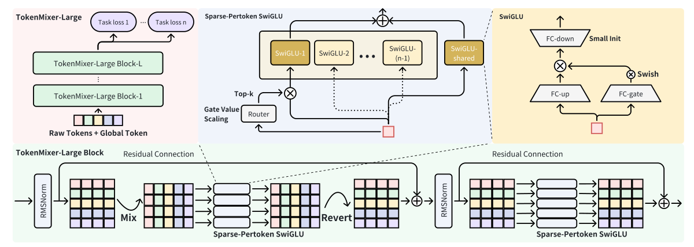
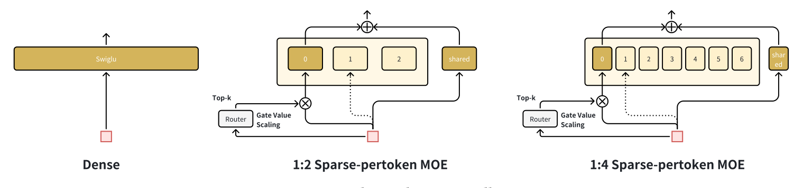
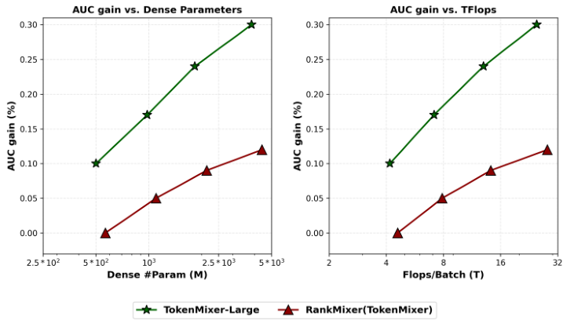

# TokenMixer-Large 详解：残差对齐、逐 token 稀疏专家与工业排序扩展

论文：[TokenMixer-Large: Scaling Up Large Ranking Models in Industrial Recommenders](https://arxiv.org/abs/2602.06563v2)，字节跳动，2026 年 2 月，v2。

本文配套 [完整中文译稿](../translation/paper.zh-CN.md)。以下先解释论文的方法和实验，最后集中讨论证据边界与工程取舍。图片来自用户提供的原始 PDF，本地稿待人工审核，公开转载前需确认许可。

## 1. 研究对象：工业排序的特征交互主干

工业排序模型接收用户、候选物品、上下文、交叉特征，以及行为序列提取结果，预测点击、转化、支付等目标。TokenMixer-Large 聚焦的是这些特征进入稠密表示后的交互网络。

它的输入可以概括为：

$$\text{稀疏特征/序列表示}\rightarrow\text{embedding与分组投影}\rightarrow X\in\mathbb R^{T\times D}.$$

输出是：

$$X^{(L)}\rightarrow\text{mean pooling}\rightarrow\text{多任务预测头}.$$

其中 $T$ 是输入 token 数，$D$ 是每个 token 的表示维度，省略 batch 维。DIN、SIM、LONGER 等模块的输出可以作为原始特征的一部分进入模型。（原文 §3.1–3.2，图 1；E01）

**因此，这是一篇大规模排序模型论文。** 它没有采用自回归方式生成物品 ID，也没有把 next-token prediction 作为推荐任务。它与生成式推荐共享模型扩展、MoE、硬件协同等技术议题，但方法对象仍是排序阶段的特征交互。

论文要解决的主要问题有三个：

1. TokenMixer 通过重排混合 token 后，残差相加的坐标语义发生变化，深层堆叠受到限制。
2. 更大的逐 token 网络需要降低训练与推理的激活成本。
3. 参数增加后，需要让算子、精度和分布式布局适应实际硬件。

## 2. 从 RankMixer 到 TokenMixer-Large：为何重排后还要还原

### 2.1 TokenMixer 如何不使用注意力完成交互

设输入有 $T$ 个 token，每个维度为 $D$。把每个 token 的通道切成 $H$ 份，每份宽度 $d=D/H$：

$$X:[T,D]\rightarrow[T,H,d].$$

再把相同 head 的通道块从所有原始 token 中取出，拼起来：

$$[T,H,d]\rightarrow[H,T,d]\rightarrow[H,Td].$$

原来的 $T$ 个 token，变成 $H$ 个混合 token。**每个混合 token 都拥有来自所有原始 token 的一部分通道。** 随后的 MLP 在这条拼接向量上计算，便可以建立跨原始 token 的交互。

以 $T=4,D=8,H=2$ 为例，每个原始 token 切成两块：

```text
x1 = [a1 | b1]
x2 = [a2 | b2]
x3 = [a3 | b3]
x4 = [a4 | b4]

Mix 后：
h1 = [a1 | a2 | a3 | a4]
h2 = [b1 | b2 | b3 | b4]
```

每个 $a_i,b_i$ 都是 4 维子向量。此时 $h_1,h_2$ 各为 16 维，因此形状从 `[4,8]` 变成 `[2,16]`。这个例子只是对论文 split/concat 规则的演示，不是论文实验配置。

Mix 本身没有学习参数；可学习交互来自后面的逐 token 网络。论文附录 A.5 比较纵向、对角和随机切分，结果基本一致；若只混合一半原始 token，AUC 下降 0.08%。这组结果强调每个混合 token 对原始 token 集合的覆盖。（原文式 9–11、表 11）

### 2.2 维度相同也可能没有语义对齐

在标准残差 $Y=X+F(X)$ 中，主分支和残差分支通常处在同一组位置坐标下。原版 TokenMixer 的 mixed token 位置代表“某个 head 汇总各 token 的通道”，原始位置则代表“某个语义组”。

当 $T\ne H$ 时，混合前后形状可能无法直接相加。即便刻意令 $T=H$，相同形状仍不意味着位置含义相同：原始的“用户组”token 与混合后的“第一组通道”token，不是同一个位置语义。

论文用三个指标描述这件事：

- **SR**：是否有标准残差连接。
- **OTR**：原始 token 语义对应的残差通路是否保留到后续层。
- **TSA**：残差相加时 token 位置语义是否对齐。

这里的“语义对齐”指分组位置与通道布局的对应关系，不要求变换后的向量含义完全不变。（原文 §4.3，表 3；E02）

### 2.3 Reverting 恢复坐标系

TokenMixer-Large 在混合并计算后，将布局还原为 `[T,D]`，再与原始输入做残差相加；随后再执行原始 token 坐标系内的逐 token 网络。

图 1 展示这两条残差分支，以及稀疏专家在其中的位置。



*图 1：TokenMixer-Large 总体结构。来源：原论文 Figure 1，第 3 页。*

图中第一条分支经过 RMSNorm、Mix、S-P MoE、Revert 后回到输入的 token 布局，第二条分支在该布局上进行 RMSNorm 和 S-P MoE。残差跨越完整分支，因此加法两端具有相同的位置对应关系。

根据图 1 的 Pre-Norm 设计，可以将主要数据流整理为以下**解释性示意**：

$$U=X+M^{-1}\!\left(F_{\mathrm{mixed}}(M(\operatorname{RMSNorm}(X)))\right),$$
$$Y=U+F_{\mathrm{original}}(\operatorname{RMSNorm}(U)).$$

这里 $M$ 是混合布局变换，$M^{-1}$ 是还原布局，$F$ 可以是逐 token SwiGLU 或其稀疏版本。这不是论文逐字给出的实现公式：原文式 (12)/(16) 仍写成 Post-Norm，第 3.3.3 节、图 1 和附录 A.4 则明确采用 Pre-Norm；上式用于解释图中结构。

Revert 只撤销布局重排，不会撤销中间 MLP 已经产生的跨特征计算。经过 $F_{\mathrm{mixed}}$ 后，属于某个原 token 的输出块，已经可以依赖其他 token 的输入块。因此还原后仍保留跨 token 交互。

## 3. 逐 token SwiGLU：保留异构特征的参数空间

### 3.1 语义分组与全局 token

不同稀疏特征的 embedding 维度可以不同。论文按语义分组，对每组使用独立 MLP，将组内 embedding 拼接后投影为统一 $D$ 维 token：

$$x_t=\operatorname{MLP}_t([e_{t,1};\ldots;e_{t,m}]).$$

此外，从所有语义组生成一个 global token，补充全局聚合信息。它是输入特征经过 MLP 得到的表示，不是一个与样本无关的固定可学习向量。global token 的独立消融损失为 0.02%。（原文 §3.2、表 5）

### 3.2 per-token 的含义是参数不共享

逐 token SwiGLU 为每个 token 配置独立参数：

$$\operatorname{SwiGLU}_t(x_t)=W_{\mathrm{down},t}\Big(\operatorname{Swish}(W_{\mathrm{gate},t}x_t)\odot W_{\mathrm{up},t}x_t\Big).$$

输入维度为 $D$、隐藏扩展比例为 $n$ 时，up/gate 都投影至 $nD$，down 再投影回 $D$。不同 token 使用不同的三组矩阵；最终设计还移除了 bias。

其动机来自推荐特征的异构性：用户画像、候选商品、上下文等语义组分布不同，独立参数允许分别学习。混合后的 head-token 同样有自身的参数组。

表 5 中两个消融分别隔离了不同因素：

| 修改 | ΔAUC |
|---|---:|
| 逐 token SwiGLU → 参数共享的 SwiGLU | −0.21% |
| 逐 token SwiGLU → 逐 token FFN | −0.10% |

前者考察参数隔离，后者考察门控 FFN 形式。论文在当前配置下同时保留了这两项设计。（原文 §3.3.2、表 5；E03）

### 3.3 参数量和计算量为何不简单同步

若同样对 $T$ 个输入位置执行宽度相同的网络，参数共享 FFN 与逐 token FFN 都需要计算 $T$ 次，但后者存储 $T$ 套权重。这提供了增大参数容量的途径，也增加权重存储和读取负担。

对一个稠密 SwiGLU，忽略 bias，参数量近似 $3nD^2$。按照论文的两阶段布局，若两阶段都取同一隐藏扩展比例 $n$，则一个 block 的稠密参数量可粗略推导为：

$$P_{\mathrm{block}}\approx3n\left[H\left(\frac{TD}{H}\right)^2+TD^2\right]
=3nD^2\left(\frac{T^2}{H}+T\right).$$

这是根据形状关系的推导，不是论文报告的参数公式。它不包含 tokenizer、router、预测头，也不适用于未经调整的所有 MoE 配置；它说明改变 $T,H,D$ 会同时影响混合侧宽度、权重规模及矩阵形状。

论文表 2 中，MLP-500M 为 125.1T FLOPs/batch，TokenMixer-Large-500M 为 4.2T。这个比较涉及整个网络结构变化，不能将差异完全解释为 SwiGLU 激活函数的收益。

## 4. 深层训练：四种机制共同保持有效更新

### 4.1 Pre-RMSNorm

RMSNorm 使用均方根归一化，不减去均值。论文用它替换 LayerNorm，并去掉 bias，报告相同效果下端到端吞吐提升 8.4%。

归一化位置也改变：原版 Post-Norm 改为 Pre-Norm。附录表 10 中，Post-Norm 曾获得 +0.01%，但最终出现 NaN；Sandwich-Norm 下降 0.03%；Pre-Norm 被选作稳定配置。（原文 §3.3.3、附录 A.4）

### 4.2 每隔 2～3 层的跨层残差

除 block 内残差，论文增加间隔残差，将较低层特征直接送往更高层，改善早期层的信号和梯度通路。作者不建议将这种连接加入最后一层，理由是最终层需要提炼高层特征，过多低层直通信息可能干扰该过程。

这里的层间连接与前面修正 token 坐标的 block 残差，解决的是不同层面的优化问题。（原文 §3.3.4、图 2）

### 4.3 低层 logits 参与辅助监督

论文将低层输出的 logits 与高层 logits 结合，计算联合损失，让较低层不只依赖从顶部反传的梯度。作者将其解释为低层学习估计高层特征中的偏差。

表 5 将间隔残差和辅助损失一起去掉，AUC 下降 0.04%。这是二者的联合消融结果，不能拆成各自的独立收益。（原文图 2、表 5；E05）

### 4.4 仅缩小 down 投影初始化

对残差结构 $x+F(x)$，若训练初期 $F(x)$ 足够小，网络初始行为接近恒等映射。论文只缩小 SwiGLU 的 down 投影，而保留 up/gate 的常规初始化。

表 14 给出：

| [up, gate, down] 的初始化设置 | ΔAUC |
|---|---:|
| [1, 1, 1] | 基线 |
| [1, 1, 0.01] | +0.03% |
| [1, 1, 0.1] | +0.02% |
| [0.01, 0.01, 0.01] | −0.10% |
| [0.01, 0.01, 1] | −0.01% |

这组结果支持对 down 投影定向使用小初始化，而非同步缩小全部矩阵。原稿对“0.01”究竟表示标准差系数还是方差 scale 的描述不一致，具体复现边界见末节。（E06）

## 5. Sparse-Pertoken MoE：每个 token 内部做稀疏选择

### 5.1 为什么专家池按 token 隔离

传统 MoE 可以让不同位置访问同一个专家池；Sparse-Pertoken MoE 为每个 token 分配独立专家池。

对于输入 token $t$，它只能路由到自己的 $\operatorname{Expert}_{t,j}$，不能访问其他 token 的专家。这样保留了前面逐 token 参数隔离的结构。

作者将其理解为一种路由先验：不同语义 token 不需要先竞争同一批专家，再由 router 学会分工。在总参数量、激活参数量对齐的实验中，将逐 token MoE 换为标准 MoE，AUC 下降 0.10%。（原文 §4.5.2、表 6；E04/E16）

### 5.2 先确定有效的大模型，再压低激活成本

论文采用“先扩大、再稀疏”的迭代策略：先联合调整深度、宽度和 SwiGLU 扩展比例，找到效果较好的稠密架构，再将其 SwiGLU 中间通道细分为多个小专家，仅激活一部分。

图 6 对比了稠密网络与不同稀疏比例的结构。



*图 6：先扩大、再稀疏的结构示意。来源：原论文 Figure 6，第 10 页。*

中间的 1:2 版本包含 3 个路由专家和 1 个共享专家，每次选择 1 个路由专家，再加常开的共享专家，因此激活 4 个中的 2 个。右侧 1:4 版本进一步细分专家，只激活总量的一部分。

**共享专家仍属于当前 token。** “共享”指该 token 的不同样本都使用它，不代表它跨全部 token 共享。

“先扩大、再稀疏”描述的是作者的结构探索策略；论文没有完整说明将训练好的 dense checkpoint 转成 MoE 的权重迁移与继续训练协议，不能仅凭这个表述认定存在无损 checkpoint 转换。

### 5.3 Gate Value Scaling 放大路由专家分支

加入共享专家后，可写为：

$$y_t=\alpha\sum_{j\in S_t}g_{t,j}(x_t)\operatorname{Expert}_{t,j}(x_t)
+\operatorname{SharedExpert}_t(x_t).$$

$S_t$ 是选中的路由专家集合。论文称所选专家权重经 softmax 后和为 1，常数 $\alpha$ 只缩放路由专家分支，不缩放共享专家。

作者的解释是：细分并稀疏激活后，单个专家获得更新的机会减少，放大激活时的梯度可以改善更新不足。附录表 12 的结果如下：

| 激活参数/总参数 | α | 相对 dense 的 AUC 变化 |
|---|---:|---:|
| 1:2 | 1 | −0.04% |
| 1:2 | 2 | −0.00% |
| 1:2 | 3 | −0.02% |
| 1:2 | 4 | −0.05% |
| 1:4 | 1 | −0.07% |
| 1:4 | 2 | −0.05% |
| 1:4 | 4 | −0.03% |
| 1:4 | 6 | −0.04% |
| 1:4 | 8 | −0.05% |

在这些配置中，$\alpha$ 取激活比例的倒数最好。1:4 即使采用最佳值仍有损失，作者最终选择 ROI 更高的 1:2 版本上线。（原文附录 A.1/A.6；E09）

作者还尝试直接增加专家权重初始化方差，代替运行时的门控缩放。表 13 中该替代方案下降 0.07%，因此实际保留门控值缩放。

### 5.4 负载均衡的结论适用范围

1:2 配置下，作者观察专家负载较均衡，不额外使用 load-balancing loss。常开专家的激活量高于单个路由专家属于结构预期。

当稀疏比例提高到 1:8，负载分布变差；Switch 风格均衡损失和 Z-loss 有一定帮助。论文的“不需要额外均衡损失”主要针对已上线的 1:2 配置。（原文图 7、附录 A.2；E10）

## 6. 工程实现：大部分工作发生在权重、算子与布局上

### 6.1 从碎片化子模块收敛到主干

历史工业模型往往保留 DCN、LHUC、DHEN 等分支。作者测试发现，随着 TokenMixer-Large 扩大，部分模块的附加收益降低：

| 主干参数量 | 加 DCN 的 AUC 增益 |
|---|---:|
| 150M | +0.09% |
| 500M | +0.04% |
| 700M | +0.00% |

作者据此移除这类零碎分支，让计算更集中在 Grouped GEMM，并报告主干/Block MFU 最高达到 60%。（原文附录 A.3；E11）

### 6.2 专家重排与 Grouped GEMM

其 MoE 执行链路为：

```text
router
  → MoEPermute：按专家整理输入，使每个专家数据连续
  → MoEGroupedSwiglu / MoEGroupedGemm：成组计算多个专家
  → MoEUnpermute：按路由权重合并，恢复样本排列
```

如果每个小专家分别启动 kernel，调度开销和小矩阵利用率会成为问题；成组计算减少这些开销。

原文表 1 中，MoEGroupedFFN 占训练算子时间的 89.18%，属于 compute-bound；服务占比则为 98.35%，属于 memory-bound。表中的比例针对所列主算子，不能直接视为整个推荐请求的延迟构成。（E12）

### 6.3 BF16 训练，FP8 推理

训练保持 BF16，推理用 E4M3 FP8 训练后量化：专家权重预量化，输入量化融合进 Permute，后续专家计算使用 FP8，最终输出回到 BF16。作者报告服务加速 1.7 倍且精度不受损。

这与全程 FP8 训练是不同的技术设置。（原文 §3.5.2）

### 6.4 Token Parallel 减少不必要的布局恢复

逐 token 权重天然可以分给不同设备。困难在于混合侧按 head 处理，原始侧按 token 处理，两者需要不同分片布局。

朴素方案在每次计算前后恢复布局，每个 block 4 次 all2all。Token Parallel 则让一个 block 的 token 分片输出直接交给下个 block，不在边界强制恢复 batch 分片：

$$4L\ \longrightarrow\ 2L+1\quad\text{次通信}.$$

最后的 $+1$ 是模型末尾恢复 batch 分片所需通信。其作用主要是减少通信轮次和布局转换，并不意味着通信字节量必然按同样比例下降。

生产实验中，4 路并行、全局 batch=320，相对无并行基线吞吐提升 29.2%；叠加计算—通信重叠后提升 96.6%。两个数字均以无并行基线为参照，不应相加。（原文 §3.5.3、代码清单 1；E13）

## 7. 离线结果：同规模架构比较与扩大模型分开看

### 7.1 实验设置

电商数据包含超过 500 种特征、数亿用户，采样后约 4 亿条/天，数据收集跨度两年。广告约 3 亿条/天，直播约 170 亿条/天。电商使用 64 张 GPU，广告和直播为 256 张。

稀疏参数异步更新，稠密参数同步更新；均使用 Adagrad，学习率分别为 0.05 和 0.01。参数量不包含稀疏 embedding；表中训练 FLOPs 对应 batch size 2048。（原文 §4.1）

### 7.2 500M 附近的横向比较

以下选取原文表 2 的主要结果，所有 ΔAUC 都相对 DLRM-MLP-500M：

| 模型 | CTCVR ΔAUC | 稠密参数 | 训练 FLOPs/batch |
|---|---:|---:|---:|
| MLP | 基线 | 499M | 125.1T |
| HiFormer | +0.44% | 570M | 28.8T |
| DCNv2 | +0.49% | 502M | 125.8T |
| DHEN | +0.63% | 415M | 103.4T |
| AutoInt | +0.75% | 549M | 138.6T |
| Wukong | +0.76% | 513M | 4.6T |
| Group Transformer | +0.81% | 550M | 4.5T |
| FAT | +0.82% | 551M | 4.59T |
| RankMixer | +0.84% | 567M | 4.6T |
| TokenMixer-Large | +0.94% | 501M | 4.2T |

在这一参数区间，Large 的报告增益高于 RankMixer，同时 FLOPs 较低。这里的 +0.94% 是相对 MLP 的报告值，并非相对 RankMixer 的提升。原文没有明确 ΔAUC 是相对百分比还是绝对 AUC 差的百分数表示，本文保留其原单位，不自行换算绝对 AUC。（E07）

### 7.3 同总参数下，MoE 把计算量降到接近一半

| 模型 | 总参数 | 激活参数 | ΔAUC | FLOPs/batch |
|---|---:|---:|---:|---:|
| 4B Dense | 4.6B | 4.6B | +1.14% | 29.8T |
| 4B S-P MoE | 4.6B | 2.3B | +1.14% | 15.1T |
| 7B Dense | 7.6B | 7.6B | +1.20% | 49.0T |

4.6B 稀疏版本的 FLOPs 相对稠密版本减少约 49.3%，报告 AUC 相同。总参数仍为 4.6B，权重容量并未随激活量一起减半。（原文表 2）

### 7.4 消融如何定位主要设计

原文表 5 在 4B 模型上给出：

| 去除或替换项 | ΔAUC |
|---|---:|
| Mixing & Reverting | −0.27% |
| 逐 token SwiGLU 改共享 SwiGLU | −0.21% |
| 残差 | −0.15% |
| SwiGLU 改逐 token FFN | −0.10% |
| 间隔残差与辅助损失 | −0.04% |
| 全局 token | −0.02% |

按这组消融，混合—还原结构、逐 token 参数和残差是影响较大的设计。这些修改存在交互，不能把所有下降相加，得到一个所谓总贡献。

MoE 的表 6 中，去共享专家下降 0.02%，去 gate scaling 下降 0.03%，去 down 小初始化下降 0.03%，改成标准 MoE 下降 0.10%。论文在保持总参数和激活参数对齐的条件下报告这些比较。

## 8. 扩展规律与线上业务结果

图 5 将 RankMixer 和 TokenMixer-Large 的效果分别对参数量、FLOPs 作图，用于观察规模增加时的性能变化。



*图 5：AUC 增益与参数量/FLOPs 的关系，横轴使用对数坐标。来源：原论文 Figure 5，第 7 页。*

图中两种模型的 AUC 都随规模增大而改善，TokenMixer-Large 的曲线更高、改善斜率也更大。论文进一步报告，超过 1B 后，只增加深度、宽度或隐藏扩展因子都容易遇到瓶颈，联合均衡扩大这些维度更有效。

更大模型还需要更多训练数据。直播表 4 报告：30M→90M 使用 14 天样本；更大的 2.3B 配置在 30 天样本下给出 +0.41% UAUC，在 60 天样本下给出 +0.70%。作者用这组实验说明大模型需要更多样本才能充分收敛。表的末行比较基线存在脚注歧义，因此这里只保留其数据需求的定性结论，不累加各行收益。（E08）

三个场景的部署规模和线上指标如下：

| 场景 | 离线最大规模 | 线上规模 | 线上基线 | 线上业务收益 |
|---|---:|---:|---|---|
| 信息流广告 | 15B | 7B | RankMixer-1B | ADSS +2.0% |
| 电商 | 7B | 4B | RankMixer-150M | 订单 +1.66%；GMV +2.98% |
| 直播 | 4B | 2B | RankMixer-500M | 支付金额 +1.4% |

原文表 7 还报告广告 ΔAUC +0.35%、电商 ΔAUC +0.51%、直播 ΔUAUC +0.7%。正文将电商 GMV 具体描述为人均预览支付 GMV，将直播指标称为总支付金额/收入增长。（原文 §4.4、§4.6、表 7；E14）

这些是更换架构并扩大规模后的整体部署收益，不是单独开启 Mixing & Reverting 的线上消融。

## 9. 工程判断与证据边界

### 9.1 哪些结论支持较直接

**混合—还原为异构 token 建立了更清晰的残差坐标。** 这一点能从形状变换、图 1 和表 3 直接对应到实现思路；表 5 的相关消融也给出较大下降。还原恢复的是位置布局，中间网络产生的数值变化和特征交互仍然保留。

**逐 token 参数隔离在本文设置中有价值。** Dense 和 MoE 两组消融都支持这一点。它依赖 token 位置有稳定语义，适用于固定分组的工业排序特征；不能直接推广到任意长度、任意重排的序列。

**温和稀疏化的成本收益较明确。** 4.6B 总参数、2.3B 激活对应 15.1T FLOPs，与稠密版本同报告 AUC。证据支持的是文中 1:2 设置，不是任意提高稀疏度都能无损。

### 9.2 “语义错位”是架构归纳偏置，不是不可学习的数学障碍

相同形状的残差相加在数值上始终可以执行；网络也可能学习适应某种混合布局。论文的主张是，保留原始坐标通路更有利于异构特征的信号传递和优化。

因此，TSA 更适合视为一种经本文实验支持的结构偏置。消融支持该模型配置下的有效性，尚不足以证明所有不满足 TSA 的混合模型都无法训练。表 5 也没有完整交代移除 Mixing & Reverting 后如何同步调整宽度、token 数和预算，收益不能全部拆解为单一原因。

### 9.3 Gate scaling 的梯度解释有条件

若暂时固定路由选择和权重，对于被选专家参数 $\theta_j$，有：

$$\frac{\partial\mathcal L}{\partial\theta_j}
=\alpha g_j\frac{\partial\mathcal L}{\partial y}
\frac{\partial\operatorname{Expert}_j(x)}{\partial\theta_j}.$$

所以 $\alpha$ 确实直接影响专家的条件梯度。但是，将它设为激活比例倒数，并不能一般性地保证与 dense 梯度无偏等价：不同专家的实际激活概率不一致，router 是可学习的，输出与上游梯度也会改变，Adagrad 又依赖累计梯度状态。

原文未完整说明 top-k 前后 softmax、router 的梯度路径等实现细节。特别是只有一个路由专家被选中时，若仅在所选集合内重归一化，其权重退化为 1；router 如何通过任务损失获得有效梯度，需要结合真实代码确认。论文的效果表支持 α 调节有用，机制解释仍应保留为作者假设。

### 9.4 初始化和归一化描述不能直接照抄成代码

原文有两组明确的复现歧义：

1. **Norm 位置**：式 (12)/(16) 仍是 Post-Norm，而图 1、正文和附录采用 Pre-Norm。复现时应明确选择最终设计，不能混用。
2. **初始化尺度**：正文说 `xavier_uniform` 且标准差缩小到 0.01；附录给出正态分布，并让 scale 出现在方差项中。若按方差乘 0.01 实现，标准差是乘 0.1；若按标准差乘 0.01，实现强度相差一个数量级。

附录还有把 SwiGLU 两个乘法支路都写成 FC_gate 的疑似笔误，应与式 (17)、图 8 交叉核对。可靠的实验应分别记录分布、gain、实际权重标准差和初始残差分支幅度。

此外，“归一化后 bias 数学冗余”不能作为任意 RMSNorm 结构下的普遍等价定理。去 bias 与替换 RMSNorm 同时进行，8.4% 吞吐也属于组合修改，不能归为 RMSNorm 单项收益。

### 9.5 规模定律和线上结果还缺哪些信息

这篇论文有大规模工业数据、多个场景以及线上结果，但仍缺少一些可复现条件：

- 基准绝对 AUC、ΔAUC 的精确定义、重复种子及置信区间。
- 数据切分、标签观察窗口、负采样比例、主损失和多任务权重。
- 辅助损失公式、分支权重、是否 stop-gradient、推理时处理方式。
- GPU 型号、训练时间、端到端成本、FP8 校准方法。
- 在线实验时长、流量比例、显著性和尾延迟。
- 多维扩展时完整的深度/宽度/隐藏比例搜索预算。

图 4/5 展示的是有限规模区间里的经验趋势。它们不足以给出在新业务上通用的最优参数规模，也不能证明无限增加参数仍有稳定收益。

线上基线从 150M/500M/1B 扩展到 4B/2B/7B，变化同时包含架构、容量和工程链路。2.98% GMV 是整套部署相对原基线的报告结果，无法归因到单个模块。数据收集跨度两年也不等于每个模型都训练了相同的两年样本。

### 9.6 哪些条件下值得尝试

若已有固定语义分组、主干接近 TokenMixer/RankMixer，且数据量足够大，可以先验证残差对齐与逐 token SwiGLU。若当前模型仍很小、数据稀疏或标签噪声高，直接追求十亿参数未必有合理回报。

成本评估需要覆盖三本账：

- **激活计算**：MoE 可以降低，但 Permute/Unpermute 等固定成本不会同比下降。
- **总权重容量**：4.6B MoE 仍要保存整套专家，显存、带宽和副本成本仍然存在。
- **跨卡通信与在线延迟**：Token Parallel 依赖高速互联与适合重叠的调度；batch=320 的吞吐结果不能直接承诺低流量服务的 P99 延迟。

“纯模型”方向也应以本地消融为准。论文在 700M 时看到 DCN 附加收益归零，不意味着所有业务都应该删除交叉分支，更不意味着序列信息本身可以删除。

### 9.7 建议的最小验证顺序

以下是依据论文形成的工程实验建议，不是作者已报告的实验：

1. **固定输入和预算，改残差坐标**：tokenizer、训练样本、总参数与 FLOPs 尽量对齐，先比较原 TokenMixer 与 mixing/reverting 结构。
2. **分开测试参数隔离与 SwiGLU**：避免把两者一次性引入后无法归因。
3. **逐步加深并监控优化状态**：记录每层梯度范数、分支输出/残差输入 RMS、NaN、收敛速度；分别加入 Pre-Norm、小初始化、跨层残差及辅助监督。
4. **从 1:2 稀疏开始**：保留 token 内共享专家，比较 α=1/2，并记录逐专家激活率、梯度和负载倾斜。
5. **先打通 grouped 算子，再测试 FP8 和并行**：同时报告精度、吞吐、显存、P50/P99 延迟和 GPU 成本；FP8 收益与多卡收益分别测量。
6. **线上采用两类对照**：同预算模型对照用于识别架构收益，更大模型对照用于判断新增成本是否值得。

TokenMixer-Large 提供的完整路线是：保持异构特征的参数空间，在混合计算后恢复可堆叠的残差布局，以温和稀疏化控制激活成本，再通过算子与并行策略把额外容量转化为可部署模型。本文证据支持在大数据工业排序场景中继续沿这条路线验证；实际复现仍需补足损失、初始化和路由实现细节。
