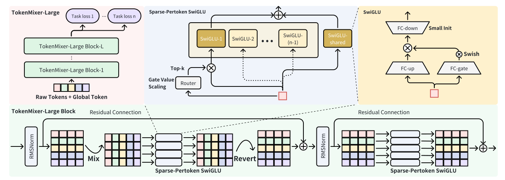
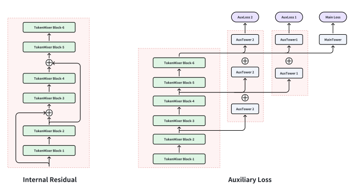
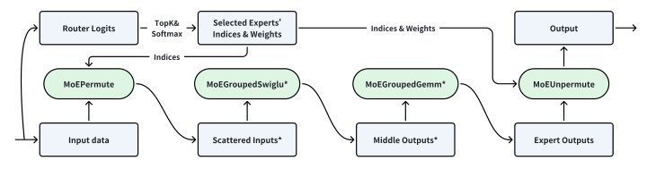
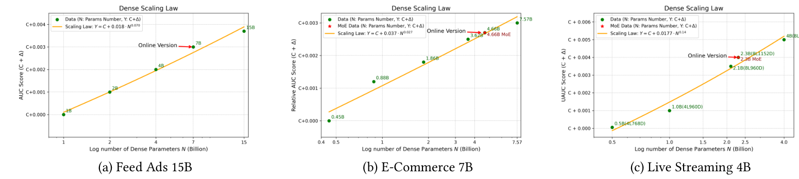
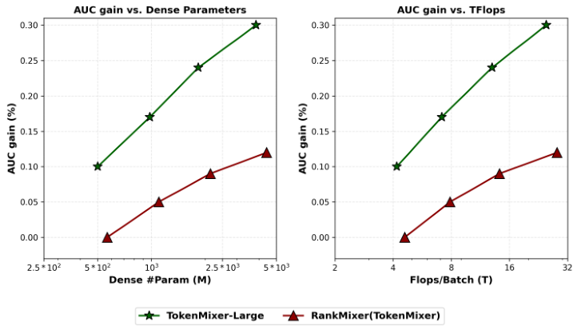
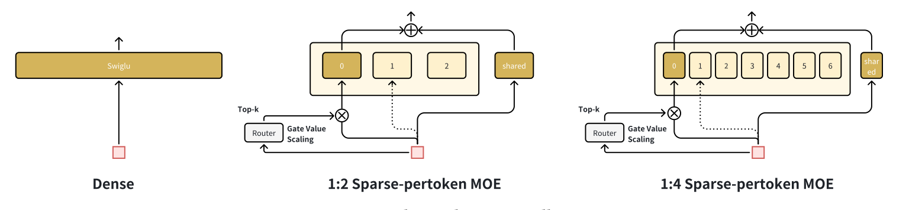
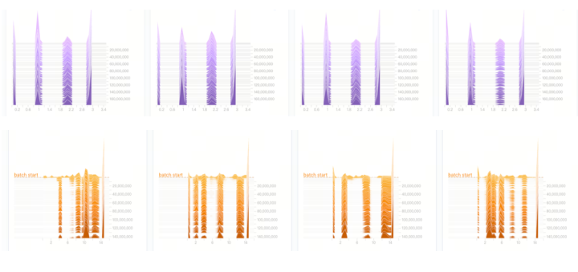
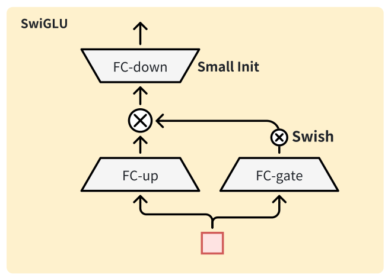

# TokenMixer-Large：扩展工业推荐系统中的大型排序模型

**作者**：Yuchen Jiang*¹、Jie Zhu*¹、Xintian Han*¹、Hui Lu*¹、Kunmin Bai*¹、Mingyu Yang*²、Shikang Wu*²、Ruihao Zhang*¹、Wenlin Zhao*²、Shipeng Bai¹、Sijin Zhou²、Huizhi Yang²、Tianyi Liu¹、Wenda Liu¹、Ziyan Gong¹、Haoran Ding¹、Zheng Chai¹、Deping Xie¹、Zhe Chen†¹、Yuchao Zheng†¹、Peng Xu¹。

¹ ByteDance AML；² ByteDance。* 同等贡献；† 通讯作者。

原文：[arXiv:2602.06563v2](https://arxiv.org/abs/2602.06563v2)，版本日期 2026-02-10，共 12 页。作者联系邮箱保留于原 PDF 第 1 页。

> 译注：本文完整翻译摘要、正文、第 9 页参考文献题名及附录 A.1—A.7，保留原公式和图表编号。参考文献的作者、出版信息及链接另保留在 [原始参考文献](../source/references.extracted.txt)。原文不存在表 8，故沿用其由表 7 跳到表 9 的编号；不自行补表。原文个别公式、初始化描述存在不一致，均在对应位置明确标注，未将推测写入译文。

## 摘要

推荐模型的规模定律（scaling laws）已受到广泛关注，但 Wukong、HiFormer、DHEN 等现有架构往往存在设计不够理想、硬件利用不足的问题，限制了其实际可扩展性。我们此前的 TokenMixer 架构在 RankMixer 论文中提出，通过以轻量级 token 混合算子替换自注意力，平衡了效果和效率；然而，当配置更深时，它遇到了关键瓶颈，包括次优的残差路径、梯度消失、不彻底的 MoE 稀疏化，以及有限的扩展能力。

本文提出 TokenMixer-Large，这是一种面向超大规模推荐、经过系统演进的架构。通过引入混合与还原（mixing-and-reverting）操作、跨层残差以及辅助损失，我们确保模型深度增加时梯度仍能稳定传播。此外，我们引入逐 token 稀疏混合专家（Sparse Per-token MoE），支持高效的参数扩展。TokenMixer-Large 在线上流量中成功扩展到 70 亿参数，在离线实验中扩展到 150 亿参数。

目前，该模型已经部署于字节跳动的多个场景，并取得显著收益：电商订单量增长 1.66%，人均预览支付 GMV 增长 2.98%；广告 ADSS 提升 2.0%；直播收入增长 1.4%。

**CCS 分类**：信息系统 → 推荐系统。

**关键词**：规模定律、排序模型、推荐系统。

**ACM 引用格式**：Yuchen Jiang 等，2026，TokenMixer-Large: Scaling Up Large Ranking Models in Industrial Recommenders，ACM，纽约，美国，12 页。原稿 DOI 为占位符 `10.1145/nnnnnnn.nnnnnnn`。

## 1 引言

推荐系统（RS）在当今互联网生态中发挥着关键作用，支撑电商 [5,39]、在线广告 [15,18]、内容信息流 [4,40] 和直播 [3] 等重要应用。因此，工业界和学术界都在持续迭代升级推荐模型及架构。随着深度学习的广泛应用，深度学习推荐模型（DLRM）表现出显著效果。这些模型通常先通过 embedding 层，将高维稀疏的用户、物品和行为特征转换为低维稠密嵌入，再设计复杂的特征交互层，捕捉潜在的用户—物品关系。

受大语言模型（LLM）[1,19,28] 成功的启发，特征交互研究开始探索 DLRM 的规模定律：增加参数和 FLOPs 是否能够持续带来性能收益？早期工作主要简单扩大模型宽度或交互层参数，缺少细致的架构设计，因此效果有限。后续 Wukong [36]、HiFormer [12]、DHEN [37] 等工作尝试设计更精细的模型结构，并扩展其规模、宽度和深度，但往往忽视与硬件匹配的协同设计和优化，导致性能未达最优。

当前工业界领先的 SOTA 模型结构是 TokenMixer——一种高度简化的 Transformer 变体。它以轻量级 token 混合操作取代注意力，大幅降低计算复杂度。RankMixer [40] 将其作为主干网络，验证了该结构在排序模型中的有效性。通过硬件感知协同设计，它在保持规模扩展效率的同时，大幅提升模型 FLOPs 利用率（Model FLOPs Utilization，MFU），显著提高硬件使用效率。尽管 TokenMixer 在工业应用中取得了成功，例如 RankMixer，我们仍发现它存在以下关键局限：

- **残差设计不够理想**：RankMixer 通过混合机制将原始 token 转换为新 token，因此要求新 token 数量 $T'$ 与原始数量 $T$ 相同，才能确保原始语义信息的完整性和传播。此外，在 add & norm 操作中，RankMixer 直接将混合前后的 token 相加，往往造成语义错位，最终影响性能。
- **模型架构不纯粹**：由于历史迭代，即使采用 TokenMixer 作为主干，许多已部署模型仍保留 LHUC [26]、DCNv2 [31] 等大量碎片化算子。这些算子受内存带宽限制，计算强度低，内存访问和通信开销高，降低了整体 MFU。
- **深层模型梯度更新不足**：工业应用中的 TokenMixer 通常较浅，例如 RankMixer 使用 2 层。随着深度增加，训练稳定性和性能提升都变得困难。现有 TokenMixer 缺少针对深层架构的设计。
- **MoE 稀疏化不充分**：RankMixer 虽然使用 Sparse MoE [11] 优化成本，但采用“稠密训练、稀疏推理”范式，无法降低训练成本。所用 ReLU-MoE [32] 的激活具有动态性，推理时难以预测每个 batch 会激活多少专家，因此需要对激活专家采用截断或回退策略，不利于推理。
- **规模探索有限**：受框架和训练效率限制，RankMixer 的参数规模仅扩展到约 10 亿。

为解决这些挑战，我们设计并深入探索 TokenMixer-Large。框架包括 Tokenization、TokenMixer-Large Block 和 Sparse-Pertoken MoE。一个 TokenMixer-Large Block 包含 Mixing & Reverting、Pertoken-SwiGLU、Residual & Normalization、Interval Residual & Residual Loss 等组件。通过堆叠多个 block，我们显著提升了工业场景下的离线和在线性能。本文贡献如下：

- 提出 TokenMixer-Large。重新审视和设计 TokenMixer 中存在缺陷的残差机制，引入 Mixing & Reverting。对关键组件的广泛消融表明，TokenMixer-Large 是一种更优的模型架构。
- 观察到随着模型扩大，堆叠多个 TokenMixer Block 可以吸收底层碎片化算子的收益。移除这些算子可以大幅提升 MFU 和硬件利用率。将“纯模型”理念融入 TokenMixer-Large 后，广告主干网络的 MFU 达到 60%。
- 针对深层模型梯度更新不足，在 block 中加入间隔残差、辅助损失和 down 矩阵小初始化，改善深层模型收敛。
- 将 RankMixer/TokenMixer 的 relu-MoE 升级为 Sparse-Pertoken MoE，统一采用“稀疏训练、稀疏推理”。配合高效算子、FP8 和 Token Parallel 等工程优化，大幅降低训练和推理成本。
- 全面研究不同模型的规模定律，验证 TokenMixer-Large 的优势。抖音广告、电商的离线模型分别扩展到 15B、7B，线上流量实验分别扩展到 7B、4B。模型已部署于字节跳动多个线上场景，在服务数亿用户的同时取得 2% ADSS 和 2.98% GMV 的收益。

## 2 相关工作

DLRM [8] 的核心是设计有效的特征交互架构。经典工作 Wide & Deep [6] 通过类似 bagging 的方式同时捕捉低阶和高阶特征交互。这种建模范式也体现在 DeepFM [13]、XDeepFM [17]、PNN [22]、DCN [30]、DCNv2 [31] 和 FCN [6] 等后续设计中。然而，作为早期设计，这些模型仍依赖 CPU 时代低效、高延迟的算子，未能充分发挥 GPU 的算力。在集成不同子结构的基础上，DHEN [37]、Wukong [36] 进一步验证了推荐系统的规模定律，表明“统一设计、逐层堆叠”的迭代方式也能在推荐任务中带来显著收益。

作为基础模型，Transformer [29] 在 GPU 时代已被广泛证明具有较强通用性，覆盖 CV [10,20]、NLP [19,28] 和 RS [25]，也具有良好的规模定律特性 [16,33]。推荐领域的 AutoInt [25]、HiFormer [12] 通过注意力机制增强特征交互。RankMixer [40] 和 MLP-Mixer [27] 进一步将注意力简化为更轻量级的 token 混合操作，降低标准注意力的二次计算成本。LONGER [3]、HSTU [35]、MTGR [14] 等工作，也从不同程度展示了 Transformer 及其变体在序列建模和生成式推荐场景中的扩展潜力。

## 3 方法

### 3.1 总体架构

如图 1 所示，TokenMixer-Large 框架包括三个部分：

1. **Tokenization**：将原始高度稀疏的 one-hot 特征转为稠密 embedding，再转换成维度对齐的语义 token。
2. **Token Mixing & Channel Mixing**：采用“混合与还原”范式，解决 RankMixer/TokenMixer 的维度不匹配问题。
3. **Sparse-Pertoken MoE**：升级 RankMixer/TokenMixer 中的 Pertoken-FFN/relu-MoE。

最后，使用均值池化聚合输出 token，并将输出表示用于各种任务的预测。



*图 1：TokenMixer-Large 架构。原始 token 包含全部原始特征，以及序列聚合和提取后的特征，例如 DIN [39]/LONGER [3]。整个模型包含多个 TokenMixer-Large Block，每个 block 的主干由（Norm、Mixing、S-P MoE、Reverting、Norm、S-P MoE）及残差组成。原文第 3 页。*

### 3.2 Tokenization

#### 3.2.1 按语义分组的 tokenizer

工业推荐系统通常包括用户特征、物品特征、序列特征和交叉特征。其中用户行为历史可以覆盖短期兴趣 DIN [39]、长期兴趣 SIM [21] 和超长期兴趣 LONGER [3]。第一步通过 embedding 层将这些特征从高维稀疏空间映射到低维稠密空间：特征 $F_i$ 被嵌入为维度各异的 $e_i$，其维度为 $d_i$：

$$e_i=\operatorname{Embedding}(F_i,d_i)\in\mathbb R^{d_i}.\tag{1}$$

TokenMixer-Large 是一种高度并行的架构，因此需要将变长 embedding 表示转成维度对齐的特征 token，方便后续计算。为此，按照语义对不同维度的 embedding 分组，将每组 $\{G_1,\ldots,G_{T-1}\}$ 内的 embedding 拼接，再压缩、对齐。由于不同语义组表示不同的特征特性，我们在压缩对齐过程中使用不同的 DNN 映射，保留其异构性：

$$X_i=\operatorname{MLP}_i(\operatorname{concat}[e_l,\ldots,e_m]),\quad e_l,\ldots,e_m\in G_i.\tag{2}$$

#### 3.2.2 全局 token

除语义分组 token 外，我们还引入专门承载全局信息的全局 token（global token）。受 BERT 的 [CLS] token 机制启发，该 token 用来聚合全局信息，并将其传播至其他 token：

$$X_G=\operatorname{MLP}_g(\operatorname{concat}[G_1,\ldots,G_{T-1}]).\tag{3}$$

最终输入由全局 token 与增强后的 token 组合而成：

$$\mathbf X=\operatorname{concat}[X_G,X_0,\ldots,X_{T-1}]\in\mathbb R^{T\times D}.\tag{4}$$

> 译注：原文组下标为 $1\ldots T-1$，式 (4) 却写成 $X_0\ldots X_{T-1}$ 再加一个全局 token，同时声称总数为 $T$。这里保留原式；实现时应统一为 $T-1$ 个语义 token 加 1 个全局 token。

### 3.3 TokenMixer-Large Block

TokenMixer-Large 采用多个 block 堆叠的结构。每个 block 可分解为混合模块、逐 token SwiGLU 和归一化三个组成部分。

#### 3.3.1 混合与还原

一个 RankMixer/TokenMixer block 可表示为：

$$[\ldots,[x_t^{(0)},\ldots,x_t^{(H)}],\ldots]=\operatorname{split}(\mathbf X)\in\mathbb R^{T\times H\times(D/H)}.\tag{5}$$
$$\mathbf H_h=\operatorname{concat}[x_1^{(h)},\ldots,x_T^{(h)}]\in\mathbb R^{T\times D/H}.\tag{6}$$
$$\mathbf H=\operatorname{concat}[\mathbf H_1,\ldots,\mathbf H_h]\in\mathbb R^{H\times(T\cdot D/H)}.\tag{7}$$
$$\mathbf H^{\mathrm{next}}=\operatorname{Norm}(\operatorname{pSwiGLU}(\mathbf H)+\mathbf H)\in\mathbb R^{H\times(T\cdot D/H)}.\tag{8}$$

可以看到，原始输入的 token 数量为 $T$，第 $i$ 层混合后的 token 数量为 $H$。除非每层 $H$ 均相同且 $T=H$，否则残差无法顺畅地跨层传播。

为克服该限制，我们设计了采用特殊双层 TokenMixer 结构的 TokenMixer-Large：第一层混合原始 token 之间的信息，第二层专门恢复混合后 token 的维度。这种对称的“混合—还原”设计确保模块输入输出维度一致，从而建立从初始输入到深层网络的连续信号通道。它支持每层稳定的残差连接，有效避免梯度信息损失。与 RankMixer/TokenMixer 的详细比较见第 4.3 节。

$$[\ldots,[x_t^{(1)},x_t^{(2)},\ldots,x_t^{(H)}],\ldots]=\operatorname{split}(\mathbf X)\in\mathbb R^{T\times H\times(D/H)}.\tag{9}$$
$$\mathbf H_h=\operatorname{concat}[x_1^{(h)},x_2^{(h)},\ldots,x_T^{(h)}]\in\mathbb R^{T\cdot D/H}.\tag{10}$$
$$\mathbf H=\operatorname{concat}[\mathbf H_1,\mathbf H_2,\ldots,\mathbf H_H]\in\mathbb R^{H\times(T\cdot D/H)}.\tag{11}$$
$$\mathbf H^{\mathrm{next}}=\operatorname{Norm}(\operatorname{pSwiGLU}(\mathbf H)+\mathbf H)\in\mathbb R^{H\times(T\cdot D/H)}.\tag{12}$$
$$[\ldots,[x_1'{}^{(h)},x_2'{}^{(h)},\ldots,x_T'{}^{(h)}],\ldots]=\operatorname{split}(\mathbf H^{\mathrm{next}})\in\mathbb R^{T\times H\times(D/H)}.\tag{13}$$
$$X_t^{\mathrm{revert}}=\operatorname{concat}[x_t'{}^{(1)},x_t'{}^{(2)},\ldots,x_t'{}^{(H)}]\in\mathbb R^D.\tag{14}$$
$$\mathbf X^{\mathrm{revert}}=\operatorname{concat}[X_1^{\mathrm{revert}},X_2^{\mathrm{revert}},\ldots,X_T^{\mathrm{revert}}]\in\mathbb R^{T\times D}.\tag{15}$$
$$\mathbf X^{\mathrm{next}}=\operatorname{Norm}(\operatorname{pSwiGLU}(\mathbf X^{\mathrm{revert}})+\mathbf X)\in\mathbb R^{T\times D}.\tag{16}$$

> 译注：式 (5) 的 $0\ldots H$ 下标、式 (6) 的矩阵形状及式 (7) 的末尾下标保留原稿记法。式 (12)/(16) 写成 Post-Norm，但第 3.3.3 节、图 1 和附录 A.4 明确采用 Pre-Norm；这些公式不能直接视为最终实现的完整伪代码。

#### 3.3.2 逐 token SwiGLU

RankMixer/TokenMixer 引入参数隔离的前馈网络架构——逐 token FFN，建模不同 token 的特征异构性。TokenMixer-Large 将逐 token FFN 升级为逐 token SwiGLU：

$$\operatorname{pSwiGLU}(\cdot)=\operatorname{FC}_{\mathrm{down}}\left(\operatorname{Swish}(\operatorname{FC}_{\mathrm{gate}}(\cdot))\odot\operatorname{FC}_{\mathrm{up}}(\cdot)\right).\tag{17}$$

其中，逐 token SwiGLU 的单个 MLP 为：

$$\operatorname{FC}_i(x)=W_i^t x_t+b_i^t,\qquad i\in\{\mathrm{up},\mathrm{gate},\mathrm{down}\}.\tag{18}$$

$\{W_{\mathrm{up}}^t,W_{\mathrm{gate}}^t\}\in\mathbb R^{D\times nD}$，$\{b_{\mathrm{up}}^t,b_{\mathrm{gate}}^t\}\in\mathbb R^{nD}$，$W_{\mathrm{down}}^t\in\mathbb R^{nD\times D}$，$b_{\mathrm{down}}^t\in\mathbb R^D$。$n$ 是调整隐藏维度的超参数，Swish 是激活函数，$x_t\in\mathbb R^D$ 为第 $t$ 个 token。

#### 3.3.3 残差与归一化

标准残差见图 1。此外，我们以更轻量级的 RMSNorm [38] 代替标准 LayerNorm。RMSNorm 去除均值中心化步骤，在保留核心归一化能力的同时显著降低计算开销。然而，在 RankMixer/TokenMixer 的 Post-Norm 设计下，我们经常遇到数值爆炸和梯度不稳定。为解决这一问题，我们采用 **Pre-Norm** 替换原始 Post-Norm。详细比较见附录 A.4。

#### 3.3.4 跨层残差与辅助损失



*图 2：内部残差与辅助损失。原文第 4 页。*

如图 2，除了标准残差，我们还引入跨层残差连接，通常每隔 2 或 3 层添加一次，以强化跨层信息流。它主要解决梯度消失问题。通过增强低层特征向高层的传递，加速早期层参数收敛，缓解深层网络中梯度逐渐衰减。

不建议在最后一层使用间隔残差。最后一层的主要作用是提炼高度抽象的高层特征，为后续分类任务提供精确支持。引入过多原始低层信息，可能干扰抽象过程，损害最终任务效果。

同时，将低层输出计算出的 logits 与高层 logits 结合，计算联合损失，形成轻量级辅助损失。该机制本质上使低层学会“估计高层特征的偏差”，增强其表示能力，避免随着深度增加，低层参数训练不足，使深层模型参数学习更充分、性能更稳定。

### 3.4 Sparse-Pertoken MoE

为进一步改善性价比，我们设计 Sparse-Pertoken MoE，在逐 token SwiGLU 基础上，将每个专家扩展为多个子专家并稀疏激活。相较 RankMixer 的“稠密训练、稀疏服务”，实现“稀疏训练、稀疏服务”，显著降低超大推荐模型训练与推理成本。

#### 3.4.1 先扩大，再稀疏

迭代策略采用“先扩大，再稀疏”：先扩大模型提升效果，再拆分逐 token SwiGLU 并稀疏激活，获得效率收益。S-P MoE 可表示为：

$$\begin{aligned}
\operatorname{S\!\!-\!P\ MoE}(\cdot)&=\sum_{j=1}^{k}g_j(\cdot)\operatorname{Expert}_j(\cdot),\quad\text{若 }j\text{ 被选中},\\
\operatorname{Expert}_j(\cdot)&=\operatorname{FC}_{\mathrm{down},j}\left(\operatorname{Swish}(\operatorname{FC}_{\mathrm{gate},j}(\cdot))\odot\operatorname{FC}_{\mathrm{up},j}(\cdot)\right),\\
\operatorname{FC}_{i,j}(x_t)&=W_{i,j}^t x_t+b_{i,j}^t,\quad i\in\{\mathrm{up},\mathrm{gate},\mathrm{down}\}.
\end{aligned}\tag{19}$$

其中 $\{W_{\mathrm{up}}^t,W_{\mathrm{gate}}^t\}\in\mathbb R^{D\times nD/E}$，$\{b_{\mathrm{up}}^t,b_{\mathrm{gate}}^t\}\in\mathbb R^{nD/E}$，$W_{\mathrm{down}}^t\in\mathbb R^{nD/E\times D}$，$b_{\mathrm{down}}^t\in\mathbb R^D$。$E$ 为每个 token 的专家数，$k$ 为 router $g(\cdot)$ 的 top-k 数。选中专家的 $g(\cdot)$ 经 softmax 约束，总和为 1，即激活专家概率之和为 1。设计思想与实验见附录 A.1。

#### 3.4.2 共享专家

当前一些基于 MoE 的 LLM 使用共享专家改善训练稳定性和效果，我们也采用这一设计。需要注意，此处的共享专家仍**按 token 分配**，并非对所有 token 全局可见的共享专家：

$$\operatorname{S\!\!-\!P\ MoE}(\cdot)=\sum_{i=1}^{k-1}g_i(\cdot)\operatorname{Expert}_i(\cdot)+\operatorname{SharedExpert}_i(\cdot).\tag{20}$$

> 译注：原式共享专家也带 $i$ 下标，但位于求和外；附录式 (23)/(24) 使用不带该下标的 SharedExpert，表达的是当前 token 的常开专家。

#### 3.4.3 门控值缩放

实践中发现，$g(\cdot)$ 通常通过 softmax 将 router logits 转为和为 1 的概率分布，该约束可能导致 SwiGLU 梯度更新不足。因此在 $g(\cdot)$ 前乘常数 $\alpha$，让专家网络获得更充分更新：

$$\operatorname{S\!\!-\!P\ MoE}(\cdot)=\alpha\sum_{i=1}^{k-1}g_i(\cdot)\operatorname{Expert}_i(\cdot)+\operatorname{SharedExpert}_i(\cdot).\tag{21}$$

#### 3.4.4 down 矩阵小初始化

受 ReZero [23] 启发，我们减小 SwiGLU 最后一层 $W_{\mathrm{down}}$ 的初始化方差：采用 `xavier_uniform`，将标准差超参数由默认 1 降为 0.01。这使训练早期 $F(x)+x$ 中的 $F(x)$ 接近 0，模块初始近似恒等映射，提升训练稳定性，也缓解 SwiGLU 中 up 与 gate 矩阵乘性交互导致的输出爆炸。

> 译注：原文此处将 ReZero 引为 [23]，但参考文献中 ReZero 是 [2]；附录 A.7 使用的初始化分布及 scale 描述也与此处不完全一致，详见 A.7 译注。

结合以上改进，MoE 版本只激活一半参数，即可达到几乎与全激活稠密模型相同的效果。图 7 还显示，引入这些改进后，token 的负载较均衡，不再需要额外负载均衡损失。详细分析见附录 A.2。

### 3.5 训练与服务优化

我们开发了一组高性能算子，提高 TokenMixer-Large 的训练和推理效率。

#### 3.5.1 高性能自定义算子



*图 3：一个 block 中高性能算子的工作流。绿色节点表示算子，蓝色节点表示数据；星号表示数据以 FP8 量化格式存储和计算。原文第 5 页。*

整体流程见图 3。MoEPermute 将输入从 batch-first 转为 expert-first，确保每个专家 FFN 的输入连续。随后，MoEGroupedFFN 算子（MoEGroupedSwiglu、MoEGroupedGemm）在单个 kernel 中计算全部专家 FFN，减少算子调度开销、提高设备利用率。最后，MoEUnpermute 将多个激活专家的输出加权求和，得到最终输出。

表 1 给出训练和推理的算子耗时。其中 MoEGroupedFFN 是主要延迟来源，推理占比更高，因为推理 batch 变小时，其内存访问并不随之减少。

**表 1：TokenMixer-Large block 主要算子的耗时、占比及瓶颈。**

| 算子 | 训练时间/ms | 训练占比 | 训练瓶颈 | 服务时间/ms | 服务占比 | 服务瓶颈 |
|---|---:|---:|---|---:|---:|---|
| MoEGroupedFFN | 136.77 | 89.18% | 计算受限 | 7.43 | 98.35% | 内存带宽受限 |
| MoEPermute | 6.32 | 4.12% | 内存带宽受限 | 0.06 | 0.75% | 内存带宽受限 |
| MoEUnpermute | 10.27 | 6.69% | 内存带宽受限 | 0.07 | 0.90% | 内存带宽受限 |

#### 3.5.2 FP8 量化

推理采用 FP8 E4M3 训练后量化，训练全过程保持 bfloat16。在线实验表明，FP8 服务在不损害模型精度的情况下提供 **1.7 倍加速**。如图 3，在 MoEPermute 中量化输入，专家权重预先量化；MoEGroupedSwiglu 融合输出量化，直接生成量化激活；MoEGroupedGemm 同样采用 FP8 计算，输出 bfloat16 结果。

#### 3.5.3 Token Parallel

在分布式多设备环境扩展 TokenMixer-Large 面临显著瓶颈。训练主要受 GPU 显存容量和总训练时间限制，模型扩大后，参数和激活可能超过单卡显存。在线服务更严重：小 batch 推理变成内存带宽受限，硬件利用率和吞吐低。

朴素模型并行可将逐 token 算子的权重分到各设备，但每次计算前后都需一次 all2all 切换分片布局，每个 block 共 4 次通信。为此我们提出专为该架构设计的 Token Parallel，将参数——具体为逐 token 算子的权重——及计算划分到多设备上。

**实现。** Token Parallel 使数据分片与 block 的计算流一致：包含 Mixing 和 Reverting，各自后接逐 token 操作。下文所有张量均视为分布式张量，Shard(dim) 表示沿指定维度分片。

**代码清单 1：Token Parallel 数据流伪代码。**

```python
# 输入：X_prev [N*B, T, D]，布局 Shard(Batch)
# N：设备数量；B：本地 batch size

# Mixing
X_chunk = split(X_prev, num_splits=N, axis=2)
# 形状：H x [N*B, T, D/H]，Shard(0)
X_head = concat(X_chunk, axis=0).view(H, N*B, -1)
# 形状：[H, N*B, T*D/H]，Shard(1)

# 交换后持有完整 Batch、分片 Head
X_hidden = all2all(X_head)
# 形状：[H, N*B, T*D/H]，Shard(0)
h_hat = pertokenOperation(X_hidden)
# 形状：[H, N*B, T*D/H]，Shard(0)

# Reverting
chunks_t = split(h_hat, num_splits=T, axis=2).transpose(0, 1)
# 形状：T x [N*B, H, D/H]，Shard(1)
# 打包传输并合并 Head 维
payload_t = concat(chunks_t).view(T, N*B, -1)
# 形状：[T, N*B, D]，Shard(2)

# 交换后持有完整 Dim、分片 Token
x_revert = all2all(payload_t)
# 形状：[T, N*B, D]，Shard(0)
x_hat = pertokenOperation(x_revert)
# 形状：[T, N*B, D]，Shard(0)

# 最终输出
X_curr = transpose(x_hat)
# 形状：[N*B, T, D]，Shard(1)
```

> 译注：代码按原稿保留。首个 split 写 `num_splits=N`，注释却用 $H$ 个块；未说明 $N$ 与 $H$ 的限制关系。这是分布式数据流示意，不能原样作为可运行实现。

Token Parallel 的输出 $X_l$ 保持沿 token 维分片，直接输入下一个 block；下一 block 的初始 split 能处理这种布局。因此省去额外两步通信，$L$ 层通信开销从 $4L$ 降到 $2L+1$；仅在末尾执行一次 all_to_all 恢复 batch 分片。

该策略同时显著改善训练和推理性能。生产服务中，4 路 token 并行、全局 batch size 为 320 的模型，相较无并行基线吞吐提升 **29.2%**。通过细粒度 micro-batch 调度或 kernel 内计算—通信重叠，将通信与计算重叠后，收益进一步达到 **96.6%**。

## 4 实验

### 4.1 实验设置

#### 4.1.1 数据集和环境

离线实验主要使用抖音主信息流电商场景的真实训练数据，来自线上日志和用户反馈标签，包括商品点击、转化及 GMV 等。训练集包含超过 500 种不同特征，覆盖数值、ID、交叉和序列特征，以及数亿独立用户。采样后每天约 4 亿条记录，收集时间跨度为两年。

还使用抖音广告、抖音直播的真实训练数据。采样后日数据量分别为 3 亿、170 亿条。

#### 4.1.2 评价指标

效果主要使用 AUC（ROC 曲线下面积）和 UAUC（用户级 AUC）；效率使用稠密参数量、FLOPs 和 MFU：

- **AUC/UAUC**：主要采用 CTR、CVR 任务的 AUC 评价效果。
- **参数量**：使用纯稠密参数数量，不包括稀疏 embedding。
- **每 batch 训练 FLOPs**：模型处理一个 2048 样本 batch 所需的浮点运算量，代表训练计算成本。
- **MFU**：衡量模型对硬件理论浮点计算能力的实际利用效率。

#### 4.1.3 基线

主要比较下列广泛认可的 SOTA 模型：

- **DLRM-MLP [24]**：使用多层感知机进行特征交互。
- **DCNv2 [31]**：Deep & Cross Network 的改进版本，提供更深、更强的特征交叉。
- **AutoInt [25]**：通过多头自注意力自动显式学习高阶特征组合。
- **HiFormer [12]**：通过异构自注意力层和低秩近似修改标准自注意力。
- **DHEN [37]**：采用 bagging 思想，在一个 block 中集成 DCN、SA、FMB 等多类特征交互模块，并堆叠多层。
- **Wukong [36]**：将因子分解机模块 FMB 与线性压缩模块 LCB 集成，逐层堆叠，研究特征交互的规模定律。
- **Group Transformer**：内部为异构特征建模设计的 Transformer 变体。将特征分组、聚合成少量 token，降低自注意力复杂度；采用逐 token 的 Q/K/V/O，增强异构特征表示能力。
- **FAT [34]**：Group Transformer 的升级版，在逐 token Q/K/V/O 基础上使用正交基组合改进性能。
- **RankMixer [40]**：以替代自注意力的 TokenMixer block 为核心，大幅降低计算成本。

所有实验使用混合分布式训练框架：电商为 64 张 GPU，信息流广告和直播为 256 张。稀疏参数异步更新，稠密参数同步更新。所有模型优化器超参数一致：稠密和稀疏部分均采用 Adagrad，学习率分别为 0.01、0.05。

### 4.2 与 SOTA 方法比较

**表 2：电商场景约 500M 参数模型的性能与效率比较，同时列出更大 TokenMixer-Large。最佳值在原文加粗。**

| 模型 | CTCVR ΔAUC↑ | 参数量 | FLOPs/Batch |
|---|---:|---:|---:|
| DLRM-MLP-500M [24] | — | 499 M | 125.1 T |
| HiFormer [12] | +0.44% | 570 M | 28.8 T |
| DCNv2 [31] | +0.49% | 502 M | 125.8 T |
| DHEN [37] | +0.63% | 415 M | 103.4 T |
| AutoInt [25] | +0.75% | 549 M | 138.6 T |
| Wukong [36] | +0.76% | 513 M | 4.6 T |
| Group Transformer | +0.81% | 550 M | 4.5 T |
| FAT [34] | +0.82% | 551 M | 4.59 T |
| RankMixer (TokenMixer) [40] | +0.84% | 567 M | 4.6 T |
| TokenMixer-Large 500M | +0.94% | 501 M | 4.2 T |
| TokenMixer-Large 4B | +1.14% | 4.6 B | 29.8 T |
| TokenMixer-Large 7B | +1.20% | 7.6 B | 49.0 T |
| TokenMixer-Large 4B SP-MoE | +1.14% | 4.6 B 中激活 2.3 B | 15.1 T |

表 2 显示 TokenMixer-Large 优于所有 SOTA 模型，相较 MLP-500M，CTCVR AUC 增益达 +1.14%。值得注意，Wukong、Group Transformer、RankMixer 等模型采用逐 token 网络设计，2048 batch 下 FLOPs 显著低于其他基线。Sparse-Pertoken MoE 只激活一半参数，即可匹配稠密模型性能，大幅改善训练/推理 ROI。

### 4.3 与 RankMixer/TokenMixer 的详细比较

定义三个关键设计维度：

- **标准残差 SR**：block 间是否存在标准残差连接。
- **原始 token 残差 OTR**：原始 token 的语义信息是否被保留并传播至后续层。例如，输入 40 个 token，混合成 16 个新 token 后一直保持 16 个，则原始 40 个 token 的语义信息无法一直保留到最终输出。
- **残差中的 token 语义对齐 TSA**：在 $F(x')+x$ 中，残差相加前后 token 的语义是否一致。RankMixer 的 $x'$ 是混合后 token，残差输入 $x$ 来自混合前，因此语义不匹配。

Group Transformer 的每层不改变输入 token 数量，注意力和逐 token FFN 后，各 token_dim 位置语义仍对齐，因此满足三项性质。RankMixer 则直接将混合前后 token 相加，破坏 token_dim 的位置语义对齐；除非特意令新 token 数量与原始数量一致，否则原始 token 残差也不能有效贯穿网络。

**表 3：与 RankMixer/TokenMixer 的详细比较。AUC 以 Group Transformer 为基线。**

| 模型版本 | SR | OTR | TSA | AUC↑ | 参数 | FLOPs |
|---|:---:|:---:|:---:|---:|---:|---:|
| Group Transformer | ✓ | ✓ | ✓ | — | 500M | 4.5T |
| RankMixer，无 SR 和 OTR | ✗ | ✗ | ✗ | -0.20% | 510M | 4.2T |
| RankMixer，无 OTR | ✓ | ✗ | ✗ | -0.13% | 510M | 4.2T |
| RankMixer | ✓ | ✓ | ✗ | +0.03% | 567M | 4.6T |
| TokenMixer-Large | ✓ | ✓ | ✓ | +0.13% | 500M | 4.2T |

表 3 表明，TokenMixer-Large 针对性解决上述问题，满足三项设计性质，并取得最好效果。

### 4.4 规模定律



*图 4：不同场景的规模定律。(a) 信息流广告 15B；(b) 电商 7B；(c) 直播 4B。原文第 7 页。*

#### 4.4.1 SOTA 模型的规模定律



*图 5：不同 SOTA 模型 AUC 增益与参数量/FLOPs 的规模关系。横轴为对数坐标。原文第 7 页。*

图 5 选择效果最好的 RankMixer 和 TokenMixer-Large，考察其规模定律。二者 AUC 均随参数/FLOPs 增加而提高。整体上，TokenMixer-Large 效果最佳，改善斜率更陡。

#### 4.4.2 TokenMixer-Large 在不同场景的规模定律

通过增加维度 $D$、深度 $L$ 和 SwiGLU 隐层扩展因子 $N$ 扩展模型，得到两个关键发现：

- **均衡扩展多个维度的回报更高**：不同于早期 RankMixer 在 1B 以下的实验，单独扩大宽度、深度或扩展因子都能带来收益，但会逐渐触及瓶颈。超过 1B 后，需要均衡扩大多个维度，才能得到更好回报。
- **更大模型需要更多数据才能收敛**：表 4 显示，30M 到 90M 的扩展仅需 14 天训练样本即可收敛；500M 到 2B 的扩展需要 60 天样本才能充分收敛。

**表 4：抖音直播模型收敛比较。**

| 参数规模* | 收敛样本天数 | ΔUAUC |
|---|---:|---:|
| 30m | — | — |
| 90m↑ | 14d | +0.94% |
| 500m↑ | 30d | +0.62% |
| 2.3B↑ | 30d | +0.41% |
| 2.3B↑ (60d) | 60d | +0.70% |

\* 原表说明：每行以其上一行为基线，↑ 表示与此前参数规模比较。

> 译注：正文将最后两行用于说明同一参数规模在 30/60 天样本下的收敛差异，而脚注笼统写“上一行基线”；最后一行的具体比较口径未进一步解释。这里保留原数据和脚注，不将这些收益累加。

我们还在不同业务中验证规模定律，各场景均表现出明显的扩展规律。信息流广告、电商、直播离线模型分别扩展到 15B、7B、4B，线上流量模型分别为 7B、4B、2B，并获得显著收益。

### 4.5 消融研究

#### 4.5.1 TokenMixer-Large Block 消融

**表 5：TokenMixer-Large 4B 各组件消融。**

| 设置 | ΔAUC |
|---|---:|
| 去掉全局 token | −0.02% |
| 去掉 Mixing & Reverting | −0.27% |
| 去掉残差 | −0.15% |
| 去掉内部残差及辅助损失 | −0.04% |
| 逐 token SwiGLU → 共享 SwiGLU | −0.21% |
| 逐 token SwiGLU → 逐 token FFN | −0.10% |

我们消融了 Tokenization、Mixing & Reverting、逐 token SwiGLU 和残差等模块。移除任一模块都会导致效果下降，其中 Mixing & Reverting、逐 token SwiGLU 的影响最大。

**纯模型设计。** 随着参数持续扩大，大量小型、I/O 受限、碎片化算子，例如 DCN [31]、LHUC [26] 的收益，都可以由 TokenMixer-Large 本身捕获。TokenMixer-Large 仅包含无参数的 mixing/reverting 和大量 GroupedGemm，因此效率很高，详见附录 A.3。

**归一化。** 我们全面分析 pre-norm、post-norm 和 sandwich norm 等位置，详见附录 A.4。

**混合策略。** 对 mixer 的拆分策略进行详细研究，见附录 A.5。

#### 4.5.2 Sparse-Pertoken MoE 消融

**表 6：Sparse-Pertoken MoE 各组件消融。**

| 设置 | ΔAUC | Δ参数量 | ΔFLOPs |
|---|---:|---:|---:|
| 去掉共享专家 | −0.02% | 0.0% | 0.0% |
| 去掉门控值缩放 | −0.03% | 0.0% | 0.0% |
| 去掉 down 矩阵小初始化 | −0.03% | 0.0% | 0.0% |
| Sparse-Pertoken MoE → 标准 Sparse MoE | −0.10% | 0.0% | 0.0% |

表 6 消融了共享专家、门控值缩放和 down 矩阵小初始化，每项均有正向贡献。上述操作未引入额外参数或 FLOPs，因此属于无额外成本的修改。

在对齐总参数量和激活参数量后，将逐 token 稀疏 MoE 与标准 MoE 比较，标准 MoE 出现明显效果下降。原因是前者相当于给标准 MoE 加入路由先验：不同 token 能激活的专家不共享，从而避免 router 在训练早期难以学习的问题。

**门控值缩放。** 全面实验发现，最优缩放因子随稀疏比例（激活参数/总参数）变化。1:2 稀疏模型在缩放因子 2 时最佳，1:4 模型在因子 4 时最佳。缩放因子与稀疏比例成反比，详见附录 A.6。

**down 矩阵小初始化。** 将 SwiGLU 最后的 $\mathrm{FC}_{\mathrm{down}}$ 初始化为 $\mathrm{FC}_{\mathrm{up}}/\mathrm{FC}_{\mathrm{gate}}$ 的 0.01 倍，显著改善性能和稳定性，详见附录 A.7。

### 4.6 在线效果

为验证效果，我们在抖音信息流广告、直播电商、普通直播等多个场景部署模型，覆盖抖音大部分业务，服务数亿用户。各场景采用不同核心指标：

- **抖音直播电商**：GMV 和订单量。
- **抖音信息流广告**：广告主满意度 ADSS 和广告主价值 ADVV。
- **抖音非电商直播**：总支付金额。

广告、电商、直播的线上基线分别为 RankMixer-1B、RankMixer-150M、RankMixer-500M；对应 TokenMixer-Large 分别扩展至 7B、4B、2B。

**表 7：TokenMixer-Large 在线效果。**

| 场景 | ΔAUC | ΔUAUC | 业务指标提升 |
|---|---:|---:|---|
| 信息流广告 | 0.35% | — | ADSS 2.0% |
| 电商 | 0.51% | — | 订单量 1.66%；GMV 2.98% |
| 直播 | — | 0.7% | 支付金额 1.4% |

如表 7，电商订单量增长 1.66%，人均预览支付 GMV 增长 2.98%；广告 ADSS 提升 2.0%；直播收入增长 1.4%。

## 5 结论

本文提出 TokenMixer 的升级版 TokenMixer-Large。深入分析原始 TokenMixer 的局限，详细研究讨论深层建模和 Sparse-Pertoken MoE。工程上实现一组高效 MoE 算子，以及专为逐 token 专家设计的 Token Parallel 策略。TokenMixer-Large 已在字节跳动多个场景中取得显著离线和在线收益，服务数亿用户。

## 参考文献

以下按原编号翻译题名，作者与出版信息不作改写；完整原始书目见 [references.extracted.txt](../source/references.extracted.txt) 和 PDF 第 9 页。

1. Achiam 等，2023。《GPT-4 技术报告》。arXiv:2303.08774。
2. Bachlechner 等，2021。《ReZero 足矣：大深度下的快速收敛》。UAI，1352–1361。
3. Chai 等，2025。《LONGER：扩展工业推荐系统中的长序列建模》。arXiv:2505.04421。
4. Chang 等，2023。《TWIN：快手 CTR 预测中的两阶段终身兴趣网络》。KDD，3785–3794。
5. Chen 等，2019。《阿里巴巴电商推荐中的行为序列 Transformer》。高维稀疏数据深度学习实践研讨会，1–4。
6. Cheng 等，2016。《推荐系统中的 Wide & Deep 学习》。推荐系统深度学习研讨会，7–10。
7. Chowdhery 等，2023。《PaLM：利用 Pathways 扩展语言建模》。JMLR 24(240)，1–113。
8. Covington、Adams、Sargin，2016。《YouTube 推荐中的深度神经网络》。RecSys，191–198。
9. Dai 等，2024。《DeepSeekMoE：迈向混合专家语言模型的极致专家专门化》。arXiv:2401.06066。
10. Dosovitskiy，2020。《一张图像相当于 16×16 个词：大规模图像识别的 Transformer》。arXiv:2010.11929。
11. Fedus、Zoph、Shazeer，2022。《Switch Transformers：用简单高效的稀疏性扩展至万亿参数模型》。JMLR 23(120)，1–39。
12. Gui 等，2023。《HiFormer：使用 Transformer 学习推荐系统中的异构特征交互》。arXiv:2311.05884。
13. Guo 等，2017。《DeepFM：基于因子分解机的 CTR 预测神经网络》。arXiv:1703.04247。
14. Han 等，2025。《MTGR：美团的工业级生成式推荐框架》。CIKM，5731–5738。
15. Jiang 等，2022。《多域推荐中的自适应领域兴趣网络》。CIKM，3212–3221。
16. Kaplan 等，2020。《神经语言模型的规模定律》。arXiv:2001.08361。
17. Lian 等，2018。《xDeepFM：结合显式与隐式特征交互进行推荐》。KDD，1754–1763。
18. Lin 等，2023。《推荐系统如何从大语言模型中受益：综述》。ACM TOIS。
19. Liu 等，2024。《DeepSeek-V3 技术报告》。arXiv:2412.19437。
20. Liu 等，2021。《Swin Transformer：使用移动窗口的层次视觉 Transformer》。ICCV，10012–10022。
21. Pi 等，2020。《使用终身序列行为数据进行 CTR 预测的基于搜索的用户兴趣建模》。CIKM，2685–2692。
22. Qu 等，2018。《面向多字段类别数据用户响应预测的基于乘积的神经网络》。ACM TOIS 37(1)，1–35。
23. Ramesh 等，2021。《零样本文本到图像生成》。ICML，8821–8831。
24. Rumelhart、Hinton、Williams，1986。《通过误差反向传播学习表示》。Nature 323(6088)，533–536。
25. Song 等，2019。《AutoInt：通过自注意力神经网络自动学习特征交互》。CIKM，1161–1170。
26. Swietojanski、Li、Renals，2016。《学习隐藏单元贡献以进行无监督声学模型自适应》。IEEE/ACM TASLP 24(8)，1450–1463。
27. Tolstikhin 等，2021。《MLP-Mixer：用于视觉的全 MLP 架构》。NeurIPS 34，24261–24272。
28. Touvron 等，2023。《LLaMA：开放且高效的基础语言模型》。arXiv:2302.13971。
29. Vaswani 等，2017。《Attention Is All You Need》。NeurIPS 30。
30. Wang 等，2017。《用于广告点击预测的 Deep & Cross Network》。ADKDD，1–7。
31. Wang 等，2021。《DCN V2：改进的 Deep & Cross Network 及大规模排序学习的实践经验》。WWW，1785–1797。
32. Wang、Chen、Zhu，2024。《ReMoE：使用 ReLU 路由的完全可微混合专家》。arXiv:2412.14711。
33. Wu、Tang，2024。《大语言模型的性能定律》。arXiv:2408.09895。
34. Yan 等，2025。《从规模扩展到结构化表达力：重新思考 CTR 预测中的 Transformer》。arXiv:2511.12081。
35. Zhai 等，2024。《行动胜于言语：用于生成式推荐的万亿参数序列转导器》。ICML。
36. Zhang 等，2024。《Wukong：迈向大规模推荐的规模定律》。ICML。
37. Zhang 等，2022。《DHEN：用于大规模 CTR 预测的深度层次集成网络》。arXiv:2203.11014。
38. Zhang、Sennrich，2019。《均方根层归一化》。NeurIPS 32。
39. Zhou 等，2018。《用于 CTR 预测的 Deep Interest Network》。KDD，1059–1068。
40. Zhu 等，2025。《RankMixer：扩展工业推荐系统中的排序模型》。CIKM，6309–6316。
41. Zoph 等，2022。《ST-MoE：设计稳定且可迁移的稀疏专家模型》。arXiv:2202.08906。

## 附录 A

### A.1 先扩大，再稀疏



*图 6：先扩大、再稀疏示意。原文第 10 页。*

传统 MoE 方法在保持激活专家数量不变的情况下直接增加总参数。然而，我们认为增加专家等价于沿单一维度扩大逐 token SwiGLU 的隐藏扩展规模，这始终存在一个容易触及的上限。因此，我们选择先设计效果最好的稠密模型，再通过稀疏化、尽可能少损失效果来提高效率。

具体而言，将 TokenMixer-Large 中 SwiGLU 的全部 FC 网络细粒度化，再做稀疏激活。图 6 展示稠密模型、1:2 和 1:4 稀疏 MoE。当前在 1:2 稀疏下，可以做到离线/在线几乎无损；1:4 时略有下降。但随着稀疏度增加，SwiGLU 的 GEMM 部分进一步减少，因此更高稀疏度的收益依赖于更大的模型和更高的 GEMM 占比。因此，我们选择 ROI 最高的 **1:2 版本**上线。能否在保持效果无损的同时达到超过 1:8 的稀疏度，仍在探索中。

### A.2 负载均衡



*图 7：1:2 和 1:8 版本的 Sparse-Pertoken MoE 负载均衡。原文第 10 页。译注：原稿内嵌图字体很小，本地已高分辨率导出；不从难辨认的小字中读取额外定量数据。*

图 7 上部展示电商 4.6B Sparse-Pertoken MoE 的负载均衡示例。采用 1 个共享专家、3 个路由专家，共激活 2 个专家。在 1:2 稀疏下，与总参数相同的 4.6B 稠密模型达到相同离线/在线效果。图中展示各 token 的激活状态，索引 0–2 为路由专家，3 为共享专家。整体负载较均衡；由于 3 是常开共享专家，其激活水平高于 0–2。

但从 1:2 提高到 1:8 时，图 7 下部显示负载均衡有所恶化。我们也尝试 Switch Transformer [11] 的负载均衡方法及 Z-loss [41]，有一定收益。考虑到已上线的 1:2 版本 ROI 最高且没有负载均衡问题，这部分留待未来探索。

### A.3 纯模型设计

**表 9：不同参数规模下 DCN 对 TokenMixer-Large 的效果增益。DCN Gain 等于有 DCN 的效果减去无 DCN 的效果。**

| 参数量 | DCN 增益 |
|---|---:|
| 150M | +0.09% |
| 500M | +0.04% |
| 700M | +0.00% |

基线中，我们人工筛选序列池化结果，送入 DCN 模块进行特征交叉，再将输出作为额外 token，补充主干 TokenMixer 的输入。但该设计有一个主要问题：主干复杂度不断增加时，前端 DCN 的收益逐渐下降。表 9 显示，150M 模型中 DCN 带来 +0.09% 增益；扩展到 700M 时，删除 DCN 不再造成效果损失。

除 DCN 外，我们还尝试串联、并联 DHEN、LHUC 等结构与 TokenMixer-Large。实践显示，随参数扩大，这些小型、数量多、I/O 受限的碎片化算子收益可被 TokenMixer-Large 本身完全捕获。此外，TokenMixer-Large Block 自身 MFU 最高达到 60%。

### A.4 归一化与位置

RMSNorm 定义如下：

$$\begin{aligned}
\operatorname{RMS}(x)&=\sqrt{\frac1d\sum_{i=1}^{d}x_i^2+\epsilon},\\
\bar a_i&=\frac{x_i}{\operatorname{RMS}(x)},\\
\operatorname{RMSNorm}(x)&=\bar a_i\cdot\gamma.
\end{aligned}\tag{22}$$

$\gamma$ 为可学习归一化参数。考虑到输入经过归一化层时，核矩阵的 bias 在数学上冗余，且受 LLaMA [7,28] 启发，我们移除所有 bias，并将 TokenMixer-Large 中全部 LayerNorm 替换为 RMSNorm。测试中，在效果相同的情况下，端到端吞吐提升 **8.4%**。

我们分析 pre-norm、post-norm、sandwich norm 的位置。表 10 显示，post-norm 效果更好，但容易梯度爆炸；pre-norm 效果略低，却能保证稳定训练。

**表 10：不同归一化变体消融。**

| 设置 | ΔAUC |
|---|---:|
| Pre-Norm | — |
| Post-Norm | +0.01% → NaN |
| Sandwich-Norm | −0.03% |

> 译注：“bias 在数学上冗余”为作者原文判断，译文按其表述保留，不构成译者对任意归一化层与 bias 可互换性的证明。

### A.5 混合策略

详细研究 mixer 的拆分策略。表 11 显示，只要每个新混合 token 都包含全部原始 token 的信息，不同 split-concat 策略不影响效果。作为对照，我们尝试只混合一半原始 token 的信息，结果显著下降。

**表 11：混合策略消融。**

| 设置 | ΔAUC |
|---|---:|
| 纵向划分 | — |
| 对角划分 | +0.00% |
| 随机划分 | +0.00% |
| 纵向划分，仅使用一半原始 token | −0.08% |

### A.6 门控值缩放分析

将稠密模型转换成 MoE 时，我们发现，在 router 函数 $g(x)$ 前引入常数缩放因子 $\alpha$，放大 router 输出、增强被选中专家的梯度更新，能显著改善效果。包含共享专家的 MoE 表示为：

$$y=\sum_{i=1}^{K-1}g(x)_i\operatorname{Expert}_i(x)+\operatorname{SharedExpert}(x).\tag{23}$$

其中 $g(x)$ 为路由权重，$\operatorname{Expert}_i$ 为第 $i$ 个专家网络，SharedExpert 为共享专家。因此 Sparse-Pertoken MoE 的数学形式为：

$$y=\alpha\sum_{i=1}^{K-1}g(x)_i\operatorname{Expert}_i(x)+\operatorname{SharedExpert}(x).\tag{24}$$

实践中，$\alpha$ 的设置很关键，过大或过小都会降低效果。进一步实验发现，最优 $\alpha$ 与稀疏比例密切相关：设为当前稀疏比例的倒数效果最佳，见表 12。

**表 12：模型稀疏比例及 α 对 AUC 的影响。**

| 版本 | 稀疏比例 | α | AUC 表现 |
|---|---|---:|---:|
| 4B 稠密 | — | — | — |
| 4B 总量中激活 2B 的 MoE | 1:2 | 1 | -0.04% |
| 同上 | 1:2 | 2 | -0.00% |
| 同上 | 1:2 | 3 | -0.02% |
| 同上 | 1:2 | 4 | -0.05% |
| 4B 总量中激活 1B 的 MoE | 1:4 | 1 | -0.07% |
| 同上 | 1:4 | 2 | -0.05% |
| 同上 | 1:4 | 4 | -0.03% |
| 同上 | 1:4 | 6 | -0.04% |
| 同上 | 1:4 | 8 | -0.05% |

我们认为门控值缩放有效，且 $\alpha$ 应取稀疏比例倒数，原因如下：SwiGLU 中各 FC 层的梯度更新需要与原始稠密模型保持一致。“先扩大、再稀疏”将大核拆成多个小核，类似 DeepSeek-MoE [9] 的细粒度专家，但关键区别在于我们不增加激活参数（topk）。分得越细，每个专家获得更新的概率越小，因此需要放大专家被激活时的梯度幅度，而门控值缩放恰好做到这一点。

另一种可能是门控值缩放增加了整体加权池化结果 $\alpha\sum_{i=1}^{K-1}g(x)_i\operatorname{Expert}_i(x)$，从而增大每层输出方差。因此，我们尝试直接提高专家核的初始化方差，从另一角度模拟输出放大。表 13 显示，直接提高初始化方差没有改善效果，反而明显恶化。

**表 13：门控值缩放与提高方差的比较。**

| 设置 | ΔAUC |
|---|---:|
| 门控值缩放 | — |
| 提高方差 | −0.07% |

### A.7 down 矩阵小初始化

为解决深层模型收敛挑战，除标准残差、间隔残差和残差损失（resloss）外，我们还采用 ReZero [2] 的思想。

考虑所用 Xavier 正态分布初始化，其公式为：

$$W\sim\mathcal N\left(0,\frac{2\cdot\mathrm{scale}}{n_{\mathrm{in}}+n_{\mathrm{out}}}\right).\tag{25}$$

其中 $W$ 为 FC 核，$n_{\mathrm{in}}/n_{\mathrm{out}}$ 为输入/输出单元数，scale 默认 1。我们直接将 SwiGLU 最后下投影矩阵 $\mathrm{FC}_{\mathrm{down}}$ 的初始化 scale 降为 0.01，同时保持 $\mathrm{FC}_{\mathrm{up}}/\mathrm{FC}_{\mathrm{gate}}$ 为 1。

如图 8，此举让早期的 $F(x)+x$ 更接近恒等映射，帮助深层模型收敛。此外，SwiGLU 中的 $\mathrm{FC}_{\mathrm{gate}}(x)*\operatorname{Swish}(\mathrm{FC}_{\mathrm{gate}}(x))$ 倾向于放大中间隐藏层激活和梯度，可能引发局部不稳定。降低 $\mathrm{FC}_{\mathrm{down}}$ 初始化 scale 也有助于约束这些中间表示的尺度，改善训练稳定性。

> 译注：上句乘积按原稿保留；式 (17) 和图 8 的正确两条支路分别是 FC_up 与 FC_gate，原句疑似误将 up 写成 gate。正文称 `xavier_uniform` 且标准差缩小到 0.01，附录却给出正态分布并将 scale 写在方差位置；表 14 又称 Stddev。按式 (25) 的通常方差约定，scale=0.01 对应标准差变为原来的 0.1。论文不足以唯一确定实际代码采用哪一种，复现需分别验证。

**表 14：小初始化分析。**

| 版本 | 标准差初始化设置* | ΔAUC |
|---|---|---:|
| Base | [1, 1, 1] | — |
| SmallInit-001 | [1, 1, 0.01] | +0.03% |
| SmallInit-01 | [1, 1, 0.1] | +0.02% |
| SmallInit-001-All | [0.01, 0.01, 0.01] | -0.10% |
| SmallInit-001-Reverse | [0.01, 0.01, 1] | -0.01% |

\* 顺序为 [FC_up, FC_gate, FC_down]。



*图 8：SwiGLU 中的小初始化。原文第 12 页。*

如表 14，我们严格评估从 1 到 0.01 的不同初始化规模及不同位置，包括所有层、反向顺序。结果显示，仅对 $\mathrm{FC}_{\mathrm{down}}$ 使用小初始化效果最好。

---

### 原稿版权与模板信息

原稿第 1 页声明：允许免费制作本作品全部或部分的数字/纸质副本供个人或课堂使用，前提是不用于盈利或商业分发，并在首页保留声明与完整引用。其他权利人的组件版权必须尊重；注明来源的摘要允许。其他复制、再出版、服务器发布或列表再分发需要事先许可或付费，联系 permissions@acm.org。版权行标注 ©2026，作者持有版权，出版许可授予 ACM。

原 PDF 的会议名、ISBN 和 DOI 仍含 Conference’17、`978-x-xxxx-xxxx-x/YYYY/MM`、`10.1145/nnnnnnn.nnnnnnn` 等模板占位，不能据此推断正式录用信息。本地译稿及图片仅作为阅读与人工审核材料，公开转载前需确认许可。
